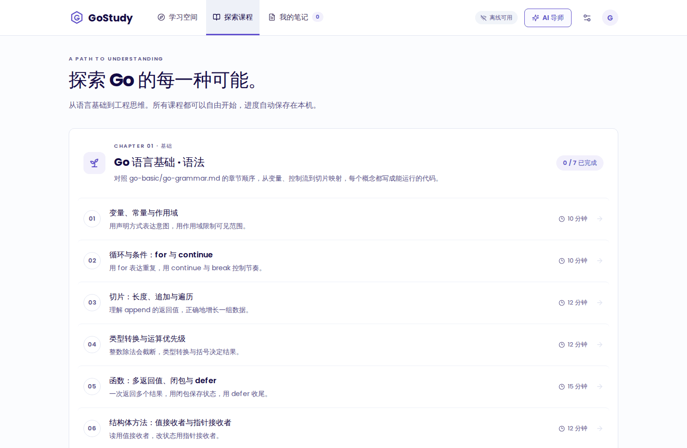
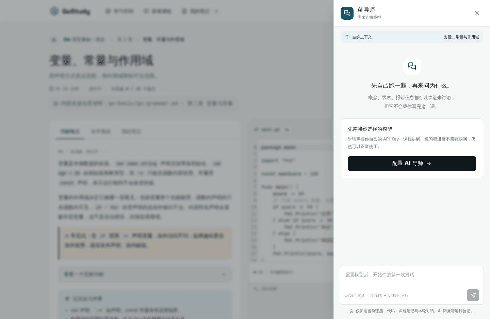
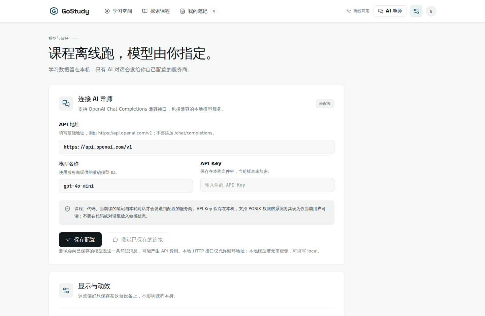
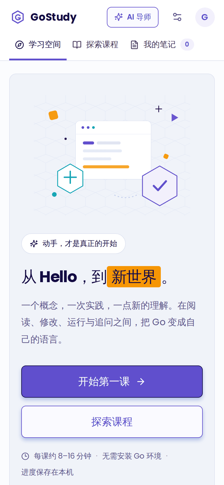

# 🚀 Go 学习之路 - go-study

  
  
  

## 📚 项目介绍

> 此项目主要是为了帮助初学 Go 的同学，快速掌握面试常见内容，同时对于有经验的同学，也可以作为一个整理好的参考资料。

> 除此之外，我们还将提供一份完整的**Go 官方文档的翻译**，以方便大家查阅。

### 💡 tips：Go 官方文档翻译（AI 翻译 + 人工校正）

为了帮助更多人更好地学习 Go 语言，我们将 Go 官方文档翻译成中文，并进行人工校正。让大家更容易理解官方文档内容。
点击下方链接，查看翻译后的文档：

👉 [go 官方文档的翻译](go-offical-doc-translate/README.md)

## 🎯 学习目标

- ✅ 快速掌握 Go 语言核心概念
- ✅ 深入理解并发编程
- ✅ 熟悉标准库和工程实践
- ✅ 掌握实际开发技能

## 🖥️ GoStudy 交互式学习应用

[GoStudy](app/README.md) 提供 React 界面与 Go 本地学习引擎，包含引导课程、代码运行、理解题、学习笔记和可配置的 AI 导师。课程与练习可以离线使用，不需要部署服务端。

课程内容依据本仓库资料整理：`go-basic`、`go-advance`、`go-practice` 的每篇文档对应一门课程，每节练习都标注来源章节，方便对照原文继续阅读。

**核心特点**

- **引导式学习闭环**：先读懂概念，再改代码、真运行、答理解题，最后记笔记——每一步都有反馈。
- **8 门课程 · 43 个练习**：Go 语言基础（语法 / 并发）、Go 语言进阶（语言深挖 / 标准库 / 工程实践）、Go 开发实战（网络开发 / 中间件 / 微服务）。
- **真实运行代码**：练习由内置 Go 解释器在本机执行，限制导入符号、运行时间与输出大小，不开放文件与网络访问。
- **可配置的 AI 导师**：支持 OpenAI Chat Completions 兼容接口，也可以接本机模型；结合当前课程、代码和笔记做引导式提问，只有你主动提问时才发送上下文。
- **本地优先**：没有账号，学习进度、笔记和草稿都保存在本机，断网也能继续学。

**界面预览**

| 学习空间 | 探索课程 |
|---|---|
|  |  |
| **课程与练习**（标注来源章节） | **AI 导师**（可配置模型） |
|  |  |

| 偏好与 AI 设置 | 手机端 |
|---|---|
|  |  |

**获取方式**

- **Windows**：到 [Releases](https://github.com/xianshujun/awsome-go-study/releases) 下载 `GoStudy.exe`，双击即用（也可从源码运行 `bash app/scripts/build-windows.sh` 自行构建）。
- **Android**：到 [Releases](https://github.com/xianshujun/awsome-go-study/releases) 下载 `GoStudy-android-debug.apk`（Android 8.0+，debug 签名可直接安装），也可以用 `bash app/scripts/build-android.sh debug` 自行构建。
- **从源码运行**：[应用说明](app/README.md) 的「2.1 本机启动」给出完整命令。

Android 说明：APK 已可下载安装（debug 签名，内含 arm64-v8a / armeabi-v7a / x86 / x86_64 四种 ABI，约 68 MB），安装时需要允许「未知来源」；**尚未在真机上验证完整学习流程**，原生 WebView 工程与构建脚本也在仓库里。
开始使用、AI 配置和构建方法见 [应用说明](app/README.md)。

## 🛣️ Go 学习路线

### 🔵 1. Go 语言基础
- 📘 [go语言语法](go-basic/go-grammar.md) - 打好基础
- 📘 [go并发编程](go-basic/go-concurrency.md) - 掌握核心特性

### 🟡 2. Go 语言进阶
- 📒 [go语言深挖](go-advance/go-deepdive.md) - 深入理解语言特性
- 📒 [go语言标准库](go-advance/go-standardlib.md) - 熟悉常用库
- 📒 [工程实践](go-advance/go-engineering.md) - 实际项目应用与工程规范

### 🔴 3. Go 语言开发实战
- 📕 [go语言网络开发](go-practice/go-webdev.md) - Web 开发技能
- 📕 [中间件与工具集成](go-practice/go-middleware.md) - 系统集成能力
- 📕 [go语言微服务](go-practice/go-microservices.md) - 现代架构实践

---

###  贡献

欢迎提交 Issue 和 Pull Request 来帮助改进这个项目！

###  许可证

MIT License - 允许任何人自由使用、修改和分发代码，但需要保留原作者信息。

---

### ⭐ Star 趋势

如果这个项目帮到了你，欢迎点一个 Star ⭐ 支持一下。

<a href="https://star-history.com/#xianshujun/awsome-go-study&Date">
  <picture>
    <source media="(prefers-color-scheme: dark)" srcset="https://api.star-history.com/svg?repos=xianshujun/awsome-go-study&type=Date&theme=dark" />
    <source media="(prefers-color-scheme: light)" srcset="https://api.star-history.com/svg?repos=xianshujun/awsome-go-study&type=Date" />
    
  </picture>
</a>

> 图表由 [star-history.com](https://star-history.com) 生成，按日期展示 Star 增长；刚起步时曲线会比较平，随着 Star 增加会自动变好看。
