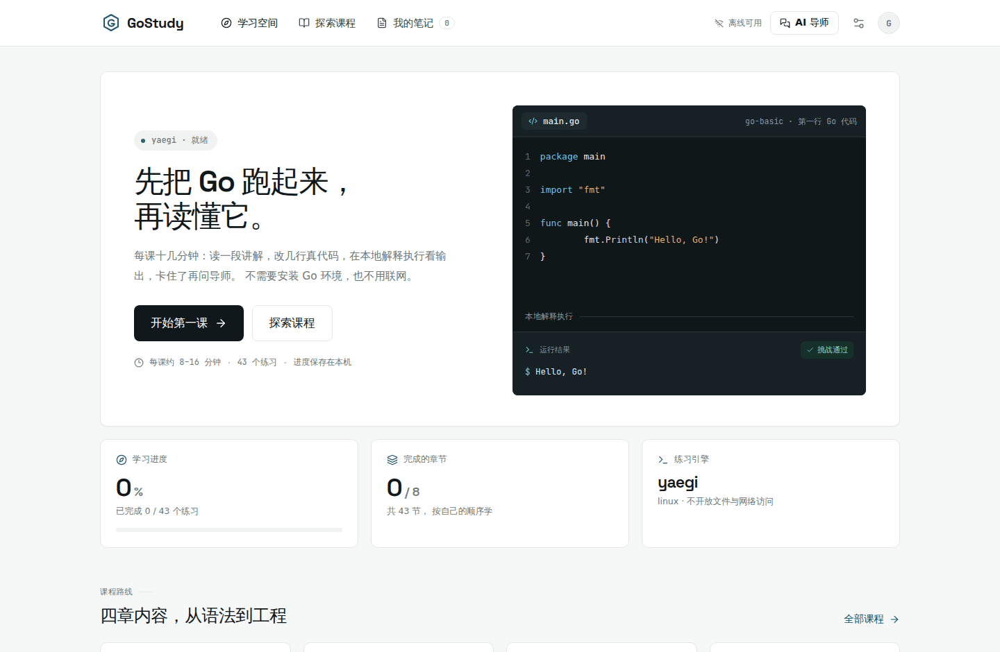
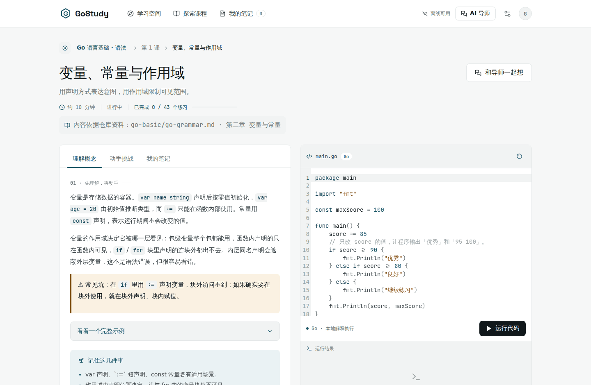
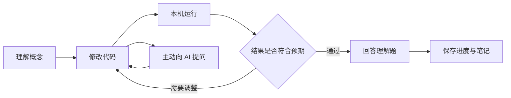
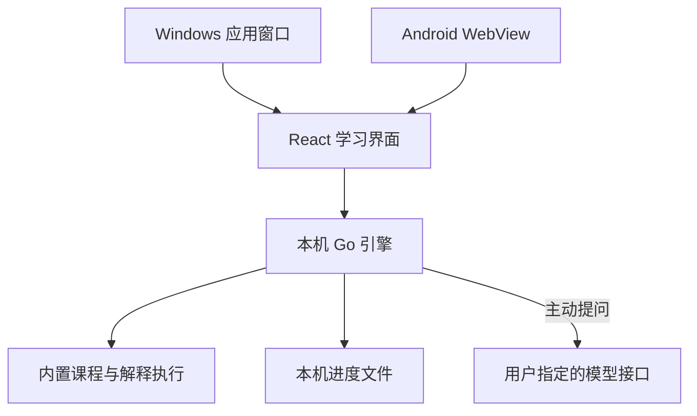

# GoStudy —— 在理解与实践之间，学会 Go

> 面向对象：希望通过动手练习学习 Go 的开发者，以及需要维护本地学习应用的贡献者。
> 阅读方式：先了解学习流程，再启动最小可运行版本，最后查看 Windows、Android 打包与运行边界。
> 环境要求：开发构建使用 Go 1.25+、Node.js 22.12+、npm；已打包的 Windows 应用无需安装 Go 或 Node.js。Android 8.0+，构建还需要 Java 17 JDK、Android SDK 35 和 NDK。
> 产品状态：8 门课程、43 个交互练习。Windows 可执行文件、Android APK（正式签名）与 Linux 单文件已随 Releases 发布；Windows 与 Linux 已在本机验证，Android 安装与完整流程见「3.3 当前限制」。

## 目录

- [第一章：学习体验](#第一章学习体验)
  - [1.1 引导式练习](#11-引导式练习)
  - [1.2 课程与 AI 导师](#12-课程与-ai-导师)
  - [1.3 本章小结](#13-本章小结)
- [第二章：运行与打包](#第二章运行与打包)
  - [2.1 本机启动](#21-本机启动)
  - [2.2 Windows 应用](#22-windows-应用)
  - [2.3 Android 应用](#23-android-应用)
  - [2.4 本章小结](#24-本章小结)
- [第三章：架构与验证](#第三章架构与验证)
  - [3.1 本地引擎](#31-本地引擎)
  - [3.2 数据与运行边界](#32-数据与运行边界)
  - [3.3 验证命令与当前限制](#33-验证命令与当前限制)
  - [3.4 本章小结](#34-本章小结)
- [附录：高频面试题汇总](#附录高频面试题汇总)

## 第一章：学习体验

### 1.1 引导式练习

GoStudy 把一个知识点拆成可以走完的小步骤：先读懂概念，修改代码，观察实际输出，再用一道理解题检查自己的判断。课程自由选择，不强制解锁；完成记录必须同时满足当前代码运行通过、理解题答对两个条件。





更多界面截图（课程目录、AI 导师、偏好设置、手机端）见 [docs/screenshots](docs/screenshots)。



界面采用近中性底色 `#F6F7F7`、白色卡片、墨黑标题 `#11181B` 与深青主色 `#0F5666`；卡片之间靠 1px 描边分层而不是投影，主按钮为近黑实色，彩色只出现在进度、链接、聚焦环与语义状态（通过 / 报错 / 提示）上。**代码与终端是唯一的深色表面**：编辑器、控制台和首页演示台共用一套墨色（`#101719` 系）与语法色值，让「能跑的代码」在浅色界面里成为视觉锚点，编辑器工具条上的运行按钮则反相为浅色。视觉方向参考 [Exercism](https://exercism.org/zh-CN) 的课程与练习页面：顶部导航、居中内容列、卡片式课程列表和克制的分隔线。**不使用渐变**，也不依赖在线字体或图片；Space Grotesk（标题与指标数字）与 JetBrains Mono（代码与等宽标签）的拉丁子集随应用本地打包（SIL OFL 1.1，许可证全文见 `frontend/public/fonts/`），中文由系统字体渲染。桌面端为顶部导航加双栏练习，窄屏端导航折行、练习纵向排列。代码编辑器采用 CodeMirror，支持 Go 语法高亮、缩进和行号，语法着色与应用同一套色值（见 `frontend/src/editor.ts`）。

交互层由 Radix UI 的无障碍组件原语（标签页、对话框、开关、滑杆、提示、进度条、通知）与 Motion 动效引擎构成；动效节奏集中在 `frontend/src/motion.ts`，系统「减少动效」或设置里的开关生效时整体关闭，此时界面直接呈现最终状态。首页首屏不加装饰性插画，而是循环演示一段真实课程代码从输入到运行通过的完整过程。

动效遵循三条约定，都写在 `frontend/src/styles.css` 与 `motion.ts` 里：

- **连续性**：首页课程卡点进课程页时，卡片与课程页标题区共享同一个 `view-transition-name`，由平台自带的 View Transitions 把"卡片长成页面"补成一帧动画；浏览器不支持（或用户要求减少动效）时退化为直接切换，不做阻塞。
- **过程感**：「运行代码」不是转圈等待，而是拆成编译 → 执行 → 比对期望输出 → 通过四个可见阶段（仅在允许动效时展开）；通过后控制台逐行列出输出，每行一个对勾表示与期望输出对得上。
- **物理感**：抽屉从用户点击的那颗按钮位置展开（`transform-origin` 取点击坐标），头部可下拉关闭，方向与手势一致；所有按钮与列表项按压时轻微缩进（用独立的 `scale` 属性，不与位移的 `transform` 互相覆盖）。

除库之外还用到几项平台自带能力，因此没有增加任何依赖：顶栏底边分隔线随滚动淡入用滚动驱动动画（`animation-timeline: scroll()`，跑在合成器线程）；中文排版用 `text-autospace` 与 `text-spacing-trim` 处理中英混排空隙与标点收边；安卓端在运行通过与失败时用 `navigator.vibrate` 给出不同触觉反馈。

### 1.2 课程与 AI 导师

课程结构与仓库资料一一对应：每篇文档一门课程，内容取自对应章节，每节练习标注来源，方便学完回到原文继续深入。当前共 8 门课程、43 个练习。

| 课程 | 依据文档 | 小节 |
|---|---|---|
| Go 语言基础 · 语法 | `go-basic/go-grammar.md` | 变量与作用域、循环与条件、切片追加、类型转换与运算、函数与 defer、结构体方法、错误处理与 %w 包装 |
| Go 语言基础 · 并发 | `go-basic/go-concurrency.md` | goroutine 与 done 通道、无缓冲通道配对、缓冲容量、select 多路复用、Worker Pool、Pipeline 与取消 |
| Go 语言进阶 · 语言深挖 | `go-advance/go-deepdive.md` | 值语义与指针、切片扩容与共享、GC 与生命周期、GMP 调度、反射入门 |
| Go 语言进阶 · 标准库 | `go-advance/go-standardlib.md` | fmt 格式化、strings 处理、strconv 转换、math 计算、文本清洗综合 |
| Go 语言进阶 · 工程实践 | `go-advance/go-engineering.md` | 项目分层、表驱动测试、性能与分配、错误链、命名与可读性 |
| Go 开发实战 · 网络开发 | `go-practice/go-webdev.md` | HTTP 请求响应模型、Handler 与中间件、路由表、参数校验、并发与超时降级 |
| Go 开发实战 · 中间件与工具集成 | `go-practice/go-middleware.md` | 中间件链、日志与可观测、令牌桶限流、熔断状态机、重试与超时 |
| Go 开发实战 · 微服务 | `go-practice/go-microservices.md` | 服务边界、注册发现、API 网关、幂等与一致性、事件驱动 |

网络、数据库、消息队列、反射等无法在本地解释器里真实运行的主题，讲解来自原文，练习改用可运行的等价模型（纯函数串联模拟中间件链、映射表模拟注册中心、channel 模拟消息队列等），并在课程中明确说明这是模型。

课程内容以 `app/backend/courses/*.json` 维护，一文件一门课程；格式与校验规则见 `backend/curriculum.go`。新增或修改课程后用 `cmd/lessoncheck` 校验：它会检查结构完整性，并用真实解释器确认「参考解答必须通过、starter 必须不通过」。

AI 导师位于学习流程中，可解释当前课、逐步提示和分析用户提交的代码。系统提示要求先引导理解，用户明确要求时才提供完整解答。课程提示是离线内容，不会冒充模型回复。

在「偏好与 AI 设置」填写服务基础地址、模型 ID 与 API Key，保存后可以测试连接。例如，基础地址 `https://api.openai.com/v1` 对应请求 `/chat/completions`。支持兼容 OpenAI Chat Completions 协议的服务；这不等同于支持所有服务商原生协议。回环地址的本地模型可以不配置密钥。

同一页的「显示与动效」提供两项只影响本机观感的偏好：**减少动效**（默认跟随系统，手动切换后可以一键恢复跟随）与**代码字号**（12–20px，同时作用于练习编辑器）。它们保存在浏览器 localStorage，不写入服务端的学习状态文件，因此换设备不会互相影响。

> ⚠️ **常见坑**：API 地址不要重复填写 `/chat/completions`。Android 中 `127.0.0.1` 指向手机自身，不能用它访问电脑上的模型。当前版本只允许 HTTPS 远程地址或本机回环 HTTP 地址。

只有主动提问或测试连接时才联系模型。学习上下文包括当前课、代码、当前课的笔记、完成状态和近期对话；API Key 只由 Go 引擎读取。AI 对话目前只保留在当前打开的导师面板中，不写入学习状态文件。AI 输出需要通过实际运行验证。

### 1.3 本章小结

**要点回顾**：

- 学习闭环由概念、实践、反馈和理解题组成。
- 8 门课程、43 个练习依据仓库文档编写，可以离线运行，进度和笔记留在本机。
- AI 是可配置的引导工具，发送上下文由用户主动触发。

**面试题**：

1. 为什么 `main` 返回后，其他 goroutine 不一定执行完？
2. 映射查询中的第二个返回值有什么作用？
3. 接口如何帮助实现可替换的业务依赖？

## 第二章：运行与打包

### 2.1 本机启动

在仓库根目录执行：

```bash
npm --prefix app/frontend ci --no-audit --no-fund
npm --prefix app/frontend run build
go -C app run ./cmd/gostudy
```

程序打印形如 `http://127.0.0.1:随机端口/#token=本次凭证` 的地址，并自动打开界面。没有图形桌面时：

```bash
go -C app run ./cmd/gostudy -no-browser -addr 127.0.0.1:7731
```

保留终端窗口，复制**完整地址**打开。关闭终端或按 Ctrl+C 停止本地引擎。`-data-dir /你的目录` 可指定学习状态存储位置。

不想装 Go 环境的话，可以直接从 [Releases](https://github.com/xianshujun/awsome-go-study/releases) 下载 Linux 版：`GoStudy-linux-amd64`（x86-64）或 `GoStudy-linux-arm64`，都是静态链接的单个文件，`chmod +x` 后运行即可；也可以用 `bash app/scripts/build-linux.sh` 自行构建这两种架构。

> 💡 **技巧**：npm 官方源无法连接时，可以为本次命令指定 `--registry=https://registry.npmmirror.com`，无需修改全局配置。生产构建仍应使用并检查锁文件。

前端热更新开发需要先启动固定端口的 Go 引擎：

```bash
# 终端一，在已构建一次前端之后运行
go -C app run ./cmd/gostudy -no-browser -addr 127.0.0.1:7731

# 终端二
npm --prefix app/frontend run dev
```

打开 Vite 打印的本机地址，并把 Go 引擎 URL 中的 `#token=...` 片段附在后面。Vite 只监听回环地址，并把 API 转发到固定本机端口；Go 引擎重启后，重新使用新的 token。

### 2.2 Windows 应用

在 Linux、macOS 或 Windows 的 Git Bash 中运行：

```bash
bash app/scripts/build-windows.sh
```

产物有两个：

| 文件 | 用途 |
|---|---|
| `app/release/GoStudy.exe` | 双击直接显示应用窗口。使用 Windows GUI 子系统，不弹控制台；启动失败以系统对话框提示。 |
| `app/release/GoStudy-console.exe` | 排查用版本，保留控制台输出与地址打印。 |

界面优先通过 Edge 或 Chrome 的应用窗口模式打开，接近独立桌面程序的外观；都找不到时回退到系统默认浏览器。想结束程序时，在应用内「偏好与 AI 设置 → 本地优先」点击 **退出 GoStudy**；关闭浏览器窗口不会自动停止本地引擎，此时可再次打开启动地址，或结束 `GoStudy.exe` 进程。

**双击后没有反应时怎么排查**（按顺序做，通常前两步就能查出原因）：

1. 先看有没有系统弹窗被忽略。Windows 对未签名程序会弹「Windows 已保护你的电脑」，点「更多信息 → 仍要运行」即可；也可能被 SmartScreen 或杀毒软件直接拦下——去「Windows 安全中心 → 保护历史记录」确认有没有拦截记录。
2. 运行自检：`GoStudy.exe -selftest`（无控制台时结果会弹对话框）。它会依次检查用户配置目录可写、本机端口监听、前端资源加载、课程加载、浏览器可用性和完整引擎接口，直接指出哪一步失败。同一份结果也会写进日志。
3. 看启动日志：程序在**自身所在目录**写 `GoStudy-startup.log`，包含版本、分步进度（准备前端资源 → 启动引擎 → 打开窗口）、失败原因；目录不可写时退到 `%AppData%\go-study\startup.log`。日志停在「步骤 2/3：启动本地引擎」说明问题出在监听端口，通常是安全软件拦截。
4. 检查文件大小是否为 12 MB 左右。只有几百 KB 说明下载没完成，重新下载。右键属性里若有「解除锁定」，勾选并确定。
5. 换成 `GoStudy-console.exe` 双击运行：它保留命令行窗口，出错时不会自动关闭，可以直接看到文字报错，按回车才退出。
6. 确认版本：命令行执行 `GoStudy.exe -version`，无控制台时会用对话框显示版本与平台；`-diagnose` 会在启动后弹窗显示访问地址与日志路径，方便手动复制地址到浏览器。

如果日志显示本地引擎已启动、只是窗口没出来，直接把日志里的地址复制到浏览器即可正常使用。

如果日志里显示本地引擎已启动、只是窗口没出来，可以直接把日志里的地址复制到浏览器使用——功能不受影响。

这是可运行的 Windows 程序：安装包已由 Inno Setup 制作，但**尚未做 MSI、自动更新、托盘与代码签名**。Windows 上的实机启动体验仍需在 Windows 中验收；Linux 交叉编译只能证明产物格式正确（已验证为 GUI 子系统 PE32+，且图标资源完整），不能代替真机运行。

#### Windows 安装包

不想让用户自己放文件、手动建快捷方式时，用安装包分发：

```bash
bash app/scripts/build-windows-installer.sh                  # 版本取当前 git tag
bash app/scripts/build-windows-installer.sh --version 0.5.0  # 或显式指定版本
```

产物是 `app/release/GoStudy-Setup.exe`。脚本要求先跑过 `bash app/scripts/build-windows.sh`（要打包的 `GoStudy.exe` 就在 `app/release/`），并且要在 **Windows 上运行**——`ISCC.exe` 是 Windows 程序，装 Inno Setup 6.3+ 即可（`choco install innosetup`；装在别处时用环境变量 `ISCC` 指过去）。安装界面的简体中文来自仓库里的 `installer/windows/ChineseSimplified.isl`——Inno Setup 发行版本身并不带这个文件（源码树里有、安装包里没有），放进仓库后本地与 CI 用的是同一份。

安装包替用户做的事：

| 项目 | 行为 |
|---|---|
| 安装位置 | 让用户自己选。默认「仅为我安装」到 `%LocalAppData%\Programs\GoStudy`，不弹 UAC；选「为所有用户安装」时才提权装进 `Program Files`。 |
| 快捷方式 | 开始菜单建 `GoStudy` 目录，桌面快捷方式默认勾选（可取消），都指向 `GoStudy.exe`。 |
| 卸载 | 在「设置 → 应用 → 已安装的应用」里注册卸载项，卸载时一并删掉快捷方式与开始菜单目录。 |
| 装完启动 | 结束页可以直接勾选「立即打开 GoStudy」。 |

> ⚠️ **安装包不碰学习进度**：进度、笔记与草稿都在 `%AppData%\go-study`，不在安装目录里，卸载只删程序文件。装到 `Program Files` 时安装目录不可写，启动日志会退到 `%AppData%\go-study\startup.log`。

> ⚠️ **安装包没有代码签名**：Windows 仍会弹「已保护你的电脑」，需要用户点「更多信息 → 仍要运行」。要消掉这个提示得买代码签名证书，属于后续事项。

素材与脚本都在 `app/installer/windows/`：`GoStudy.iss` 是 Inno Setup 脚本（其中 `AppId` 是升级与卸载的识别标志，**发布之后不能改**），`gostudy.ico` 是安装包与快捷方式用的图标。图标由 `make-icon.py` 从 `frontend/public/favicon.svg` 渲染而来，同时生成 `cmd/gostudy/rsrc_windows_amd64.syso`，让 `GoStudy.exe` 自己带上图标：

```bash
python3 app/installer/windows/make-icon.py   # 需要 Chrome/Chromium 与 Pillow；改品牌图形后重跑
```

发布时由 `.github/workflows/release.yml` 的 `windows-installer` 任务在 Windows 运行器上调用构建脚本，产物以 `GoStudy-Setup.exe` 上传到 Release；落地页的下载按钮直接指向这个资源名。

### 2.3 Android 应用

Android 使用原生 Activity（页面容器）与 WebView（内嵌网页视图），Go 引擎经 gomobile 编译为 AAR（Android 库）。界面、学习数据接口与桌面端共用；不需要部署服务器。

准备 Java 17 **JDK**、SDK 35、build-tools 35.0.0 与 NDK 27.2.12479018，然后执行：

```bash
export JAVA_HOME=/你的/jdk17
export ANDROID_HOME=/你的/Android/Sdk
export ANDROID_NDK_HOME="$ANDROID_HOME/ndk/27.2.12479018"

bash app/scripts/install-mobile-tools.sh
bash app/scripts/build-android.sh debug
```

构建脚本使用固定版本 gomobile/gobind，以及带校验值的 Gradle 8.11.1 wrapper。调试产物路径为 `app/release/GoStudy-debug.apk`。仓库的 [Releases](https://github.com/xianshujun/awsome-go-study/releases) 里提供了正式签名的 `GoStudy-android-release.apk`（约 65 MB，含四种 ABI），不想自己搭 Android 工具链的话可以直接下载安装。

正式版需要签名才能安装，脚本支持自动完成 zipalign 与签名：

```bash
export GOSTUDY_KEYSTORE=/路径/gostudy-release.jks
export GOSTUDY_KEY_ALIAS=gostudy
export GOSTUDY_KEY_PASSWORD=你的密钥库密码
bash app/scripts/build-android.sh release
```

设置这三个变量时产出 `app/release/GoStudy-release.apk`（已签名并打印证书信息）；不设置则产出 `GoStudy-release-unsigned.apk` 并提示如何手动签名。

> ⚠️ **签名密钥必须长期保管好**：Android 用签名判断应用身份，密钥丢了或换了，新版本就无法覆盖安装旧版本，只能让用户卸载重装。密钥库与密码都不要提交到仓库（`.gitignore` 已忽略 `*.jks`）。

> ⚠️ **常见坑**：只有 Java 运行时而没有 `javac` 不能构建 Android。Android 平台、NDK 与 Go 移动绑定工具缺一不可。首次构建需要下载工具和依赖；安装完成后的课程练习可以离线运行。下载 Go 模块遇到网络问题时，可临时设置 `GOPROXY=https://goproxy.cn,direct`。

手机端笔记导出显示可选择的 Markdown 文本并提供复制按钮；系统不允许剪贴板访问时可以长按手动复制。桌面端通过浏览器下载 Markdown。当前 Android 版本没有原生文件导出与分享桥接。

### 2.4 本章小结

**要点回顾**：

- 开发阶段先构建 React 静态资源，再启动 Go 引擎。
- Windows 打包为内嵌资源的单个可执行文件。
- Windows 安装包用 Inno Setup 制作：用户自选目录，自动建快捷方式，注册卸载项；学习数据不在安装目录，卸载不会删进度。
- Android 需要 Go 移动绑定、原生容器和完整 SDK/NDK 工具链。

**面试题**：

1. 编译工具依赖与最终用户运行依赖有什么区别？
2. 交叉编译成功为什么不能代替目标平台的运行测试？
3. WebView 与普通浏览器在文件下载能力上有哪些差异？

## 第三章：架构与验证

### 3.1 本地引擎

“没有服务端”指无需部署远程服务。每个设备上有一个随应用启动的 Go 引擎，只监听 `127.0.0.1` 的随机端口；React 通过同来源 HTTP 访问它。AI 网络请求由 Go 发起，浏览器不会直接持有 API Key。



| 路径 | 职责 |
|---|---|
| `frontend/` | React、TypeScript、CodeMirror；交互用 Radix UI 原语，动效用 Motion，样式为手写设计令牌与组件层 |
| `backend/curriculum.go` | 课程加载与结构校验 |
| `backend/courses/*.json` | 课程内容，一文件一门课程，对应仓库文档 |
| `backend/runner.go` | Go 解释执行、输出和时间限制 |
| `backend/server.go` | 本机鉴权、API、完成条件校验 |
| `backend/ai.go` | 模型上下文和兼容接口调用 |
| `backend/state.go` | 本地状态读写 |
| `web/` | 编译时嵌入的前端资源 |
| `cmd/gostudy/` | 桌面启动器 |
| `cmd/lessoncheck/` | 课程内容校验工具 |
| `mobile/`、`android/` | Go 移动绑定与 Android 容器 |
| `scripts/` | 平台构建脚本 |

### 3.2 数据与运行边界

默认状态文件为系统用户配置目录中的 `go-study/state.json`，Android 使用应用私有文件目录。保存采用临时文件再替换，写入失败会返回错误；文件权限在支持的系统上设为 `0600`。**API Key 当前以明文保存，没有使用 Windows 凭据管理器或 Android Keystore 加密**；Windows 的权限语义也不能只用 POSIX 文件模式证明。

本机 API 使用每次启动生成的随机 token，校验 Host、Origin 和跨站请求，不开放任意跨域访问。模型请求禁止自动重定向，修改服务地址会清除旧密钥；未把新服务地址和旧 Key 隐式绑定。

练习使用 Yaegi（Go 解释器），支持语言基础和指定标准库的部分符号：`fmt`、`strings`、`strconv`、`math`。限制代码 32 KiB、输出 16 KiB、运行约两秒，限制并发练习与派生 goroutine 数量；不注册文件、网络、系统命令和反射相关库。

> ⚠️ **常见坑**：这是练习引擎，不是完整 Go 工具链，也不是具有进程和内存隔离的安全沙箱。没有硬性内存配额，不应运行来源不明或恶意的代码。泛型、第三方包、网络服务和完整工程构建不在当前练习能力内。

编写课程内容时要避开解释器的两个已知限制（`go test -race` 会暴露第一个）：

- 同一个 `select` 语句不能由多个解释器 goroutine 并发执行（Yaegi 内部会写同一份状态）。需要取消语义时，把 `select` 放在只启动一个 goroutine 的阶段里，其余阶段用普通收发。
- `%w` 包装解释器内定义的自定义错误类型会格式化成 `%!w(...)`；练习里用 `fmt.Errorf` 产生的原生错误做包装链，自定义错误类型放在讲解中介绍。

### 3.3 验证命令与当前限制

```bash
npm --prefix app/frontend test
npm --prefix app/frontend run build
go -C app test ./...
go -C app test -race ./...
go -C app vet ./...
go -C app run ./cmd/lessoncheck -embedded                 # 全量课程校验
go -C app run ./cmd/lessoncheck -file backend/courses/grammar.json   # 单文件校验
bash app/scripts/build-windows.sh
bash app/scripts/build-windows-installer.sh --version 0.0.0   # 需在 Windows 上跑，且已装 Inno Setup 6.3+
```

后端验证全部 43 个练习的参考解答在真实解释器中通过、starter 一律不能直接通过，以及错误代码、超时与并发收尾、本机鉴权、非法来源、进度持久化、完成证明、模型请求和密钥隐藏。前端交互测试验证学习完成、失败重试、代码变更后重新校验、AI 配置、笔记和即时切页保存。模型接口测试使用本机模拟服务，不代表已验证用户的付费模型账号。

本次依赖审计未完成：npm 官方源连接超时，镜像源的安全审计接口返回未实现。依赖安装和锁文件构建成功不能替代漏洞审计。

界面验收使用无头 Chromium 完成：1440×940 与 390×844 两种视口下截取首页、课程目录、课程详情、动手挑战、AI 导师抽屉、笔记、设置页与手机端共八张截图，控制台无报错、无失败请求，两种视口都没有横向滚动；实测计算样式为页面底色 `rgb(246,247,247)`、卡片纯白、代码区 `rgb(16,23,25)`、代码文字 `rgb(223,232,234)`、编辑器工具条运行按钮反相为 `rgb(223,232,234)`，卡片为 1px 描边且无投影，样式表内渐变规则计数为 0；Space Grotesk 与 JetBrains Mono 加载成功且中文正常渲染。动效逐项实测：共享元素转场确实调用了 `startViewTransition` 且转场后无残留的 `view-transition-name`；运行过程依次出现「正在编译…」「比对期望输出…」并最终得到「挑战通过 · 3 ms」与两行带对勾的输出；抽屉的 `transform-origin` 为点击位置、头部 `touch-action` 为 `none`；顶栏分隔线透明度随滚动由 0 变 1。「减少动效」下界面直接呈现最终状态（无 `opacity: 0` 的隐藏元素、无打字光标、无位移）。截图验收能证明布局与配色未崩坏，但不能替代真机上的字体、交互与性能体验。Windows 退出流程已在本机验证：调用退出接口后进程结束、端口释放、重复退出保持幂等。Windows 安装包在 CI 的真实 Windows 运行器上编译验证：`windows-installer` 任务输出 `Successful compile`，产出约 5.8 MB 的 `GoStudy-Setup.exe`；下载产物后用 pefile 校验为 i386 PE、GUI 子系统、版本信息为 `GoStudy <版本> 安装程序`、图标资源七档齐全、含 `Inno Setup Setup Data` 标记。另外用 Wine 9.0 + Xvfb 对 CI 产物跑了一遍静默安装（`/VERYSILENT /DIR=C:\GoStudy /TASKS=desktopicon`）：安装目录里得到 `GoStudy.exe` 与卸载器，开始菜单 `GoStudy\GoStudy.lnk`、`Uninstall GoStudy.lnk` 与桌面快捷方式都建好，`HKCU\Software\Microsoft\Windows\CurrentVersion\Uninstall\{FB9FE764-6145-4C0B-A69A-EC7730ADDC10}_is1` 里写入 `DisplayName`、`DisplayVersion`、`DisplayIcon`、`EstimatedSize` 等值；卸载器跑完后安装目录、三个快捷方式与注册表项全部清干净。从安装目录启动 `GoStudy.exe -selftest`，自检六项过五项，唯一失败的是「浏览器可用性」——Wine 里没有 Edge/Chrome，Windows 10/11 自带 Edge，真机上不会这样。**Wine 只能证明安装脚本、快捷方式与卸载逻辑对得上，不能替代 Windows 真机走一遍向导**（选目录页、任务勾选、结束页启动这三处交互仍需人工验收，安装包也无签名，会触发 SmartScreen）。

Android 构建环境与产物现状：本机已用官方源安装 SDK 35 / build-tools 35.0.0 / NDK 27.2.12479018，并据此产出并签署过 release APK（当时为 `versionName=0.3.1`，约 65 MB，含 arm64-v8a、armeabi-v7a、x86、x86_64 四种 ABI）。校验结果：`apksigner verify` 通过（APK Signature Scheme v2 + v3，证书 CN=GoStudy，非 debug 证书）、`aapt2 dump badging` 显示 `minSdkVersion=26`、`targetSdkVersion=35`，且没有 `application-debuggable` 标记。当前版本为 **0.4.0**（`versionCode 32`，`versionName '0.4.0'`），改由 `.github/workflows/release.yml` 在推送 `v*` tag 时构建并签名，密钥取自仓库 secret；发布资源名与下载说明保持一致（`GoStudy-android-release.apk`）。**但还没有在真机上安装并跑完学习流程**，触摸交互、WebView 表现和安装兼容性都需要真机验收。

课程已覆盖仓库 `go-basic`、`go-advance`、`go-practice` 三部分共 8 篇文档的核心章节（43 节）。文档中较长篇幅的面试题汇总、框架集成细节（Gin、GORM、Redis、Kafka 等）尚未逐条转换为课程；仓库原有长篇资料保持完整。后续扩展课程应添加明确任务、可运行参考解答和预期输出，并纳入全课程执行测试。

### 3.4 本章小结

**要点回顾**：

- 本机引擎让练习、课程与存储共用 Go 实现，远程只有用户选择的 AI 接口。
- 权限限制、请求鉴权与解释执行限制是不同层次的保护。
- 编译、接口、交互、视觉与目标平台运行验证不能互相替代。

**面试题**：

1. 为什么本机 HTTP 服务仍然需要 token 和来源检查？
2. 为什么解释器中的超时不等于内存与进程隔离？
3. 配置文件权限与系统凭据加密分别解决什么问题？

## 附录：高频面试题汇总

1. Go 程序的入口是什么，`main` 返回意味着什么？
2. 切片和数组的关系是什么，扩容会影响哪些引用？
3. channel 的缓冲容量如何影响阻塞？谁应该关闭 channel？
4. `select` 中的 `default` 会怎样改变等待行为？
5. 指针接收者和接口实现之间有什么关系？
6. 为什么要显式处理错误，而不是忽略错误返回值？
7. `defer` 的执行顺序和参数求值时机是什么？
8. 如何通过纯函数和输入规范化提高业务规则的可测试性？
