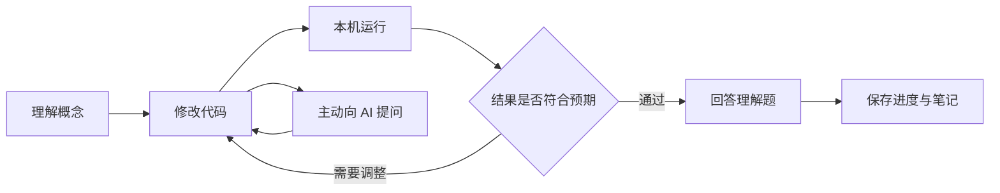
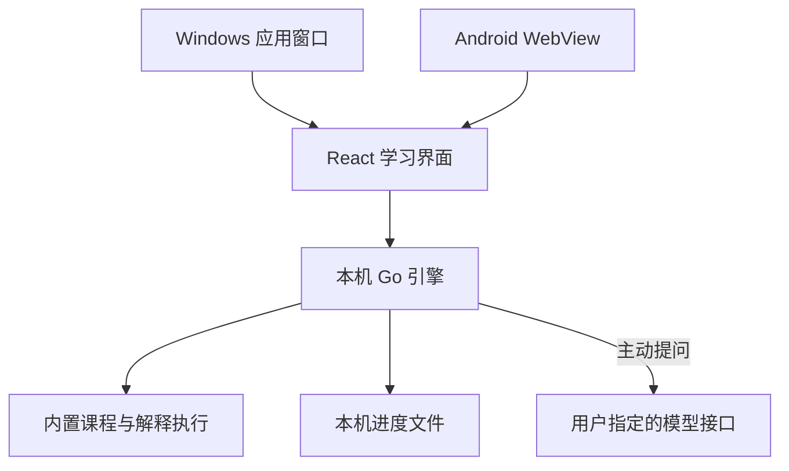

# GoStudy —— 在理解与实践之间，学会 Go

> 面向对象：希望通过动手练习学习 Go 的开发者，以及需要维护本地学习应用的贡献者。
> 阅读方式：先了解学习流程，再启动最小可运行版本，最后查看 Windows、Android 打包与运行边界。
> 环境要求：开发构建使用 Go 1.25+、Node.js 22.12+、npm；已打包的 Windows 应用无需安装 Go 或 Node.js。Android 8.0+，构建还需要 Java 17 JDK、Android SDK 35 和 NDK。
> 产品状态：首个可运行版本，包含四章、16 个交互练习。Windows 可执行文件已交叉编译；Android 工程已实现，尚未完成 APK 构建和真机验收。

## 目录

- [第一章：学习体验](#第一章学习体验)
  - [1.1 引导式练习](#11-引导式练习)
  - [1.2 课程与 AI 导师](#12-课程与-ai-导师)
  - [1.3 本章小结](#13-本章小结)
- [第二章：运行与打包](#第二章运行与打包)
  - [2.1 本机启动](#21-本机启动)
  - [2.2 Windows 应用](#22-windows-应用)
  - [2.3 Android 应用](#23-android-应用)
  - [2.4 本章小结](#24-本章小结)
- [第三章：架构与验证](#第三章架构与验证)
  - [3.1 本地引擎](#31-本地引擎)
  - [3.2 数据与运行边界](#32-数据与运行边界)
  - [3.3 验证命令与当前限制](#33-验证命令与当前限制)
  - [3.4 本章小结](#34-本章小结)
- [附录：高频面试题汇总](#附录高频面试题汇总)

## 第一章：学习体验

### 1.1 引导式练习

GoStudy 把一个知识点拆成可以走完的小步骤：先读懂概念，修改代码，观察实际输出，再用一道理解题检查自己的判断。课程自由选择，不强制解锁；完成记录必须同时满足当前代码运行通过、理解题答对两个条件。



界面采用浅色底 `#FBFCFE`、白色卡片、深靛蓝标题 `#130B43` 与主紫色 `#604FCD`，按钮为 8px 圆角并带淡蓝投影，强调文字使用品牌黄 `#F69605` 高亮。视觉方向参考 [Exercism](https://exercism.org/zh-CN) 的课程与练习页面：顶部导航、居中内容列、卡片式课程列表和克制的分隔线。没有渐变，也不依赖在线字体或图片；Poppins 拉丁字符子集随应用本地打包（SIL OFL 1.1，许可证全文见 `frontend/public/fonts/LICENSE-Poppins-OFL.txt`），中文由系统字体渲染。桌面端为顶部导航加双栏练习，窄屏端导航折行、练习纵向排列。代码编辑器采用 CodeMirror，支持 Go 语法高亮、缩进和行号。

### 1.2 课程与 AI 导师

课程结构与仓库资料一一对应：每篇文档一门课程，内容取自对应章节，每节练习标注来源，方便学完回到原文继续深入。当前共 8 门课程、43 个练习。

| 课程 | 依据文档 | 小节 |
|---|---|---|
| Go 语言基础 · 语法 | `go-basic/go-grammar.md` | 变量与作用域、循环与条件、切片追加、类型转换与运算、函数与 defer、结构体方法、错误处理与 %w 包装 |
| Go 语言基础 · 并发 | `go-basic/go-concurrency.md` | goroutine 与 done 通道、无缓冲通道配对、缓冲容量、select 多路复用、Worker Pool、Pipeline 与取消 |
| Go 语言进阶 · 语言深挖 | `go-advance/go-deepdive.md` | 值语义与指针、切片扩容与共享、GC 与生命周期、GMP 调度、反射入门 |
| Go 语言进阶 · 标准库 | `go-advance/go-standardlib.md` | fmt 格式化、strings 处理、strconv 转换、math 计算、文本清洗综合 |
| Go 语言进阶 · 工程实践 | `go-advance/go-engineering.md` | 项目分层、表驱动测试、性能与分配、错误链、命名与可读性 |
| Go 开发实战 · 网络开发 | `go-practice/go-webdev.md` | HTTP 请求响应模型、Handler 与中间件、路由表、参数校验、并发与超时降级 |
| Go 开发实战 · 中间件与工具集成 | `go-practice/go-middleware.md` | 中间件链、日志与可观测、令牌桶限流、熔断状态机、重试与超时 |
| Go 开发实战 · 微服务 | `go-practice/go-microservices.md` | 服务边界、注册发现、API 网关、幂等与一致性、事件驱动 |

网络、数据库、消息队列、反射等无法在本地解释器里真实运行的主题，讲解来自原文，练习改用可运行的等价模型（纯函数串联模拟中间件链、映射表模拟注册中心、channel 模拟消息队列等），并在课程中明确说明这是模型。

课程内容以 `app/backend/courses/*.json` 维护，一文件一门课程；格式与校验规则见 `backend/curriculum.go`。新增或修改课程后用 `cmd/lessoncheck` 校验：它会检查结构完整性，并用真实解释器确认「参考解答必须通过、starter 必须不通过」。

AI 导师位于学习流程中，可解释当前课、逐步提示和分析用户提交的代码。系统提示要求先引导理解，用户明确要求时才提供完整解答。课程提示是离线内容，不会冒充模型回复。

在「偏好与 AI 设置」填写服务基础地址、模型 ID 与 API Key，保存后可以测试连接。例如，基础地址 `https://api.openai.com/v1` 对应请求 `/chat/completions`。支持兼容 OpenAI Chat Completions 协议的服务；这不等同于支持所有服务商原生协议。回环地址的本地模型可以不配置密钥。

> ⚠️ **常见坑**：API 地址不要重复填写 `/chat/completions`。Android 中 `127.0.0.1` 指向手机自身，不能用它访问电脑上的模型。当前版本只允许 HTTPS 远程地址或本机回环 HTTP 地址。

只有主动提问或测试连接时才联系模型。学习上下文包括当前课、代码、当前课的笔记、完成状态和近期对话；API Key 只由 Go 引擎读取。AI 对话目前只保留在当前打开的导师面板中，不写入学习状态文件。AI 输出需要通过实际运行验证。

### 1.3 本章小结

**要点回顾**：

- 学习闭环由概念、实践、反馈和理解题组成。
- 8 门课程、43 个练习依据仓库文档编写，可以离线运行，进度和笔记留在本机。
- AI 是可配置的引导工具，发送上下文由用户主动触发。

**面试题**：

1. 为什么 `main` 返回后，其他 goroutine 不一定执行完？
2. 映射查询中的第二个返回值有什么作用？
3. 接口如何帮助实现可替换的业务依赖？

## 第二章：运行与打包

### 2.1 本机启动

在仓库根目录执行：

```bash
npm --prefix app/frontend ci --no-audit --no-fund
npm --prefix app/frontend run build
go -C app run ./cmd/gostudy
```

程序打印形如 `http://127.0.0.1:随机端口/#token=本次凭证` 的地址，并自动打开界面。没有图形桌面时：

```bash
go -C app run ./cmd/gostudy -no-browser -addr 127.0.0.1:7731
```

保留终端窗口，复制**完整地址**打开。关闭终端或按 Ctrl+C 停止本地引擎。`-data-dir /你的目录` 可指定学习状态存储位置。

> 💡 **技巧**：npm 官方源无法连接时，可以为本次命令指定 `--registry=https://registry.npmmirror.com`，无需修改全局配置。生产构建仍应使用并检查锁文件。

前端热更新开发需要先启动固定端口的 Go 引擎：

```bash
# 终端一，在已构建一次前端之后运行
go -C app run ./cmd/gostudy -no-browser -addr 127.0.0.1:7731

# 终端二
npm --prefix app/frontend run dev
```

打开 Vite 打印的本机地址，并把 Go 引擎 URL 中的 `#token=...` 片段附在后面。Vite 只监听回环地址，并把 API 转发到固定本机端口；Go 引擎重启后，重新使用新的 token。

### 2.2 Windows 应用

在 Linux、macOS 或 Windows 的 Git Bash 中运行：

```bash
bash app/scripts/build-windows.sh
```

产物有两个：

| 文件 | 用途 |
|---|---|
| `app/release/GoStudy.exe` | 双击直接显示应用窗口。使用 Windows GUI 子系统，不弹控制台；启动失败以系统对话框提示。 |
| `app/release/GoStudy-console.exe` | 排查用版本，保留控制台输出与地址打印。 |

界面优先通过 Microsoft Edge 的应用窗口模式打开，接近独立桌面程序的外观；找不到 Edge 时回退到系统默认浏览器。想结束程序时，在应用内「偏好与 AI 设置 → 本地优先」点击 **退出 GoStudy**；关闭浏览器窗口不会自动停止本地引擎，此时可再次打开启动地址，或结束 `GoStudy.exe` 进程。

这是可运行的 Windows 程序，当前尚未制作 MSI 安装包、自动更新、托盘或签名。Windows 上的实机启动体验仍需在 Windows 中验收；Linux 交叉编译只能证明产物格式正确（已验证为 GUI 子系统 PE32+），不能代替真机运行。

### 2.3 Android 应用

Android 使用原生 Activity（页面容器）与 WebView（内嵌网页视图），Go 引擎经 gomobile 编译为 AAR（Android 库）。界面、学习数据接口与桌面端共用；不需要部署服务器。

准备 Java 17 **JDK**、SDK 35、build-tools 35.0.0 与 NDK 27.2.12479018，然后执行：

```bash
export JAVA_HOME=/你的/jdk17
export ANDROID_HOME=/你的/Android/Sdk
export ANDROID_NDK_HOME="$ANDROID_HOME/ndk/27.2.12479018"

bash app/scripts/install-mobile-tools.sh
bash app/scripts/build-android.sh debug
```

构建脚本使用固定版本 gomobile/gobind，以及带校验值的 Gradle 8.11.1 wrapper。调试产物路径为 `app/release/GoStudy-debug.apk`。发布构建：

```bash
bash app/scripts/build-android.sh release
```

发布产物为 `app/release/GoStudy-release-unsigned.apk`，需要自行签名后分发。签名材料不进入仓库。

> ⚠️ **常见坑**：只有 Java 运行时而没有 `javac` 不能构建 Android。Android 平台、NDK 与 Go 移动绑定工具缺一不可。首次构建需要下载工具和依赖；安装完成后的课程练习可以离线运行。

手机端笔记导出显示可选择的 Markdown 文本并提供复制按钮；系统不允许剪贴板访问时可以长按手动复制。桌面端通过浏览器下载 Markdown。当前 Android 版本没有原生文件导出与分享桥接。

### 2.4 本章小结

**要点回顾**：

- 开发阶段先构建 React 静态资源，再启动 Go 引擎。
- Windows 打包为内嵌资源的单个可执行文件。
- Android 需要 Go 移动绑定、原生容器和完整 SDK/NDK 工具链。

**面试题**：

1. 编译工具依赖与最终用户运行依赖有什么区别？
2. 交叉编译成功为什么不能代替目标平台的运行测试？
3. WebView 与普通浏览器在文件下载能力上有哪些差异？

## 第三章：架构与验证

### 3.1 本地引擎

“没有服务端”指无需部署远程服务。每个设备上有一个随应用启动的 Go 引擎，只监听 `127.0.0.1` 的随机端口；React 通过同来源 HTTP 访问它。AI 网络请求由 Go 发起，浏览器不会直接持有 API Key。



| 路径 | 职责 |
|---|---|
| `frontend/` | React、TypeScript、CodeMirror 与响应式样式 |
| `backend/curriculum.go` | 课程加载与结构校验 |
| `backend/courses/*.json` | 课程内容，一文件一门课程，对应仓库文档 |
| `backend/runner.go` | Go 解释执行、输出和时间限制 |
| `backend/server.go` | 本机鉴权、API、完成条件校验 |
| `backend/ai.go` | 模型上下文和兼容接口调用 |
| `backend/state.go` | 本地状态读写 |
| `web/` | 编译时嵌入的前端资源 |
| `cmd/gostudy/` | 桌面启动器 |
| `cmd/lessoncheck/` | 课程内容校验工具 |
| `mobile/`、`android/` | Go 移动绑定与 Android 容器 |
| `scripts/` | 平台构建脚本 |

### 3.2 数据与运行边界

默认状态文件为系统用户配置目录中的 `go-study/state.json`，Android 使用应用私有文件目录。保存采用临时文件再替换，写入失败会返回错误；文件权限在支持的系统上设为 `0600`。**API Key 当前以明文保存，没有使用 Windows 凭据管理器或 Android Keystore 加密**；Windows 的权限语义也不能只用 POSIX 文件模式证明。

本机 API 使用每次启动生成的随机 token，校验 Host、Origin 和跨站请求，不开放任意跨域访问。模型请求禁止自动重定向，修改服务地址会清除旧密钥；未把新服务地址和旧 Key 隐式绑定。

练习使用 Yaegi（Go 解释器），支持语言基础和指定标准库的部分符号：`fmt`、`strings`、`strconv`、`math`。限制代码 32 KiB、输出 16 KiB、运行约两秒，限制并发练习与派生 goroutine 数量；不注册文件、网络、系统命令和反射相关库。

> ⚠️ **常见坑**：这是练习引擎，不是完整 Go 工具链，也不是具有进程和内存隔离的安全沙箱。没有硬性内存配额，不应运行来源不明或恶意的代码。泛型、第三方包、网络服务和完整工程构建不在当前练习能力内。

编写课程内容时要避开解释器的两个已知限制（`go test -race` 会暴露第一个）：

- 同一个 `select` 语句不能由多个解释器 goroutine 并发执行（Yaegi 内部会写同一份状态）。需要取消语义时，把 `select` 放在只启动一个 goroutine 的阶段里，其余阶段用普通收发。
- `%w` 包装解释器内定义的自定义错误类型会格式化成 `%!w(...)`；练习里用 `fmt.Errorf` 产生的原生错误做包装链，自定义错误类型放在讲解中介绍。

### 3.3 验证命令与当前限制

```bash
npm --prefix app/frontend test
npm --prefix app/frontend run build
go -C app test ./...
go -C app test -race ./...
go -C app vet ./...
go -C app run ./cmd/lessoncheck -embedded                 # 全量课程校验
go -C app run ./cmd/lessoncheck -file backend/courses/grammar.json   # 单文件校验
bash app/scripts/build-windows.sh
```

后端验证全部 43 个练习的参考解答在真实解释器中通过、starter 一律不能直接通过，以及错误代码、超时与并发收尾、本机鉴权、非法来源、进度持久化、完成证明、模型请求和密钥隐藏。前端交互测试验证学习完成、失败重试、代码变更后重新校验、AI 配置、笔记和即时切页保存。模型接口测试使用本机模拟服务，不代表已验证用户的付费模型账号。

本次依赖审计未完成：npm 官方源连接超时，镜像源的安全审计接口返回未实现。依赖安装和锁文件构建成功不能替代漏洞审计。

界面验收使用无头 Chromium 完成：1440×940 与 390×844 两种视口下截取首页、课程目录、课程详情、动手挑战、AI 导师抽屉与设置页共八张截图，控制台无报错；实测计算样式为页面底色 `rgb(251,252,254)`、标题 `rgb(19,11,67)`、主按钮 `rgb(96,79,205)` 且圆角 8px，与参考站点一致，Poppins 字体加载成功且中文正常渲染。截图验收能证明布局与配色未崩坏，但不能替代真机上的字体、交互与性能体验。Windows 退出流程已在本机验证：调用退出接口后进程结束、端口释放、重复退出保持幂等。

Android 缺少 SDK 35/build-tools 35/NDK，尚未产出 AAR/APK。原生 Java 的编译检查使用已安装的 Android API 36 与绑定占位类型，只能证明容器源代码通过该级别静态检查。

课程已覆盖仓库 `go-basic`、`go-advance`、`go-practice` 三部分共 8 篇文档的核心章节（43 节）。文档中较长篇幅的面试题汇总、框架集成细节（Gin、GORM、Redis、Kafka 等）尚未逐条转换为课程；仓库原有长篇资料保持完整。后续扩展课程应添加明确任务、可运行参考解答和预期输出，并纳入全课程执行测试。

### 3.4 本章小结

**要点回顾**：

- 本机引擎让练习、课程与存储共用 Go 实现，远程只有用户选择的 AI 接口。
- 权限限制、请求鉴权与解释执行限制是不同层次的保护。
- 编译、接口、交互、视觉与目标平台运行验证不能互相替代。

**面试题**：

1. 为什么本机 HTTP 服务仍然需要 token 和来源检查？
2. 为什么解释器中的超时不等于内存与进程隔离？
3. 配置文件权限与系统凭据加密分别解决什么问题？

## 附录：高频面试题汇总

1. Go 程序的入口是什么，`main` 返回意味着什么？
2. 切片和数组的关系是什么，扩容会影响哪些引用？
3. channel 的缓冲容量如何影响阻塞？谁应该关闭 channel？
4. `select` 中的 `default` 会怎样改变等待行为？
5. 指针接收者和接口实现之间有什么关系？
6. 为什么要显式处理错误，而不是忽略错误返回值？
7. `defer` 的执行顺序和参数求值时机是什么？
8. 如何通过纯函数和输入规范化提高业务规则的可测试性？
