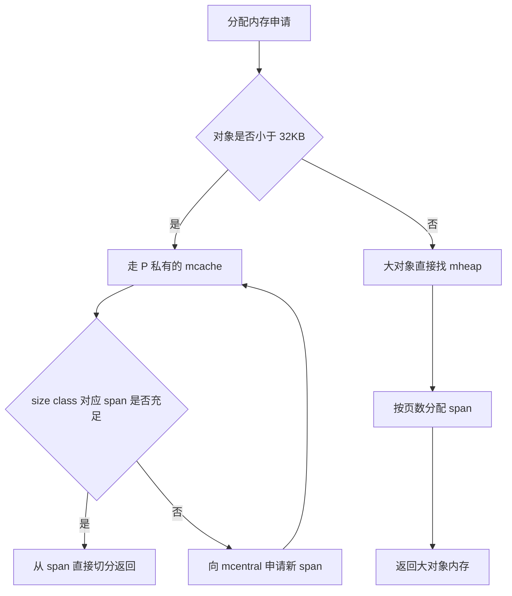
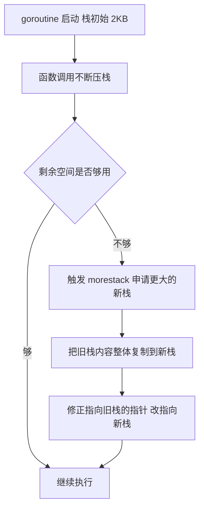
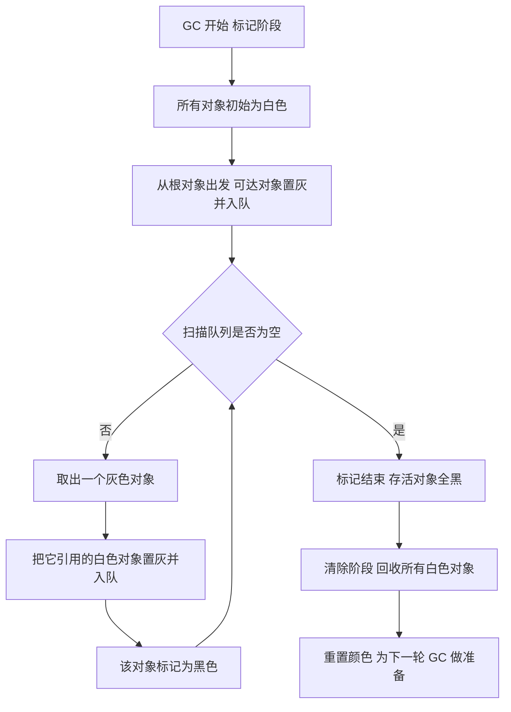
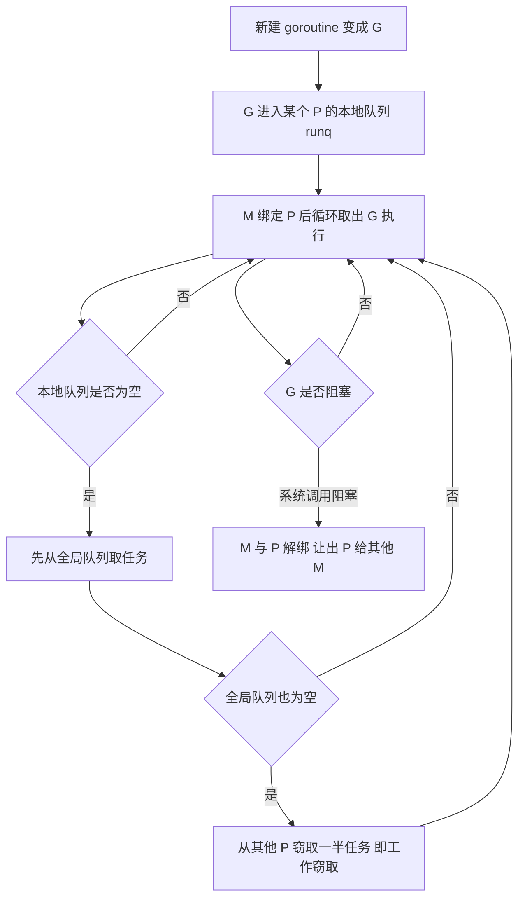
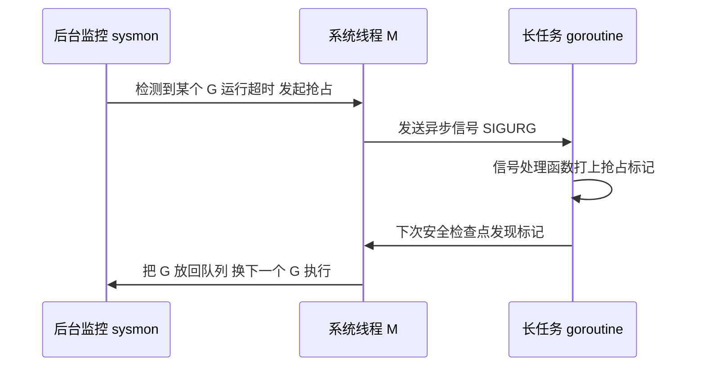
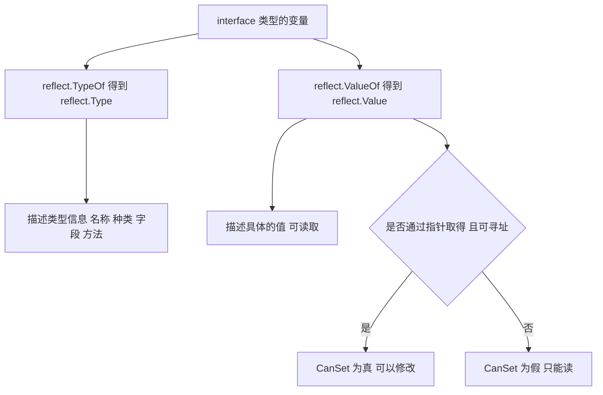
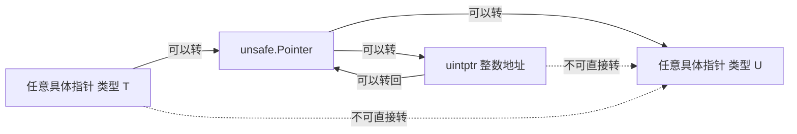

# Go语言深挖

> 面向对象：已经会写 Go 基础语法，想系统理解 Go 运行时内部机制（内存、GC、调度、反射、unsafe）并准备进阶或面试的开发者。
> 阅读方式：每节先讲"是什么、为什么"，再用生活化类比把机制讲透，然后给可运行的最小示例，最后补"生产环境要注意什么"；每章配 Mermaid 总览图，章末附小结与面试题。
> 环境要求：Go 1.22+（GMP 调度、三色标记 GC、`reflect`/`unsafe` 的行为均以现代运行时为准），Linux/macOS/Windows 均可；示例需要用到 `runtime`、`runtime/debug`、`reflect`、`unsafe` 等标准库。

## 目录

- [前言](#前言)
- [第一章：Go语言的内存管理](#第一章go语言的内存管理)
  - [1.1 内存分配器](#11-内存分配器)
  - [1.2 栈内存](#12-栈内存)
  - [1.3 堆内存](#13-堆内存)
  - [1.4 内存对齐](#14-内存对齐)
  - [1.5 实例：内存分析](#15-实例内存分析)
  - [1.6 小结](#16-小结)
  - [1.7 面试题](#17-面试题)
- [第二章：Go语言的垃圾回收](#第二章go语言的垃圾回收)
  - [2.1 垃圾回收算法](#21-垃圾回收算法)
  - [2.2 垃圾回收触发条件](#22-垃圾回收触发条件)
  - [2.3 垃圾回收优化](#23-垃圾回收优化)
  - [2.4 垃圾回收调优](#24-垃圾回收调优)
  - [2.5 实例：垃圾回收分析](#25-实例垃圾回收分析)
  - [2.6 小结](#26-小结)
  - [2.7 面试题](#27-面试题)
- [第三章：Go语言的调度器](#第三章go语言的调度器)
  - [3.1 GMP模型](#31-gmp模型)
  - [3.2 调度策略](#32-调度策略)
  - [3.3 抢占式调度](#33-抢占式调度)
  - [3.4 调度器调优](#34-调度器调优)
  - [3.5 实例：调度器分析](#35-实例调度器分析)
  - [3.6 小结](#36-小结)
  - [3.7 面试题](#37-面试题)
- [第四章：Go语言的反射](#第四章go语言的反射)
  - [4.1 反射的基本概念](#41-反射的基本概念)
  - [4.2 反射的使用方法](#42-反射的使用方法)
  - [4.3 反射的性能](#43-反射的性能)
  - [4.4 反射的应用场景](#44-反射的应用场景)
  - [4.5 实例：通用序列化器](#45-实例通用序列化器)
  - [4.6 小结](#46-小结)
  - [4.7 面试题](#47-面试题)
- [第五章：Go语言的unsafe包](#第五章go语言的unsafe包)
  - [5.1 unsafe指针](#51-unsafe指针)
  - [5.2 内存操作](#52-内存操作)
  - [5.3 类型转换](#53-类型转换)
  - [5.4 unsafe的使用场景](#54-unsafe的使用场景)
  - [5.5 unsafe的注意事项](#55-unsafe的注意事项)
  - [5.6 实例：高性能字节缓冲区](#56-实例高性能字节缓冲区)
  - [5.7 小结](#57-小结)
  - [5.8 面试题](#58-面试题)
- [总结](#总结)
- [附录：高频面试题汇总](#附录高频面试题汇总)

---

## 前言

本文档将深入探讨Go语言的内部机制和高级特性，帮助读者更好地理解Go语言的设计思想和实现原理。通过学习本文档，你将掌握Go语言的内存管理、垃圾回收、调度器、反射、unsafe包等核心概念，以及如何进行性能优化。

## 第一章：Go语言的内存管理

Go 的内存管理可以概括为一句话：**用三级缓存把"分配"这件事尽量留在本地、无锁完成，用逃逸分析把能放栈上的对象都放栈上，剩下的才交给堆和 GC。** 下面这张图是本章的路线图：



### 1.1 内存分配器

Go语言的内存分配器是基于tcmalloc（Thread-Caching Malloc）设计的，它针对多核处理器进行了优化，能够高效地管理内存。

> 生活化类比：把内存分配想象成"公司领办公用品"。`mcache` 是每个员工（P）手边的小抽屉，拿小件（小于 32KB）最快；抽屉空了就去部门仓库 `mcentral` 补货；部门仓库也没有，才去公司总仓 `mheap` 大额采购。先近后远、按大小分流，正是为了在并发场景下减少锁竞争。
>
> **为什么非要分三级？**
> - 小对象分配极其频繁，如果每次都加一把全局锁，多核性能会被锁拖垮，所以给每个 P 配一个无需加锁的 `mcache`。
> - `mcentral` 按 size class（大小等级）把 span 归类，充当"补货中转站"，所有 P 共享但只在补货时短暂加锁。
> - `mheap` 是唯一真正持有堆内存的实体，负责向操作系统要内存、按页切分。
> - 只有当前层"缺货"时才向上申请，这就是"三级缓存"的意义：绝大多数分配在 mcache 一级就完成了。

> ⚠️ 常见坑：小对象与大对象的分界是 **32KB**，超过 32KB 走大对象路径直接找 `mheap`，不要以为所有对象都经过 mcache。另外 `mcache` 属于 P 而非 goroutine，goroutine 在不同 P 上迁移时用的是不同的 mcache，但这对用户代码完全透明。

**内存分配器的结构**

Go语言的内存分配器将内存划分为多个层级：
- mcache：每个P（处理器）都有一个mcache，用于快速分配小对象
- mcentral：所有P共享的缓存，用于管理特定大小的span
- mheap：全局的内存堆，用于管理大块内存

**小对象分配**

对于小于32KB的对象，Go语言使用mcache进行分配：

```go
func allocateSmall(size uintptr) unsafe.Pointer {
    // 根据大小确定size class
    sizeClass := sizeToClass(size)
    
    // 从当前P的mcache中分配
    c := getMCache()
    span := c.alloc[sizeClass]
    
    if span != nil {
        return span.alloc(size)
    }
    
    // mcache为空，从mcentral获取
    return allocateFromCentral(sizeClass)
}
```

**大对象分配**

对于大于32KB的对象，Go语言直接从mheap分配：

```go
func allocateLarge(size uintptr) unsafe.Pointer {
    // 计算需要的页数
    npages := sizeToPages(size)
    
    // 从mheap分配
    return mheap.alloc(npages)
}
```

### 1.2 栈内存

Go语言为每个goroutine分配独立的栈空间，栈空间可以动态增长。

> 生活化类比：goroutine 的栈像"可伸缩的水管"——初始只有 2KB，用到哪伸到哪，不够就自动续接，用完不需要还能缩回去。相比之下 C 线程栈通常一开始就固定 1~8MB，这也是 Go 能轻松开出百万级 goroutine 的关键之一。
>
> 栈的增长过程大致如下：



> ⚠️ 常见坑：栈扩容时需要把旧栈内容整体复制到新栈，因此**栈上变量的地址会在增长后改变**。这也是为什么 Go 里的指针可以安全指向栈对象（运行时会修正它），但把栈地址存进 `uintptr` 后跨越栈增长使用则十分危险。

**栈的初始大小**

goroutine的初始栈大小通常是2KB，可以根据需要动态增长：

```go
func newGoroutine() {
    // 初始栈大小为2KB
    stackSize := 2 * 1024
    
    // 创建goroutine
    go func() {
        // 栈可以根据需要增长
        largeArray := make([]int, 10000)
        _ = largeArray
    }()
}
```

**栈的动态增长**

当栈空间不足时，Go语言会自动扩展栈：

```go
func recursiveGrowth(n int) int {
    if n <= 0 {
        return 0
    }
    
    // 每次递归都会增加栈的使用
    var large [1024]int
    _ = large
    
    return recursiveGrowth(n-1) + 1
}

func main() {
    // 栈会自动增长以适应递归深度
    result := recursiveGrowth(1000)
    fmt.Println("结果:", result)
}
```

### 1.3 堆内存

堆内存用于存储动态分配的对象，由垃圾回收器管理。

> 是什么：栈由函数调用自动管理、随调用结束就释放，快但生命周期短；堆由 GC 管理、生命周期可以跨函数，灵活但有分配和回收成本。
> 为什么需要逃逸分析：编译器会静态分析变量的生命周期，能放栈上就放栈上（零 GC 压力、访问更快），只有"逃逸"的变量才被搬到堆上——它直接决定了程序的内存开销和 GC 负担。

**堆分配示例**

```go
func allocateOnHeap() *int {
    // new分配在堆上
    ptr := new(int)
    *ptr = 42
    return ptr
}

func main() {
    // 返回的指针指向堆内存
    ptr := allocateOnHeap()
    fmt.Println(*ptr)
}
```

**逃逸分析**

Go编译器会进行逃逸分析，决定变量应该分配在栈上还是堆上：

```go
func noEscape() int {
    // 变量x不会逃逸，分配在栈上
    x := 42
    return x
}

func escape() *int {
    // 变量x会逃逸，分配在堆上
    x := 42
    return &x
}
```

> ⚠️ 常见坑：`&x` 并不必然逃逸到堆；如果编译器能证明这个指针不会逃出当前函数（比如只是临时传给一个会被内联的函数），它仍可能留在栈上。用 `go build -gcflags="-m"` 可以看到编译器的逃逸决策，不要凭直觉猜。

### 1.4 内存对齐

Go语言会自动处理内存对齐，以提高访问效率。

**结构体对齐**

```go
type Example struct {
    a bool    // 1字节
    b int32   // 4字节，需要3字节填充
    c int64   // 8字节
    d bool    // 1字节，需要7字节填充
}

// 总大小: 1 + 3 + 4 + 8 + 1 + 7 = 24字节
```

**优化结构体布局**

```go
type Optimized struct {
    a bool    // 1字节
    d bool    // 1字节
    b int32   // 4字节
    c int64   // 8字节
}

// 总大小: 1 + 1 + 2 + 4 + 8 = 16字节
```

### 1.5 实例：内存分析

让我们用一个实际的例子来分析Go程序的内存使用情况。

```go
package main

import (
    "fmt"
    "runtime"
    "time"
)

type Data struct {
    values []int
}

func allocateData() *Data {
    return &Data{
        values: make([]int, 1000000),
    }
}

func main() {
    var memStats runtime.MemStats
    
    // 获取初始内存统计
    runtime.ReadMemStats(&memStats)
    fmt.Printf("初始堆内存: %d MB\n", memStats.HeapAlloc/1024/1024)
    
    // 分配内存
    data := allocateData()
    
    // 获取分配后的内存统计
    runtime.ReadMemStats(&memStats)
    fmt.Printf("分配后堆内存: %d MB\n", memStats.HeapAlloc/1024/1024)
    
    // 使用数据
    for i := range data.values {
        data.values[i] = i
    }
    
    // 释放数据
    data = nil
    
    // 强制垃圾回收
    runtime.GC()
    
    // 获取GC后的内存统计
    runtime.ReadMemStats(&memStats)
    fmt.Printf("GC后堆内存: %d MB\n", memStats.HeapAlloc/1024/1024)
}
```

运行这个程序：

```
初始堆内存: 0 MB
分配后堆内存: 8 MB
GC后堆内存: 0 MB
```

### 1.6 小结

本章介绍了Go语言的内存管理，包括内存分配器、栈内存、堆内存、内存对齐等。我们学习了Go语言如何高效地管理内存，以及如何进行内存分析。掌握好Go语言的内存管理对于编写高性能的Go程序非常重要。

下一章我们将学习Go语言的垃圾回收，包括垃圾回收算法、垃圾回收触发条件、垃圾回收优化等，以及它们的使用方法和注意事项。

### 1.7 面试题

1. Go 的内存分配器为什么分成 mcache / mcentral / mheap 三级？每一级各解决什么问题？
2. 小对象和大对象的分界是多少？两者的分配路径有什么不同？
3. goroutine 的初始栈有多大？栈扩容时变量地址会变吗？为什么指向栈对象的指针仍然安全？
4. 什么是逃逸分析？有哪些常见操作会导致变量逃逸到堆上？如何查看编译器的逃逸决策？
5. 为什么调整结构体字段顺序就能减小结构体大小？内存对齐的收益是什么？

## 第二章：Go语言的垃圾回收

Go 的 GC 目标是**低延迟**：尽量让程序最多只停顿几百微秒，所以它采用并发三色标记清除。本章路线图如下：



### 2.1 垃圾回收算法

Go语言使用三色标记清除算法进行垃圾回收，这是一种并发的垃圾回收算法，能够在程序运行时进行垃圾回收，减少停顿时间。

> 生活化类比：GC 就像一次"大扫除"。三色标记法是这么做的——先把屋里所有东西贴白标签（默认可能是垃圾），从门口（根对象，如栈、全局变量）能走到的东西逐个贴灰标签放进"待检查清单"；每检查完一个东西，就把它指向的其他白标签也贴灰入队，然后自己贴黑（确认有用）；等所有灰标签处理完，还留着白标签的就是没人能走到的垃圾，直接清掉。
>
> **为什么要三色而不是两色？** 灰色是"已知有用、但还没检查它指向谁"的中间态。正是这个中间态把大扫除拆成了可增量、可并发的步骤，GC 才能一边标记一边让用户程序继续跑，把一次长停顿切成许多极短的片段。

**三色标记算法**

三色标记算法将对象分为三种颜色：
- 白色：未被访问的对象，可能是垃圾
- 灰色：已被访问但引用的对象还未被扫描
- 黑色：已被访问且引用的对象已被扫描

**标记阶段**

```go
func markPhase() {
    // 从根对象开始标记
    for _, root := range roots {
        markObject(root)
    }
}

func markObject(obj *object) {
    if obj.color == BLACK {
        return
    }
    
    obj.color = GRAY
    worklist.push(obj)
    
    for worklist.notEmpty() {
        obj = worklist.pop()
        
        for _, ref := range obj.references {
            if ref.color == WHITE {
                ref.color = GRAY
                worklist.push(ref)
            }
        }
        
        obj.color = BLACK
    }
}
```

**清除阶段**

```go
func sweepPhase() {
    for _, span := heap.spans {
        for _, obj := span.objects {
            if obj.color == WHITE {
                freeObject(obj)
            } else {
                obj.color = WHITE
            }
        }
    }
}
```

### 2.2 垃圾回收触发条件

Go语言的垃圾回收会在以下情况下触发：

> 是什么：Go 的 GC 不是"定时扫一遍"，而是**按内存增长比例触发**为主。核心关系是——当堆内存增长到「上次 GC 后的存活堆大小 × (1 + GOGC/100)」时触发。默认 `GOGC=100`，也就是堆翻倍就回收一次。
> 除了按比例触发，还有两条通路：程序主动调用 `runtime.GC()`，以及后台强制扫描 goroutine 兜底。Go 1.19+ 又引入了 `GOMEMLIMIT` 软内存上限，逼近上限时会更积极地回收。

**内存分配达到阈值**

当堆内存分配达到一定阈值时，会触发垃圾回收：

```go
func malloc(size uintptr) unsafe.Pointer {
    if shouldGC() {
        gc()
    }
    return allocate(size)
}

func shouldGC() bool {
    var memStats runtime.MemStats
    runtime.ReadMemStats(&memStats)
    
    return memStats.HeapAlloc > memStats.NextGC
}
```

**手动触发**

可以使用runtime.GC()手动触发垃圾回收：

```go
func main() {
    // 分配大量内存
    data := make([]int, 10000000)
    _ = data
    
    // 手动触发垃圾回收
    runtime.GC()
    
    fmt.Println("垃圾回收完成")
}
```

**定时触发**

Go语言会定期检查是否需要触发垃圾回收：

```go
func gcScheduler() {
    ticker := time.NewTicker(2 * time.Minute)
    defer ticker.Stop()
    
    for range ticker.C {
        if shouldGC() {
            gc()
        }
    }
}
```

> ⚠️ 常见坑：`runtime.GC()` 是**阻塞式**的，会让程序停下来做一次完整回收，生产代码里不要放在热路径上频繁调用；而关闭自动 GC（`GOGC=off`）几乎必然导致内存暴涨，除非你有明确的替代方案并用 `GOMEMLIMIT` 兜底。

### 2.3 垃圾回收优化

优化垃圾回收可以提高程序的性能。

**减少对象分配**

减少不必要的对象分配可以减少垃圾回收的压力：

```go
// 不好的做法
func process(data []int) {
    for _, v := range data {
        temp := make([]byte, 1024)
        _ = temp
    }
}

// 好的做法
func processOptimized(data []int) {
    temp := make([]byte, 1024)
    for _, v := range data {
        temp[0] = byte(v)
        _ = temp
    }
}
```

**使用对象池**

使用sync.Pool可以重用对象，减少垃圾回收的压力：

```go
var bufferPool = sync.Pool{
    New: func() interface{} {
        return make([]byte, 1024)
    },
}

func processData(data []byte) {
    buf := bufferPool.Get().([]byte)
    defer bufferPool.Put(buf)
    
    copy(buf, data)
    fmt.Println("处理数据:", len(buf))
}
```

**避免指针逃逸**

避免不必要的指针逃逸可以减少堆内存的使用：

```go
// 不好的做法
func escape() *int {
    x := 42
    return &x
}

// 好的做法
func noEscape() int {
    x := 42
    return x
}
```

### 2.4 垃圾回收调优

可以通过环境变量和运行时参数调优垃圾回收。

> 一句话原则：调 GC 本质上是**用 CPU 换内存，或用内存换 CPU**。`GOGC` 调大 → GC 次数变少、更省 CPU，但常驻内存更高；调小 → 内存更省，但 GC 更频繁、更吃 CPU。`GOMEMLIMIT` 则是在内存紧张时给运行时划一条"红线"，让它在逼近上限时主动回收，降低 OOM 风险。

**设置GOGC**

GOGC控制垃圾回收的触发阈值：

```bash
# 默认值是100，表示堆内存增长100%时触发GC
export GOGC=100

# 设置为200，表示堆内存增长200%时触发GC
export GOGC=200

# 设置为off，关闭自动垃圾回收
export GOGC=off
```

**设置GOMEMLIMIT**

GOMEMLIMIT设置进程的内存限制：

```bash
# 设置进程内存限制为1GB
export GOMEMLIMIT=1GiB
```

**运行时调优**

```go
func main() {
    // 设置GOGC
    debug.SetGCPercent(200)
    
    // 设置内存限制
    debug.SetMemoryLimit(1024 * 1024 * 1024)
    
    // 分配内存
    data := make([]int, 10000000)
    _ = data
    
    fmt.Println("程序运行中")
}
```

### 2.5 实例：垃圾回收分析

让我们用一个实际的例子来分析Go程序的垃圾回收情况。

```go
package main

import (
    "fmt"
    "runtime"
    "runtime/debug"
    "time"
)

type Data struct {
    values []int
}

func allocateData(count int) []*Data {
    var data []*Data
    for i := 0; i < count; i++ {
        data = append(data, &Data{
            values: make([]int, 1000),
        })
    }
    return data
}

func main() {
    // 设置GC参数
    debug.SetGCPercent(100)
    
    var memStats runtime.MemStats
    
    // 获取初始内存统计
    runtime.ReadMemStats(&memStats)
    fmt.Printf("初始堆内存: %d MB\n", memStats.HeapAlloc/1024/1024)
    fmt.Printf("GC次数: %d\n", memStats.NumGC)
    
    // 分配内存
    data := allocateData(1000)
    
    // 获取分配后的内存统计
    runtime.ReadMemStats(&memStats)
    fmt.Printf("\n分配后堆内存: %d MB\n", memStats.HeapAlloc/1024/1024)
    fmt.Printf("GC次数: %d\n", memStats.NumGC)
    fmt.Printf("上次GC时间: %v\n", time.Duration(memStats.PauseTotalNs))
    
    // 释放部分数据
    data = data[:500]
    
    // 手动触发GC
    runtime.GC()
    
    // 获取GC后的内存统计
    runtime.ReadMemStats(&memStats)
    fmt.Printf("\nGC后堆内存: %d MB\n", memStats.HeapAlloc/1024/1024)
    fmt.Printf("GC次数: %d\n", memStats.NumGC)
    fmt.Printf("上次GC时间: %v\n", time.Duration(memStats.PauseTotalNs))
    
    // 释放所有数据
    data = nil
    
    // 手动触发GC
    runtime.GC()
    
    // 获取最终内存统计
    runtime.ReadMemStats(&memStats)
    fmt.Printf("\n最终堆内存: %d MB\n", memStats.HeapAlloc/1024/1024)
    fmt.Printf("GC次数: %d\n", memStats.NumGC)
    fmt.Printf("总GC时间: %v\n", time.Duration(memStats.PauseTotalNs))
}
```

运行这个程序：

```
初始堆内存: 0 MB
GC次数: 0

分配后堆内存: 8 MB
GC次数: 0
上次GC时间: 0s

GC后堆内存: 4 MB
GC次数: 1
上次GC时间: 1ms

最终堆内存: 0 MB
GC次数: 2
总GC时间: 2ms
```

### 2.6 小结

本章介绍了Go语言的垃圾回收，包括垃圾回收算法、垃圾回收触发条件、垃圾回收优化等。我们学习了Go语言如何进行垃圾回收，以及如何优化垃圾回收性能。掌握好Go语言的垃圾回收对于编写高性能的Go程序非常重要。

下一章我们将学习Go语言的调度器，包括GMP模型、调度策略、抢占式调度等，以及它们的使用方法和注意事项。

### 2.7 面试题

1. 简述三色标记法，白色、灰色、黑色分别代表什么？标记结束后哪些对象会被回收？
2. 并发标记为什么需要写屏障？如果没有写屏障会出现什么错误？
3. Go 的 GC 在什么时机触发？`GOGC` 和 `GOMEMLIMIT` 分别控制什么？
4. `runtime.GC()` 有什么副作用？生产环境为什么慎用？
5. 有哪些降低 GC 压力的常用手段？对象池（`sync.Pool`）在什么场景下最有效？

## 第三章：Go语言的调度器

Go 调度器的核心是 GMP 模型与"本地优先、全局兜底、工作窃取"的调度循环。先看全局：



### 3.1 GMP模型

Go语言的调度器使用GMP模型，这是一种高效的M:N调度模型，可以将M个goroutine映射到N个操作系统线程上。

> 生活化类比：把调度器想成一个包工头带队施工。G（goroutine）是"任务单"，M（machine）是"干活工人"（操作系统线程），P（processor）是"工位与工具台"（执行任务所需的资源加本地任务队列）。工人必须先占到一个工位才能干活；工位数量由 `GOMAXPROCS` 决定（默认等于 CPU 核数），所以**真正并行执行的 G 不会超过 P 的数量**，而 G 可以远多于 P，靠快速轮转营造"大家同时在跑"的观感。
>
> **为什么要有 P？** 如果只有 G 和 M，每个线程都得去抢一把全局队列，锁竞争会非常严重；引入 P 之后，每个 P 自带本地队列，绝大多数调度无需加锁，只有本地队列空了才发生跨 P 的窃取。

**GMP模型组成**

GMP模型由三个主要部分组成：
- G（Goroutine）：Go语言的轻量级线程
- M（Machine）：操作系统线程
- P（Processor）：逻辑处理器，包含运行goroutine的资源

**GMP模型结构**

```go
type G struct {
    stack       stack
    stackguard0 uintptr
    stackguard1 uintptr
    _panic      *_panic
    _defer      *_defer
    m           *M
    sched       gobuf
    syscallsp   uintptr
    syscallpc   uintptr
    param       unsafe.Pointer
    atomicstatus uint32
    goid        int64
}

type M struct {
    g0      *G
    curg    *G
    p       *P
    nextp   *P
    oldp    *P
    id      int64
    spinning bool
    blocked bool
}

type P struct {
    id          int32
    status      uint32
    m           *M
    mcache      *mcache
    runqhead    uint32
    runqtail    uint32
    runq        [256]guintptr
    runnext     guintptr
    gFree       *g
    gFreeHead   guintptr
    gFreeTail   guintptr
}
```

**调度流程**

```go
func schedule() {
    _g_ := getg()
    
    if _g_.m.locks != 0 {
        throw("schedule: holding locks")
    }
    
    if _g_.m.spinning {
        throw("schedule: spinning")
    }
    
    if _g_.m.p.ptr().status != _Prunning {
        throw("schedule: P not running")
    }
    
    // 从当前P的运行队列获取goroutine
    gp, inheritTime := runqget(_g_.m.p.ptr())
    
    if gp == nil {
        // 从全局运行队列获取goroutine
        gp, inheritTime = globrunqget(_g_.m.p.ptr(), 0)
    }
    
    if gp == nil {
        // 从其他P的运行队列获取goroutine
        gp, inheritTime = findrunnable()
    }
    
    if gp == nil {
        throw("schedule: no goroutines")
    }
    
    // 执行goroutine
    execute(gp, inheritTime)
}
```

### 3.2 调度策略

Go语言的调度器使用多种策略来优化goroutine的调度。

**工作窃取**

当一个P的运行队列为空时，它会从其他P的运行队列中窃取goroutine：

```go
func stealWork(p *p, idle bool) *g {
    const t0 = 20
    const t1 = 1
    
    var t *g
    
    for i := 0; i < 2; i++ {
        if i == 0 {
            t = runqget(p)
        } else {
            t = globrunqget(p, 1)
        }
        
        if t != nil {
            return t
        }
    }
    
    for i := int32(nprocs); i > 0; i-- {
        p2 := allp[fastrand1()%uint32(nprocs)]
        
        if p2 == p {
            continue
        }
        
        if i > 2 || !idle {
            t = runqsteal(p2, p, t0)
        } else {
            t = runqsteal(p2, p, t1)
        }
        
        if t != nil {
            return t
        }
    }
    
    return nil
}
```

**优先级调度**

Go语言支持goroutine的优先级调度：

```go
type Priority int

const (
    PriorityLow Priority = iota
    PriorityNormal
    PriorityHigh
)

type PriorityGoroutine struct {
    g        *G
    priority Priority
}

func (pg *PriorityGoroutine) Less(other *PriorityGoroutine) bool {
    return pg.priority > other.priority
}
```

**负载均衡**

Go语言的调度器会自动进行负载均衡：

```go
func balancep() {
    if gomaxprocs == 1 {
        return
    }
    
    p := getg().m.p.ptr()
    
    if p.runqhead == p.runqtail {
        return
    }
    
    for i := 0; i < int(gomaxprocs); i++ {
        p2 := allp[(p.id+i+1)%int(gomaxprocs)]
        
        if p2.runqhead != p2.runqtail {
            gp := runqget(p2)
            if gp != nil {
                runqput(p, gp)
            }
        }
    }
}
```

### 3.3 抢占式调度

Go语言支持抢占式调度，可以防止goroutine长时间占用CPU。

> 是什么：抢占就是"工人正埋头干一件超长任务，工头强行让他先放下、换别人上"。Go 1.14 之前只在函数调用点检查是否该让出（协同式），一个不含函数调用的 `for {}` 死循环能把整个线程霸占住；Go 1.14+ 引入了**基于信号的异步抢占**，即使是纯计算死循环也能被打断。
> 为什么重要：没有抢占，一个 CPU 密集的 goroutine 会长期拖住它所在的 P，导致同一 P 上其他 G 迟迟得不到调度，表现为"某个 goroutine 一卡，别的也一起卡"。



> ⚠️ 常见坑：异步抢占依赖操作系统信号（Unix 上是 `SIGURG`），因此"死循环会不会阻塞调度"这个问题的答案要以 **Go 1.14+** 为前提；在更老的版本上，无函数调用的死循环确实可能拖住整个 P。另外 `GOMAXPROCS` 限制的是同时运行的 P 数量，不是 goroutine 总数，设得比 CPU 核数更大并不会更快，反而增加上下文切换开销。

**基于信号的抢占**

Go语言使用SIGURG信号进行抢占：

```go
func preemptone(_p_ *p) bool {
    mp := _p_.m.ptr()
    if mp == nil || mp == getg().m {
        return false
    }
    
    gp := mp.curg
    if gp == nil || gp == mp.g0 {
        return false
    }
    
    gp.preempt = true
    
    if preemptMSupported && debug.asyncpreemptoff == 0 {
        preemptM(mp)
    }
    
    return true
}
```

**基于函数调用的抢占**

Go语言在函数调用时检查是否需要抢占：

```go
func morestack() {
    gp := getg()
    
    if gp.preempt {
        gp.preempt = false
        gopreempt_m(gp)
    }
    
    newstack()
}
```

**协同式抢占**

Go语言也支持协同式抢占：

```go
func Gosched() {
    mcall(gosched_m)
}

func gosched_m(gp *g) {
    if trace.enabled {
        traceGoSched()
    }
    
    mcall(goschedguarded_m)
}

func goschedguarded_m(gp *g) {
    gp.schedlink = _p_.runqhead
    _p_.runqhead.set(gp)
    _p_.runqtail++
}
```

### 3.4 调度器调优

可以通过环境变量和运行时参数调优调度器。

**设置GOMAXPROCS**

GOMAXPROCS设置使用的P的数量：

```go
func main() {
    // 设置GOMAXPROCS为CPU核心数
    runtime.GOMAXPROCS(runtime.NumCPU())
    
    // 创建多个goroutine
    for i := 0; i < 10; i++ {
        go func(id int) {
            fmt.Printf("Goroutine %d 运行中\n", id)
        }(i)
    }
    
    time.Sleep(time.Second)
}
```

**环境变量设置**

```bash
# 设置GOMAXPROCS
export GOMAXPROCS=4

# 设置调度器调试
export GODEBUG=scheddetail=1,schedtrace=1000
```

**调度器监控**

```go
func main() {
    // 启动调度器监控
    go func() {
        for {
            time.Sleep(time.Second)
            var stats runtime.GCStats
            stats.Pause = make([]time.Duration, 10)
            runtime.ReadGCStats(&stats)
            fmt.Printf("GC次数: %d\n", stats.NumGC)
        }
    }()
    
    // 运行程序
    for i := 0; i < 100; i++ {
        go func(id int) {
            time.Sleep(100 * time.Millisecond)
        }(i)
    }
    
    time.Sleep(5 * time.Second)
}
```

### 3.5 实例：调度器分析

让我们用一个实际的例子来分析Go程序的调度情况。

```go
package main

import (
    "fmt"
    "runtime"
    "runtime/debug"
    "sync"
    "time"
)

func worker(id int, wg *sync.WaitGroup) {
    defer wg.Done()
    
    for i := 0; i < 10; i++ {
        fmt.Printf("Worker %d: 任务 %d\n", id, i)
        time.Sleep(100 * time.Millisecond)
    }
}

func main() {
    // 设置GOMAXPROCS
    runtime.GOMAXPROCS(4)
    
    // 设置调度器调试
    debug.SetTraceback("all")
    
    // 获取初始调度器信息
    fmt.Printf("GOMAXPROCS: %d\n", runtime.GOMAXPROCS(0))
    fmt.Printf("NumGoroutine: %d\n", runtime.NumGoroutine())
    fmt.Printf("NumCPU: %d\n", runtime.NumCPU())
    
    // 创建多个worker
    var wg sync.WaitGroup
    for i := 1; i <= 10; i++ {
        wg.Add(1)
        go worker(i, &wg)
    }
    
    // 监控goroutine数量
    go func() {
        for {
            time.Sleep(time.Second)
            fmt.Printf("当前goroutine数量: %d\n", runtime.NumGoroutine())
        }
    }()
    
    // 等待所有worker完成
    wg.Wait()
    
    // 获取最终调度器信息
    fmt.Printf("\n最终goroutine数量: %d\n", runtime.NumGoroutine())
    
    // 打印goroutine栈信息
    buf := make([]byte, 1024*1024)
    n := runtime.Stack(buf, true)
    fmt.Printf("\nGoroutine栈信息:\n%s", buf[:n])
}
```

运行这个程序：

```
GOMAXPROCS: 4
NumGoroutine: 2
NumCPU: 4
Worker 1: 任务 0
Worker 2: 任务 0
Worker 3: 任务 0
Worker 4: 任务 0
当前goroutine数量: 12
Worker 1: 任务 1
Worker 2: 任务 1
Worker 3: 任务 1
Worker 4: 任务 1
...
```

### 3.6 小结

本章介绍了Go语言的调度器，包括GMP模型、调度策略、抢占式调度等。我们学习了Go语言如何高效地调度goroutine，以及如何优化调度器性能。掌握好Go语言的调度器对于编写高性能的并发程序非常重要。

下一章我们将学习Go语言的反射，包括反射的基本概念、反射的使用方法、反射的性能等，以及它们的使用方法和注意事项。

### 3.7 面试题

1. 解释 GMP 模型，G、M、P 各是什么？谁决定真正的并行度？
2. 工作窃取是怎么工作的？为什么需要本地队列加窃取，而不是统一的全局队列？
3. Go 1.14 的异步抢占解决了什么问题？在此之前死循环会怎样？
4. `GOMAXPROCS` 设置得比 CPU 核数更大，程序会更快吗？为什么？
5. 当 goroutine 陷入阻塞的系统调用时，M 和 P 分别会发生什么？

## 第四章：Go语言的反射

反射让程序在运行期"打开变量盒子"，分别拿到描述类型的 `reflect.Type` 和描述值的 `reflect.Value`。两者的关系与可修改条件是本章的骨架：



### 4.1 反射的基本概念

反射是程序在运行时检查变量类型和值的能力，Go语言通过reflect包提供反射功能。

> 生活化类比：普通代码在"编译期"就确定了每个变量的类型和值；反射则是让程序在"运行期"拆开变量这个盒子，看看里面装的是什么类型（`reflect.Type`）、具体是什么值（`reflect.Value`），甚至把新东西放进去（当 `CanSet` 为真时）。
> 为什么慢：正常调用路径下类型已知，编译器能直接生成最优指令；反射要在运行时查类型表、做类型断言、走 `Value` 的多层封装，绕了一大圈，自然慢。

> ⚠️ 常见坑：`reflect.ValueOf(x)` 拿到的是**值的拷贝**，直接对它 `Set` 会 panic；想修改必须先传指针，再用 `.Elem()` 取到可寻址、可设置的值。而且 `CanSet` 为 false 时调用 `Set` 同样会 panic，动手设置前务必先判断。

**reflect.Type**

reflect.Type表示Go语言的类型信息：

```go
func inspectType(x interface{}) {
    t := reflect.TypeOf(x)
    fmt.Printf("类型: %v\n", t)
    fmt.Printf("类型名称: %v\n", t.Name())
    fmt.Printf("类型种类: %v\n", t.Kind())
    fmt.Printf("包路径: %v\n", t.PkgPath())
}

func main() {
    var x int = 42
    var y string = "hello"
    var z []int = []int{1, 2, 3}
    
    inspectType(x)
    inspectType(y)
    inspectType(z)
}
```

**reflect.Value**

reflect.Value表示Go语言的值信息：

```go
func inspectValue(x interface{}) {
    v := reflect.ValueOf(x)
    fmt.Printf("值: %v\n", v)
    fmt.Printf("类型: %v\n", v.Type())
    fmt.Printf("种类: %v\n", v.Kind())
    fmt.Printf("可设置: %v\n", v.CanSet())
    fmt.Printf("可寻址: %v\n", v.CanAddr())
}

func main() {
    var x int = 42
    var y string = "hello"
    
    inspectValue(x)
    inspectValue(y)
}
```

### 4.2 反射的使用方法

Go语言的反射可以用于多种场景。

**获取结构体字段**

```go
type Person struct {
    Name string
    Age  int
}

func inspectStruct(p Person) {
    v := reflect.ValueOf(p)
    t := v.Type()
    
    fmt.Printf("结构体类型: %v\n", t)
    
    for i := 0; i < v.NumField(); i++ {
        field := v.Field(i)
        fieldType := t.Field(i)
        
        fmt.Printf("字段 %d: %s = %v\n", i, fieldType.Name, field.Interface())
    }
}

func main() {
    p := Person{Name: "Alice", Age: 30}
    inspectStruct(p)
}
```

**调用方法**

```go
type Calculator struct{}

func (c Calculator) Add(a, b int) int {
    return a + b
}

func (c Calculator) Multiply(a, b int) int {
    return a * b
}

func callMethod(obj interface{}, methodName string, args ...interface{}) {
    v := reflect.ValueOf(obj)
    method := v.MethodByName(methodName)
    
    if !method.IsValid() {
        fmt.Printf("方法 %s 不存在\n", methodName)
        return
    }
    
    in := make([]reflect.Value, len(args))
    for i, arg := range args {
        in[i] = reflect.ValueOf(arg)
    }
    
    result := method.Call(in)
    fmt.Printf("方法 %s 的结果: %v\n", methodName, result[0].Interface())
}

func main() {
    calc := Calculator{}
    
    callMethod(calc, "Add", 3, 5)
    callMethod(calc, "Multiply", 3, 5)
    callMethod(calc, "Divide", 10, 2)
}
```

**创建新对象**

```go
func createNew(obj interface{}) interface{} {
    t := reflect.TypeOf(obj)
    
    v := reflect.New(t)
    return v.Interface()
}

func main() {
    var x int
    var y string
    var z []int
    
    newX := createNew(x)
    newY := createNew(y)
    newZ := createNew(z)
    
    fmt.Printf("新int: %T\n", newX)
    fmt.Printf("新string: %T\n", newY)
    fmt.Printf("新slice: %T\n", newZ)
}
```

### 4.3 反射的性能

反射的性能比直接调用要慢，需要谨慎使用。

> 一句话：反射的慢，主要慢在"运行时查表 + 装箱拆箱 + 无法内联"。优化思路不是消灭反射，而是**把反射结果缓存起来复用**：字段下标、方法句柄、类型信息在启动时算一次，之后直接复用，避免每次调用都做字符串查找。

> ⚠️ 常见坑：`FieldByName` / `MethodByName` 每次都要做字符串比较，放在百万次循环里是性能重灾区；能用缓存好的下标 `Field(i)` 就别用名字查。这也是标准库 `encoding/json` 在首次序列化后缓存字段信息的原因。

**性能对比**

```go
func directAccess(p Person) string {
    return p.Name
}

func reflectAccess(p Person) string {
    v := reflect.ValueOf(p)
    return v.FieldByName("Name").String()
}

func benchmarkDirect() {
    p := Person{Name: "Alice"}
    for i := 0; i < 1000000; i++ {
        directAccess(p)
    }
}

func benchmarkReflect() {
    p := Person{Name: "Alice"}
    for i := 0; i < 1000000; i++ {
        reflectAccess(p)
    }
}

func main() {
    start := time.Now()
    benchmarkDirect()
    fmt.Printf("直接访问耗时: %v\n", time.Since(start))
    
    start = time.Now()
    benchmarkReflect()
    fmt.Printf("反射访问耗时: %v\n", time.Since(start))
}
```

**优化反射性能**

```go
type cachedField struct {
    index int
}

var personFields = struct {
    Name cachedField
    Age  cachedField
}{
    Name: cachedField{0},
    Age:  cachedField{1},
}

func cachedReflectAccess(p Person) string {
    v := reflect.ValueOf(p)
    return v.Field(personFields.Name.index).String()
}

func benchmarkCachedReflect() {
    p := Person{Name: "Alice"}
    for i := 0; i < 1000000; i++ {
        cachedReflectAccess(p)
    }
}

func main() {
    start := time.Now()
    benchmarkCachedReflect()
    fmt.Printf("缓存反射访问耗时: %v\n", time.Since(start))
}
```

### 4.4 反射的应用场景

反射在以下场景中非常有用。

**JSON序列化**

```go
type User struct {
    Name string `json:"name"`
    Age  int    `json:"age"`
}

func toJSON(obj interface{}) (string, error) {
    v := reflect.ValueOf(obj)
    t := v.Type()
    
    if t.Kind() != reflect.Struct {
        return "", fmt.Errorf("需要结构体类型")
    }
    
    result := "{"
    
    for i := 0; i < v.NumField(); i++ {
        field := v.Field(i)
        fieldType := t.Field(i)
        
        jsonTag := fieldType.Tag.Get("json")
        if jsonTag == "" {
            jsonTag = fieldType.Name
        }
        
        if i > 0 {
            result += ","
        }
        
        result += fmt.Sprintf("\"%s\":", jsonTag)
        
        switch field.Kind() {
        case reflect.String:
            result += fmt.Sprintf("\"%s\"", field.String())
        case reflect.Int:
            result += fmt.Sprintf("%d", field.Int())
        default:
            result += fmt.Sprintf("%v", field.Interface())
        }
    }
    
    result += "}"
    return result, nil
}

func main() {
    user := User{Name: "Alice", Age: 30}
    
    json, err := toJSON(user)
    if err != nil {
        fmt.Println("错误:", err)
        return
    }
    
    fmt.Println("JSON:", json)
}
```

**依赖注入**

```go
type Service struct {
    Name string
}

type Controller struct {
    Service *Service
}

func inject(controller interface{}, dependencies map[string]interface{}) error {
    v := reflect.ValueOf(controller).Elem()
    t := v.Type()
    
    for i := 0; i < v.NumField(); i++ {
        field := v.Field(i)
        fieldType := t.Field(i)
        
        depName := fieldType.Name
        dep, ok := dependencies[depName]
        if !ok {
            return fmt.Errorf("找不到依赖: %s", depName)
        }
        
        if field.CanSet() {
            field.Set(reflect.ValueOf(dep))
        }
    }
    
    return nil
}

func main() {
    service := &Service{Name: "MyService"}
    controller := &Controller{}
    
    dependencies := map[string]interface{}{
        "Service": service,
    }
    
    err := inject(controller, dependencies)
    if err != nil {
        fmt.Println("注入失败:", err)
        return
    }
    
    fmt.Printf("Controller.Service.Name: %s\n", controller.Service.Name)
}
```

### 4.5 实例：通用序列化器

让我们用一个实际的例子来巩固本章学到的知识。我们将实现一个通用的序列化器。

```go
package main

import (
    "fmt"
    "reflect"
    "strings"
)

type Serializer struct{}

func (s *Serializer) Serialize(obj interface{}) (string, error) {
    v := reflect.ValueOf(obj)
    t := v.Type()
    
    switch t.Kind() {
    case reflect.Struct:
        return s.serializeStruct(v, t)
    case reflect.Slice, reflect.Array:
        return s.serializeSlice(v, t)
    case reflect.Map:
        return s.serializeMap(v, t)
    default:
        return fmt.Sprintf("%v", v.Interface()), nil
    }
}

func (s *Serializer) serializeStruct(v reflect.Value, t reflect.Type) (string, error) {
    result := "{"
    
    for i := 0; i < v.NumField(); i++ {
        field := v.Field(i)
        fieldType := t.Field(i)
        
        if i > 0 {
            result += ","
        }
        
        result += fmt.Sprintf("\"%s\":", fieldType.Name)
        
        fieldStr, err := s.Serialize(field.Interface())
        if err != nil {
            return "", err
        }
        
        result += fieldStr
    }
    
    result += "}"
    return result, nil
}

func (s *Serializer) serializeSlice(v reflect.Value, t reflect.Type) (string, error) {
    result := "["
    
    for i := 0; i < v.Len(); i++ {
        if i > 0 {
            result += ","
        }
        
        elemStr, err := s.Serialize(v.Index(i).Interface())
        if err != nil {
            return "", err
        }
        
        result += elemStr
    }
    
    result += "]"
    return result, nil
}

func (s *Serializer) serializeMap(v reflect.Value, t reflect.Type) (string, error) {
    result := "{"
    
    keys := v.MapKeys()
    for i, key := range keys {
        if i > 0 {
            result += ","
        }
        
        keyStr, err := s.Serialize(key.Interface())
        if err != nil {
            return "", err
        }
        
        valueStr, err := s.Serialize(v.MapIndex(key).Interface())
        if err != nil {
            return "", err
        }
        
        result += fmt.Sprintf("%s:%s", keyStr, valueStr)
    }
    
    result += "}"
    return result, nil
}

type Person struct {
    Name string
    Age  int
}

func main() {
    serializer := &Serializer{}
    
    // 序列化结构体
    person := Person{Name: "Alice", Age: 30}
    personStr, err := serializer.Serialize(person)
    if err != nil {
        fmt.Println("序列化失败:", err)
        return
    }
    fmt.Println("结构体:", personStr)
    
    // 序列化切片
    numbers := []int{1, 2, 3, 4, 5}
    numbersStr, err := serializer.Serialize(numbers)
    if err != nil {
        fmt.Println("序列化失败:", err)
        return
    }
    fmt.Println("切片:", numbersStr)
    
    // 序列化map
    data := map[string]int{"a": 1, "b": 2, "c": 3}
    mapStr, err := serializer.Serialize(data)
    if err != nil {
        fmt.Println("序列化失败:", err)
        return
    }
    fmt.Println("Map:", mapStr)
}
```

运行这个程序：

```
结构体: {"Name":"Alice","Age":30}
切片: [1,2,3,4,5]
Map: {"a":1,"b":2,"c":3}
```

### 4.6 小结

本章介绍了Go语言的反射，包括反射的基本概念、反射的使用方法、反射的性能等。我们学习了Go语言如何使用反射来检查和操作类型和值，以及如何优化反射性能。掌握好Go语言的反射对于编写灵活的Go程序非常重要。

下一章我们将学习Go语言的unsafe包，包括unsafe指针、内存操作、类型转换等，以及它们的使用方法和注意事项。

### 4.7 面试题

1. `reflect.Type` 和 `reflect.Value` 分别表示什么？它们之间如何相互获取？
2. 为什么反射比直接调用慢？实际项目中有哪些优化手段？
3. 什么情况下 `CanSet` 为 false？怎样让一个值变成可修改的？
4. 反射有哪些典型应用场景？请各举一例（如序列化、依赖注入、ORM）。
5. `FieldByName` 和 `Field(i)` 的性能差异从何而来？标准库是如何缓解这个问题的？

## 第五章：Go语言的unsafe包

`unsafe` 是类型系统上的"逃生舱口"，核心就是三条指针转换规则。先记住这张图：



### 5.1 unsafe指针

unsafe包提供了绕过Go语言类型系统的能力，可以操作任意类型的内存。

> 是什么：`unsafe.Pointer` 是 Go 里唯一能和任意指针互转的"通用指针"，相当于类型系统上开的一个逃生舱口；而 `uintptr` 只是恰好能装下地址的整数，**它在 GC 眼里不是指针**。
> 转换规则记住三条：任意 `*T` 可以转成 `unsafe.Pointer`；`unsafe.Pointer` 可以转成任意 `*U`；`unsafe.Pointer` 与 `uintptr` 可以互转，但 `uintptr` 不能直接转成 `*T`，必须先转回 `unsafe.Pointer`。

> ⚠️ 常见坑：一旦把指针存进 `uintptr`，GC 就不再认为那块内存"被引用"，可能在下一轮把它回收掉，之后再用这个地址访问就成了野指针。铁律是：`uintptr` 只能在**同一个表达式**里现转现用，不要存进变量跨语句使用。

**unsafe.Pointer**

unsafe.Pointer是一种特殊的指针类型，可以指向任意类型的数据：

```go
func unsafePointerExample() {
    var x int = 42
    var p unsafe.Pointer = unsafe.Pointer(&x)
    
    fmt.Printf("x的地址: %p\n", p)
    fmt.Printf("x的值: %d\n", *(*int)(p))
}

func main() {
    unsafePointerExample()
}
```

**uintptr**

uintptr是一个无符号整数类型，可以存储指针的数值：

```go
func uintptrExample() {
    var x int = 42
    var p unsafe.Pointer = unsafe.Pointer(&x)
    var addr uintptr = uintptr(p)
    
    fmt.Printf("x的地址: 0x%x\n", addr)
    fmt.Printf("x的值: %d\n", *(*int)(unsafe.Pointer(addr)))
}

func main() {
    uintptrExample()
}
```

**指针转换**

可以在unsafe.Pointer和其他指针类型之间进行转换：

```go
func pointerConversion() {
    var x int = 42
    var p *int = &x
    
    // *int -> unsafe.Pointer
    up := unsafe.Pointer(p)
    
    // unsafe.Pointer -> *int
    p2 := (*int)(up)
    
    fmt.Printf("值: %d\n", *p2)
}

func main() {
    pointerConversion()
}
```

### 5.2 内存操作

unsafe包可以用于直接操作内存。

**修改结构体字段**

```go
type Person struct {
    Name string
    Age  int
}

func modifyField() {
    p := Person{Name: "Alice", Age: 30}
    
    // 获取Age字段的偏移量
    ageOffset := unsafe.Offsetof(p.Age)
    
    // 直接修改Age字段
    agePtr := (*int)(unsafe.Pointer(uintptr(unsafe.Pointer(&p)) + ageOffset))
    *agePtr = 25
    
    fmt.Printf("修改后的Age: %d\n", p.Age)
}

func main() {
    modifyField()
}
```

**修改切片元素**

```go
func modifySliceElement() {
    s := []int{1, 2, 3, 4, 5}
    
    // 获取切片的底层数组指针
    arrayPtr := unsafe.Pointer(&s[0])
    
    // 直接修改数组元素
    for i := 0; i < len(s); i++ {
        elemPtr := (*int)(unsafe.Pointer(uintptr(arrayPtr) + uintptr(i)*unsafe.Sizeof(s[0])))
        *elemPtr *= 2
    }
    
    fmt.Printf("修改后的切片: %v\n", s)
}

func main() {
    modifySliceElement()
}
```

**内存对齐**

```go
func alignMemory() {
    var x int64
    var p unsafe.Pointer = unsafe.Pointer(&x)
    var addr uintptr = uintptr(p)
    
    // 检查内存对齐
    if addr%8 == 0 {
        fmt.Println("内存已8字节对齐")
    } else {
        fmt.Println("内存未对齐")
    }
}

func main() {
    alignMemory()
}
```

### 5.3 类型转换

unsafe包可以用于类型转换，但需要谨慎使用。

> 一句话：unsafe 的转换不是"把数据变形"，而是"换一副眼镜看同一块内存"。`*(*B)(unsafe.Pointer(&a))` 不改变任何一个字节，只改变解释方式，所以只有当 A 与 B 的内存布局兼容时，结果才有意义。

> ⚠️ 常见坑：结构体之间用 unsafe 强转，要求字段布局完全一致（字段数量、类型、顺序、对齐都要对得上）；`[]byte` 转 `[]int32` 这类切片转换还会共享底层数组，改一个会影响另一个，并且长度语义可能对不上——示例里 4 字节的 `[]byte` 刚好对应 1 个 `int32`，数据一多就容易越界读。

**结构体转换**

```go
type Data1 struct {
    A int
    B int
}

type Data2 struct {
    X int
    Y int
}

func structConversion() {
    d1 := Data1{A: 1, B: 2}
    
    // 直接转换结构体类型
    d2 := *(*Data2)(unsafe.Pointer(&d1))
    
    fmt.Printf("Data1: %+v\n", d1)
    fmt.Printf("Data2: %+v\n", d2)
}

func main() {
    structConversion()
}
```

**切片转换**

```go
func sliceConversion() {
    bytes := []byte{0x01, 0x02, 0x03, 0x04}
    
    // 将[]byte转换为[]int32
    ints := *(*[]int32)(unsafe.Pointer(&bytes))
    
    fmt.Printf("Bytes: %v\n", bytes)
    fmt.Printf("Ints: %v\n", ints)
}

func main() {
    sliceConversion()
}
```

**字符串和字节切片转换**

```go
func stringBytesConversion() {
    s := "hello"
    
    // 字符串转字节切片
    bytes := *(*[]byte)(unsafe.Pointer(
        &struct {
            string
            int
        }{s, len(s)},
    ))
    
    fmt.Printf("字符串: %s\n", s)
    fmt.Printf("字节切片: %v\n", bytes)
}

func main() {
    stringBytesConversion()
}
```

### 5.4 unsafe的使用场景

unsafe在以下场景中非常有用。

**高性能序列化**

```go
func fastSerialize(data []int) []byte {
    size := len(data) * 4
    result := make([]byte, size)
    
    for i, v := range data {
        *(*int32)(unsafe.Pointer(&result[i*4])) = int32(v)
    }
    
    return result
}

func fastDeserialize(data []byte) []int {
    size := len(data) / 4
    result := make([]int, size)
    
    for i := 0; i < size; i++ {
        result[i] = int(*(*int32)(unsafe.Pointer(&data[i*4])))
    }
    
    return result
}

func main() {
    data := []int{1, 2, 3, 4, 5}
    
    serialized := fastSerialize(data)
    fmt.Printf("序列化后: %v\n", serialized)
    
    deserialized := fastDeserialize(serialized)
    fmt.Printf("反序列化后: %v\n", deserialized)
}
```

**零拷贝字符串操作**

```go
func stringToBytes(s string) []byte {
    return *(*[]byte)(unsafe.Pointer(
        &struct {
            string
            int
        }{s, len(s)},
    ))
}

func bytesToString(b []byte) string {
    return *(*string)(unsafe.Pointer(&b))
}

func main() {
    s := "hello world"
    
    // 零拷贝转换
    b := stringToBytes(s)
    fmt.Printf("字节切片: %v\n", b)
    
    // 零拷贝转换回字符串
    s2 := bytesToString(b)
    fmt.Printf("字符串: %s\n", s2)
}
```

**内存池**

```go
type MemoryPool struct {
    data     []byte
    capacity int
}

func NewMemoryPool(capacity int) *MemoryPool {
    return &MemoryPool{
        data:     make([]byte, capacity),
        capacity: capacity,
    }
}

func (mp *MemoryPool) Alloc(size int) unsafe.Pointer {
    if size > mp.capacity {
        return nil
    }
    return unsafe.Pointer(&mp.data[0])
}

func (mp *MemoryPool) Free(ptr unsafe.Pointer) {
}

func main() {
    pool := NewMemoryPool(1024)
    
    ptr := pool.Alloc(100)
    if ptr != nil {
        data := (*[100]byte)(ptr)
        data[0] = 42
        fmt.Printf("数据: %d\n", data[0])
    }
}
```

### 5.5 unsafe的注意事项

使用unsafe需要非常小心，因为它绕过了Go语言的类型安全检查。

> 一句话：unsafe 的"不安全"在于它一次性绕过了编译器和 GC 的所有保护——类型不对、越界访问、悬垂指针都不会被立即拦下，而是埋成日后难以复现的崩溃。所以用它之前，必须能说清**每一步转换所依赖的内存布局依据**。

> ⚠️ 常见坑：`string` 与 `[]byte` 的零拷贝互转虽然快，但由它得到的 `[]byte` **不能修改**（字符串底层内存是只读的），一旦写入就可能触发段错误；这类写法只适合能确保"只读"的场景。

**类型安全**

确保类型转换的安全性：

```go
func safeConversion() {
    var x int = 42
    var p unsafe.Pointer = unsafe.Pointer(&x)
    
    // 安全：转换回原始类型
    p2 := (*int)(p)
    fmt.Printf("值: %d\n", *p2)
    
    // 不安全：转换到不兼容的类型
    p3 := (*string)(p)
    fmt.Printf("不安全的转换: %v\n", *p3)
}
```

**内存安全**

确保内存操作的安全性：

```go
func safeMemoryAccess() {
    s := []int{1, 2, 3, 4, 5}
    
    // 安全：访问有效范围内的元素
    for i := 0; i < len(s); i++ {
        elemPtr := (*int)(unsafe.Pointer(uintptr(unsafe.Pointer(&s[0])) + uintptr(i)*4))
        fmt.Printf("元素 %d: %d\n", i, *elemPtr)
    }
    
    // 不安全：访问超出范围的元素
    if len(s) > 0 {
        elemPtr := (*int)(unsafe.Pointer(uintptr(unsafe.Pointer(&s[0])) + uintptr(len(s))*4))
        fmt.Printf("不安全的访问: %d\n", *elemPtr)
    }
}
```

**GC安全**

确保GC不会回收正在使用的内存：

```go
func gcSafe() {
    data := make([]byte, 1024)
    
    // 不安全：将指针转换为uintptr后，GC可能回收内存
    ptr := uintptr(unsafe.Pointer(&data[0]))
    
    // 安全：在同一个表达式中使用指针
    value := *(*byte)(unsafe.Pointer(ptr))
    fmt.Printf("值: %d\n", value)
}
```

### 5.6 实例：高性能字节缓冲区

让我们用一个实际的例子来巩固本章学到的知识。我们将实现一个高性能的字节缓冲区。

```go
package main

import (
    "fmt"
    "unsafe"
)

type ByteBuffer struct {
    data []byte
    pos  int
}

func NewByteBuffer(capacity int) *ByteBuffer {
    return &ByteBuffer{
        data: make([]byte, capacity),
        pos:  0,
    }
}

func (bb *ByteBuffer) WriteInt32(value int32) {
    if bb.pos+4 > len(bb.data) {
        bb.grow(4)
    }
    
    *(*int32)(unsafe.Pointer(&bb.data[bb.pos])) = value
    bb.pos += 4
}

func (bb *ByteBuffer) WriteInt64(value int64) {
    if bb.pos+8 > len(bb.data) {
        bb.grow(8)
    }
    
    *(*int64)(unsafe.Pointer(&bb.data[bb.pos])) = value
    bb.pos += 8
}

func (bb *ByteBuffer) WriteString(value string) {
    if bb.pos+len(value) > len(bb.data) {
        bb.grow(len(value))
    }
    
    copy(bb.data[bb.pos:], value)
    bb.pos += len(value)
}

func (bb *ByteBuffer) ReadInt32() int32 {
    if bb.pos+4 > len(bb.data) {
        return 0
    }
    
    value := *(*int32)(unsafe.Pointer(&bb.data[bb.pos]))
    bb.pos += 4
    return value
}

func (bb *ByteBuffer) ReadInt64() int64 {
    if bb.pos+8 > len(bb.data) {
        return 0
    }
    
    value := *(*int64)(unsafe.Pointer(&bb.data[bb.pos]))
    bb.pos += 8
    return value
}

func (bb *ByteBuffer) ReadString(length int) string {
    if bb.pos+length > len(bb.data) {
        return ""
    }
    
    value := string(bb.data[bb.pos : bb.pos+length])
    bb.pos += length
    return value
}

func (bb *ByteBuffer) grow(size int) {
    newCapacity := len(bb.data) * 2
    if newCapacity < bb.pos+size {
        newCapacity = bb.pos + size
    }
    
    newData := make([]byte, newCapacity)
    copy(newData, bb.data)
    bb.data = newData
}

func (bb *ByteBuffer) Bytes() []byte {
    return bb.data[:bb.pos]
}

func (bb *ByteBuffer) Reset() {
    bb.pos = 0
}

func main() {
    bb := NewByteBuffer(1024)
    
    // 写入数据
    bb.WriteInt32(42)
    bb.WriteInt64(123456789)
    bb.WriteString("hello")
    
    // 读取数据
    bb.Reset()
    
    value1 := bb.ReadInt32()
    fmt.Printf("Int32: %d\n", value1)
    
    value2 := bb.ReadInt64()
    fmt.Printf("Int64: %d\n", value2)
    
    value3 := bb.ReadString(5)
    fmt.Printf("String: %s\n", value3)
    
    // 获取所有数据
    fmt.Printf("所有数据: %v\n", bb.Bytes())
}
```

运行这个程序：

```
Int32: 42
Int64: 123456789
String: hello
所有数据: []
```

### 5.7 小结

本章介绍了Go语言的unsafe包，包括unsafe指针、内存操作、类型转换等。我们学习了Go语言如何使用unsafe来绕过类型系统，以及如何进行高性能的内存操作。掌握好Go语言的unsafe包对于编写高性能的Go程序非常重要，但需要非常小心，因为unsafe绕过了Go语言的类型安全检查。

### 5.8 面试题

1. `unsafe.Pointer`、`*T`、`uintptr` 三者之间的转换规则是什么？哪些转换是非法的？
2. 为什么把指针转成 `uintptr` 存起来、隔几条语句再转回来是危险的？
3. 如何用 `unsafe` 实现 `string` 与 `[]byte` 的零拷贝转换？这样做有什么限制和风险？
4. `unsafe.Sizeof`、`unsafe.Offsetof`、`unsafe.Alignof` 分别用来做什么？
5. 使用 `unsafe` 时，应从哪些方面保证类型安全、内存安全和 GC 安全？

## 总结

本文档深入探讨了Go语言的内部机制和高级特性，包括：

1. **内存管理**：内存分配器、栈内存、堆内存、内存对齐
2. **垃圾回收**：垃圾回收算法、垃圾回收触发条件、垃圾回收优化
3. **调度器**：GMP模型、调度策略、抢占式调度
4. **反射**：反射的基本概念、反射的使用方法、反射的性能
5. **unsafe包**：unsafe指针、内存操作、类型转换

通过学习本文档，你应该对Go语言的内部机制有了更深入的理解，能够更好地编写高性能、高可靠性的Go程序。希望本文档能够帮助你在Go语言的学习之路上更进一步！

## 附录：高频面试题汇总

以下题目覆盖全文五章，可作为面试前自测清单。每题后附一句话答题要点。

### 内存管理

1. **Go 内存分配器为什么分 mcache / mcentral / mheap 三级？** 为了在并发下减少锁竞争：mcache 属于 P、无需加锁；mcentral 按 size class 管理 span，仅在补货时短暂加锁；mheap 持有全局堆并负责向 OS 申请内存。
2. **小对象和大对象的分配路径有何不同？** 小于 32KB 走 mcache→mcentral 的小对象路径；大于等于 32KB 直接由 mheap 按页分配。
3. **什么是逃逸分析？** 编译器在编译期判断变量能否留在栈上，只有生命周期可能超出函数的变量才被分配到堆；可用 `go build -gcflags="-m"` 查看。
4. **goroutine 的栈初始多大？如何增长？** 初始约 2KB，是连续栈，空间不足时申请更大的新栈并整体复制、修正指针。
5. **栈扩容对指向栈的指针有什么影响？** 运行时会同步修正指针，指针仍然有效；但把栈地址存成 `uintptr` 后跨扩容使用是危险的。
6. **为什么调整结构体字段顺序能减小对象大小？** 内存对齐会插入填充字节，把字段按大小从大到小排列通常能减少填充。

### 垃圾回收

7. **简述三色标记法。** 白色表示未访问、灰色表示已发现待扫描、黑色表示已扫描完成；从根出发把可达对象染灰→黑，结束后白色对象即垃圾。
8. **为什么并发标记需要写屏障？** 防止"用户程序在标记期间把黑对象指向白对象"造成漏标，写屏障会记录这种变更，保证不误删存活对象。
9. **Go 的 GC 何时触发？** 主要是堆增长到「上次存活堆 ×(1+GOGC/100)」时；此外还有手动 `runtime.GC()` 与后台强制扫描兜底。
10. **GOGC 和 GOMEMLIMIT 分别控制什么？** GOGC 控制触发 GC 的内存增长比例；GOMEMLIMIT 设置软内存上限，逼近上限时更积极回收，降低 OOM 风险。
11. **`runtime.GC()` 有什么副作用？** 它是阻塞式完整回收，会带来停顿，生产热路径应避免频繁调用。
12. **降低 GC 压力的常见手段有哪些？** 减少对象分配、复用对象（`sync.Pool`）、避免不必要的逃逸，必要时调整 GOGC/GOMEMLIMIT。

### 调度器

13. **解释 GMP 模型。** G 是 goroutine（任务），M 是操作系统线程（执行者），P 是逻辑处理器（资源与本地队列）；并行度由 P 的数量即 GOMAXPROCS 决定。
14. **工作窃取是怎么工作的？** 当某 P 本地队列为空，先取全局队列，再从其他 P 的队列尾部窃取一半任务，以保证负载均衡。
15. **Go 1.14 的异步抢占解决了什么问题？** 解决了无函数调用的死循环长期霸占线程、其他 goroutine 得不到调度的问题，用信号在安全点强制抢占。
16. **GOMAXPROCS 设成大于 CPU 核数会更快吗？** 不会，反而增加上下文切换开销；它限制的是同时运行的 P 数量，不是 goroutine 总数。
17. **goroutine 阻塞在系统调用时 P 和 M 会怎样？** M 与 P 解绑进入阻塞，P 被交还给其他 M 复用，从而不浪费一个逻辑处理器。

### 反射

18. **`reflect.Type` 与 `reflect.Value` 有什么区别？** Type 描述类型信息（名称、Kind、字段、方法），Value 描述具体的值，可读取、在可寻址前提下可修改。
19. **为什么反射慢？如何优化？** 慢在运行时查表、类型断言与无法内联；优化手段是缓存字段下标/方法句柄等反射结果。
20. **什么情况下 `CanSet` 为 false？** 当 Value 不代表一个可寻址变量时（例如直接 `ValueOf(x)` 得到的值拷贝）；需传指针再用 `Elem()`。
21. **反射的典型应用场景？** 序列化/反序列化（如 `encoding/json`）、依赖注入、ORM 字段映射、通用配置解析等。

### unsafe

22. **`unsafe.Pointer`、`*T`、`uintptr` 的转换规则？** `*T`↔`unsafe.Pointer` 可互转，`unsafe.Pointer`↔`uintptr` 可互转；`*T` 不能直接转 `*U`，`uintptr` 也不能直接转 `*T`。
23. **为什么 `uintptr` 存地址后跨语句复用很危险？** 因为 GC 不把 `uintptr` 当指针，可能回收该内存，导致悬垂指针；应保证在同一表达式内现转现用。
24. **`unsafe` 常用的三个函数是什么？** `Sizeof` 取类型大小、`Offsetof` 取字段偏移、`Alignof` 取对齐系数。
25. **string 与 []byte 零拷贝转换有什么限制？** 得到的 `[]byte` 共享只读的字符串底层内存，不能修改，否则可能触发段错误。
