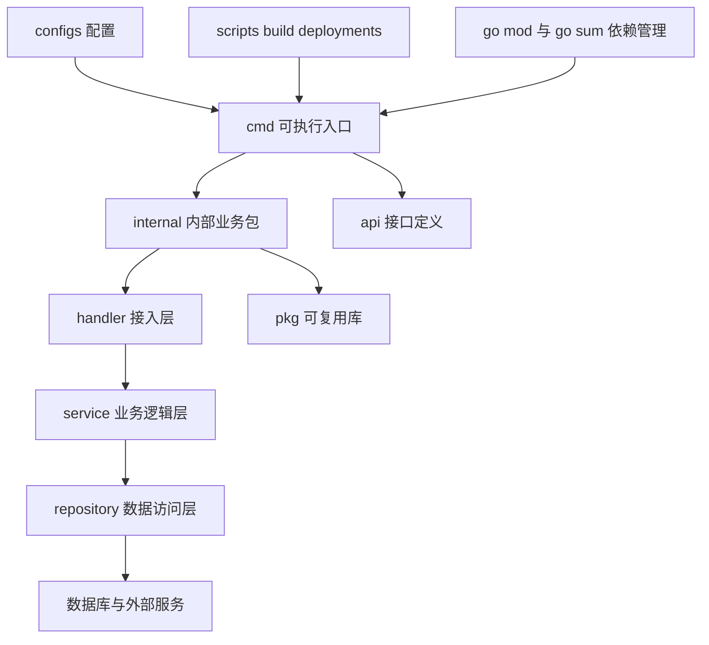
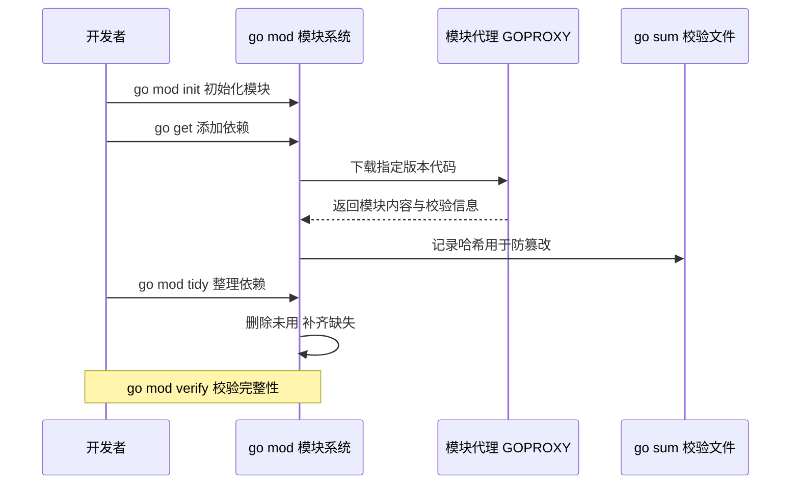
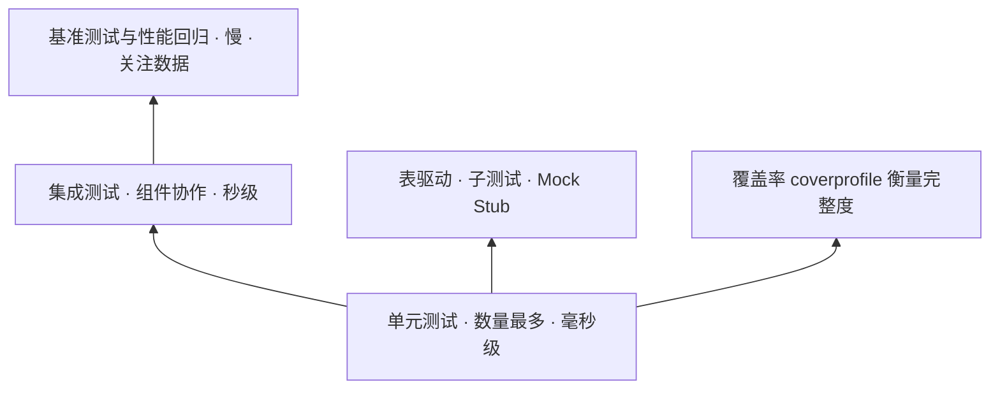
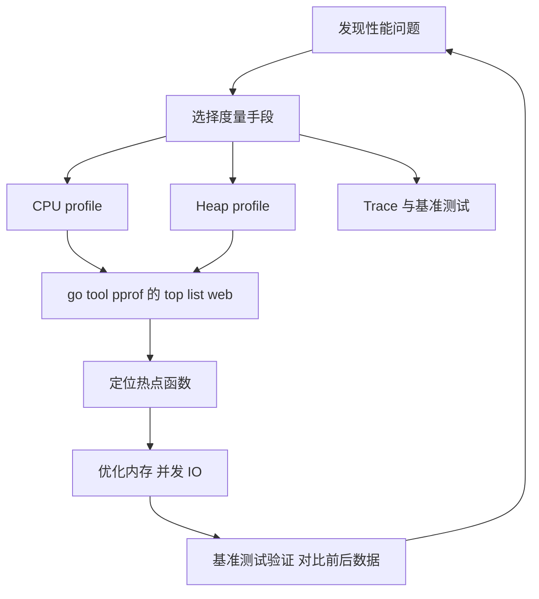
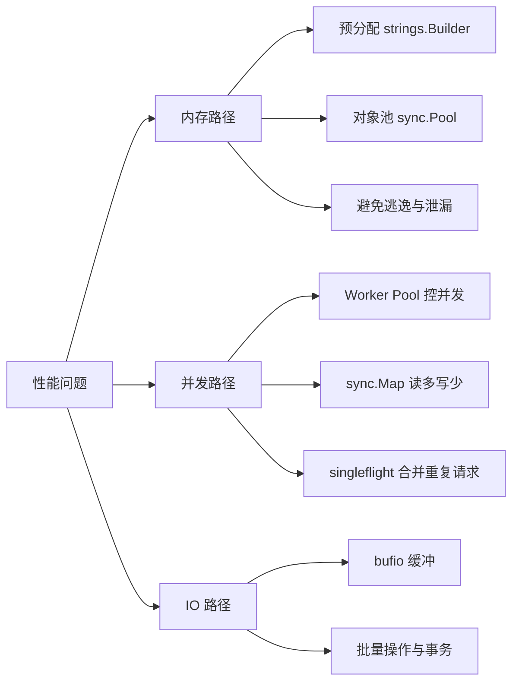
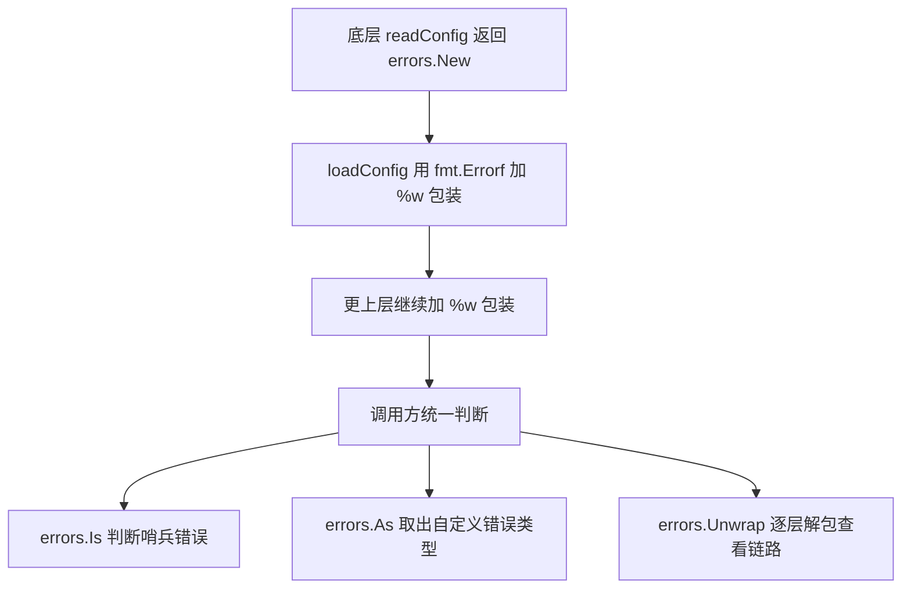
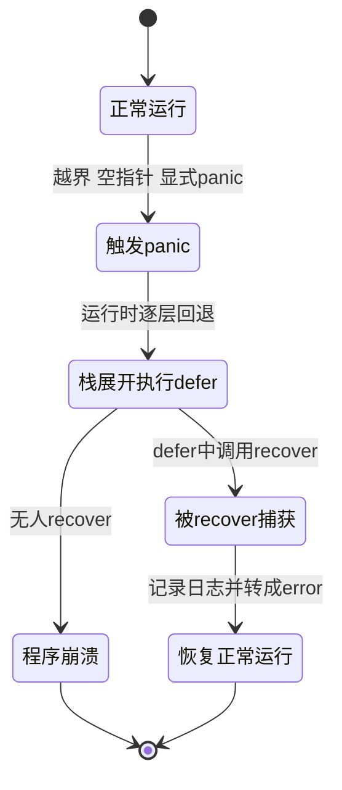

# Go语言工程实践

> 面向对象：已经会写 Go 基础语法，准备把代码从"能跑通"提升到"能维护、能协作、能上线"的同学。
> 阅读方式：每章先用一张 Mermaid 图建立整体认知，再讲"是什么、为什么"，然后给**可直接运行的最小示例**，最后补生产实践、常见坑、小结与面试题。
> 环境要求：Go 1.22+（示例涉及 `errors.Is/As`、`go mod`、`testing`、`runtime/pprof` 等标准库能力），Linux/macOS/Windows 均可运行。

## 目录

- [前言](#前言)
- [第一章：项目结构](#第一章项目结构)
  - [1.1 标准项目结构](#11-标准项目结构)
  - [1.2 模块管理](#12-模块管理)
  - [1.3 代码组织](#13-代码组织)
  - [1.4 构建配置](#14-构建配置)
  - [1.5 实例：创建一个新项目](#15-实例创建一个新项目)
  - [1.6 小结](#16-小结)
- [第二章：测试](#第二章测试)
  - [2.1 单元测试](#21-单元测试)
  - [2.2 测试辅助函数](#22-测试辅助函数)
  - [2.3 Mock和Stub](#23-mock和stub)
  - [2.4 集成测试](#24-集成测试)
  - [2.5 基准测试](#25-基准测试)
  - [2.6 测试覆盖率](#26-测试覆盖率)
  - [2.7 实例：完整的测试套件](#27-实例完整的测试套件)
  - [2.8 小结](#28-小结)
- [第三章：性能优化](#第三章性能优化)
  - [3.1 性能分析](#31-性能分析)
  - [3.2 内存优化](#32-内存优化)
  - [3.3 并发优化](#33-并发优化)
  - [3.4 I/O优化](#34-io优化)
  - [3.5 实例：性能优化案例](#35-实例性能优化案例)
  - [3.6 小结](#36-小结)
- [第四章：错误处理](#第四章错误处理)
  - [4.1 错误定义](#41-错误定义)
  - [4.2 错误处理模式](#42-错误处理模式)
  - [4.3 错误恢复](#43-错误恢复)
  - [4.4 错误日志](#44-错误日志)
  - [4.5 实例：完整的错误处理](#45-实例完整的错误处理)
  - [4.6 小结](#46-小结)
- [总结](#总结)
- [附录：高频面试题汇总](#附录高频面试题汇总)

---

## 前言

本文档将全面介绍Go语言的工程实践，帮助读者更好地理解和使用Go语言进行工程开发。通过学习本文档，你将掌握Go语言工程实践的核心概念和常用技巧，包括项目结构、测试、性能优化、错误处理、日志、配置管理等。

## 第一章：项目结构

工程实践的第一个问题不是"代码怎么写"，而是"代码放哪儿"。项目结构就像一栋楼的户型图：户型合理，住进去找东西顺手；户型混乱，东西随手一放就再也找不回。Go 官方没有强制目录规范，但社区演进出了一套被广泛认可的约定，先看整体分层：



一张图记住：**依赖自上而下单向流动，`cmd` 只做组装，真正的代码沉在 `internal` 里**。

### 1.1 标准项目结构

**是什么 / 为什么**：标准项目结构就是给"不同职责的代码"划好房间——`cmd` 是大门口（程序入口），`internal` 是自家卧室（只给自家用），`pkg` 是客厅（可以招待外人），`api`/`configs` 是水电图纸。这样划分的好处是：新人一眼能定位代码，工具（构建、测试、部署）也能按约定自动识别。

Go语言有一个推荐的目录结构，遵循这个结构可以让你的项目更易于维护和理解。

**基本项目结构**

```
myproject/
├── cmd/
│   ├── app1/
│   │   └── main.go
│   └── app2/
│       └── main.go
├── internal/
│   ├── pkg1/
│   │   └── pkg1.go
│   └── pkg2/
│       └── pkg2.go
├── pkg/
│   ├── pkg1/
│   │   └── pkg1.go
│   └── pkg2/
│       └── pkg2.go
├── api/
│   ├── proto/
│   │   └── service.proto
│   └── openapi/
│       └── api.yaml
├── web/
│   ├── static/
│   └── templates/
├── configs/
│   ├── config.yaml
│   └── config.prod.yaml
├── scripts/
│   ├── build.sh
│   └── deploy.sh
├── build/
│   └── docker/
│       └── Dockerfile
├── deployments/
│   ├── k8s/
│   │   └── deployment.yaml
│   └── docker-compose.yml
├── test/
│   ├── testdata/
│   └── integration/
├── docs/
│   ├── architecture.md
│   └── api.md
├── tools/
│   └── tools.go
├── go.mod
├── go.sum
├── Makefile
├── README.md
└── .gitignore
```

**目录说明**

- `cmd/`: 应用程序的入口点，每个子目录包含一个主程序
- `internal/`: 内部包，不能被外部项目导入
- `pkg/`: 外部可用的库代码
- `api/`: API定义文件，如protobuf、OpenAPI等
- `web/`: Web应用相关的静态资源和模板
- `configs/`: 配置文件
- `scripts/`: 构建和部署脚本
- `build/`: 构建配置和Dockerfile
- `deployments/`: 部署配置
- `test/`: 测试数据和集成测试
- `docs/`: 文档
- `tools/`: 工具和依赖管理
- `go.mod/go.sum`: Go模块依赖
- `Makefile`: 构建脚本
- `README.md`: 项目说明
- `.gitignore`: Git忽略文件

### 1.2 模块管理

**是什么 / 为什么**：模块（module）就是"一个可以被别人下载、版本可追溯的代码快递箱"。在没有模块的年代，代码只能放在 `GOPATH` 里，换个版本就像把全屋家具重新搬一遍；`go mod` 之后，每个项目自带一份"购物清单"（`go.mod`）和"收货单"（`go.sum`），谁依赖谁、版本是多少，一目了然。

一次典型的依赖管理流程如下：



Go模块是Go语言依赖管理的官方解决方案。

> ⚠️ 常见坑：`go get -u ./...` 会把所有依赖升到最新次要/补丁版本，可能引入不兼容变更；生产项目应精确升级单个依赖并跑测试，而不是一把梭全量更新。

**初始化模块**

```bash
# 初始化新模块
go mod init github.com/username/myproject

# 查看模块信息
go list -m all

# 查看依赖图
go mod graph
```

**添加依赖**

```bash
# 添加依赖
go get github.com/gin-gonic/gin

# 添加指定版本的依赖
go get github.com/gin-gonic/gin@v1.9.1

# 添加测试依赖
go get github.com/stretchr/testify@latest
```

**更新依赖**

```bash
# 更新所有依赖
go get -u ./...

# 更新指定依赖
go get -u github.com/gin-gonic/gin

# 整理依赖
go mod tidy

# 验证依赖
go mod verify
```

**vendor模式**

```bash
# 创建vendor目录
go mod vendor

# 使用vendor模式构建
go build -mod=vendor
```

### 1.3 代码组织

**是什么 / 为什么**：代码组织关心"一个包该装什么、一个文件该放什么"。可以类比成厨房：刀叉归一个抽屉（包），调料再分小盒（文件）。包名是别人调用你时打交道的"门牌"，所以越短越好、越能自解释越好。

> ⚠️ 常见坑：包名不要用复数、下划线或驼峰，也不要和标准库重名（如 `strings`、`http`），否则调用方必须起别名，极易混淆。

**包的命名**

```go
// 包名应该简短、小写、有意义
package user

// 避免使用下划线或驼峰命名
package user_service  // 不推荐
package userService   // 不推荐

// 避免使用复数形式
package users  // 不推荐
package user   // 推荐
```

**文件组织**

```go
// user.go - 主要类型定义
package user

type User struct {
    ID       string
    Name     string
    Email    string
    Password string
}

// user_repository.go - 数据访问层
package user

type Repository interface {
    FindByID(id string) (*User, error)
    Create(user *User) error
    Update(user *User) error
    Delete(id string) error
}

// user_service.go - 业务逻辑层
package user

type Service struct {
    repo Repository
}

func NewService(repo Repository) *Service {
    return &Service{repo: repo}
}

func (s *Service) CreateUser(user *User) error {
    return s.repo.Create(user)
}
```

### 1.4 构建配置

**Makefile示例**

```makefile
# 变量定义
APP_NAME=myapp
VERSION=$(shell git describe --tags --always --dirty)
BUILD_TIME=$(shell date +%FT%T%z)
GO_FLAGS=-ldflags="-X main.Version=$(VERSION) -X main.BuildTime=$(BUILD_TIME)"

# 默认目标
.PHONY: all
all: build

# 构建
.PHONY: build
build:
    go build $(GO_FLAGS) -o bin/$(APP_NAME) ./cmd/app

# 运行
.PHONY: run
run:
    go run ./cmd/app

# 测试
.PHONY: test
test:
    go test -v ./...

# 测试覆盖率
.PHONY: coverage
coverage:
    go test -coverprofile=coverage.out ./...
    go tool cover -html=coverage.out -o coverage.html

# 格式化代码
.PHONY: fmt
fmt:
    go fmt ./...

# 代码检查
.PHONY: lint
lint:
    golangci-lint run

# 清理
.PHONY: clean
clean:
    rm -rf bin/
    rm -f coverage.out coverage.html

# Docker构建
.PHONY: docker-build
docker-build:
    docker build -t $(APP_NAME):$(VERSION) .

# Docker运行
.PHONY: docker-run
docker-run:
    docker run -p 8080:8080 $(APP_NAME):$(VERSION)
```

### 1.5 实例：创建一个新项目

让我们创建一个简单的Web项目。

**项目结构**

```
mywebapp/
├── cmd/
│   └── server/
│       └── main.go
├── internal/
│   ├── handler/
│   │   └── handler.go
│   ├── service/
│   │   └── service.go
│   └── repository/
│       └── repository.go
├── pkg/
│   └── util/
│       └── util.go
├── configs/
│   └── config.yaml
├── go.mod
└── README.md
```

**main.go**

```go
package main

import (
    "log"
    "mywebapp/internal/handler"
    "mywebapp/internal/service"
    "mywebapp/internal/repository"
)

var (
    Version   = "dev"
    BuildTime = "unknown"
)

func main() {
    log.Printf("Starting server, version: %s, build time: %s", Version, BuildTime)
    
    repo := repository.NewRepository()
    svc := service.NewService(repo)
    h := handler.NewHandler(svc)
    
    if err := h.Run(":8080"); err != nil {
        log.Fatal(err)
    }
}
```

### 1.6 小结

本章介绍了Go语言的项目结构，包括标准项目结构、模块管理、代码组织、构建配置等。掌握好Go语言的项目结构对于编写可维护的项目非常重要。

下一章我们将学习Go语言的测试，包括单元测试、集成测试、基准测试、测试覆盖率等，以及它们的使用方法和注意事项。

**要点回顾**

- 标准结构按职责分层：`cmd` 入口、`internal` 私有、`pkg` 可复用、`api`/`configs`/`scripts` 各司其职。
- 依赖自上而下单向流动，`internal` 由编译器强制外部不可导入。
- 用 `go mod` 管理依赖，`go.mod` 记录清单、`go.sum` 保证完整性。
- 包名短小、小写、单数、无下划线；文件按职责拆分。

**面试题**

1. `internal/` 目录的作用是什么？Go 工具链是如何强制外部无法导入的？
2. `cmd/`、`internal/`、`pkg/` 三者职责如何划分？为什么社区常建议慎用 `pkg/`？
3. `go.mod` 与 `go.sum` 分别记录什么？`go mod tidy` 到底做了哪些事？
4. 什么是语义化导入版本（semantic import versioning）？为什么 v2 及以上的模块路径要带 `/v2`？
5. `go mod vendor` 解决什么问题？什么场景下应该使用 vendor 模式？

## 第二章：测试

测试就像给代码买保险：平时看不到收益，出事故时才救命。但保险也分种类——单元测试是"随身急救包"（快、多、便宜），集成测试是"住院观察"（慢、少、贵），基准测试则是"体能检测"（量性能）。先建立测试金字塔的整体印象：



原则：**越往下数量越多、越快、越稳定；越往上越少、越慢、越贴近真实环境。**

### 2.1 单元测试

**是什么 / 为什么**：单元测试就是"只测一个小零件"。比如测 `Add(2,3)` 等于 5，不牵扯数据库、网络、时间。它的价值在于把 bug 挡在函数门口，改代码时还能立刻告诉你"有没有踩到别的地方"——像汽车的安全带，平时不觉得，碰撞时保命。

Go语言内置了测试框架，使得编写单元测试变得非常简单。

**基本测试**

```go
package math

func Add(a, b int) int {
    return a + b
}

func Subtract(a, b int) int {
    return a - b
}
```

```go
package math

import "testing"

func TestAdd(t *testing.T) {
    result := Add(2, 3)
    expected := 5
    if result != expected {
        t.Errorf("Add(2, 3) = %d; want %d", result, expected)
    }
}

func TestSubtract(t *testing.T) {
    result := Subtract(5, 3)
    expected := 2
    if result != expected {
        t.Errorf("Subtract(5, 3) = %d; want %d", result, expected)
    }
}
```

**表驱动测试**

```go
package math

import "testing"

func TestAddTableDriven(t *testing.T) {
    tests := []struct {
        name     string
        a, b     int
        expected int
    }{
        {"positive", 2, 3, 5},
        {"negative", -2, -3, -5},
        {"mixed", 2, -3, -1},
        {"zero", 0, 0, 0},
    }

    for _, tt := range tests {
        t.Run(tt.name, func(t *testing.T) {
            result := Add(tt.a, tt.b)
            if result != tt.expected {
                t.Errorf("Add(%d, %d) = %d; want %d", tt.a, tt.b, result, tt.expected)
            }
        })
    }
}
```

**子测试**

```go
package math

import "testing"

func TestSubtractSubtests(t *testing.T) {
    t.Run("positive", func(t *testing.T) {
        result := Subtract(5, 3)
        if result != 2 {
            t.Errorf("expected 2, got %d", result)
        }
    })

    t.Run("negative", func(t *testing.T) {
        result := Subtract(-5, -3)
        if result != -2 {
            t.Errorf("expected -2, got %d", result)
        }
    })
}
```

### 2.2 测试辅助函数

**使用testing.T辅助函数**

```go
package math

import "testing"

func TestAddHelper(t *testing.T) {
    tests := []struct {
        a, b     int
        expected int
    }{
        {2, 3, 5},
        {-2, -3, -5},
        {0, 0, 0},
    }

    for _, tt := range tests {
        result := Add(tt.a, tt.b)
        if result != tt.expected {
            t.Fatalf("Add(%d, %d) = %d; want %d", tt.a, tt.b, result, tt.expected)
        }
    }
}
```

**使用assert库**

```go
package math

import (
    "testing"
    "github.com/stretchr/testify/assert"
)

func TestAddAssert(t *testing.T) {
    result := Add(2, 3)
    assert.Equal(t, 5, result, "Add(2, 3) should equal 5")
}

func TestAddTableDrivenAssert(t *testing.T) {
    tests := []struct {
        name     string
        a, b     int
        expected int
    }{
        {"positive", 2, 3, 5},
        {"negative", -2, -3, -5},
        {"zero", 0, 0, 0},
    }

    for _, tt := range tests {
        t.Run(tt.name, func(t *testing.T) {
            result := Add(tt.a, tt.b)
            assert.Equal(t, tt.expected, result)
        })
    }
}
```

### 2.3 Mock和Stub

**是什么 / 为什么**：Mock 和 Stub 都是"替身演员"。真实数据库又慢又难搭，测试时就让一个假对象顶上，按剧本返回预设结果。区别在于：Stub 只负责"给答案"，Mock 还会校验"你有没有按约定调用我"。Go 里最自然的替身方式是**用接口解耦**——只要 `Repository` 是接口，就能塞任意实现进去。

> ⚠️ 常见坑：接口要定义在**使用方**（service）而不是实现方，这样替身才好替换；过度 Mock 会让测试变成"测试 Mock 自己"，尽量只 Mock 外部边界（数据库、HTTP、时间）。

**使用接口进行Mock**

```go
package user

type Repository interface {
    FindByID(id string) (*User, error)
    Create(user *User) error
}

type Service struct {
    repo Repository
}

func (s *Service) GetUser(id string) (*User, error) {
    return s.repo.FindByID(id)
}
```

```go
package user

import "testing"

type MockRepository struct {
    users map[string]*User
}

func NewMockRepository() *MockRepository {
    return &MockRepository{
        users: make(map[string]*User),
    }
}

func (m *MockRepository) FindByID(id string) (*User, error) {
    return m.users[id], nil
}

func (m *MockRepository) Create(user *User) error {
    m.users[user.ID] = user
    return nil
}

func TestServiceGetUser(t *testing.T) {
    mockRepo := NewMockRepository()
    mockRepo.users["1"] = &User{ID: "1", Name: "Alice"}

    service := &Service{repo: mockRepo}
    user, err := service.GetUser("1")

    if err != nil {
        t.Fatalf("unexpected error: %v", err)
    }

    if user.Name != "Alice" {
        t.Errorf("expected name Alice, got %s", user.Name)
    }
}
```

### 2.4 集成测试

集成测试用于测试多个组件之间的交互。

**HTTP服务测试**

```go
package handler

import (
    "encoding/json"
    "net/http"
    "net/http/httptest"
    "testing"
)

func TestHandler(t *testing.T) {
    handler := NewHandler()

    req, err := http.NewRequest("GET", "/health", nil)
    if err != nil {
        t.Fatal(err)
    }

    rr := httptest.NewRecorder()
    handler.ServeHTTP(rr, req)

    if status := rr.Code; status != http.StatusOK {
        t.Errorf("handler returned wrong status code: got %v want %v", status, http.StatusOK)
    }

    expected := `{"status":"ok"}`
    if rr.Body.String() != expected {
        t.Errorf("handler returned unexpected body: got %v want %v", rr.Body.String(), expected)
    }
}
```

**数据库集成测试**

```go
package repository

import (
    "testing"
    "github.com/stretchr/testify/assert"
)

func TestUserRepository(t *testing.T) {
    db := setupTestDB(t)
    defer cleanupTestDB(t, db)

    repo := NewRepository(db)

    user := &User{
        ID:    "1",
        Name:  "Alice",
        Email: "alice@example.com",
    }

    err := repo.Create(user)
    assert.NoError(t, err)

    found, err := repo.FindByID("1")
    assert.NoError(t, err)
    assert.Equal(t, "Alice", found.Name)
}
```

### 2.5 基准测试

**是什么 / 为什么**：基准测试回答"这段代码到底多快"。它像跑步机上的计时器：让同一段代码反复跑 `b.N` 次，测出单次耗时与内存分配。没有它，性能优化就是"我觉得快了"；有了它，才能用数据证明"确实快了"。

> ⚠️ 常见坑：基准测试的循环体里不要做与测量无关的耗时操作（如打印、`b.ResetTimer` 之前的大初始化），否则测出来的是"杂音"；编译器还可能把没有副作用的结果优化掉，可用 `blackhole`变量或 `b.ReportAllocs` 观察。

基准测试用于测量代码的性能。

**基本基准测试**

```go
package math

import "testing"

func BenchmarkAdd(b *testing.B) {
    for i := 0; i < b.N; i++ {
        Add(2, 3)
    }
}

func BenchmarkSubtract(b *testing.B) {
    for i := 0; i < b.N; i++ {
        Subtract(5, 3)
    }
}
```

**带重置的基准测试**

```go
package math

import "testing"

func BenchmarkAddWithReset(b *testing.B) {
    b.ResetTimer()
    for i := 0; i < b.N; i++ {
        Add(2, 3)
    }
}
```

**并行基准测试**

```go
package math

import "testing"

func BenchmarkAddParallel(b *testing.B) {
    b.RunParallel(func(pb *testing.PB) {
        for pb.Next() {
            Add(2, 3)
        }
    })
}
```

### 2.6 测试覆盖率

测试覆盖率用于衡量测试的完整性。

**生成覆盖率报告**

```bash
# 生成覆盖率报告
go test -coverprofile=coverage.out ./...

# 查看覆盖率
go tool cover -func=coverage.out

# 生成HTML报告
go tool cover -html=coverage.out -o coverage.html
```

**设置覆盖率阈值**

```bash
# 检查覆盖率是否达到阈值
go test -coverprofile=coverage.out -covermode=atomic ./...
```

**在CI中使用覆盖率**

```yaml
name: CI

on: [push, pull_request]

jobs:
  test:
    runs-on: ubuntu-latest
    steps:
      - uses: actions/checkout@v2
      - uses: actions/setup-go@v2
        with:
          go-version: '1.21'
      - name: Test
        run: go test -v -race -coverprofile=coverage.out -covermode=atomic ./...
      - name: Coverage
        run: go tool cover -func=coverage.out
```

### 2.7 实例：完整的测试套件

让我们为一个用户服务创建完整的测试套件。

```go
package user

import (
    "testing"
    "github.com/stretchr/testify/assert"
    "github.com/stretchr/testify/mock"
)

type MockRepository struct {
    mock.Mock
}

func (m *MockRepository) FindByID(id string) (*User, error) {
    args := m.Called(id)
    if args.Get(0) == nil {
        return nil, args.Error(1)
    }
    return args.Get(0).(*User), args.Error(1)
}

func (m *MockRepository) Create(user *User) error {
    args := m.Called(user)
    return args.Error(0)
}

func TestServiceCreateUser(t *testing.T) {
    tests := []struct {
        name    string
        user    *User
        setup   func(*MockRepository)
        wantErr bool
    }{
        {
            name: "success",
            user: &User{ID: "1", Name: "Alice", Email: "alice@example.com"},
            setup: func(m *MockRepository) {
                m.On("Create", mock.AnythingOfType("*user.User")).Return(nil)
            },
            wantErr: false,
        },
        {
            name: "invalid email",
            user: &User{ID: "1", Name: "Alice", Email: "invalid"},
            setup: func(m *MockRepository) {
                m.On("Create", mock.AnythingOfType("*user.User")).Return(assert.AnError)
            },
            wantErr: true,
        },
    }

    for _, tt := range tests {
        t.Run(tt.name, func(t *testing.T) {
            mockRepo := new(MockRepository)
            tt.setup(mockRepo)

            service := &Service{repo: mockRepo}
            err := service.CreateUser(tt.user)

            if tt.wantErr {
                assert.Error(t, err)
            } else {
                assert.NoError(t, err)
            }

            mockRepo.AssertExpectations(t)
        })
    }
}
```

### 2.8 小结

本章介绍了Go语言的测试，包括单元测试、集成测试、基准测试、测试覆盖率等。我们学习了Go语言如何编写测试、使用测试辅助函数、进行Mock和Stub、测量性能等。掌握好Go语言的测试对于编写高质量的代码非常重要。

下一章我们将学习Go语言的性能优化，包括性能分析、内存优化、并发优化等，以及它们的使用方法和注意事项。

**要点回顾**

- `testing` 是内置框架，`*_test.go` + `TestXxx` 即可，无需第三方依赖。
- 表驱动 + 子测试（`t.Run`）是 Go 测试的惯用法，便于定位失败用例。
- `t.Error` 记录失败继续执行，`t.Fatal` / `t.Fatalf` 立即终止当前测试。
- Mock/Stub 通过接口解耦依赖，只替身外部边界。
- 基准测试用 `b.N` 衡量性能；覆盖率是参考线而非及格线。

**面试题**

1. 表驱动测试与子测试相比普通断言有什么好处？`t.Run` 的作用是什么？
2. `t.Error` 与 `t.Fatal` 的区别？什么时候必须用 `Fatal`？
3. 基准测试中 `b.N`、`b.ResetTimer`、`b.RunParallel` 分别解决什么问题？
4. 测试覆盖率能说明什么、不能说明什么？`-covermode` 有哪些取值？
5. `httptest.NewRecorder` 与 `httptest.NewServer` 各适合什么场景？

## 第三章：性能优化

性能优化不是"凭感觉改代码"，而是一场"先诊断、再开药、后复检"的流程。没有数据支撑的优化，往往是"把快的改慢、把简单的改复杂"。先记住这张定位瓶颈的路线图：



核心口诀：**先测量、再定位、后优化、必复检**，跳过任何一步都会返工。

### 3.1 性能分析

**是什么 / 为什么**：性能分析（profiling）就是给程序做"体检 + CT"。CPU profile 告诉你"时间都花在哪个函数了"，Heap profile 告诉你"内存都被谁占了"，Trace 告诉你"协程在哪儿排队阻塞了"。它像医院的检查设备，先拍片再决定动不动刀。

Go语言提供了强大的性能分析工具，帮助我们找出性能瓶颈。

**使用pprof进行CPU分析**

```go
package main

import (
    "log"
    "os"
    "runtime/pprof"
)

func fibonacci(n int) int {
    if n <= 1 {
        return n
    }
    return fibonacci(n-1) + fibonacci(n-2)
}

func main() {
    f, err := os.Create("cpu.prof")
    if err != nil {
        log.Fatal(err)
    }
    defer f.Close()

    if err := pprof.StartCPUProfile(f); err != nil {
        log.Fatal(err)
    }
    defer pprof.StopCPUProfile()

    for i := 0; i < 10; i++ {
        fibonacci(30)
    }
}
```

**分析CPU性能**

```bash
# 运行程序生成profile文件
go run main.go

# 分析profile文件
go tool pprof cpu.prof

# 在pprof交互界面中
top 10
list fibonacci
web
```

**使用pprof进行内存分析**

```go
package main

import (
    "log"
    "os"
    "runtime/pprof"
)

func main() {
    f, err := os.Create("mem.prof")
    if err != nil {
        log.Fatal(err)
    }
    defer f.Close()

    data := make([]byte, 1024*1024*100)
    _ = data

    if err := pprof.WriteHeapProfile(f); err != nil {
        log.Fatal(err)
    }
}
```

**HTTP pprof**

```go
package main

import (
    "log"
    "net/http"
    _ "net/http/pprof"
)

func main() {
    go func() {
        log.Println(http.ListenAndServe("localhost:6060", nil))
    }()

    select {}
}
```

访问 `http://localhost:6060/debug/pprof/` 查看性能分析页面。

### 3.2 内存优化

**是什么 / 为什么**：内存优化就是"少买垃圾、多复用"。程序里每一次 `make`、每一次字符串拼接，都在向操作系统申请房间；申请太频繁，GC 就要不停打扫卫生，CPU 就被拖慢。对策有两条：能一次申请够就一次申请够（预分配），能复用的对象就别扔（对象池）。

定位到瓶颈后，常见优化可以沿三条路径展开：



内存优化是提高程序性能的重要手段。

> ⚠️ 常见坑：`sync.Pool` 里的对象可能随时被 GC 回收，取出后必须当成"零值或脏值"处理并显式重置；用它省分配，但别用它当持久缓存。

**减少内存分配**

```go
// 不好的做法：频繁分配内存
func badConcatenate(strings []string) string {
    var result string
    for _, s := range strings {
        result += s
    }
    return result
}

// 好的做法：预分配内存
func goodConcatenate(strings []string) string {
    var builder strings.Builder
    builder.Grow(1024)
    for _, s := range strings {
        builder.WriteString(s)
    }
    return builder.String()
}
```

**使用对象池**

```go
package main

import (
    "sync"
)

type Buffer struct {
    data []byte
}

var bufferPool = sync.Pool{
    New: func() interface{} {
        return &Buffer{
            data: make([]byte, 1024),
        }
    },
}

func processData() {
    buf := bufferPool.Get().(*Buffer)
    defer bufferPool.Put(buf)

    buf.data[0] = 1
}

func main() {
    for i := 0; i < 1000; i++ {
        processData()
    }
}
```

**避免内存泄漏**

```go
// 不好的做法：goroutine泄漏
func badLeak() {
    ch := make(chan int)
    go func() {
        for {
            select {
            case <-ch:
            }
        }
    }()
}

// 好的做法：使用context取消
func goodLeak(ctx context.Context) {
    ch := make(chan int)
    go func() {
        for {
            select {
            case <-ctx.Done():
                return
            case <-ch:
            }
        }
    }()
}
```

### 3.3 并发优化

**是什么 / 为什么**：并发优化是"多请几个帮手同时干活"。但帮手不是越多越好——一个人排队等仓库（I/O）时，多派人有用；大家抢同一把锁（共享写）时，人越多越乱。所以并发优化的关键不是"开更多 goroutine"，而是**找到并行度合适的位置**。

> ⚠️ 常见坑：并发不是免费的，goroutine 泄漏、锁竞争、伪共享都会让性能不升反降；上线前务必用 `go test -race` 和 pprof 的 mutex/block profile 验证。

并发是Go语言的优势，正确使用并发可以大幅提高性能。

**使用Worker Pool**

```go
package main

import (
    "sync"
)

func worker(id int, jobs <-chan int, results chan<- int, wg *sync.WaitGroup) {
    defer wg.Done()
    for job := range jobs {
        results <- job * 2
    }
}

func main() {
    jobs := make(chan int, 100)
    results := make(chan int, 100)

    var wg sync.WaitGroup

    for i := 1; i <= 5; i++ {
        wg.Add(1)
        go worker(i, jobs, results, &wg)
    }

    for j := 1; j <= 100; j++ {
        jobs <- j
    }
    close(jobs)

    wg.Wait()
    close(results)

    for result := range results {
        _ = result
    }
}
```

**使用sync.Map**

```go
package main

import (
    "sync"
)

var cache sync.Map

func getFromCache(key string) (interface{}, bool) {
    return cache.Load(key)
}

func setCache(key string, value interface{}) {
    cache.Store(key, value)
}

func main() {
    setCache("key1", "value1")
    if value, ok := getFromCache("key1"); ok {
        _ = value
    }
}
```

**使用singleflight**

```go
package main

import (
    "sync"
    "time"
)

var (
    sf    singleflight.Group
    cache = make(map[string]string)
)

func getData(key string) (string, error) {
    if value, ok := cache[key]; ok {
        return value, nil
    }

    result, err, _ := sf.Do(key, func() (interface{}, error) {
        time.Sleep(time.Second)
        value := "data for " + key
        cache[key] = value
        return value, nil
    })

    if err != nil {
        return "", err
    }

    return result.(string), nil
}

func main() {
    var wg sync.WaitGroup
    for i := 0; i < 10; i++ {
        wg.Add(1)
        go func() {
            defer wg.Done()
            data, _ := getData("key1")
            _ = data
        }()
    }
    wg.Wait()
}
```

### 3.4 I/O优化

I/O操作通常是性能瓶颈，优化I/O可以显著提高性能。

**使用缓冲**

```go
package main

import (
    "bufio"
    "os"
)

func writeBuffered(filename string, data []string) error {
    file, err := os.Create(filename)
    if err != nil {
        return err
    }
    defer file.Close()

    writer := bufio.NewWriter(file)
    defer writer.Flush()

    for _, line := range data {
        _, err := writer.WriteString(line + "\n")
        if err != nil {
            return err
        }
    }

    return nil
}

func main() {
    data := []string{"line1", "line2", "line3"}
    writeBuffered("output.txt", data)
}
```

**批量操作**

```go
package main

import (
    "database/sql"
    "fmt"
)

func batchInsert(db *sql.DB, users []User) error {
    tx, err := db.Begin()
    if err != nil {
        return err
    }
    defer tx.Rollback()

    stmt, err := tx.Prepare("INSERT INTO users (name, email) VALUES (?, ?)")
    if err != nil {
        return err
    }
    defer stmt.Close()

    for _, user := range users {
        _, err := stmt.Exec(user.Name, user.Email)
        if err != nil {
            return err
        }
    }

    return tx.Commit()
}

type User struct {
    Name  string
    Email string
}

func main() {
    users := []User{
        {Name: "Alice", Email: "alice@example.com"},
        {Name: "Bob", Email: "bob@example.com"},
    }
    batchInsert(nil, users)
    fmt.Println("Batch insert completed")
}
```

### 3.5 实例：性能优化案例

让我们优化一个实际的性能问题。

**优化前的代码**

```go
package main

import (
    "fmt"
    "strings"
)

func processText(text string) string {
    var result string
    words := strings.Fields(text)
    
    for _, word := range words {
        result += strings.ToUpper(word) + " "
    }
    
    return result
}

func main() {
    text := "hello world this is a test"
    result := processText(text)
    fmt.Println(result)
}
```

**优化后的代码**

```go
package main

import (
    "fmt"
    "strings"
    "sync"
)

func processTextOptimized(text string) string {
    words := strings.Fields(text)
    var builder strings.Builder
    builder.Grow(len(text) * 2)
    
    for _, word := range words {
        builder.WriteString(strings.ToUpper(word))
        builder.WriteByte(' ')
    }
    
    return builder.String()
}

func processTextConcurrent(text string) string {
    words := strings.Fields(text)
    var wg sync.WaitGroup
    results := make([]string, len(words))
    
    for i, word := range words {
        wg.Add(1)
        go func(idx int, w string) {
            defer wg.Done()
            results[idx] = strings.ToUpper(w)
        }(i, word)
    }
    
    wg.Wait()
    
    var builder strings.Builder
    builder.Grow(len(text) * 2)
    for _, result := range results {
        builder.WriteString(result)
        builder.WriteByte(' ')
    }
    
    return builder.String()
}

func main() {
    text := "hello world this is a test"
    
    result1 := processTextOptimized(text)
    fmt.Println("Optimized:", result1)
    
    result2 := processTextConcurrent(text)
    fmt.Println("Concurrent:", result2)
}
```

### 3.6 小结

本章介绍了Go语言的性能优化，包括性能分析、内存优化、并发优化、I/O优化等。我们学习了Go语言如何进行性能分析、优化内存使用、提高并发性能、优化I/O操作等。掌握好Go语言的性能优化对于编写高性能的程序非常重要。

下一章我们将学习Go语言的错误处理，包括错误定义、错误处理模式、错误包装等，以及它们的使用方法和注意事项。

**要点回顾**

- 性能优化四步法：先测量、再定位、后优化、必复检。
- `runtime/pprof` 与 `net/http/pprof` 分别用于离线/在线采样；`go tool pprof` 的 `top`、`list`、`web` 是核心命令。
- 内存优化优先预分配、对象池、避免泄漏；`sync.Pool` 内容可能被 GC 清空。
- 并发优化要找对并行度，警惕 goroutine 泄漏与锁竞争。
- I/O 优化靠缓冲与批量，减少系统调用次数。

**面试题**

1. 如何用 pprof 定位 CPU 与内存瓶颈？`top`、`list`、`web` 分别看什么？
2. 为什么 `strings.Builder` 比 `+=` 拼接字符串性能好？`Grow` 的作用是什么？
3. `sync.Pool` 适合什么场景？为什么取出的对象不能假设是干净的？
4. Goroutine 泄漏的常见原因有哪些？如何排查与预防？
5. 基准测试如何配合 pprof 使用？`-benchmem` 输出的 allocs/op、B/op 分别代表什么？

## 第四章：错误处理

Go 把错误当成**普通的返回值**，而不是特殊的控制流。这看似啰嗦，实则是"显式优于隐式"：每个可能出错的地方都必须写 `if err != nil`，错误就无法被悄悄吞掉。先看懂一条错误从产生到被识别的完整链路：



关键点：**包装只是加一层"备注"，`%w` 让原始错误保留在链上，调用方仍能用 `Is`/`As` 识别它。**

### 4.1 错误定义

**是什么 / 为什么**：`error` 是一个只有 `Error() string` 方法的接口，任何实现了它的类型都是错误。可以把它理解成"快递面单"：面单上写了什么（错误信息）给你看，而面单背后的包裹（错误类型/字段）可以被 `errors.As` 打开检查。

Go语言的错误处理机制简单而强大，通过error接口实现。

**基本错误**

```go
package main

import (
    "errors"
    "fmt"
)

func divide(a, b int) (int, error) {
    if b == 0 {
        return 0, errors.New("division by zero")
    }
    return a / b, nil
}

func main() {
    result, err := divide(10, 0)
    if err != nil {
        fmt.Println("Error:", err)
        return
    }
    fmt.Println("Result:", result)
}
```

**自定义错误类型**

```go
package main

import "fmt"

type ValidationError struct {
    Field   string
    Message string
}

func (e *ValidationError) Error() string {
    return fmt.Sprintf("validation error on field %s: %s", e.Field, e.Message)
}

func validateUser(name, email string) error {
    if name == "" {
        return &ValidationError{Field: "name", Message: "name cannot be empty"}
    }
    if email == "" {
        return &ValidationError{Field: "email", Message: "email cannot be empty"}
    }
    return nil
}

func main() {
    err := validateUser("", "")
    if err != nil {
        fmt.Println("Validation error:", err)
        return
    }
}
```

**错误断言**

```go
package main

import (
    "errors"
    "fmt"
)

type MyError struct {
    Code    int
    Message string
}

func (e *MyError) Error() string {
    return fmt.Sprintf("error %d: %s", e.Code, e.Message)
}

func doSomething() error {
    return &MyError{Code: 404, Message: "not found"}
}

func main() {
    err := doSomething()
    if err != nil {
        var myErr *MyError
        if errors.As(err, &myErr) {
            fmt.Printf("MyError: Code=%d, Message=%s\n", myErr.Code, myErr.Message)
        } else {
            fmt.Println("Unknown error:", err)
        }
    }
}
```

### 4.2 错误处理模式

**是什么 / 为什么**：错误处理模式是"约定俗成的错误表达方式"。哨兵错误像路口的固定红灯（`ErrNotFound`），谁看到都知道什么意思；错误包装像给包裹贴便签（`加载配置失败: 文件不存在`），既有上下文又能顺藤摸瓜找到根因。选哪种，取决于调用方是想"精确判断"还是"看个大概"。

> ⚠️ 常见坑：用 `fmt.Errorf` 包装时若写成 `%v`（而非 `%w`），错误链会断掉，`errors.Is/As` 将无法识别原始错误；只在需要被上层识别的边界用 `%w`，避免无意义地层层包装。

Go语言有多种错误处理模式，可以根据场景选择合适的模式。

**Sentinel错误**

```go
package main

import (
    "errors"
    "fmt"
)

var (
    ErrUserNotFound = errors.New("user not found")
    ErrInvalidInput = errors.New("invalid input")
)

func getUser(id int) (string, error) {
    if id <= 0 {
        return "", ErrInvalidInput
    }
    if id == 999 {
        return "", ErrUserNotFound
    }
    return "user", nil
}

func main() {
    _, err := getUser(999)
    if errors.Is(err, ErrUserNotFound) {
        fmt.Println("User not found")
        return
    }
    if errors.Is(err, ErrInvalidInput) {
        fmt.Println("Invalid input")
        return
    }
}
```

**错误包装**

```go
package main

import (
    "errors"
    "fmt"
)

func readConfig() error {
    return errors.New("config file not found")
}

func loadConfig() error {
    err := readConfig()
    if err != nil {
        return fmt.Errorf("failed to load config: %w", err)
    }
    return nil
}

func main() {
    err := loadConfig()
    if err != nil {
        fmt.Println("Error:", err)
        
        var originalErr error
        if errors.As(err, &originalErr) {
            fmt.Println("Original error:", originalErr)
        }
    }
}
```

**错误链**

```go
package main

import (
    "errors"
    "fmt"
)

func step1() error {
    return errors.New("step1 failed")
}

func step2() error {
    err := step1()
    if err != nil {
        return fmt.Errorf("step2: %w", err)
    }
    return nil
}

func step3() error {
    err := step2()
    if err != nil {
        return fmt.Errorf("step3: %w", err)
    }
    return nil
}

func main() {
    err := step3()
    if err != nil {
        fmt.Println("Error chain:")
        fmt.Println(err)
        
        for err != nil {
            fmt.Println("  -", err)
            err = errors.Unwrap(err)
        }
    }
}
```

### 4.3 错误恢复

**是什么 / 为什么**：`panic` 是"程序自己按下了紧急弹射按钮"，`recover` 是"在弹射瞬间张开降落伞"。普通错误应该用 `error` 返回处理；只有当程序已经处于无法继续的不一致状态（如启动时配置缺失、不可恢复的编程错误）才用 panic。它像火灾警报——不该天天响，但响了要有预案。



Go语言的panic和recover机制用于处理不可恢复的错误。

> ⚠️ 常见坑：`recover` 只有在 `defer` 中直接调用才有效；在协程里不要裸 panic 而不 recover，否则整个进程会崩——服务端要保证每个请求的 goroutine 都有兜底 recover。

**Panic和Recover**

```go
package main

import "fmt"

func riskyOperation() {
    defer func() {
        if r := recover(); r != nil {
            fmt.Println("Recovered from panic:", r)
        }
    }()
    
    fmt.Println("Starting risky operation")
    panic("something went wrong")
    fmt.Println("This won't be printed")
}

func main() {
    riskyOperation()
    fmt.Println("Program continues")
}
```

**在HTTP处理中使用Recover**

```go
package main

import (
    "fmt"
    "net/http"
)

func recoverMiddleware(next http.Handler) http.Handler {
    return http.HandlerFunc(func(w http.ResponseWriter, r *http.Request) {
        defer func() {
            if r := recover(); r != nil {
                http.Error(w, "Internal Server Error", http.StatusInternalServerError)
                fmt.Println("Recovered from panic:", r)
            }
        }()
        next.ServeHTTP(w, r)
    })
}

func handler(w http.ResponseWriter, r *http.Request) {
    panic("unexpected error")
}

func main() {
    mux := http.NewServeMux()
    mux.HandleFunc("/", handler)
    
    wrapped := recoverMiddleware(mux)
    http.ListenAndServe(":8080", wrapped)
}
```

### 4.4 错误日志

记录错误对于调试和监控非常重要。

**使用log包**

```go
package main

import (
    "log"
    "os"
)

func main() {
    logFile, err := os.OpenFile("errors.log", os.O_APPEND|os.O_CREATE|os.O_WRONLY, 0644)
    if err != nil {
        log.Fatal(err)
    }
    defer logFile.Close()

    log.SetOutput(logFile)
    log.SetFlags(log.Ldate | log.Ltime | log.Lshortfile)

    log.Println("Application started")
    log.Printf("Processing item %d", 1)
    log.Println("Application finished")
}
```

**结构化日志**

```go
package main

import (
    "encoding/json"
    "log"
    "os"
    "time"
)

type Logger struct {
    logger *log.Logger
}

func NewLogger(filename string) *Logger {
    file, err := os.OpenFile(filename, os.O_APPEND|os.O_CREATE|os.O_WRONLY, 0644)
    if err != nil {
        log.Fatal(err)
    }
    return &Logger{
        logger: log.New(file, "", 0),
    }
}

func (l *Logger) Log(level, message string, fields map[string]interface{}) {
    entry := map[string]interface{}{
        "time":    time.Now().Format(time.RFC3339),
        "level":   level,
        "message": message,
    }
    
    for k, v := range fields {
        entry[k] = v
    }
    
    data, _ := json.Marshal(entry)
    l.logger.Println(string(data))
}

func main() {
    logger := NewLogger("app.log")
    
    logger.Log("INFO", "Application started", map[string]interface{}{
        "version": "1.0.0",
    })
    
    logger.Log("ERROR", "Failed to process request", map[string]interface{}{
        "error": "invalid input",
        "path":  "/api/users",
    })
}
```

### 4.5 实例：完整的错误处理

让我们为一个用户服务实现完整的错误处理。

```go
package user

import (
    "errors"
    "fmt"
)

var (
    ErrUserNotFound    = errors.New("user not found")
    ErrInvalidEmail    = errors.New("invalid email")
    ErrUserExists      = errors.New("user already exists")
    ErrInvalidPassword = errors.New("invalid password")
)

type ValidationError struct {
    Field   string
    Message string
}

func (e *ValidationError) Error() string {
    return fmt.Sprintf("validation error: %s", e.Message)
}

type User struct {
    ID       string
    Name     string
    Email    string
    Password string
}

type Service struct {
    repo Repository
}

func (s *Service) CreateUser(user *User) error {
    if err := s.validateUser(user); err != nil {
        return fmt.Errorf("validation failed: %w", err)
    }
    
    exists, err := s.repo.ExistsByEmail(user.Email)
    if err != nil {
        return fmt.Errorf("check user existence: %w", err)
    }
    
    if exists {
        return ErrUserExists
    }
    
    if err := s.repo.Create(user); err != nil {
        return fmt.Errorf("create user: %w", err)
    }
    
    return nil
}

func (s *Service) validateUser(user *User) error {
    if user.Name == "" {
        return &ValidationError{Field: "name", Message: "name cannot be empty"}
    }
    
    if user.Email == "" {
        return &ValidationError{Field: "email", Message: "email cannot be empty"}
    }
    
    if !isValidEmail(user.Email) {
        return ErrInvalidEmail
    }
    
    if user.Password == "" {
        return &ValidationError{Field: "password", Message: "password cannot be empty"}
    }
    
    if len(user.Password) < 8 {
        return ErrInvalidPassword
    }
    
    return nil
}

func isValidEmail(email string) bool {
    return len(email) > 5 && email[len(email)-4:] == ".com"
}

type Repository interface {
    ExistsByEmail(email string) (bool, error)
    Create(user *User) error
}
```

### 4.6 小结

本章介绍了Go语言的错误处理，包括错误定义、错误处理模式、错误包装、错误恢复、错误日志等。我们学习了Go语言如何定义错误、处理错误、包装错误、恢复panic、记录错误等。掌握好Go语言的错误处理对于编写健壮的程序非常重要。

**要点回顾**

- `error` 是接口，用 `errors.New` 造哨兵，用自定义类型携带结构化信息。
- `fmt.Errorf` 的 `%w` 保留错误链，`%v` 会断链。
- `errors.Is` 判"是不是某类错误"，`errors.As` 取"某类错误的具体值"，`errors.Unwrap` 逐层解包。
- panic/recover 只用于不可恢复场景，服务端必须有兜底 recover。
- 错误要记录上下文，但避免同一错误在每个层级重复打印。

**面试题**

1. Go 的 `error` 接口设计相比异常机制有什么优劣？为什么不用 try/catch？
2. `errors.Is`、`errors.As`、`errors.Unwrap` 的区别与各自适用场景？
3. `fmt.Errorf` 中 `%w` 与 `%v` 的区别？错误链断开会带来什么后果？
4. 自定义错误类型为什么常用指针接收者实现 `Error`？`errors.As` 的目标参数要注意什么？
5. `panic`/`recover` 适合什么场景？为什么滥用 recover 是反模式？

## 总结

本文档全面介绍了Go语言的工程实践，包括：

1. **项目结构**：标准项目结构、模块管理、代码组织、构建配置
2. **测试**：单元测试、集成测试、基准测试、测试覆盖率
3. **性能优化**：性能分析、内存优化、并发优化、I/O优化
4. **错误处理**：错误定义、错误处理模式、错误包装、错误恢复、错误日志

通过学习本文档，你应该对Go语言的工程实践有了全面的了解，能够更好地使用Go语言进行工程开发。希望本文档能够帮助你在Go语言的学习之路上更进一步！

## 附录：高频面试题汇总

**项目结构与工程化**

1. `cmd/`、`internal/`、`pkg/` 的职责如何划分？`internal` 为什么外部无法导入？
2. `go.mod` 与 `go.sum` 分别记录什么？`go mod tidy` 做了什么？
3. 什么是语义化导入版本？v2+ 模块路径为什么要带 `/v2`？
4. vendor 模式解决什么问题？什么场景该用、什么场景不该用？
5. 一个标准的 Go 项目需要哪些构建/发布配套（Makefile、Dockerfile、CI）？

**测试**

6. 表驱动测试与子测试的好处？`t.Run` 有什么用？
7. `t.Error` 与 `t.Fatal` 的区别？
8. 基准测试中 `b.N`、`b.ResetTimer`、`b.RunParallel` 的作用？
9. 测试覆盖率能说明什么、不能说明什么？
10. `httptest.NewRecorder` 与 `httptest.NewServer` 的区别与适用场景？
11. 如何用接口 + Mock 隔离外部依赖？接口应该定义在哪一侧？

**性能优化**

12. pprof 能定位哪些问题？`top`、`list`、`web` 分别怎么看？
13. `net/http/pprof` 在线采样的安全注意事项有哪些？
14. 为什么 `strings.Builder` 比 `+=` 快？预分配为什么重要？
15. `sync.Pool` 适合什么场景？有什么坑？
16. Goroutine 泄漏的常见原因与排查手段？
17. 如何理解"并发不等于并行"？Worker Pool 解决什么问题？
18. `-benchmem` 的 allocs/op、B/op 分别代表什么？
19. 内存优化的三条常见路径是什么？

**错误处理**

20. Go 的 `error` 接口相比异常机制的优劣？
21. `errors.Is`、`errors.As`、`errors.Unwrap` 的区别与应用？
22. `fmt.Errorf` 的 `%w` 与 `%v` 有何本质区别？
23. 哨兵错误与自定义错误类型分别适合什么场景？
24. `panic`/`recover` 的正确使用姿势与常见误用？
25. 服务端如何通过 middleware 统一兜底 recover 并记录错误日志？