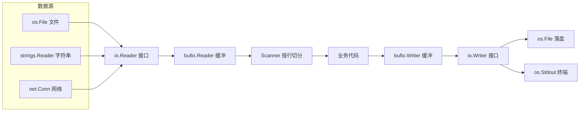
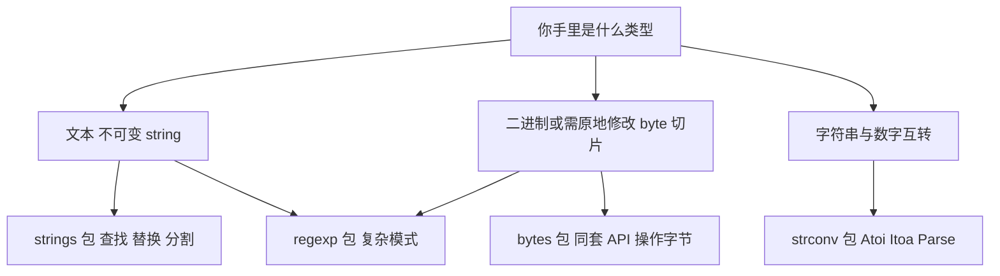
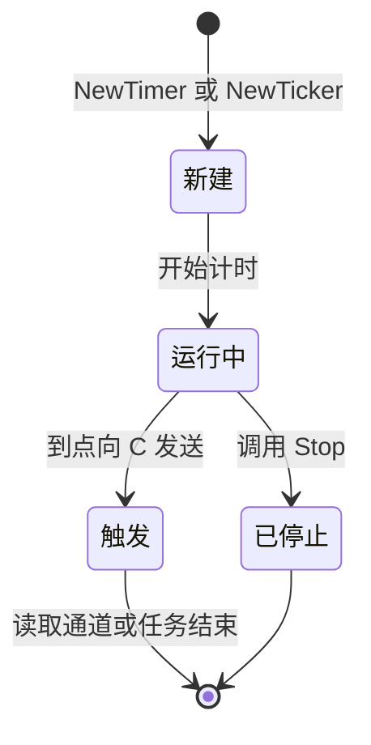
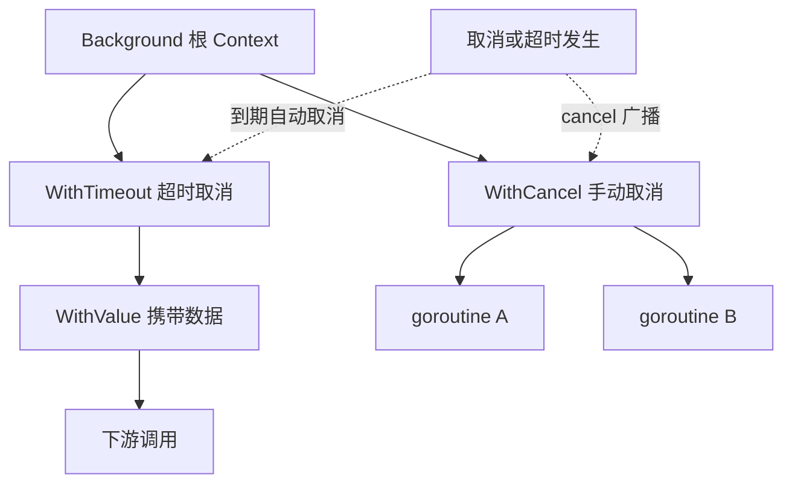

# Go语言标准库

> 面向对象：会写 Go 基础语法、想系统掌握标准库并准备面试的开发者。
> 阅读方式：每章先用一张 Mermaid 总览图建立全局认识，再讲"是什么、为什么"，最后补"生产环境要注意什么"。
> 环境要求：Go 1.22+（文中示例均可直接 `go run`；`io`、`bufio`、`context`、`sync/atomic` 等均为标准库自带，无需第三方依赖），Linux/macOS/Windows 均可。

## 目录

- [第一章：输入输出](#第一章输入输出)
  - [1.1 fmt包](#11-fmt包)
  - [1.2 io包](#12-io包)
  - [1.3 bufio包](#13-bufio包)
  - [1.4 os包](#14-os包)
  - [1.5 实例：文件复制工具](#15-实例文件复制工具)
  - [1.6 小结](#16-小结)
- [第二章：字符串处理](#第二章字符串处理)
  - [2.1 strings包](#21-strings包)
  - [2.2 strconv包](#22-strconv包)
  - [2.3 regexp包](#23-regexp包)
  - [2.4 bytes包](#24-bytes包)
  - [2.5 实例：文本分析工具](#25-实例文本分析工具)
  - [2.6 小结](#26-小结)
- [第三章：时间处理](#第三章时间处理)
  - [3.1 time包](#31-time包)
  - [3.2 Duration](#32-duration)
  - [3.3 Timer](#33-timer)
  - [3.4 Ticker](#34-ticker)
  - [3.5 时区处理](#35-时区处理)
  - [3.6 实例：倒计时器](#36-实例倒计时器)
  - [3.7 小结](#37-小结)
- [第四章：并发编程](#第四章并发编程)
  - [4.1 sync包](#41-sync包)
  - [4.2 context包](#42-context包)
  - [4.3 atomic包](#43-atomic包)
  - [4.4 sync/atomic包](#44-syncatomic包)
  - [4.5 实例：并发任务处理器](#45-实例并发任务处理器)
  - [4.6 小结](#46-小结)
- [总结](#总结)
- [附录：高频面试题汇总](#附录高频面试题汇总)

---

## 前言

本文档将全面介绍Go语言的标准库，帮助读者更好地理解和使用Go语言提供的丰富功能。通过学习本文档，你将掌握Go语言标准库的核心包和常用功能，包括输入输出、字符串处理、时间处理、网络编程、并发编程等。

## 第一章：输入输出

> 本章脉络：`io` 定义"读写"的抽象接口，`fmt` 负责格式化，`bufio` 在接口之上加缓冲，`os` 落到真实文件与进程。抓住 **Reader/Writer 两个接口 + 缓冲层** 这条主线，本章就通了。



### 1.1 fmt包

fmt包提供了格式化输入输出功能，是Go语言中最常用的包之一。

**格式化输出**

```go
func main() {
    // Print系列函数
    fmt.Print("Hello, ")
    fmt.Println("World!")
    
    // Printf格式化输出
    name := "Alice"
    age := 30
    fmt.Printf("姓名: %s, 年龄: %d\n", name, age)
    
    // 格式化动词
    fmt.Printf("二进制: %b\n", 10)
    fmt.Printf("八进制: %o\n", 10)
    fmt.Printf("十六进制: %x\n", 10)
    fmt.Printf("浮点数: %.2f\n", 3.14159)
    fmt.Printf("布尔值: %t\n", true)
    fmt.Printf("指针: %p\n", &name)
}
```

**格式化输入**

```go
func main() {
    var name string
    var age int
    
    fmt.Print("请输入姓名: ")
    fmt.Scan(&name)
    
    fmt.Print("请输入年龄: ")
    fmt.Scan(&age)
    
    fmt.Printf("姓名: %s, 年龄: %d\n", name, age)
}
```

**Sprintf格式化字符串**

```go
func main() {
    name := "Bob"
    age := 25
    
    // 格式化字符串
    message := fmt.Sprintf("姓名: %s, 年龄: %d", name, age)
    fmt.Println(message)
    
    // 格式化到缓冲区
    var buf bytes.Buffer
    fmt.Fprintf(&buf, "姓名: %s, 年龄: %d", name, age)
    fmt.Println(buf.String())
}
```

### 1.2 io包

io包提供了基本的I/O原语，是所有I/O操作的基础。

**是什么 / 为什么**：`io.Reader` 和 `io.Writer` 是 Go 标准库的"插座标准"。可以把它们想象成水管接头——只要一头是 Reader（能往外"抽"数据），另一头是 Writer（能往里"灌"数据），任何组合都能对接。文件、网络连接、内存缓冲区、压缩流……全都实现了这两个接口，所以 `io.Copy(dst, src)` 才能完全不认识具体类型却完成复制。这就是"面向接口编程"最朴素的红利：**写一次代码，适配所有数据源**。

> 💡 组合优于继承：`io.TeeReader`、`io.MultiWriter`、`io.LimitReader` 都只是"把 Reader/Writer 包一层"，就能加上"边读边备份""同时写多处""限制读取上限"的能力。

> ⚠️ 常见坑：`r.Read` 返回的 `n` 可能小于 `len(buf)`，也可能是 `(0, nil)`。**绝不能假设一次 Read 就读满**，循环读取要用 `io.ReadFull` 或判断 `err == io.EOF`。读取类函数里忘记 `defer file.Close()` 会导致文件描述符泄漏。

**Reader接口**

```go
func readFromReader(r io.Reader) {
    buf := make([]byte, 1024)
    n, err := r.Read(buf)
    if err != nil && err != io.EOF {
        fmt.Println("读取错误:", err)
        return
    }
    fmt.Printf("读取了 %d 字节: %s\n", n, buf[:n])
}

func main() {
    // 从字符串读取
    reader := strings.NewReader("Hello, World!")
    readFromReader(reader)
    
    // 从文件读取
    file, err := os.Open("test.txt")
    if err != nil {
        fmt.Println("打开文件错误:", err)
        return
    }
    defer file.Close()
    readFromReader(file)
}
```

**Writer接口**

```go
func writeToWriter(w io.Writer, data string) {
    n, err := w.Write([]byte(data))
    if err != nil {
        fmt.Println("写入错误:", err)
        return
    }
    fmt.Printf("写入了 %d 字节\n", n)
}

func main() {
    // 写入到标准输出
    writeToWriter(os.Stdout, "Hello, World!\n")
    
    // 写入到缓冲区
    var buf bytes.Buffer
    writeToWriter(&buf, "Hello, Buffer!")
    fmt.Println(buf.String())
}
```

**Copy复制数据**

```go
func copyData(src, dst string) error {
    srcFile, err := os.Open(src)
    if err != nil {
        return err
    }
    defer srcFile.Close()
    
    dstFile, err := os.Create(dst)
    if err != nil {
        return err
    }
    defer dstFile.Close()
    
    _, err = io.Copy(dstFile, srcFile)
    return err
}

func main() {
    err := copyData("source.txt", "destination.txt")
    if err != nil {
        fmt.Println("复制失败:", err)
        return
    }
    fmt.Println("复制成功")
}
```

### 1.3 bufio包

bufio包提供了带缓冲的I/O操作，可以提高I/O性能。

**是什么 / 为什么**：直接对文件做"读一个字节"或"写一个字符"是昂贵的系统调用，就像你每次只从超市扛一袋米回家，来回跑断腿。`bufio` 相当于给你配了一辆货车：一次拉一整箱（默认 4096 字节）放家里，用的时候从箱子里拿。写方向同理——先攒在内存缓冲区，攒够或手动 `Flush` 时再一次性写出去。

> ⚠️ 常见坑：用了 `bufio.Writer` **必须 `Flush()`**（或 `defer writer.Flush()`），否则缓冲区里没攒满的数据根本不会落盘，程序退出后数据凭空消失——这是新手最常见的"文件写空"事故。

> ⚠️ 常见坑：`bufio.Scanner` 单行默认上限约 64KB（`bufio.MaxScanTokenSize`），遇到超长行会报 `token too long`。此时应改用 `bufio.Reader` 的 `ReadString('\n')`，或调用 `scanner.Buffer` 扩大上限。

**带缓冲的读取**

```go
func readLines(filename string) ([]string, error) {
    file, err := os.Open(filename)
    if err != nil {
        return nil, err
    }
    defer file.Close()
    
    scanner := bufio.NewScanner(file)
    var lines []string
    
    for scanner.Scan() {
        lines = append(lines, scanner.Text())
    }
    
    if err := scanner.Err(); err != nil {
        return nil, err
    }
    
    return lines, nil
}

func main() {
    lines, err := readLines("test.txt")
    if err != nil {
        fmt.Println("读取失败:", err)
        return
    }
    
    for i, line := range lines {
        fmt.Printf("行 %d: %s\n", i+1, line)
    }
}
```

**带缓冲的写入**

```go
func writeLines(filename string, lines []string) error {
    file, err := os.Create(filename)
    if err != nil {
        return err
    }
    defer file.Close()
    
    writer := bufio.NewWriter(file)
    for _, line := range lines {
        _, err := writer.WriteString(line + "\n")
        if err != nil {
            return err
        }
    }
    
    return writer.Flush()
}

func main() {
    lines := []string{"第一行", "第二行", "第三行"}
    err := writeLines("output.txt", lines)
    if err != nil {
        fmt.Println("写入失败:", err)
        return
    }
    fmt.Println("写入成功")
}
```

### 1.4 os包

os包提供了与操作系统交互的功能，包括文件操作、环境变量、进程管理等。

**文件操作**

```go
func fileOperations() {
    // 创建文件
    file, err := os.Create("test.txt")
    if err != nil {
        fmt.Println("创建文件失败:", err)
        return
    }
    defer file.Close()
    
    // 写入文件
    _, err = file.WriteString("Hello, World!")
    if err != nil {
        fmt.Println("写入文件失败:", err)
        return
    }
    
    // 读取文件
    data, err := os.ReadFile("test.txt")
    if err != nil {
        fmt.Println("读取文件失败:", err)
        return
    }
    fmt.Println("文件内容:", string(data))
    
    // 删除文件
    err = os.Remove("test.txt")
    if err != nil {
        fmt.Println("删除文件失败:", err)
        return
    }
    fmt.Println("文件已删除")
}

func main() {
    fileOperations()
}
```

**目录操作**

```go
func directoryOperations() {
    // 创建目录
    err := os.Mkdir("testdir", 0755)
    if err != nil {
        fmt.Println("创建目录失败:", err)
        return
    }
    
    // 创建多级目录
    err = os.MkdirAll("testdir/subdir1/subdir2", 0755)
    if err != nil {
        fmt.Println("创建多级目录失败:", err)
        return
    }
    
    // 读取目录
    entries, err := os.ReadDir("testdir")
    if err != nil {
        fmt.Println("读取目录失败:", err)
        return
    }
    
    for _, entry := range entries {
        fmt.Printf("名称: %s, 是否目录: %t\n", entry.Name(), entry.IsDir())
    }
    
    // 删除目录
    err = os.RemoveAll("testdir")
    if err != nil {
        fmt.Println("删除目录失败:", err)
        return
    }
    fmt.Println("目录已删除")
}

func main() {
    directoryOperations()
}
```

**环境变量**

```go
func environmentVariables() {
    // 获取环境变量
    path := os.Getenv("PATH")
    fmt.Println("PATH:", path)
    
    // 设置环境变量
    os.Setenv("MY_VAR", "my_value")
    myVar := os.Getenv("MY_VAR")
    fmt.Println("MY_VAR:", myVar)
    
    // 获取所有环境变量
    envs := os.Environ()
    for _, env := range envs {
        fmt.Println(env)
    }
    
    // 清除环境变量
    os.Unsetenv("MY_VAR")
}

func main() {
    environmentVariables()
}
```

### 1.5 实例：文件复制工具

让我们用一个实际的例子来巩固本章学到的知识。我们将实现一个文件复制工具。

```go
package main

import (
    "bufio"
    "flag"
    "fmt"
    "io"
    "os"
)

func copyFile(src, dst string, bufferSize int) error {
    srcFile, err := os.Open(src)
    if err != nil {
        return fmt.Errorf("打开源文件失败: %w", err)
    }
    defer srcFile.Close()
    
    dstFile, err := os.Create(dst)
    if err != nil {
        return fmt.Errorf("创建目标文件失败: %w", err)
    }
    defer dstFile.Close()
    
    srcReader := bufio.NewReaderSize(srcFile, bufferSize)
    dstWriter := bufio.NewWriterSize(dstFile, bufferSize)
    defer dstWriter.Flush()
    
    _, err = io.Copy(dstWriter, srcReader)
    if err != nil {
        return fmt.Errorf("复制文件失败: %w", err)
    }
    
    srcInfo, err := os.Stat(src)
    if err != nil {
        return fmt.Errorf("获取源文件信息失败: %w", err)
    }
    
    err = os.Chmod(dst, srcInfo.Mode())
    if err != nil {
        return fmt.Errorf("设置文件权限失败: %w", err)
    }
    
    return nil
}

func main() {
    src := flag.String("src", "", "源文件路径")
    dst := flag.String("dst", "", "目标文件路径")
    bufferSize := flag.Int("buffer", 4096, "缓冲区大小")
    flag.Parse()
    
    if *src == "" || *dst == "" {
        fmt.Println("请指定源文件和目标文件")
        flag.Usage()
        os.Exit(1)
    }
    
    fmt.Printf("复制文件: %s -> %s\n", *src, *dst)
    err := copyFile(*src, *dst, *bufferSize)
    if err != nil {
        fmt.Println("复制失败:", err)
        os.Exit(1)
    }
    
    fmt.Println("复制成功")
}
```

运行这个程序：

```bash
go run main.go -src source.txt -dst destination.txt -buffer 8192
```

### 1.6 小结

本章介绍了Go语言的输入输出，包括fmt包、io包、bufio包、os包等。我们学习了Go语言如何进行格式化输入输出、文件操作、目录操作等。掌握好Go语言的输入输出对于编写实用的Go程序非常重要。

下一章我们将学习Go语言的字符串处理，包括strings包、strconv包、regexp包等，以及它们的使用方法和注意事项。

**面试题**

1. `io.Reader` 和 `io.Writer` 接口各只有一个方法，为什么这么设计？带来了什么好处？
2. `io.Copy` 的工作原理是什么？它内部做了什么优化？
3. `bufio.Scanner` 的默认单行大小上限是多少？遇到超长行怎么处理？
4. `bufio.Writer` 忘记 `Flush` 会发生什么？`defer` 与显式 `Flush` 该如何配合？
5. `os.ReadFile` 和手动 `Open`+`io.Copy` 复制文件有什么区别？各自适用什么场景？

## 第二章：字符串处理

> 本章脉络：先分清三种类型的分工——`string` 处理文本、`[]byte` 处理可变字节、`strconv` 负责字符串与数字互转；`regexp` 在两者之上做复杂模式匹配。



### 2.1 strings包

strings包提供了字符串操作的常用函数。

**是什么 / 为什么**：Go 的 `string` 是**不可变的只读字节序列**。可以把它想成"刻好的石碑"——内容一个字也改不了，所有 `strings.Replace`、`ToUpper` 之类的操作，本质都是**新刻一块石碑**再返回，原串纹丝不动。这也带来一个性能直觉：大量拼接别用 `+`（每次都在重刻），应使用 `strings.Builder`。

> ✅ 正确直觉：`s = strings.ToUpper(s)` 是把新串重新赋值给 `s`，而不是"把 s 改了"。原字符串若被其它变量引用，依然保持原样。

> ⚠️ 常见坑：`strings` 按**字节**索引，而中文等多字节字符一个字符可能占 3 个字节。要按"字符"遍历用 `for _, r := range s`（得到 `rune`），不要用 `s[i]`。

**字符串查找**

```go
func stringSearch() {
    s := "Hello, World!"
    
    // 查找子串
    index := strings.Index(s, "World")
    fmt.Printf("找到 'World' 的位置: %d\n", index)
    
    // 查找子串（从后往前）
    lastIndex := strings.LastIndex(s, "o")
    fmt.Printf("找到 'o' 的最后位置: %d\n", lastIndex)
    
    // 检查是否包含
    contains := strings.Contains(s, "Hello")
    fmt.Printf("是否包含 'Hello': %t\n", contains)
    
    // 检查前缀和后缀
    hasPrefix := strings.HasPrefix(s, "Hello")
    hasSuffix := strings.HasSuffix(s, "!")
    fmt.Printf("前缀 'Hello': %t, 后缀 '!': %t\n", hasPrefix, hasSuffix)
}

func main() {
    stringSearch()
}
```

**字符串替换**

```go
func stringReplace() {
    s := "Hello, World! Hello, Go!"
    
    // 替换所有匹配
    replaced := strings.ReplaceAll(s, "Hello", "Hi")
    fmt.Printf("替换后: %s\n", replaced)
    
    // 替换指定次数
    replacedN := strings.Replace(s, "Hello", "Hi", 1)
    fmt.Printf("替换1次后: %s\n", replacedN)
}

func main() {
    stringReplace()
}
```

**字符串分割和连接**

```go
func stringSplitJoin() {
    s := "apple,banana,orange"
    
    // 分割字符串
    parts := strings.Split(s, ",")
    fmt.Printf("分割结果: %v\n", parts)
    
    // 连接字符串
    joined := strings.Join(parts, ";")
    fmt.Printf("连接结果: %s\n", joined)
    
    // 按空白分割
    text := "Hello  World  Go"
    fields := strings.Fields(text)
    fmt.Printf("按空白分割: %v\n", fields)
}

func main() {
    stringSplitJoin()
}
```

**字符串大小写转换**

```go
func stringCase() {
    s := "Hello, World!"
    
    // 转大写
    upper := strings.ToUpper(s)
    fmt.Printf("大写: %s\n", upper)
    
    // 转小写
    lower := strings.ToLower(s)
    fmt.Printf("小写: %s\n", lower)
    
    // 标题格式
    title := strings.ToTitle(s)
    fmt.Printf("标题格式: %s\n", title)
}

func main() {
    stringCase()
}
```

**字符串修剪**

```go
func stringTrim() {
    s := "  Hello, World!  "
    
    // 修剪空格
    trimmed := strings.TrimSpace(s)
    fmt.Printf("修剪后: '%s'\n", trimmed)
    
    // 修剪指定字符
    prefix := "!!!Hello!!!"
    trimmedPrefix := strings.Trim(prefix, "!")
    fmt.Printf("修剪!后: '%s'\n", trimmedPrefix)
}

func main() {
    stringTrim()
}
```

### 2.2 strconv包

strconv包提供了字符串和基本数据类型之间的转换。

**是什么 / 为什么**：`strconv` 是"字符串 ↔ 数字"的专职转换工，比用 `fmt.Sprintf`/`fmt.Sscanf` 更直接也更高效（少了反射和格式解析的开销）。日常记住三个方向即可：`Atoi/Itoa`（int）、`ParseFloat/FormatFloat`（浮点）、`ParseInt/FormatInt`（任意进制）。

> ⚠️ 常见坑：`strconv.Atoi(" 42 ")` 会因空格报错，输入来自用户时务必先 `strings.TrimSpace`。另外 `FormatFloat(3.14159, 'f', 2, 64)` 的第三个参数是**小数位数**，不是精度上限，`'f'` 与 `'e'` 决定普通/科学计数法。

**字符串转数字**

```go
func stringToNumber() {
    // 字符串转整数
    i, err := strconv.Atoi("42")
    if err != nil {
        fmt.Println("转换失败:", err)
        return
    }
    fmt.Printf("整数: %d\n", i)
    
    // 字符串转浮点数
    f, err := strconv.ParseFloat("3.14", 64)
    if err != nil {
        fmt.Println("转换失败:", err)
        return
    }
    fmt.Printf("浮点数: %f\n", f)
    
    // 字符串转布尔值
    b, err := strconv.ParseBool("true")
    if err != nil {
        fmt.Println("转换失败:", err)
        return
    }
    fmt.Printf("布尔值: %t\n", b)
}

func main() {
    stringToNumber()
}
```

**数字转字符串**

```go
func numberToString() {
    // 整数转字符串
    s := strconv.Itoa(42)
    fmt.Printf("字符串: %s\n", s)
    
    // 浮点数转字符串
    f := strconv.FormatFloat(3.14159, 'f', 2, 64)
    fmt.Printf("字符串: %s\n", f)
    
    // 布尔值转字符串
    b := strconv.FormatBool(true)
    fmt.Printf("字符串: %s\n", b)
}

func main() {
    numberToString()
}
```

**进制转换**

```go
func baseConversion() {
    // 十进制转二进制
    binary := strconv.FormatInt(42, 2)
    fmt.Printf("二进制: %s\n", binary)
    
    // 十进制转八进制
    octal := strconv.FormatInt(42, 8)
    fmt.Printf("八进制: %s\n", octal)
    
    // 十进制转十六进制
    hex := strconv.FormatInt(42, 16)
    fmt.Printf("十六进制: %s\n", hex)
    
    // 二进制转十进制
    decimal, err := strconv.ParseInt("101010", 2, 64)
    if err != nil {
        fmt.Println("转换失败:", err)
        return
    }
    fmt.Printf("十进制: %d\n", decimal)
}

func main() {
    baseConversion()
}
```

### 2.3 regexp包

regexp包提供了正则表达式支持。

**是什么 / 为什么**：正则表达式是"描述一类字符串的模板"，比如 `\d{4}-\d{2}-\d{2}` 描述日期。编译正则会生成状态机，成本不低，所以**不要在高频循环里反复 `regexp.MustCompile`**；把它提到包级变量或只编译一次，就像"把程序编译好后反复运行"。

> ⚠️ 常见坑：能不用正则就别用正则。判断前缀后缀优先 `strings.HasPrefix/HasSuffix`，它们比正则快一个数量级；`regexp.MatchString` 每次都会隐含编译一次正则，循环中应改用预编译的 `re.MatchString`。

**正则表达式匹配**

```go
func regexMatch() {
    // 简单匹配
    matched, err := regexp.MatchString(`\d+`, "abc123def")
    if err != nil {
        fmt.Println("正则错误:", err)
        return
    }
    fmt.Printf("是否匹配: %t\n", matched)
    
    // 编译正则表达式
    re := regexp.MustCompile(`\d+`)
    
    // 查找匹配
    matches := re.FindAllString("abc123def456ghi", -1)
    fmt.Printf("所有匹配: %v\n", matches)
}

func main() {
    regexMatch()
}
```

**正则表达式替换**

```go
func regexReplace() {
    // 编译正则表达式
    re := regexp.MustCompile(`\d+`)
    
    // 替换匹配
    replaced := re.ReplaceAllString("abc123def456ghi", "NUM")
    fmt.Printf("替换后: %s\n", replaced)
    
    // 使用函数替换
    replacedFunc := re.ReplaceAllStringFunc("abc123def456ghi", func(s string) string {
        return "[" + s + "]"
    })
    fmt.Printf("函数替换后: %s\n", replacedFunc)
}

func main() {
    regexReplace()
}
```

**正则表达式分组**

```go
func regexGroups() {
    // 编译正则表达式
    re := regexp.MustCompile(`(\d{4})-(\d{2})-(\d{2})`)
    
    // 查找分组
    matches := re.FindStringSubmatch("2024-03-12")
    if len(matches) > 0 {
        fmt.Printf("完整匹配: %s\n", matches[0])
        fmt.Printf("年份: %s\n", matches[1])
        fmt.Printf("月份: %s\n", matches[2])
        fmt.Printf("日期: %s\n", matches[3])
    }
}

func main() {
    regexGroups()
}
```

### 2.4 bytes包

bytes包提供了类似strings包的功能，但用于[]byte类型。

**字节切片操作**

```go
func bytesOperations() {
    data := []byte("Hello, World!")
    
    // 查找
    index := bytes.Index(data, []byte("World"))
    fmt.Printf("找到 'World' 的位置: %d\n", index)
    
    // 包含
    contains := bytes.Contains(data, []byte("Hello"))
    fmt.Printf("是否包含 'Hello': %t\n", contains)
    
    // 分割
    parts := bytes.Split(data, []byte(","))
    fmt.Printf("分割结果: %v\n", parts)
    
    // 连接
    joined := bytes.Join(parts, []byte(";"))
    fmt.Printf("连接结果: %s\n", joined)
}

func main() {
    bytesOperations()
}
```

### 2.5 实例：文本分析工具

让我们用一个实际的例子来巩固本章学到的知识。我们将实现一个文本分析工具。

```go
package main

import (
    "bufio"
    "fmt"
    "os"
    "regexp"
    "strconv"
    "strings"
)

type TextStats struct {
    Lines      int
    Words      int
    Characters int
    Digits     int
    Letters    int
}

func analyzeText(filename string) (*TextStats, error) {
    file, err := os.Open(filename)
    if err != nil {
        return nil, fmt.Errorf("打开文件失败: %w", err)
    }
    defer file.Close()

    scanner := bufio.NewScanner(file)
    stats := &TextStats{}

    digitRe := regexp.MustCompile(`\d`)
    letterRe := regexp.MustCompile(`[a-zA-Z]`)

    for scanner.Scan() {
        line := scanner.Text()
        stats.Lines++
        stats.Characters += len(line)

        words := strings.Fields(line)
        stats.Words += len(words)

        for _, char := range line {
            if digitRe.MatchString(string(char)) {
                stats.Digits++
            }
            if letterRe.MatchString(string(char)) {
                stats.Letters++
            }
        }
    }

    if err := scanner.Err(); err != nil {
        return nil, fmt.Errorf("读取文件失败: %w", err)
    }

    return stats, nil
}

func main() {
    if len(os.Args) < 2 {
        fmt.Println("请指定文件名")
        os.Exit(1)
    }

    filename := os.Args[1]
    fmt.Printf("分析文件: %s\n", filename)

    stats, err := analyzeText(filename)
    if err != nil {
        fmt.Println("分析失败:", err)
        os.Exit(1)
    }

    fmt.Println("\n文本统计:")
    fmt.Printf("行数: %d\n", stats.Lines)
    fmt.Printf("单词数: %d\n", stats.Words)
    fmt.Printf("字符数: %d\n", stats.Characters)
    fmt.Printf("数字数: %d\n", stats.Digits)
    fmt.Printf("字母数: %d\n", stats.Letters)

    avgWordsPerLine := float64(stats.Words) / float64(stats.Lines)
    fmt.Printf("平均每行单词数: %.2f\n", avgWordsPerLine)
}
```

运行这个程序：

```bash
go run main.go text.txt
```

### 2.6 小结

本章介绍了Go语言的字符串处理，包括strings包、strconv包、regexp包等。我们学习了Go语言如何进行字符串操作、类型转换、正则表达式匹配等。掌握好Go语言的字符串处理对于编写文本处理程序非常重要。

下一章我们将学习Go语言的时间处理，包括time包、duration、timer等，以及它们的使用方法和注意事项。

**面试题**

1. Go 的 `string` 为什么不可变？不可变带来哪些好处与代价？
2. `strings.Builder` 为什么比 `+` 拼接高效？它的底层做了什么优化？
3. `strings` 和 `bytes` 包的 API 几乎一样，为什么要分成两个包？如何选择？
4. `strconv.Atoi` 与 `fmt.Sscanf` 转换数字有什么区别？性能谁更好？
5. 正则表达式的预编译为什么重要？`regexp.MustCompile` 和 `regexp.Compile` 有什么区别？

## 第三章：时间处理

> 本章脉络：`time.Time` 表示时间点，`Duration` 表示时间段；`Timer` 是"一次性闹钟"，`Ticker` 是"循环闹钟"。用 `2006-01-02 15:04:05` 作为格式化参考模板是关键记忆点。



### 3.1 time包

time包提供了时间测量和显示的功能。

**是什么 / 为什么**：Go 的时间格式不是 `%Y-%m-%d` 这套，而是一个"参考时间模板"：**`Mon Jan 2 15:04:05 MST 2006`**（即 `01/02 03:04:05PM '06 -0700`）。可以把这串数字当成填字游戏的样例——想输出 `2006-01-02` 就照着写 `2006-01-02`，想输出 `15:04` 就写 `15:04`。这个"魔法数字"必须记死，写错一个数字格式就不对。

> ⚠️ 常见坑：`time.Time` 的 `==` 比较会连**单调时钟（monotonic clock）**和时区信息一起比较，两个"看起来相同"的时间可能并不相等。判断先后用 `Before/After/Equal`，不要用 `==`。

**获取当前时间**

```go
func getCurrentTime() {
    // 获取当前时间
    now := time.Now()
    fmt.Printf("当前时间: %v\n", now)
    fmt.Printf("Unix时间戳: %d\n", now.Unix())
    fmt.Printf("Unix纳秒时间戳: %d\n", now.UnixNano())
    
    // 获取UTC时间
    utc := time.Now().UTC()
    fmt.Printf("UTC时间: %v\n", utc)
}

func main() {
    getCurrentTime()
}
```

**时间格式化**

```go
func formatTime() {
    now := time.Now()
    
    // 预定义格式
    fmt.Printf("RFC1123: %s\n", now.Format(time.RFC1123))
    fmt.Printf("RFC3339: %s\n", now.Format(time.RFC3339))
    
    // 自定义格式
    fmt.Printf("自定义: %s\n", now.Format("2006-01-02 15:04:05"))
    fmt.Printf("日期: %s\n", now.Format("2006年01月02日"))
    fmt.Printf("时间: %s\n", now.Format("15:04:05"))
}

func main() {
    formatTime()
}
```

**解析时间字符串**

```go
func parseTime() {
    // 解析时间字符串
    timeStr := "2024-03-12 15:04:05"
    parsed, err := time.Parse("2006-01-02 15:04:05", timeStr)
    if err != nil {
        fmt.Println("解析失败:", err)
        return
    }
    fmt.Printf("解析结果: %v\n", parsed)
    
    // 解析RFC3339格式
    rfcTime := "2024-03-12T15:04:05Z"
    parsedRFC, err := time.Parse(time.RFC3339, rfcTime)
    if err != nil {
        fmt.Println("解析失败:", err)
        return
    }
    fmt.Printf("RFC3339解析结果: %v\n", parsedRFC)
}

func main() {
    parseTime()
}
```

**时间计算**

```go
func timeCalculation() {
    now := time.Now()
    
    // 加时间
    future := now.Add(24 * time.Hour)
    fmt.Printf("24小时后: %v\n", future)
    
    // 减时间
    past := now.Add(-24 * time.Hour)
    fmt.Printf("24小时前: %v\n", past)
    
    // 时间差
    duration := future.Sub(now)
    fmt.Printf("时间差: %v\n", duration)
    fmt.Printf("时间差(小时): %.2f\n", duration.Hours())
    fmt.Printf("时间差(分钟): %.2f\n", duration.Minutes())
    fmt.Printf("时间差(秒): %.2f\n", duration.Seconds())
}

func main() {
    timeCalculation()
}
```

### 3.2 Duration

Duration表示两个时间点之间经过的时间。

**创建Duration**

```go
func createDuration() {
    // 创建Duration
    d1 := time.Hour
    d2 := 30 * time.Minute
    d3 := 90 * time.Second
    
    fmt.Printf("1小时: %v\n", d1)
    fmt.Printf("30分钟: %v\n", d2)
    fmt.Printf("90秒: %v\n", d3)
    
    // Duration运算
    d4 := d1 + d2
    d5 := d1 - d2
    fmt.Printf("1小时+30分钟: %v\n", d4)
    fmt.Printf("1小时-30分钟: %v\n", d5)
}

func main() {
    createDuration()
}
```

**Duration转换**

```go
func convertDuration() {
    d := 2*time.Hour + 30*time.Minute + 45*time.Second
    
    // 转换为不同单位
    fmt.Printf("小时: %.2f\n", d.Hours())
    fmt.Printf("分钟: %.2f\n", d.Minutes())
    fmt.Printf("秒: %.2f\n", d.Seconds())
    fmt.Printf("毫秒: %d\n", d.Milliseconds())
    fmt.Printf("微秒: %d\n", d.Microseconds())
    fmt.Printf("纳秒: %d\n", d.Nanoseconds())
}

func main() {
    convertDuration()
}
```

### 3.3 Timer

Timer表示一个单独的事件，在指定时间后发送时间到channel。

**是什么 / 为什么**：`Timer` 是"一次性的闹钟"，`Ticker` 是"每隔一段时间响一次的闹钟"。`time.After(d)` 本质是帮你创建并丢弃一个 Timer——方便但危险：它在**触发前无法 Stop**，在循环里反复用会不断堆积定时器对象，造成内存泄漏。

> ⚠️ 常见坑：`Timer`/`Ticker` 用完后应调用 `Stop()` 释放资源；`time.Tick(d)` 返回的通道**无法 Stop**，只适合程序整个生命周期都需要的心跳，长期运行的服务请用 `time.NewTicker` + `defer ticker.Stop()`。

> ⚠️ 常见坑：`select` 中用 `time.After` 做超时，若该分支长期不触发会一直持有定时器；高频循环里更推荐复用一个 `Ticker`。

**创建Timer**

```go
func createTimer() {
    // 创建Timer
    timer := time.NewTimer(2 * time.Second)
    
    fmt.Println("等待2秒...")
    <-timer.C
    fmt.Println("2秒已过")
    
    // 停止Timer
    timer.Stop()
}

func main() {
    createTimer()
}
```

**使用After**

```go
func useAfter() {
    fmt.Println("等待3秒...")
    
    // 使用After
    <-time.After(3 * time.Second)
    
    fmt.Println("3秒已过")
}

func main() {
    useAfter()
}
```

**使用AfterFunc**

```go
func useAfterFunc() {
    fmt.Println("设置定时任务...")
    
    // 使用AfterFunc
    timer := time.AfterFunc(2*time.Second, func() {
        fmt.Println("定时任务执行")
    })
    
    // 等待定时任务执行
    time.Sleep(3 * time.Second)
    
    // 停止Timer
    timer.Stop()
}

func main() {
    useAfterFunc()
}
```

### 3.4 Ticker

Ticker表示一个重复的事件，以指定的时间间隔发送时间到channel。

**创建Ticker**

```go
func createTicker() {
    // 创建Ticker
    ticker := time.NewTicker(1 * time.Second)
    defer ticker.Stop()
    
    count := 0
    for t := range ticker.C {
        fmt.Printf("滴答: %v\n", t)
        count++
        if count >= 5 {
            break
        }
    }
    
    fmt.Println("Ticker已停止")
}

func main() {
    createTicker()
}
```

**使用Tick**

```go
func useTick() {
    // 使用Tick
    count := 0
    for range time.Tick(1 * time.Second) {
        fmt.Printf("滴答: %d\n", count)
        count++
        if count >= 5 {
            break
        }
    }
    
    fmt.Println("Tick已停止")
}

func main() {
    useTick()
}
```

### 3.5 时区处理

time包支持时区处理。

**使用时区**

```go
func useTimezone() {
    // 获取本地时区
    local, _ := time.Now().Zone()
    fmt.Printf("本地时区: %s\n", local)
    
    // 使用UTC时区
    utc := time.Now().UTC()
    fmt.Printf("UTC时间: %v\n", utc)
    
    // 使用指定时区
    location, err := time.LoadLocation("America/New_York")
    if err != nil {
        fmt.Println("加载时区失败:", err)
        return
    }
    
    nyTime := time.Now().In(location)
    fmt.Printf("纽约时间: %v\n", nyTime)
}

func main() {
    useTimezone()
}
```

**时区转换**

```go
func convertTimezone() {
    // 获取当前时间
    now := time.Now()
    fmt.Printf("本地时间: %v\n", now)
    
    // 转换为UTC
    utc := now.UTC()
    fmt.Printf("UTC时间: %v\n", utc)
    
    // 转换为纽约时间
    nyLocation, _ := time.LoadLocation("America/New_York")
    nyTime := now.In(nyLocation)
    fmt.Printf("纽约时间: %v\n", nyTime)
    
    // 转换为东京时间
    tokyoLocation, _ := time.LoadLocation("Asia/Tokyo")
    tokyoTime := now.In(tokyoLocation)
    fmt.Printf("东京时间: %v\n", tokyoTime)
}

func main() {
    convertTimezone()
}
```

### 3.6 实例：倒计时器

让我们用一个实际的例子来巩固本章学到的知识。我们将实现一个倒计时器。

```go
package main

import (
    "fmt"
    "os"
    "os/signal"
    "syscall"
    "time"
)

func countdown(seconds int) {
    ticker := time.NewTicker(1 * time.Second)
    defer ticker.Stop()

    for i := seconds; i > 0; i-- {
        select {
        case <-ticker.C:
            fmt.Printf("倒计时: %d\n", i)
        case <-interruptChan():
            fmt.Println("\n倒计时被中断")
            return
        }
    }

    fmt.Println("倒计时结束!")
}

func interruptChan() chan os.Signal {
    ch := make(chan os.Signal, 1)
    signal.Notify(ch, os.Interrupt, syscall.SIGTERM)
    return ch
}

func main() {
    if len(os.Args) < 2 {
        fmt.Println("请指定倒计时秒数")
        os.Exit(1)
    }

    var seconds int
    _, err := fmt.Sscanf(os.Args[1], "%d", &seconds)
    if err != nil || seconds <= 0 {
        fmt.Println("无效的秒数")
        os.Exit(1)
    }

    fmt.Printf("开始倒计时: %d秒\n", seconds)
    countdown(seconds)
}
```

运行这个程序：

```bash
go run main.go 10
```

### 3.7 小结

本章介绍了Go语言的时间处理，包括time包、Duration、Timer、Ticker等。我们学习了Go语言如何处理时间、格式化时间、解析时间字符串、使用定时器等。掌握好Go语言的时间处理对于编写需要时间管理的程序非常重要。

下一章我们将学习Go语言的并发编程，包括sync包、context包、atomic包等，以及它们的使用方法和注意事项。

**面试题**

1. Go 的时间格式化为什么用 `2006-01-02 15:04:05` 这个"魔法时间"？
2. `time.Timer` 和 `time.Ticker` 有什么区别？分别适用于什么场景？
3. `time.After` 在循环中使用会有什么问题？如何避免？
4. `Timer.Stop` 和 `Timer.Reset` 一起使用时需要注意什么？
5. 为什么 `time.Time` 不建议用 `==` 比较？应该用什么方法？

## 第四章：并发编程

> 本章脉络：`sync` 提供锁与等待组，`context` 负责取消与超时的"信号传递"，`atomic` 提供无锁的原子操作。选型口诀：**能原子就别加锁，要组合状态才用互斥锁，跨 goroutine 传递取消用 context**。



### 4.1 sync包

sync包提供了基本的同步原语，如互斥锁、等待组等。

**是什么 / 为什么**：`sync.Mutex` 像"卫生间的门锁"——一次只能进一个人，出来才解锁；`sync.RWMutex` 则允许"读的人一起进，写的人独占"。Go 的信条是"用通信共享内存，而不是用共享内存通信"，所以能用 channel 表达所有权时优先 channel；但像计数器、缓存这种"就地改一点状态"的场景，锁更简单直接。

> ⚠️ 常见坑：`sync.WaitGroup` 的 `Add` 必须在**启动 goroutine 之前**调用（通常在主协程里 `wg.Add(1)`），若放进 goroutine 内部，可能出现 `Wait` 先返回、`Add` 后执行导致计数错乱。

> ⚠️ 常见坑：`sync.Mutex` 等同步原语**不可复制**（`go vet` 会告警），含锁的结构体应按指针传递；`map` 并发读写会直接 panic，必须加锁或用 `sync.Map`。

**互斥锁**

```go
type Counter struct {
    value int
    mutex sync.Mutex
}

func (c *Counter) Increment() {
    c.mutex.Lock()
    defer c.mutex.Unlock()
    c.value++
}

func (c *Counter) Get() int {
    c.mutex.Lock()
    defer c.mutex.Unlock()
    return c.value
}

func main() {
    counter := &Counter{}
    var wg sync.WaitGroup

    for i := 0; i < 1000; i++ {
        wg.Add(1)
        go func() {
            defer wg.Done()
            counter.Increment()
        }()
    }

    wg.Wait()
    fmt.Printf("计数: %d\n", counter.Get())
}
```

**读写锁**

```go
type Cache struct {
    data  map[string]int
    mutex sync.RWMutex
}

func (c *Cache) Get(key string) (int, bool) {
    c.mutex.RLock()
    defer c.mutex.RUnlock()
    value, found := c.data[key]
    return value, found
}

func (c *Cache) Set(key string, value int) {
    c.mutex.Lock()
    defer c.mutex.Unlock()
    c.data[key] = value
}

func main() {
    cache := &Cache{
        data: make(map[string]int),
    }

    cache.Set("key1", 100)
    cache.Set("key2", 200)

    if value, found := cache.Get("key1"); found {
        fmt.Printf("key1的值: %d\n", value)
    }
}
```

**等待组**

```go
func worker(id int, wg *sync.WaitGroup) {
    defer wg.Done()
    fmt.Printf("Worker %d 开始工作\n", id)
    time.Sleep(time.Second)
    fmt.Printf("Worker %d 完成工作\n", id)
}

func main() {
    var wg sync.WaitGroup

    for i := 1; i <= 5; i++ {
        wg.Add(1)
        go worker(i, &wg)
    }

    wg.Wait()
    fmt.Println("所有worker完成")
}
```

**Once**

```go
type Service struct {
    initialized bool
    once        sync.Once
}

func (s *Service) Init() {
    s.once.Do(func() {
        fmt.Println("初始化服务")
        s.initialized = true
    })
}

func main() {
    service := &Service{}

    // 多次调用Init
    service.Init()
    service.Init()
    service.Init()

    fmt.Printf("服务已初始化: %t\n", service.initialized)
}
```

### 4.2 context包

context包提供了跨API边界和进程间传递取消信号、截止时间等的功能。

**是什么 / 为什么**：`context` 是并发世界的"接力棒 + 停工通知单"。一次请求往往要串起多层调用（HTTP → 业务 → 数据库 → RPC），当用户取消请求或超时时，需要一条"通知链"把取消信号从上往下传遍所有 goroutine。`context` 就是这根链：父节点 `cancel`，所有子节点以及它们派生出的 goroutine 都会收到 `ctx.Done()` 关闭的信号。

> ⚠️ 常见坑：`ctx.Value` **只应携带请求域的元数据**（如 traceID、用户ID），不要拿来传业务参数或可选配置——它没有类型安全，键也容易冲突。

> ⚠️ 常见坑：不要把 `Context` 塞进结构体长期保存；它应当作为函数的**第一个参数**层层传递。另外 `WithCancel` 返回的 `cancel` 一定要调用（常 `defer cancel()`），否则父 context 可能泄漏。

**创建Context**

```go
func createContext() {
    // 创建根Context
    ctx := context.Background()
    fmt.Printf("根Context: %v\n", ctx)

    // 创建可取消的Context
    ctx, cancel := context.WithCancel(ctx)
    fmt.Printf("可取消的Context: %v\n", ctx)

    // 创建带超时的Context
    ctx, cancel = context.WithTimeout(ctx, 5*time.Second)
    fmt.Printf("带超时的Context: %v\n", ctx)

    // 创建带截止时间的Context
    deadline := time.Now().Add(10 * time.Second)
    ctx, cancel = context.WithDeadline(ctx, deadline)
    fmt.Printf("带截止时间的Context: %v\n", ctx)
}

func main() {
    createContext()
}
```

**使用Context取消**

```go
func worker(ctx context.Context, id int) {
    for {
        select {
        case <-ctx.Done():
            fmt.Printf("Worker %d 收到取消信号\n", id)
            return
        default:
            fmt.Printf("Worker %d 正在工作\n", id)
            time.Sleep(500 * time.Millisecond)
        }
    }
}

func main() {
    ctx, cancel := context.WithCancel(context.Background())

    for i := 1; i <= 3; i++ {
        go worker(ctx, i)
    }

    time.Sleep(2 * time.Second)
    fmt.Println("取消所有worker")
    cancel()

    time.Sleep(time.Second)
}
```

**使用Context超时**

```go
func doWork(ctx context.Context) error {
    select {
    case <-time.After(3 * time.Second):
        fmt.Println("工作完成")
        return nil
    case <-ctx.Done():
        fmt.Println("工作超时")
        return ctx.Err()
    }
}

func main() {
    ctx, cancel := context.WithTimeout(context.Background(), 2*time.Second)
    defer cancel()

    err := doWork(ctx)
    if err != nil {
        fmt.Println("错误:", err)
    }
}
```

**传递Context值**

```go
type contextKey string

const userIDKey contextKey = "userID"

func handleRequest(ctx context.Context) {
    userID := ctx.Value(userIDKey)
    fmt.Printf("处理用户请求: %v\n", userID)
}

func main() {
    ctx := context.WithValue(context.Background(), userIDKey, "user123")
    handleRequest(ctx)
}
```

### 4.3 atomic包

atomic包提供了底层的原子内存原语，用于实现同步算法。

**是什么 / 为什么**：`atomic` 是"无锁的原子操作"，靠 CPU 指令保证"读-改-写"一气呵成。它就像几个人共用同一个计数器阀门，`AddInt64` 保证不会有人同时拧两下。**取舍**：只改一个数值（计数、标志位）用 `atomic` 更快更省；要同时保证多个字段一致（比如"余额和流水一起改"）就必须用 `Mutex`，因为原子操作只保护单个变量。

> ⚠️ 常见坑：`atomic` 系列函数**必须操作地址**（`&c.value`），且变量要 64 位对齐（`int64` 在 32 位平台上未对齐会 panic，用结构体首个字段或 `atomic.Int64` 类型规避）。`atomic.Value` 一旦存入某类型，之后 `Store` 必须存**同类型**，否则 panic。

**原子操作**

```go
type AtomicCounter struct {
    value int64
}

func (c *AtomicCounter) Increment() {
    atomic.AddInt64(&c.value, 1)
}

func (c *AtomicCounter) Get() int64 {
    return atomic.LoadInt64(&c.value)
}

func main() {
    counter := &AtomicCounter{}
    var wg sync.WaitGroup

    for i := 0; i < 1000; i++ {
        wg.Add(1)
        go func() {
            defer wg.Done()
            counter.Increment()
        }()
    }

    wg.Wait()
    fmt.Printf("原子计数: %d\n", counter.Get())
}
```

**比较并交换**

```go
func compareAndSwap() {
    var value int64 = 42

    // 比较并交换
    swapped := atomic.CompareAndSwapInt64(&value, 42, 100)
    fmt.Printf("交换成功: %t, 新值: %d\n", swapped, value)

    // 再次尝试交换
    swapped = atomic.CompareAndSwapInt64(&value, 42, 200)
    fmt.Printf("交换成功: %t, 新值: %d\n", swapped, value)
}

func main() {
    compareAndSwap()
}
```

**加载和存储**

```go
func loadAndStore() {
    var value int64

    // 存储值
    atomic.StoreInt64(&value, 42)
    fmt.Printf("存储后的值: %d\n", value)

    // 加载值
    loaded := atomic.LoadInt64(&value)
    fmt.Printf("加载的值: %d\n", loaded)
}

func main() {
    loadAndStore()
}
```

### 4.4 sync/atomic包

sync/atomic包提供了更高级的原子操作。

**原子指针**

```go
type Config struct {
    Value string
}

type ConfigManager struct {
    config atomic.Value
}

func (cm *ConfigManager) Load() *Config {
    return cm.config.Load().(*Config)
}

func (cm *ConfigManager) Store(config *Config) {
    cm.config.Store(config)
}

func main() {
    manager := &ConfigManager{}

    // 存储配置
    config1 := &Config{Value: "config1"}
    manager.Store(config1)

    // 加载配置
    loaded := manager.Load()
    fmt.Printf("加载的配置: %s\n", loaded.Value)

    // 更新配置
    config2 := &Config{Value: "config2"}
    manager.Store(config2)

    // 加载新配置
    loaded = manager.Load()
    fmt.Printf("新配置: %s\n", loaded.Value)
}
```

### 4.5 实例：并发任务处理器

让我们用一个实际的例子来巩固本章学到的知识。我们将实现一个并发任务处理器。

```go
package main

import (
    "context"
    "fmt"
    "sync"
    "time"
)

type Task struct {
    ID   int
    Data string
}

type TaskResult struct {
    TaskID int
    Result string
    Error  error
}

type TaskProcessor struct {
    tasks    chan Task
    results  chan TaskResult
    workers  int
    ctx      context.Context
    cancel   context.CancelFunc
    wg       sync.WaitGroup
}

func NewTaskProcessor(workers int) *TaskProcessor {
    ctx, cancel := context.WithCancel(context.Background())
    return &TaskProcessor{
        tasks:   make(chan Task, 100),
        results: make(chan TaskResult, 100),
        workers: workers,
        ctx:     ctx,
        cancel:  cancel,
    }
}

func (tp *TaskProcessor) Start() {
    for i := 0; i < tp.workers; i++ {
        tp.wg.Add(1)
        go tp.worker(i + 1)
    }
}

func (tp *TaskProcessor) worker(id int) {
    defer tp.wg.Done()

    for {
        select {
        case <-tp.ctx.Done():
            fmt.Printf("Worker %d 收到停止信号\n", id)
            return
        case task, ok := <-tp.tasks:
            if !ok {
                fmt.Printf("Worker %d 任务通道关闭\n", id)
                return
            }

            result := TaskResult{TaskID: task.ID}

            if err := tp.processTask(&task, &result); err != nil {
                result.Error = fmt.Errorf("Worker %d 处理任务 %d 失败: %v", id, task.ID, err)
            }

            select {
            case tp.results <- result:
            case <-tp.ctx.Done():
                return
            }
        }
    }
}

func (tp *TaskProcessor) processTask(task *Task, result *TaskResult) error {
    fmt.Printf("处理任务 %d: %s\n", task.ID, task.Data)
    time.Sleep(time.Second)
    result.Result = fmt.Sprintf("处理完成: %s", task.Data)
    return nil
}

func (tp *TaskProcessor) AddTask(task Task) {
    select {
    case tp.tasks <- task:
    case <-tp.ctx.Done():
        fmt.Println("任务处理器已关闭，无法添加任务")
    }
}

func (tp *TaskProcessor) Results() <-chan TaskResult {
    return tp.results
}

func (tp *TaskProcessor) Stop() {
    tp.cancel()
    close(tp.tasks)
    tp.wg.Wait()
    close(tp.results)
}

func main() {
    processor := NewTaskProcessor(3)
    processor.Start()

    for i := 1; i <= 10; i++ {
        processor.AddTask(Task{
            ID:   i,
            Data: fmt.Sprintf("任务数据%d", i),
        })
    }

    go func() {
        for result := range processor.Results() {
            if result.Error != nil {
                fmt.Println("错误:", result.Error)
            } else {
                fmt.Printf("结果: 任务 %d - %s\n", result.TaskID, result.Result)
            }
        }
    }()

    time.Sleep(5 * time.Second)
    processor.Stop()
    fmt.Println("任务处理器已停止")
}
```

运行这个程序：

```
处理任务 1: 任务数据1
处理任务 2: 任务数据2
处理任务 3: 任务数据3
...
结果: 任务 1 - 处理完成: 任务数据1
结果: 任务 2 - 处理完成: 任务数据2
结果: 任务 3 - 处理完成: 任务数据3
...
```

### 4.6 小结

本章介绍了Go语言的并发编程，包括sync包、context包、atomic包等。我们学习了Go语言如何进行并发编程、使用同步原语、管理并发任务等。掌握好Go语言的并发编程对于编写高性能的并发程序非常重要。

**面试题**

1. `sync.Mutex` 和 `sync.RWMutex` 的区别与适用场景？
2. `sync.Once` 的典型用途是什么？`init` 函数和 `Once` 有何不同？
3. `context` 的取消信号是如何在父子节点间传播的？
4. `atomic` 和 `Mutex` 该如何取舍？各自的限制是什么？
5. 说清楚 `context.WithValue` 的正确用法，以及误用会带来什么问题？

## 总结

本文档全面介绍了Go语言的标准库，包括：

1. **输入输出**：fmt包、io包、bufio包、os包
2. **字符串处理**：strings包、strconv包、regexp包、bytes包
3. **时间处理**：time包、Duration、Timer、Ticker
4. **并发编程**：sync包、context包、atomic包

通过学习本文档，你应该对Go语言的标准库有了全面的了解，能够更好地使用Go语言提供的丰富功能。希望本文档能够帮助你在Go语言的学习之路上更进一步！

---

## 附录：高频面试题汇总

**输入输出**

1. `io.Reader`/`io.Writer` 的设计哲学是什么？为什么标准库到处都用它们？
2. `io.Copy` 与 `io.CopyBuffer` 的区别？缓冲区如何影响性能？
3. `bufio.Reader` 和 `bufio.Scanner` 各适合什么场景？`Scanner` 有什么限制？
4. `fmt.Printf` 中 `%v`、`%+v`、`%#v`、`%s`、`%d`、`%w` 分别是什么？
5. `os.ReadFile` 与手动 `Open`+`Read`+`Close` 相比，省去了什么？

**字符串处理**

6. `string`、`[]byte`、`[]rune` 三者的区别与转换代价？
7. `strings.Builder` 与 `bytes.Buffer` 如何选择？
8. `strconv` 与 `fmt` 做类型转换时，性能与语义有何差异？
9. 正则表达式预编译的必要性？`FindStringSubmatch` 的返回值有何含义？
10. 为什么遍历字符串推荐 `for range` 而不是下标？

**时间处理**

11. `time.Duration` 的底层类型是什么？为什么 `time.Second * 3` 可以直接相加？
12. 时间格式化的"参考时间"是什么？写错会怎样？
13. `Timer`/`Ticker` 不 `Stop` 会导致什么后果？
14. `time.Tick` 为什么被认为"泄漏"？何时才可以用？
15. 时区处理中 `time.UTC`、`time.Local`、`LoadLocation` 的区别？

**并发编程**

16. `Mutex`、`RWMutex`、`atomic` 的性能与语义差异？
17. `WaitGroup` 的 `Add` 为什么要在 goroutine 外调用？
18. `context` 的四个派生函数分别做什么？取消如何传播？
19. `context.Value` 的键为什么推荐自定义类型而不是 `string`？
20. `atomic.Value` 的读写一致性是如何保证的？存不同类型会怎样？
21. 什么情况下优先用 channel，什么情况下优先用锁？

**综合与实战**

22. 从"读文件→处理→写文件"串一遍本章涉及的标准库包及各自的坑。
23. 一个长期运行的服务，如何用 `context` + `sync` + `time` 实现优雅退出？
24. 如何用标准库实现一个带上限的并发任务处理器？关键点有哪些？