# Go并发编程 - 掌握核心特性

> 面向对象：已掌握 Go 基础语法，想系统学习并发编程、准备后端 / Go 岗位面试的开发者。
> 阅读方式：每章先看图建立整体认知，再按"是什么 → 为什么 → 怎么用"逐节展开，配合可直接运行的示例；易错处用 `⚠️` 标出，章末附小结与面试题。
> 环境要求：Go 1.22+（示例涉及 Go 1.22 的循环变量新语义、`golang.org/x/sync` 等），Linux/macOS/Windows 均可。

## 目录

- [第一章：并发编程基础](#第一章并发编程基础)
  - [1.1 并发与并行的区别](#11-并发与并行的区别)
  - [1.2 goroutine](#12-goroutine)
  - [1.3 channel](#13-channel)
  - [1.4 sync包](#14-sync包)
  - [1.5 实例：生产者-消费者模型](#15-实例生产者-消费者模型)
  - [1.6 小结](#16-小结)
- [第二章：并发模式](#第二章并发模式)
  - [2.1 Worker Pool模式](#21-worker-pool模式)
  - [2.2 Pipeline模式](#22-pipeline模式)
  - [2.3 Fan-out/Fan-in模式](#23-fan-outfan-in模式)
  - [2.4 Context模式](#24-context模式)
  - [2.5 实例：并发下载器](#25-实例并发下载器)
  - [2.6 小结](#26-小结)
- [第三章：并发调试和优化](#第三章并发调试和优化)
  - [3.1 竞态检测](#31-竞态检测)
  - [3.2 性能分析](#32-性能分析)
  - [3.3 并发优化](#33-并发优化)
  - [3.4 常见并发问题](#34-常见并发问题)
  - [3.5 实例：并发缓存系统](#35-实例并发缓存系统)
  - [3.6 小结](#36-小结)
- [第四章：并发实践](#第四章并发实践)
  - [4.1 并发Web服务](#41-并发web服务)
  - [4.2 并发数据处理](#42-并发数据处理)
  - [4.3 并发任务调度](#43-并发任务调度)
  - [4.4 实例：并发爬虫](#44-实例并发爬虫)
  - [4.5 小结](#45-小结)
- [第五章：并发测试](#第五章并发测试)
  - [5.1 并发单元测试](#51-并发单元测试)
  - [5.2 并发基准测试](#52-并发基准测试)
  - [5.3 并发压力测试](#53-并发压力测试)
  - [5.4 实例：并发缓存测试](#54-实例并发缓存测试)
  - [5.5 小结](#55-小结)
- [第六章：并发最佳实践](#第六章并发最佳实践)
  - [6.1 并发设计原则](#61-并发设计原则)
  - [6.2 并发代码组织](#62-并发代码组织)
  - [6.3 并发错误处理](#63-并发错误处理)
  - [6.4 并发性能优化](#64-并发性能优化)
  - [6.5 实例：并发任务处理器](#65-实例并发任务处理器)
  - [6.6 小结](#66-小结)
- [第七章：高级并发特性](#第七章高级并发特性)
  - [7.1 sync.Pool](#71-syncpool)
  - [7.2 singleflight](#72-singleflight)
  - [7.3 errgroup](#73-errgroup)
  - [7.4 semaphore](#74-semaphore)
  - [7.5 实例：并发下载器](#75-实例并发下载器)
  - [7.6 小结](#76-小结)
- [总结](#总结)
- [附录：高频面试题汇总](#附录高频面试题汇总)

---

## 第一章：并发编程基础

本章先建立 Go 并发的最小认知模型：**goroutine 是执行体，channel 是通信管道，sync 是共享内存时的保护工具**。Go 运行时用 GMP 模型，把海量 goroutine 调度到少量操作系统线程上执行。

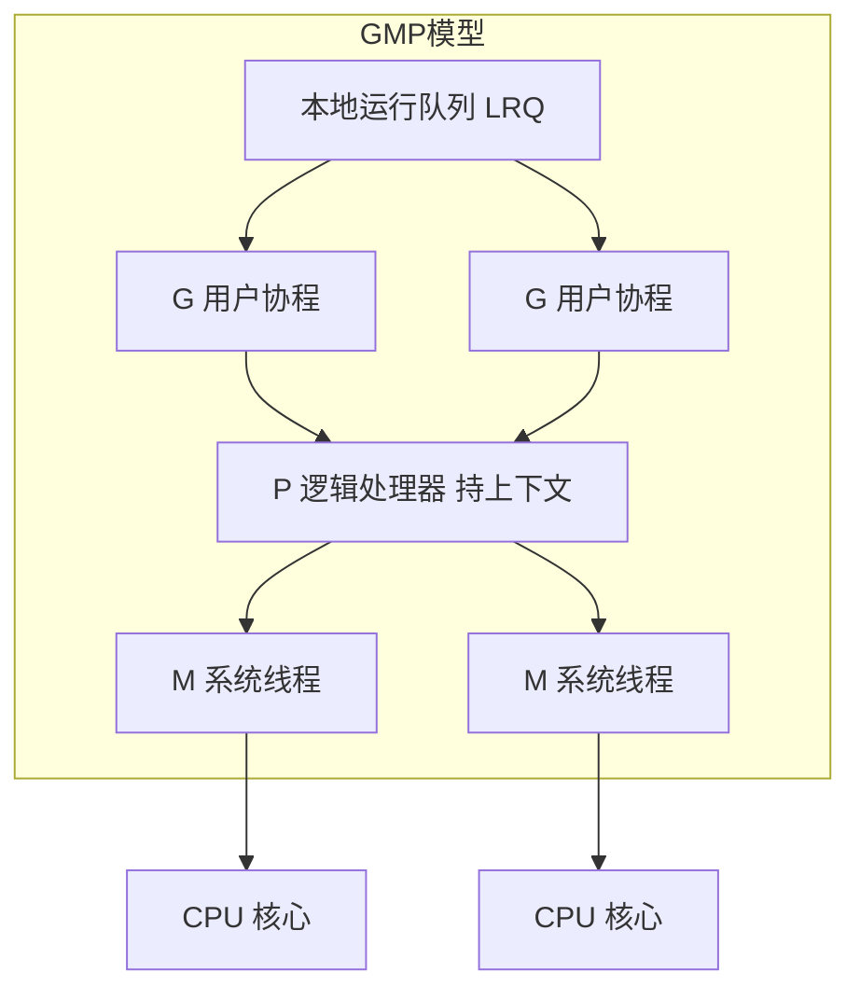

一句话记住 GMP：**G 是要跑的任务，M 是干活的操作系统线程，P 是 M 干活需要的工具台（调度上下文）**。G 只有绑定到 P 上，才能被 M 执行。

### 1.1 并发与并行的区别

在开始学习Go语言的并发编程之前，我们需要先理解并发和并行的区别。这两个概念经常被混淆，但它们有着本质的不同。

**并发**

并发是指在同一时间段内处理多个任务的能力。并发并不意味着同时执行多个任务，而是指多个任务在同一时间段内交替执行。就像一个人可以同时处理多项任务，比如一边听音乐一边写代码，虽然同一时间只能做一件事，但在一段时间内可以交替完成多项任务。

**并行**

并行是指在同一时刻执行多个任务的能力。并行需要多个处理器或多核CPU的支持，每个处理器可以同时执行一个任务。就像多个人同时处理不同的任务，每个人在同一时间都在做自己的事情。

**Go语言的并发模型**

Go语言采用的是CSP（Communicating Sequential Processes，通信顺序进程）并发模型，强调通过通信来共享内存，而不是通过共享内存来通信。这种模型的核心思想是："不要通过共享内存来通信，而要通过通信来共享内存"。

Go语言的并发编程主要基于两个核心概念：
- goroutine：轻量级线程
- channel：用于goroutine之间通信的通道

### 1.2 goroutine

> **是什么**：goroutine 可以理解为"由 Go 运行时管理的超轻量线程"。打个比方，操作系统线程像公司里的正式员工，招聘、工位、社保成本都高；goroutine 像按需召之即来的外包小时工，初始栈只有约 2KB，用完就走，一个程序开几十万个也不心疼。

> **为什么**：传统"一个请求一个线程"的模型，线程切换要陷入内核、保存大量寄存器，代价高；goroutine 的切换发生在用户态，由 Go 调度器完成，因此能轻松支撑高并发。这也是 Go 写出高并发服务的底气所在。

goroutine是Go语言中轻量级的线程，它是Go并发编程的基础。

**什么是goroutine**

goroutine是Go语言运行时管理的轻量级线程。与操作系统线程相比，goroutine的创建和销毁成本非常低，一个Go程序可以轻松创建成千上万个goroutine而不会导致系统资源耗尽。

**创建goroutine**

使用`go`关键字创建goroutine：

```go
func sayHello() {
    fmt.Println("Hello from goroutine")
}

func main() {
    go sayHello()
    fmt.Println("Hello from main")
}
```

运行这个程序，你可能只会看到"Hello from main"，因为当main函数结束时，所有goroutine都会被终止。为了确保goroutine能够执行完成，我们需要使用同步机制。

**goroutine的同步**

使用`time.Sleep`进行简单的同步：

```go
func sayHello() {
    fmt.Println("Hello from goroutine")
}

func main() {
    go sayHello()
    time.Sleep(time.Second)
    fmt.Println("Hello from main")
}
```

使用`sync.WaitGroup`进行更可靠的同步：

```go
func sayHello(wg *sync.WaitGroup) {
    defer wg.Done()
    fmt.Println("Hello from goroutine")
}

func main() {
    var wg sync.WaitGroup
    wg.Add(1)
    go sayHello(&wg)
    wg.Wait()
    fmt.Println("Hello from main")
}
```

**匿名函数goroutine**

也可以使用匿名函数创建goroutine：

```go
func main() {
    var wg sync.WaitGroup
    wg.Add(1)

    go func() {
        defer wg.Done()
        fmt.Println("Hello from anonymous goroutine")
    }()

    wg.Wait()
}
```

**goroutine的参数传递**

goroutine的参数在创建时就已经确定：

```go
func printNumber(n int) {
    fmt.Println(n)
}

func main() {
    for i := 0; i < 5; i++ {
        go printNumber(i)
    }
    time.Sleep(time.Second)
}
```

**goroutine的常见陷阱**

在循环中创建goroutine时，需要注意变量捕获的问题：

```go
func main() {
    var wg sync.WaitGroup

    for i := 0; i < 5; i++ {
        wg.Add(1)
        go func() {
            defer wg.Done()
            fmt.Println(i)
        }()
    }

    wg.Wait()
}
```

解决方法是在goroutine内部创建一个新变量：

```go
func main() {
    var wg sync.WaitGroup

    for i := 0; i < 5; i++ {
        wg.Add(1)
        go func(n int) {
            defer wg.Done()
            fmt.Println(n)
        }(i)
    }

    wg.Wait()
}
```

> ⚠️ **常见坑**：在 `go func(){ fmt.Println(i) }()` 里直接引用循环变量 `i`，在 Go 1.22 之前所有闭包共享同一个 `i`，往往打印出一串末值；Go 1.22 起每次迭代会创建新的循环变量，该问题已默认修复。此外，`main` 返回或程序退出时，**所有仍在运行的 goroutine 会被直接杀死**，务必用 `WaitGroup` / channel 等显式等待。

### 1.3 channel

> **是什么**：channel 是 goroutine 之间的"传送带"或"接力棒"。发送方把数据放上传送带，接收方从另一头取走；两头都不用关心对方是谁，只认这条管道。它天然解决了"谁先谁后"的同步问题。

> **为什么**：Go 的哲学是"不要通过共享内存来通信，而要通过通信来共享内存"。用 channel 把数据的所有权在 goroutine 之间传递，就从根上避免了多个 goroutine 同时改一块内存的竞态。

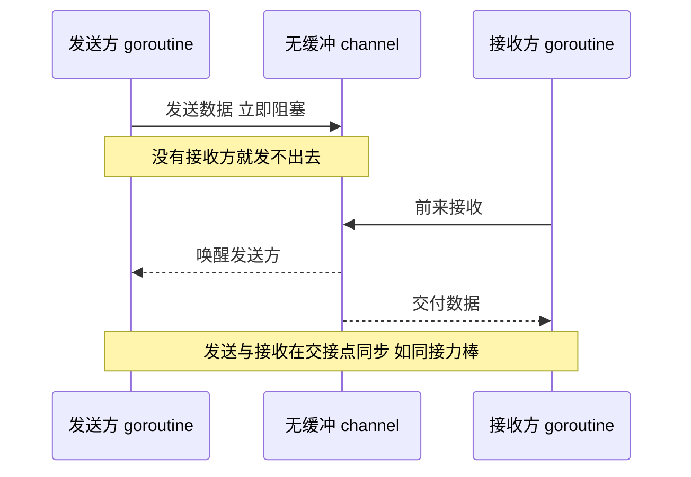

channel是Go语言中用于goroutine之间通信的通道，它是Go并发编程的核心。

**什么是channel**

channel是一种类型安全的管道，用于在goroutine之间传递数据。channel可以确保数据在goroutine之间安全地传递，避免了传统并发编程中常见的竞态条件问题。

**创建channel**

使用`make`函数创建channel：

```go
ch := make(chan int)
ch := make(chan int, 10)
```

**发送和接收数据**

使用`<-`操作符发送和接收数据：

```go
ch := make(chan int)

go func() {
    ch <- 1
}()

value := <-ch
fmt.Println(value)
```

**无缓冲channel**

无缓冲channel的发送和接收是同步的，发送方会阻塞直到接收方准备好：

```go
ch := make(chan int)

go func() {
    fmt.Println("准备发送")
    ch <- 1
    fmt.Println("发送完成")
}()

time.Sleep(time.Second)
fmt.Println("准备接收")
value := <-ch
fmt.Println("接收完成:", value)
```

**带缓冲channel**

带缓冲channel可以在缓冲区未满时异步发送数据：

```go
ch := make(chan int, 2)

ch <- 1
ch <- 2

fmt.Println(<-ch)
fmt.Println(<-ch)
```

**关闭channel**

使用`close`函数关闭channel：

```go
ch := make(chan int, 2)
ch <- 1
ch <- 2
close(ch)

for value := range ch {
    fmt.Println(value)
}
```

**判断channel是否关闭**

使用多返回值判断channel是否关闭：

```go
value, ok := <-ch
if !ok {
    fmt.Println("channel已关闭")
}
```

**select语句**

select语句可以同时监听多个channel：

```go
ch1 := make(chan int)
ch2 := make(chan int)

go func() {
    time.Sleep(time.Second)
    ch1 <- 1
}()

go func() {
    time.Sleep(2 * time.Second)
    ch2 <- 2
}()

select {
case value := <-ch1:
    fmt.Println("从ch1接收:", value)
case value := <-ch2:
    fmt.Println("从ch2接收:", value)
case <-time.After(3 * time.Second):
    fmt.Println("超时")
}
```

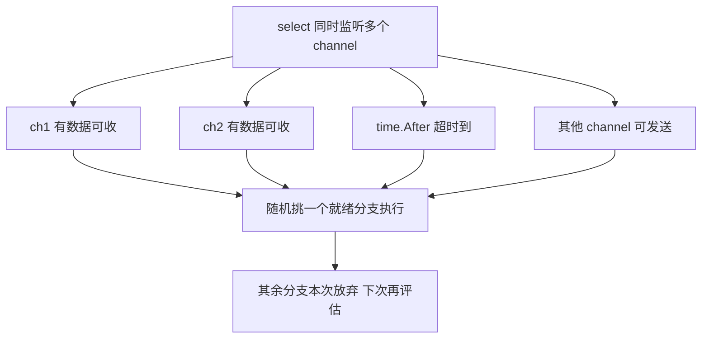

> ⚠️ **常见坑**：
> 1. **向已关闭的 channel 发送**会 panic；**重复关闭**同一 channel 也会 panic。关闭方应是唯一确定的发送方。
> 2. **无缓冲 channel 在没有接收方时发送会永久阻塞**；若发生在 main goroutine 上，会直接 `fatal error: all goroutines are asleep - deadlock!`。
> 3. 忘记 `close`，会让 `for range ch` 永远等不到结束，造成 goroutine 泄漏。
> 4. `nil` channel 上的收发会永远阻塞；反过来也可以利用它"禁用某个 select 分支"。

### 1.4 sync包

> **是什么**：sync 包里的工具是"共享内存"路线上的门禁。`Mutex` 像一把唯一钥匙，谁拿到谁进门；`RWMutex` 像会议室，允许很多人同时旁听（读），但有人要改造（写）时必须独占；`WaitGroup` 像活动签到表，凑齐人数才出发。

> **为什么**：当数据必须在多个 goroutine 间共享（例如用一个大 map 做缓存）时，通信并非最优解，此时用锁或原子操作保护临界区最直接、开销也最低。

sync包提供了基本的同步原语，包括互斥锁、读写锁、条件变量等。

**互斥锁**

互斥锁用于保护共享资源，确保同一时间只有一个goroutine可以访问：

```go
var counter int
var mutex sync.Mutex

func increment() {
    mutex.Lock()
    defer mutex.Unlock()
    counter++
}

func main() {
    var wg sync.WaitGroup

    for i := 0; i < 1000; i++ {
        wg.Add(1)
        go func() {
            defer wg.Done()
            increment()
        }()
    }

    wg.Wait()
    fmt.Println("Counter:", counter)
}
```

**读写锁**

读写锁允许多个读操作同时进行，但写操作是互斥的：

```go
var data string
var rwMutex sync.RWMutex

func read() {
    rwMutex.RLock()
    defer rwMutex.RUnlock()
    fmt.Println("Read:", data)
}

func write(s string) {
    rwMutex.Lock()
    defer rwMutex.Unlock()
    data = s
}
```

**条件变量**

条件变量用于goroutine之间的协调：

```go
var condition sync.Cond
var ready bool

func worker() {
    time.Sleep(time.Second)
    condition.L.Lock()
    ready = true
    condition.Signal()
    condition.L.Unlock()
}

func main() {
    condition.L = &sync.Mutex{}

    go worker()

    condition.L.Lock()
    for !ready {
        condition.Wait()
    }
    condition.L.Unlock()

    fmt.Println("Worker is ready")
}
```

**WaitGroup**

WaitGroup用于等待一组goroutine完成：

```go
func worker(id int, wg *sync.WaitGroup) {
    defer wg.Done()
    fmt.Printf("Worker %d starting\n", id)
    time.Sleep(time.Second)
    fmt.Printf("Worker %d done\n", id)
}

func main() {
    var wg sync.WaitGroup

    for i := 1; i <= 5; i++ {
        wg.Add(1)
        go worker(i, &wg)
    }

    wg.Wait()
    fmt.Println("All workers done")
}
```

**Once**

Once确保某个函数只执行一次：

```go
var once sync.Once
var initialized bool

func initialize() {
    once.Do(func() {
        fmt.Println("Initializing...")
        initialized = true
    })
}

func main() {
    initialize()
    initialize()
    initialize()
    fmt.Println("Initialized:", initialized)
}
```

> ⚠️ **常见坑**：
> 1. 含锁的类型（如 `sync.Mutex`）**不要按值传递或拷贝**，否则锁的是副本，保护形同虚设；应始终传指针。
> 2. `Lock()` 后忘记 `Unlock()`（尤其是中途 panic）会造成死锁，务必 `defer mu.Unlock()` 紧跟加锁。
> 3. **原生 map 并发写会直接 panic**（`fatal error: concurrent map writes`），且无法 recover；并发读写必须加锁或用 `sync.Map`。
> 4. `sync.Cond` 的 `Wait` 必须放在 `for` 循环里反复判断条件，防止虚假唤醒。

### 1.5 实例：生产者-消费者模型

让我们用一个实际的例子来巩固本章学到的知识。我们将实现一个生产者-消费者模型。

```go
package main

import (
    "fmt"
    "math/rand"
    "sync"
    "time"
)

func producer(id int, ch chan<- int, wg *sync.WaitGroup) {
    defer wg.Done()
    defer close(ch)

    for i := 1; i <= 5; i++ {
        value := rand.Intn(100)
        fmt.Printf("生产者 %d 生产: %d\n", id, value)
        ch <- value
        time.Sleep(time.Duration(rand.Intn(500)) * time.Millisecond)
    }
}

func consumer(id int, ch <-chan int, wg *sync.WaitGroup) {
    defer wg.Done()

    for value := range ch {
        fmt.Printf("消费者 %d 消费: %d\n", id, value)
        time.Sleep(time.Duration(rand.Intn(500)) * time.Millisecond)
    }
}

func main() {
    rand.Seed(time.Now().UnixNano())

    ch := make(chan int, 10)
    var wg sync.WaitGroup

    for i := 1; i <= 3; i++ {
        wg.Add(1)
        go producer(i, ch, &wg)
    }

    for i := 1; i <= 2; i++ {
        wg.Add(1)
        go consumer(i, ch, &wg)
    }

    wg.Wait()
    fmt.Println("所有生产者和消费者已完成")
}
```

这个程序：
1. 创建了3个生产者和2个消费者
2. 使用channel在生产者和消费者之间传递数据
3. 使用WaitGroup等待所有goroutine完成
4. 使用带缓冲的channel提高性能

### 1.6 小结

本章介绍了Go语言并发编程的基础知识，包括并发与并行的区别、goroutine的使用、channel的使用、sync包提供的同步原语等。我们学习了每种特性的使用方法和注意事项。goroutine是Go语言轻量级的线程，channel是goroutine之间通信的通道，sync包提供了基本的同步原语。掌握好这些基础知识对于编写高效的并发程序非常重要。

下一章我们将学习Go语言的并发模式，包括worker pool、pipeline、fan-out/fan-in等，以及它们的使用方法和注意事项。

**面试题**

1. goroutine 与操作系统线程的区别？为什么 goroutine 更轻量、切换更便宜？
2. 无缓冲 channel 与带缓冲 channel 在同步行为上有何不同？容量为 1 的缓冲 channel 能否当锁用？
3. 向已关闭的 channel 发送、从已关闭的 channel 接收分别会发生什么？`ok` 返回值的含义是什么？
4. `sync.Mutex`、`sync.RWMutex` 分别适合什么场景？`RWMutex` 一定比 `Mutex` 快吗？
5. 循环中启动 goroutine 捕获循环变量有什么坑？Go 1.22 之后有什么变化？

## 第二章：并发模式

本章把散落的 goroutine 组织成可复用的"套路"。核心思想：**用 channel 连接固定数量的 worker，把"临时开协程"变成"有节制的流水线"**。

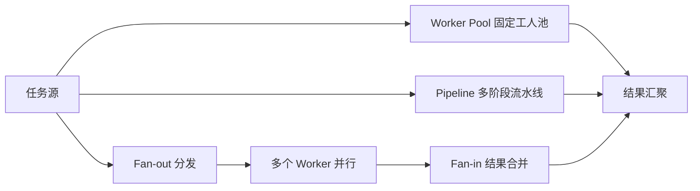

### 2.1 Worker Pool模式

> **是什么**：Worker Pool 像银行只开固定几个柜台（worker），顾客（任务）统一排队取号。柜台数量固定，无论来多少顾客都不会把大厅挤爆；任务多就多排一会儿队，而不是无限加开窗口。

> **为什么**：无限制地为每个任务 `go` 一个 goroutine，短时间创建上万协程会带来调度和内存压力，还可能把下游数据库打垮。固定 worker 数能把并发量控制在可预期的范围。

Worker Pool是一种常见的并发模式，它创建一组worker goroutine来处理任务队列中的任务。这种模式可以限制并发goroutine的数量，避免创建过多的goroutine导致系统资源耗尽。

**基本Worker Pool**

```go
func worker(id int, jobs <-chan int, results chan<- int) {
    for job := range jobs {
        fmt.Printf("Worker %d 开始处理任务 %d\n", id, job)
        time.Sleep(time.Second)
        results <- job * 2
        fmt.Printf("Worker %d 完成任务 %d\n", id, job)
    }
}

func main() {
    jobs := make(chan int, 100)
    results := make(chan int, 100)

    for w := 1; w <= 3; w++ {
        go worker(w, jobs, results)
    }

    for j := 1; j <= 5; j++ {
        jobs <- j
    }
    close(jobs)

    for a := 1; a <= 5; a++ {
        <-results
    }
}
```

**带错误处理的Worker Pool**

```go
type Job struct {
    ID   int
    Data string
}

type Result struct {
    JobID  int
    Output string
    Error  error
}

func worker(id int, jobs <-chan Job, results chan<- Result) {
    for job := range jobs {
        fmt.Printf("Worker %d 开始处理任务 %d\n", id, job.ID)
        
        result := Result{JobID: job.ID}
        
        if job.Data == "" {
            result.Error = fmt.Errorf("任务 %d 数据为空", job.ID)
        } else {
            result.Output = fmt.Sprintf("任务 %d 处理结果: %s", job.ID, job.Data)
        }
        
        results <- result
        fmt.Printf("Worker %d 完成任务 %d\n", id, job.ID)
    }
}

func main() {
    jobs := make(chan Job, 100)
    results := make(chan Result, 100)

    for w := 1; w <= 3; w++ {
        go worker(w, jobs, results)
    }

    for j := 1; j <= 5; j++ {
        jobs <- Job{ID: j, Data: fmt.Sprintf("数据%d", j)}
    }
    jobs <- Job{ID: 6, Data: ""}
    close(jobs)

    for a := 1; a <= 6; a++ {
        result := <-results
        if result.Error != nil {
            fmt.Printf("任务 %d 失败: %v\n", result.JobID, result.Error)
        } else {
            fmt.Printf("%s\n", result.Output)
        }
    }
}
```

**可动态调整的Worker Pool**

```go
type WorkerPool struct {
    jobs    chan Job
    results chan Result
    workers int
}

func NewWorkerPool(workers int) *WorkerPool {
    return &WorkerPool{
        jobs:    make(chan Job, 100),
        results: make(chan Result, 100),
        workers: workers,
    }
}

func (wp *WorkerPool) Start() {
    for i := 1; i <= wp.workers; i++ {
        go wp.worker(i)
    }
}

func (wp *WorkerPool) worker(id int) {
    for job := range wp.jobs {
        result := Result{JobID: job.ID}
        
        if job.Data == "" {
            result.Error = fmt.Errorf("任务 %d 数据为空", job.ID)
        } else {
            result.Output = fmt.Sprintf("任务 %d 处理结果: %s", job.ID, job.Data)
        }
        
        wp.results <- result
    }
}

func (wp *WorkerPool) AddJob(job Job) {
    wp.jobs <- job
}

func (wp *WorkerPool) Close() {
    close(wp.jobs)
}

func (wp *WorkerPool) Results() <-chan Result {
    return wp.results
}

func main() {
    pool := NewWorkerPool(3)
    pool.Start()

    for j := 1; j <= 5; j++ {
        pool.AddJob(Job{ID: j, Data: fmt.Sprintf("数据%d", j)})
    }
    pool.Close()

    for result := range pool.Results() {
        if result.Error != nil {
            fmt.Printf("任务 %d 失败: %v\n", result.JobID, result.Error)
        } else {
            fmt.Printf("%s\n", result.Output)
        }
    }
}
```

### 2.2 Pipeline模式

> **是什么**：Pipeline 就是工厂流水线。原料从第一道工序进入，每个阶段只做自己那道加工，做完立刻传给下一道；各阶段同时开工，整体吞吐量取决于最慢的那一站。

> **为什么**：把大任务拆成可重叠的阶段后，CPU 计算和 IO 等待可以并行起来；每个阶段用 channel 连接，代码职责清晰，易于单独测试和横向加 worker。

Pipeline模式将任务分解为多个阶段，每个阶段由一组goroutine处理，数据在各个阶段之间通过channel传递。

**基本Pipeline**

```go
func generator(nums ...int) <-chan int {
    out := make(chan int)
    go func() {
        defer close(out)
        for _, n := range nums {
            out <- n
        }
    }()
    return out
}

func square(in <-chan int) <-chan int {
    out := make(chan int)
    go func() {
        defer close(out)
        for n := range in {
            out <- n * n
        }
    }()
    return out
}

func main() {
    nums := []int{1, 2, 3, 4, 5}
    
    ch1 := generator(nums...)
    ch2 := square(ch1)
    
    for result := range ch2 {
        fmt.Println(result)
    }
}
```

**多阶段Pipeline**

```go
func generator(nums ...int) <-chan int {
    out := make(chan int)
    go func() {
        defer close(out)
        for _, n := range nums {
            out <- n
        }
    }()
    return out
}

func multiply(in <-chan int, factor int) <-chan int {
    out := make(chan int)
    go func() {
        defer close(out)
        for n := range in {
            out <- n * factor
        }
    }()
    return out
}

func add(in <-chan int, value int) <-chan int {
    out := make(chan int)
    go func() {
        defer close(out)
        for n := range in {
            out <- n + value
        }
    }()
    return out
}

func main() {
    nums := []int{1, 2, 3, 4, 5}
    
    ch1 := generator(nums...)
    ch2 := multiply(ch1, 2)
    ch3 := add(ch2, 10)
    
    for result := range ch3 {
        fmt.Println(result)
    }
}
```

**带错误处理的Pipeline**

```go
type StageResult struct {
    Value int
    Error error
}

func generator(nums ...int) <-chan StageResult {
    out := make(chan StageResult)
    go func() {
        defer close(out)
        for _, n := range nums {
            out <- StageResult{Value: n}
        }
    }()
    return out
}

func validate(in <-chan StageResult) <-chan StageResult {
    out := make(chan StageResult)
    go func() {
        defer close(out)
        for result := range in {
            if result.Value < 0 {
                out <- StageResult{Error: fmt.Errorf("负数无效: %d", result.Value)}
            } else {
                out <- result
            }
        }
    }()
    return out
}

func process(in <-chan StageResult) <-chan StageResult {
    out := make(chan StageResult)
    go func() {
        defer close(out)
        for result := range in {
            if result.Error != nil {
                out <- result
                continue
            }
            out <- StageResult{Value: result.Value * 2}
        }
    }()
    return out
}

func main() {
    nums := []int{1, 2, -3, 4, 5}
    
    ch1 := generator(nums...)
    ch2 := validate(ch1)
    ch3 := process(ch2)
    
    for result := range ch3 {
        if result.Error != nil {
            fmt.Printf("错误: %v\n", result.Error)
        } else {
            fmt.Printf("结果: %d\n", result.Value)
        }
    }
}
```

### 2.3 Fan-out/Fan-in模式

Fan-out/Fan-in模式是一种常见的并发模式，用于提高处理性能。Fan-out将任务分发给多个worker并行处理，Fan-in将多个worker的结果合并。

**基本Fan-out/Fan-in**

```go
func worker(id int, jobs <-chan int, results chan<- int) {
    for job := range jobs {
        fmt.Printf("Worker %d 处理任务 %d\n", id, job)
        time.Sleep(time.Second)
        results <- job * 2
    }
}

func fanOut(jobs <-chan int, workers int) []<-chan int {
    var outs []<-chan int
    for i := 0; i < workers; i++ {
        ch := make(chan int)
        outs = append(outs, ch)
        go worker(i+1, jobs, ch)
    }
    return outs
}

func fanIn(inputs ...<-chan int) <-chan int {
    out := make(chan int)
    var wg sync.WaitGroup
    
    for _, ch := range inputs {
        wg.Add(1)
        go func(c <-chan int) {
            defer wg.Done()
            for n := range c {
                out <- n
            }
        }(ch)
    }
    
    go func() {
        wg.Wait()
        close(out)
    }()
    
    return out
}

func main() {
    jobs := make(chan int, 100)
    
    for j := 1; j <= 5; j++ {
        jobs <- j
    }
    close(jobs)
    
    outs := fanOut(jobs, 3)
    results := fanIn(outs...)
    
    for result := range results {
        fmt.Println("结果:", result)
    }
}
```

**带错误处理的Fan-out/Fan-in**

```go
type Task struct {
    ID   int
    Data string
}

type TaskResult struct {
    TaskID int
    Result string
    Error  error
}

func worker(id int, tasks <-chan Task, results chan<- TaskResult) {
    for task := range tasks {
        fmt.Printf("Worker %d 处理任务 %d\n", id, task.ID)
        
        result := TaskResult{TaskID: task.ID}
        
        if task.Data == "" {
            result.Error = fmt.Errorf("任务 %d 数据为空", task.ID)
        } else {
            time.Sleep(time.Duration(rand.Intn(1000)) * time.Millisecond)
            result.Result = fmt.Sprintf("任务 %d 处理完成: %s", task.ID, task.Data)
        }
        
        results <- result
    }
}

func fanOut(tasks <-chan Task, workers int) []<-chan TaskResult {
    var outs []<-chan TaskResult
    for i := 0; i < workers; i++ {
        ch := make(chan TaskResult)
        outs = append(outs, ch)
        go worker(i+1, tasks, ch)
    }
    return outs
}

func fanIn(inputs ...<-chan TaskResult) <-chan TaskResult {
    out := make(chan TaskResult)
    var wg sync.WaitGroup
    
    for _, ch := range inputs {
        wg.Add(1)
        go func(c <-chan TaskResult) {
            defer wg.Done()
            for result := range c {
                out <- result
            }
        }(ch)
    }
    
    go func() {
        wg.Wait()
        close(out)
    }()
    
    return out
}

func main() {
    tasks := make(chan Task, 100)
    
    for i := 1; i <= 5; i++ {
        tasks <- Task{ID: i, Data: fmt.Sprintf("数据%d", i)}
    }
    tasks <- Task{ID: 6, Data: ""}
    close(tasks)
    
    outs := fanOut(tasks, 3)
    results := fanIn(outs...)
    
    for result := range results {
        if result.Error != nil {
            fmt.Printf("任务 %d 失败: %v\n", result.TaskID, result.Error)
        } else {
            fmt.Printf("%s\n", result.Result)
        }
    }
}
```

### 2.4 Context模式

> **是什么**：Context 像公司的"逐级通知链"。总部（父 context）喊一声"项目取消"，所有下属部门（子 context）都会收到并停下手头工作，下属再往下传，一呼百应。它自己不干活，只负责传递取消 / 超时 / 截止时间这些信号。

> **为什么**：并发任务层层嵌套时，如果没人负责"叫停"，一个请求超时后，它派生的一堆 goroutine 仍会继续跑，造成泄漏和资源浪费。context 提供了标准的取消传播机制。

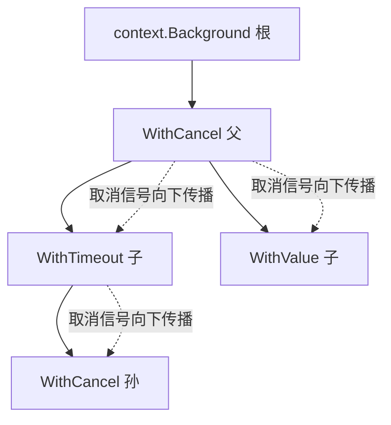

Context是Go语言中用于控制goroutine生命周期的机制，它可以用于取消操作、设置超时、传递请求范围的值等。

**基本Context使用**

```go
func worker(ctx context.Context, id int) {
    for {
        select {
        case <-ctx.Done():
            fmt.Printf("Worker %d 收到取消信号\n", id)
            return
        default:
            fmt.Printf("Worker %d 正在工作\n", id)
            time.Sleep(500 * time.Millisecond)
        }
    }
}

func main() {
    ctx, cancel := context.WithCancel(context.Background())
    
    for i := 1; i <= 3; i++ {
        go worker(ctx, i)
    }
    
    time.Sleep(2 * time.Second)
    fmt.Println("取消所有worker")
    cancel()
    time.Sleep(time.Second)
}
```

**超时控制**

```go
func workerWithTimeout(ctx context.Context, id int) {
    timeoutCtx, cancel := context.WithTimeout(ctx, 2*time.Second)
    defer cancel()
    
    for {
        select {
        case <-timeoutCtx.Done():
            fmt.Printf("Worker %d 超时\n", id)
            return
        default:
            fmt.Printf("Worker %d 正在工作\n", id)
            time.Sleep(500 * time.Millisecond)
        }
    }
}

func main() {
    ctx := context.Background()
    
    for i := 1; i <= 3; i++ {
        go workerWithTimeout(ctx, i)
    }
    
    time.Sleep(3 * time.Second)
}
```

**传递值**

```go
func workerWithValue(ctx context.Context, id int) {
    userID := ctx.Value("userID")
    fmt.Printf("Worker %d, UserID: %v\n", id, userID)
}

func main() {
    ctx := context.WithValue(context.Background(), "userID", 12345)
    
    for i := 1; i <= 3; i++ {
        go workerWithValue(ctx, i)
    }
    
    time.Sleep(time.Second)
}
```

### 2.5 实例：并发下载器

让我们用一个实际的例子来巩固本章学到的知识。我们将实现一个并发下载器。

```go
package main

import (
    "fmt"
    "io"
    "net/http"
    "os"
    "sync"
    "time"
)

type DownloadTask struct {
    URL  string
    Path string
}

type DownloadResult struct {
    Task  DownloadTask
    Error error
}

func downloader(id int, tasks <-chan DownloadTask, results chan<- DownloadResult) {
    for task := range tasks {
        fmt.Printf("下载器 %d 开始下载: %s\n", id, task.URL)
        
        result := DownloadResult{Task: task}
        
        resp, err := http.Get(task.URL)
        if err != nil {
            result.Error = fmt.Errorf("下载失败: %v", err)
            results <- result
            continue
        }
        defer resp.Body.Close()
        
        file, err := os.Create(task.Path)
        if err != nil {
            result.Error = fmt.Errorf("创建文件失败: %v", err)
            results <- result
            continue
        }
        defer file.Close()
        
        _, err = io.Copy(file, resp.Body)
        if err != nil {
            result.Error = fmt.Errorf("写入文件失败: %v", err)
            results <- result
            continue
        }
        
        fmt.Printf("下载器 %d 完成下载: %s\n", id, task.URL)
        results <- result
    }
}

func main() {
    tasks := []DownloadTask{
        {
            URL:  "https://example.com/file1.txt",
            Path: "file1.txt",
        },
        {
            URL:  "https://example.com/file2.txt",
            Path: "file2.txt",
        },
        {
            URL:  "https://example.com/file3.txt",
            Path: "file3.txt",
        },
    }
    
    taskChan := make(chan DownloadTask, len(tasks))
    resultChan := make(chan DownloadResult, len(tasks))
    
    for i := 1; i <= 3; i++ {
        go downloader(i, taskChan, resultChan)
    }
    
    for _, task := range tasks {
        taskChan <- task
    }
    close(taskChan)
    
    var wg sync.WaitGroup
    wg.Add(1)
    go func() {
        defer wg.Done()
        for result := range resultChan {
            if result.Error != nil {
                fmt.Printf("下载失败: %s, 错误: %v\n", result.Task.URL, result.Error)
            } else {
                fmt.Printf("下载成功: %s -> %s\n", result.Task.URL, result.Task.Path)
            }
        }
    }()
    
    wg.Wait()
    fmt.Println("所有下载任务完成")
}
```

这个程序：
1. 创建了3个并发下载器
2. 使用channel传递下载任务
3. 使用WaitGroup等待所有任务完成
4. 处理下载过程中的错误

### 2.6 小结

本章介绍了Go语言的常见并发模式，包括Worker Pool模式、Pipeline模式、Fan-out/Fan-in模式、Context模式等。我们学习了每种模式的使用方法和注意事项。这些模式是Go语言并发编程的最佳实践，掌握好这些模式对于编写高效的并发程序非常重要。

下一章我们将学习Go语言的并发调试和优化，包括竞态检测、性能分析、并发优化等，以及它们的使用方法和注意事项。

**面试题**

1. Worker Pool 的作用是什么？如何优雅关闭并保证已入队任务不丢？
2. Pipeline 模式中错误如何传递与终止？缺少 `close` 会怎样？
3. Fan-out 与 Fan-in 分别解决什么问题？Fan-in 为什么需要额外 goroutine 来 close？
4. context 的取消信号如何传播？为什么 `WithCancel` 一定要调用 `cancel()`？
5. `context.Value` 应该放什么？为什么不建议放业务 API 的入参？

## 第三章：并发调试和优化

并发程序"能跑"不等于"正确"，也不等于"高效"。本章用一套可落地的工具链：**先 `-race` 抓数据竞争，再用 `pprof` 找瓶颈，最后对症优化**。

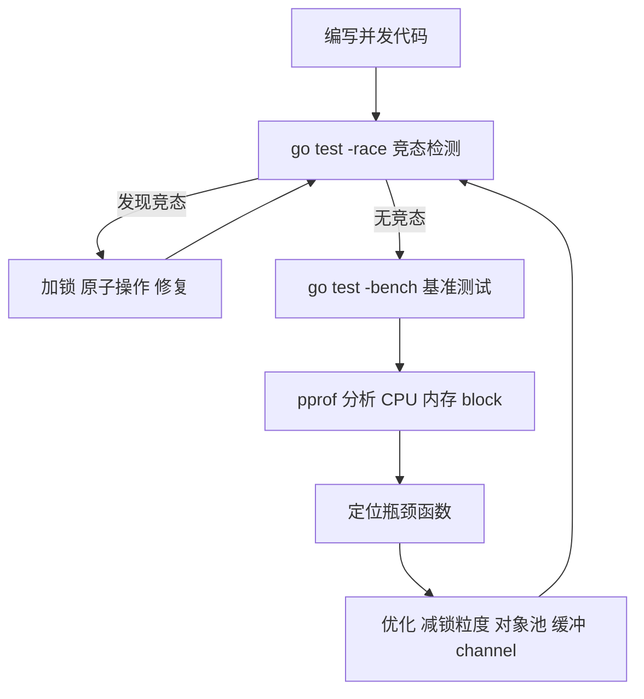

### 3.1 竞态检测

> **是什么**：数据竞争像几个人同时在一张白纸上改写同一行字。A 读完准备把 1 改成 2，B 也读完同样改成 2，结果两次自增只生效一次——谁后写谁赢，结果不可预测。

> **为什么**：只要存在"至少一个写 + 无同步"的共享访问，就可能产生竞争。`-race` 会在运行时记录每次内存访问，发现冲突时打印出两处调用栈，是排查并发 bug 的第一工具。

竞态条件是并发编程中最常见的问题之一，Go语言提供了竞态检测工具来帮助我们发现这些问题。

**什么是竞态条件**

竞态条件是指多个goroutine同时访问和修改共享数据，导致程序行为不可预测。例如：

```go
var counter int

func increment() {
    counter++
}

func main() {
    for i := 0; i < 1000; i++ {
        go increment()
    }
    time.Sleep(time.Second)
    fmt.Println("Counter:", counter)
}
```

这个程序的输出可能小于1000，因为多个goroutine可能同时读取和修改counter变量。

**使用竞态检测器**

使用`go run -race`命令运行程序，可以检测竞态条件：

```bash
go run -race main.go
```

如果存在竞态条件，竞态检测器会输出警告信息：

```
WARNING: DATA RACE
Write at 0x00c0000a2008 by goroutine 7:
  main.increment()
      /path/to/main.go:6 +0x44
  main.main.func1()
      /path/to/main.go:12 +0x44

Previous write at 0x00c0000a2008 by goroutine 6:
  main.increment()
      /path/to/main.go:6 +0x44
  main.main.func1()
      /path/to/main.go:12 +0x44
```

**修复竞态条件**

使用互斥锁修复竞态条件：

```go
var counter int
var mutex sync.Mutex

func increment() {
    mutex.Lock()
    defer mutex.Unlock()
    counter++
}

func main() {
    for i := 0; i < 1000; i++ {
        go increment()
    }
    time.Sleep(time.Second)
    fmt.Println("Counter:", counter)
}
```

**使用原子操作**

对于简单的计数器，可以使用原子操作：

```go
var counter int64

func increment() {
    atomic.AddInt64(&counter, 1)
}

func main() {
    for i := 0; i < 1000; i++ {
        go increment()
    }
    time.Sleep(time.Second)
    fmt.Println("Counter:", atomic.LoadInt64(&counter))
}
```

> ⚠️ **常见坑**：`-race` 只在程序**实际运行到**竞争路径时才报告，测试没覆盖到照样漏报；它会让程序慢 5~10 倍、内存占用上升，不能用于生产，但必须在 CI 里跑。另外 `atomic` 只适合简单标量，复杂结构仍要加锁。

### 3.2 性能分析

Go语言提供了强大的性能分析工具，可以帮助我们找出程序的性能瓶颈。

**CPU性能分析**

使用`go test -cpuprofile`命令生成CPU性能分析文件：

```bash
go test -cpuprofile=cpu.prof -bench=.
```

使用`go tool pprof`命令分析CPU性能：

```bash
go tool pprof cpu.prof
```

在pprof交互式界面中，可以使用以下命令：

- `top`：显示最耗CPU的函数
- `list 函数名`：显示函数的源代码和CPU使用情况
- `web`：在浏览器中显示调用图

**内存性能分析**

使用`go test -memprofile`命令生成内存性能分析文件：

```bash
go test -memprofile=mem.prof -bench=.
```

使用`go tool pprof`命令分析内存性能：

```bash
go tool pprof mem.prof
```

**goroutine性能分析**

使用`go tool pprof`命令分析goroutine：

```bash
go tool pprof http://localhost:8080/debug/pprof/goroutine
```

**block性能分析**

使用`go test -blockprofile`命令生成阻塞性能分析文件：

```bash
go test -blockprofile=block.prof -bench=.
```

### 3.3 并发优化

> **是什么**：锁就像公共厕所的隔间门。所有人都抢同一扇门（大锁）时，队伍排得老长；把资源按维度拆成多个隔间（分段锁），不同人用不同隔间，吞吐立刻上去。

> **为什么**：锁争用（contention）是并发性能的最大杀手之一。减少临界区长度、拆分锁、读写分离、用原子操作替代锁，都是降低争用的手段；但也要先测量再优化，避免过早优化。

并发优化是提高程序性能的重要手段，但需要注意不要过度优化。

**减少锁的粒度**

使用多个锁而不是一个大锁：

```go
type Cache struct {
    data1 map[string]int
    data2 map[string]int
    mutex1 sync.RWMutex
    mutex2 sync.RWMutex
}

func (c *Cache) Get1(key string) int {
    c.mutex1.RLock()
    defer c.mutex1.RUnlock()
    return c.data1[key]
}

func (c *Cache) Get2(key string) int {
    c.mutex2.RLock()
    defer c.mutex2.RUnlock()
    return c.data2[key]
}
```

**使用读写锁**

对于读多写少的场景，使用读写锁可以提高性能：

```go
type Cache struct {
    data  map[string]int
    mutex sync.RWMutex
}

func (c *Cache) Get(key string) int {
    c.mutex.RLock()
    defer c.mutex.RUnlock()
    return c.data[key]
}

func (c *Cache) Set(key string, value int) {
    c.mutex.Lock()
    defer c.mutex.Unlock()
    c.data[key] = value
}
```

**使用sync.Map**

对于高并发的键值对存储，使用sync.Map：

```go
var cache sync.Map

func get(key string) (int, bool) {
    value, ok := cache.Load(key)
    if !ok {
        return 0, false
    }
    return value.(int), true
}

func set(key string, value int) {
    cache.Store(key, value)
}
```

**减少goroutine的创建**

使用对象池复用goroutine：

```go
type WorkerPool struct {
    tasks chan func()
    wg    sync.WaitGroup
}

func NewWorkerPool(size int) *WorkerPool {
    pool := &WorkerPool{
        tasks: make(chan func(), 100),
    }
    
    for i := 0; i < size; i++ {
        pool.wg.Add(1)
        go pool.worker()
    }
    
    return pool
}

func (p *WorkerPool) worker() {
    defer p.wg.Done()
    for task := range p.tasks {
        task()
    }
}

func (p *WorkerPool) Submit(task func()) {
    p.tasks <- task
}

func (p *WorkerPool) Close() {
    close(p.tasks)
    p.wg.Wait()
}
```

**使用缓冲channel**

使用缓冲channel可以减少goroutine的阻塞：

```go
ch := make(chan int, 100)
```

### 3.4 常见并发问题

**死锁**

死锁是指两个或多个goroutine互相等待对方释放资源，导致所有goroutine都无法继续执行。

```go
func main() {
    var mutex1, mutex2 sync.Mutex

    go func() {
        mutex1.Lock()
        defer mutex1.Unlock()
        time.Sleep(time.Second)
        mutex2.Lock()
        defer mutex2.Unlock()
    }()

    go func() {
        mutex2.Lock()
        defer mutex2.Unlock()
        time.Sleep(time.Second)
        mutex1.Lock()
        defer mutex1.Unlock()
    }()

    time.Sleep(2 * time.Second)
}
```

避免死锁的方法：
- 按照固定的顺序获取锁
- 使用超时机制
- 避免嵌套锁

**活锁**

活锁是指goroutine不断重试，但无法完成工作。

```go
func main() {
    var mutex1, mutex2 sync.Mutex

    go func() {
        for {
            mutex1.Lock()
            if mutex2.TryLock() {
                fmt.Println("Goroutine 1 acquired both locks")
                mutex2.Unlock()
                mutex1.Unlock()
                break
            }
            mutex1.Unlock()
        }
    }()

    go func() {
        for {
            mutex2.Lock()
            if mutex1.TryLock() {
                fmt.Println("Goroutine 2 acquired both locks")
                mutex1.Unlock()
                mutex2.Unlock()
                break
            }
            mutex2.Unlock()
        }
    }()

    time.Sleep(time.Second)
}
```

避免活锁的方法：
- 使用随机退避
- 限制重试次数
- 使用更合理的锁获取顺序

**资源泄漏**

资源泄漏是指goroutine或channel没有被正确释放，导致资源耗尽。

```go
func leakyFunction() {
    ch := make(chan int)
    go func() {
        <-ch
    }()
}
```

避免资源泄漏的方法：
- 确保所有goroutine都能退出
- 使用context控制goroutine的生命周期
- 及时关闭不再使用的channel

> ⚠️ **常见坑**：
> 1. **goroutine 泄漏**：向无缓冲 / 已满缓冲 channel 发送却无人接收，或 `for range` 永不结束，都会让 goroutine 永久挂起。用 `context` + `select` 或 buffered channel 兜底。
> 2. **死锁**：`fatal error: all goroutines are asleep - deadlock!` 通常源于所有 goroutine 都在等待对方。用固定顺序加锁、避免嵌套锁。
> 3. **map 并发写**：会直接崩溃且无法 recover，必须加锁或用 `sync.Map`。
> 4. `time.Ticker` 用后要 `Stop()`，否则底层资源不会释放。

### 3.5 实例：并发缓存系统

让我们用一个实际的例子来巩固本章学到的知识。我们将实现一个并发缓存系统。

```go
package main

import (
    "fmt"
    "sync"
    "time"
)

type CacheItem struct {
    Value      interface{}
    Expiration time.Time
}

type Cache struct {
    items map[string]CacheItem
    mutex sync.RWMutex
}

func NewCache() *Cache {
    return &Cache{
        items: make(map[string]CacheItem),
    }
}

func (c *Cache) Set(key string, value interface{}, ttl time.Duration) {
    c.mutex.Lock()
    defer c.mutex.Unlock()
    
    var expiration time.Time
    if ttl > 0 {
        expiration = time.Now().Add(ttl)
    }
    
    c.items[key] = CacheItem{
        Value:      value,
        Expiration: expiration,
    }
}

func (c *Cache) Get(key string) (interface{}, bool) {
    c.mutex.RLock()
    defer c.mutex.RUnlock()
    
    item, found := c.items[key]
    if !found {
        return nil, false
    }
    
    if !item.Expiration.IsZero() && time.Now().After(item.Expiration) {
        return nil, false
    }
    
    return item.Value, true
}

func (c *Cache) Delete(key string) {
    c.mutex.Lock()
    defer c.mutex.Unlock()
    delete(c.items, key)
}

func (c *Cache) Clear() {
    c.mutex.Lock()
    defer c.mutex.Unlock()
    c.items = make(map[string]CacheItem)
}

func (c *Cache) Cleanup() {
    c.mutex.Lock()
    defer c.mutex.Unlock()
    
    now := time.Now()
    for key, item := range c.items {
        if !item.Expiration.IsZero() && now.After(item.Expiration) {
            delete(c.items, key)
        }
    }
}

func main() {
    cache := NewCache()
    
    cache.Set("key1", "value1", 5*time.Second)
    cache.Set("key2", "value2", 10*time.Second)
    cache.Set("key3", "value3", 0)
    
    if value, found := cache.Get("key1"); found {
        fmt.Println("key1:", value)
    }
    
    if value, found := cache.Get("key2"); found {
        fmt.Println("key2:", value)
    }
    
    if value, found := cache.Get("key3"); found {
        fmt.Println("key3:", value)
    }
    
    time.Sleep(6 * time.Second)
    
    if value, found := cache.Get("key1"); found {
        fmt.Println("key1:", value)
    } else {
        fmt.Println("key1已过期")
    }
    
    if value, found := cache.Get("key2"); found {
        fmt.Println("key2:", value)
    }
    
    cache.Cleanup()
    fmt.Println("缓存清理完成")
}
```

这个程序：
1. 实现了一个线程安全的缓存系统
2. 使用读写锁提高读操作的性能
3. 支持过期时间设置
4. 提供了清理过期数据的功能

运行这个程序：

```
key1: value1
key2: value2
key3: value3
key1已过期
key2: value2
缓存清理完成
```

### 3.6 小结

本章介绍了Go语言的并发调试和优化，包括竞态检测、性能分析、并发优化等。我们学习了每种工具和技术的使用方法和注意事项。竞态检测可以帮助我们发现并发问题，性能分析可以帮助我们找出性能瓶颈，并发优化可以提高程序的性能。掌握好这些调试和优化技术对于编写高效的并发程序非常重要。

下一章我们将学习Go语言的并发实践，包括并发Web服务、并发数据处理、并发任务调度等，以及它们的使用方法和注意事项。

**面试题**

1. 什么是数据竞争？`go test -race` 的原理和局限分别是什么？
2. `sync.Mutex`、`sync.RWMutex`、`atomic`、`sync.Map` 各自适合什么场景？
3. 死锁产生的条件是什么？Go 运行时如何检测死锁？活锁与死锁有何区别？
4. goroutine 泄漏的常见原因有哪些？如何排查（提示：pprof goroutine）？
5. 减少锁争用有哪些常用手段？为什么性能优化要先测量后动手？

## 第四章：并发实践

前面学的模型与工具，最终都要落到真实场景。本章看三个高频方向：**Web 服务、数据处理、任务调度**，每个都配一个可运行实例。

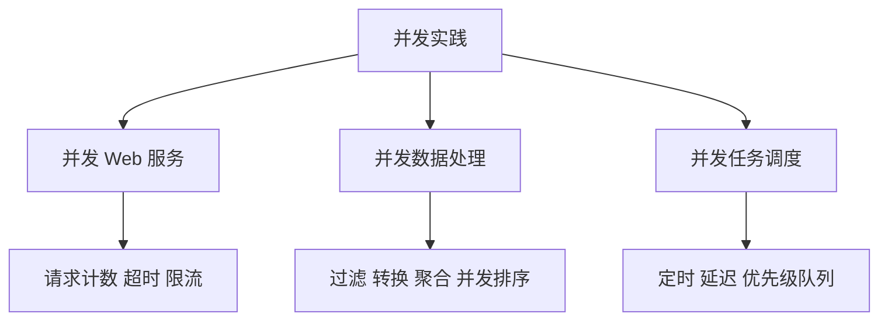

### 4.1 并发Web服务

> **是什么**：Go 的 `net/http` 天生并发——服务器每来一个连接就交给一个 goroutine 处理。你的 Handler 会被成百上千个 goroutine 同时调用，因此 Handler 里碰到的共享数据必须自己保护。

> **为什么**：HTTP 服务器本质就是"高并发连接处理"，这正是 goroutine 的强项；但便利背后是陷阱：全局计数器、缓存、懒加载单例等共享状态，一旦忘了同步就会数据竞争。

并发是Web服务性能的关键，Go语言的并发特性使得编写高性能的Web服务变得简单。

**基本并发Web服务**

```go
package main

import (
    "fmt"
    "net/http"
    "time"
)

func handler(w http.ResponseWriter, r *http.Request) {
    fmt.Fprintf(w, "Hello, World!")
}

func main() {
    http.HandleFunc("/", handler)
    fmt.Println("Server starting on :8080")
    http.ListenAndServe(":8080", nil)
}
```

**带并发处理的Web服务**

```go
package main

import (
    "fmt"
    "net/http"
    "sync"
    "time"
)

type RequestCounter struct {
    count int
    mutex sync.Mutex
}

func (rc *RequestCounter) Increment() {
    rc.mutex.Lock()
    defer rc.mutex.Unlock()
    rc.count++
}

func (rc *RequestCounter) Get() int {
    rc.mutex.Lock()
    defer rc.mutex.Unlock()
    return rc.count
}

func handler(w http.ResponseWriter, r *http.Request, counter *RequestCounter) {
    counter.Increment()
    
    fmt.Fprintf(w, "Request #%d\n", counter.Get())
}

func main() {
    counter := &RequestCounter{}
    
    http.HandleFunc("/", func(w http.ResponseWriter, r *http.Request) {
        handler(w, r, counter)
    })
    
    fmt.Println("Server starting on :8080")
    http.ListenAndServe(":8080", nil)
}
```

**带超时控制的Web服务**

```go
package main

import (
    "context"
    "fmt"
    "net/http"
    "time"
)

func handler(ctx context.Context, w http.ResponseWriter, r *http.Request) {
    select {
    case <-time.After(2 * time.Second):
        fmt.Fprintf(w, "Request completed")
    case <-ctx.Done():
        http.Error(w, "Request timeout", http.StatusRequestTimeout)
    }
}

func main() {
    http.HandleFunc("/", func(w http.ResponseWriter, r *http.Request) {
        ctx, cancel := context.WithTimeout(r.Context(), 1*time.Second)
        defer cancel()
        handler(ctx, w, r)
    })
    
    fmt.Println("Server starting on :8080")
    http.ListenAndServe(":8080", nil)
}
```

**并发限流**

```go
package main

import (
    "fmt"
    "net/http"
    "sync"
)

type RateLimiter struct {
    semaphore chan struct{}
}

func NewRateLimiter(limit int) *RateLimiter {
    return &RateLimiter{
        semaphore: make(chan struct{}, limit),
    }
}

func (rl *RateLimiter) Acquire() {
    rl.semaphore <- struct{}{}
}

func (rl *RateLimiter) Release() {
    <-rl.semaphore
}

func handler(w http.ResponseWriter, r *http.Request, limiter *RateLimiter) {
    limiter.Acquire()
    defer limiter.Release()
    
    fmt.Fprintf(w, "Request processed")
}

func main() {
    limiter := NewRateLimiter(10)
    
    http.HandleFunc("/", func(w http.ResponseWriter, r *http.Request) {
        handler(w, r, limiter)
    })
    
    fmt.Println("Server starting on :8080")
    http.ListenAndServe(":8080", nil)
}
```

> ⚠️ **常见坑**：`http.Get` / `http.DefaultClient` **默认没有超时**，下游一卡，goroutine 就永久泄漏；生产务必自定义 `http.Client{Timeout: ...}`，并用 `r.Context()` 串联超时。用 buffered channel 做限流时，`Acquire` / `Release` 必须成对，中途 panic 也要靠 `defer` 归还"令牌"，否则令牌泄漏会把后续请求全部堵死。

### 4.2 并发数据处理

数据处理是并发编程的重要应用场景，Go语言的并发特性可以大大提高数据处理的效率。

**并发数据过滤**

```go
package main

import (
    "fmt"
    "sync"
)

func filter(numbers []int, predicate func(int) bool) []int {
    var wg sync.WaitGroup
    results := make(chan int, len(numbers))
    
    for _, num := range numbers {
        wg.Add(1)
        go func(n int) {
            defer wg.Done()
            if predicate(n) {
                results <- n
            }
        }(num)
    }
    
    go func() {
        wg.Wait()
        close(results)
    }()
    
    var filtered []int
    for result := range results {
        filtered = append(filtered, result)
    }
    
    return filtered
}

func main() {
    numbers := []int{1, 2, 3, 4, 5, 6, 7, 8, 9, 10}
    
    evenNumbers := filter(numbers, func(n int) bool {
        return n%2 == 0
    })
    
    fmt.Println("偶数:", evenNumbers)
    
    oddNumbers := filter(numbers, func(n int) bool {
        return n%2 != 0
    })
    
    fmt.Println("奇数:", oddNumbers)
}
```

**并发数据转换**

```go
package main

import (
    "fmt"
    "sync"
)

func mapFunc(numbers []int, transform func(int) int) []int {
    var wg sync.WaitGroup
    results := make(chan int, len(numbers))
    
    for _, num := range numbers {
        wg.Add(1)
        go func(n int) {
            defer wg.Done()
            results <- transform(n)
        }(num)
    }
    
    go func() {
        wg.Wait()
        close(results)
    }()
    
    var transformed []int
    for result := range results {
        transformed = append(transformed, result)
    }
    
    return transformed
}

func main() {
    numbers := []int{1, 2, 3, 4, 5}
    
    squared := mapFunc(numbers, func(n int) int {
        return n * n
    })
    
    fmt.Println("平方:", squared)
    
    doubled := mapFunc(numbers, func(n int) int {
        return n * 2
    })
    
    fmt.Println("双倍:", doubled)
}
```

**并发数据聚合**

```go
package main

import (
    "fmt"
    "sync"
)

func reduce(numbers []int, initial int, reducer func(int, int) int) int {
    var wg sync.WaitGroup
    results := make(chan int, len(numbers))
    
    for _, num := range numbers {
        wg.Add(1)
        go func(n int) {
            defer wg.Done()
            results <- n
        }(num)
    }
    
    go func() {
        wg.Wait()
        close(results)
    }()
    
    result := initial
    for num := range results {
        result = reducer(result, num)
    }
    
    return result
}

func main() {
    numbers := []int{1, 2, 3, 4, 5}
    
    sum := reduce(numbers, 0, func(acc, n int) int {
        return acc + n
    })
    
    fmt.Println("和:", sum)
    
    product := reduce(numbers, 1, func(acc, n int) int {
        return acc * n
    })
    
    fmt.Println("积:", product)
}
```

**并发数据排序**

```go
package main

import (
    "fmt"
    "sync"
)

func merge(left, right []int) []int {
    result := make([]int, 0, len(left)+len(right))
    i, j := 0, 0
    
    for i < len(left) && j < len(right) {
        if left[i] <= right[j] {
            result = append(result, left[i])
            i++
        } else {
            result = append(result, right[j])
            j++
        }
    }
    
    result = append(result, left[i:]...)
    result = append(result, right[j:]...)
    
    return result
}

func mergeSort(numbers []int) []int {
    if len(numbers) <= 1 {
        return numbers
    }
    
    mid := len(numbers) / 2
    var left, right []int
    var wg sync.WaitGroup
    
    wg.Add(2)
    
    go func() {
        defer wg.Done()
        left = mergeSort(numbers[:mid])
    }()
    
    go func() {
        defer wg.Done()
        right = mergeSort(numbers[mid:])
    }()
    
    wg.Wait()
    
    return merge(left, right)
}

func main() {
    numbers := []int{5, 3, 8, 1, 2, 7, 4, 6}
    
    sorted := mergeSort(numbers)
    fmt.Println("排序后:", sorted)
}
```

### 4.3 并发任务调度

> **是什么**：任务调度就是"什么时候、由谁、按什么优先级干活"。定时任务像闹钟（`time.Ticker`），延迟任务像预约（`time.AfterFunc`），优先级队列像机场值机——头等舱先登机。

> **为什么**：真实系统里任务的紧急程度不同，一律先到先服务会让重要任务排在长队后面。用堆维护优先级，能让"重要且紧急"的任务优先被 worker 取走。

任务调度是并发编程的重要应用场景，Go语言的并发特性可以大大提高任务调度的效率。

**定时任务调度**

```go
package main

import (
    "fmt"
    "time"
)

func scheduleTask(interval time.Duration, task func()) {
    ticker := time.NewTicker(interval)
    defer ticker.Stop()
    
    for range ticker.C {
        task()
    }
}

func main() {
    go scheduleTask(1*time.Second, func() {
        fmt.Println("定时任务执行:", time.Now().Format("15:04:05"))
    })
    
    time.Sleep(5 * time.Second)
}
```

**延迟任务调度**

```go
package main

import (
    "fmt"
    "time"
)

func scheduleTask(delay time.Duration, task func()) {
    time.AfterFunc(delay, task)
}

func main() {
    scheduleTask(2*time.Second, func() {
        fmt.Println("延迟任务执行:", time.Now().Format("15:04:05"))
    })
    
    time.Sleep(3 * time.Second)
}
```

**并发任务队列**

```go
package main

import (
    "fmt"
    "sync"
    "time"
)

type Task struct {
    ID   int
    Data string
}

type TaskQueue struct {
    tasks   chan Task
    workers int
}

func NewTaskQueue(workers int) *TaskQueue {
    return &TaskQueue{
        tasks:   make(chan Task, 100),
        workers: workers,
    }
}

func (tq *TaskQueue) Start() {
    for i := 0; i < tq.workers; i++ {
        go tq.worker(i + 1)
    }
}

func (tq *TaskQueue) worker(id int) {
    for task := range tq.tasks {
        fmt.Printf("Worker %d 处理任务 %d: %s\n", id, task.ID, task.Data)
        time.Sleep(time.Second)
    }
}

func (tq *TaskQueue) AddTask(task Task) {
    tq.tasks <- task
}

func (tq *TaskQueue) Close() {
    close(tq.tasks)
}

func main() {
    queue := NewTaskQueue(3)
    queue.Start()
    
    for i := 1; i <= 10; i++ {
        queue.AddTask(Task{
            ID:   i,
            Data: fmt.Sprintf("任务数据%d", i),
        })
    }
    
    time.Sleep(5 * time.Second)
    queue.Close()
}
```

**优先级任务队列**

```go
package main

import (
    "container/heap"
    "fmt"
    "sync"
    "time"
)

type Task struct {
    ID       int
    Priority int
    Data     string
}

type TaskHeap []Task

func (h TaskHeap) Len() int           { return len(h) }
func (h TaskHeap) Less(i, j int) bool { return h[i].Priority > h[j].Priority }
func (h TaskHeap) Swap(i, j int)      { h[i], h[j] = h[j], h[i] }

func (h *TaskHeap) Push(x interface{}) {
    *h = append(*h, x.(Task))
}

func (h *TaskHeap) Pop() interface{} {
    old := *h
    n := len(old)
    x := old[n-1]
    *h = old[0 : n-1]
    return x
}

type PriorityQueue struct {
    heap    TaskHeap
    mutex   sync.Mutex
    tasks   chan Task
    workers int
}

func NewPriorityQueue(workers int) *PriorityQueue {
    return &PriorityQueue{
        heap:    make(TaskHeap, 0),
        tasks:   make(chan Task, 100),
        workers: workers,
    }
}

func (pq *PriorityQueue) Start() {
    go pq.scheduler()
    
    for i := 0; i < pq.workers; i++ {
        go pq.worker(i + 1)
    }
}

func (pq *PriorityQueue) scheduler() {
    for task := range pq.tasks {
        pq.mutex.Lock()
        heap.Push(&pq.heap, task)
        pq.mutex.Unlock()
    }
}

func (pq *PriorityQueue) worker(id int) {
    for {
        pq.mutex.Lock()
        if pq.heap.Len() == 0 {
            pq.mutex.Unlock()
            time.Sleep(100 * time.Millisecond)
            continue
        }
        
        task := heap.Pop(&pq.heap).(Task)
        pq.mutex.Unlock()
        
        fmt.Printf("Worker %d 处理任务 %d (优先级 %d): %s\n", id, task.ID, task.Priority, task.Data)
        time.Sleep(time.Second)
    }
}

func (pq *PriorityQueue) AddTask(task Task) {
    pq.tasks <- task
}

func main() {
    queue := NewPriorityQueue(3)
    queue.Start()
    
    queue.AddTask(Task{ID: 1, Priority: 1, Data: "低优先级任务"})
    queue.AddTask(Task{ID: 2, Priority: 3, Data: "高优先级任务"})
    queue.AddTask(Task{ID: 3, Priority: 2, Data: "中优先级任务"})
    
    time.Sleep(5 * time.Second)
}
```

> ⚠️ **常见坑**：上面优先级队列的 worker 用 `time.Sleep` 轮询堆，属于**忙等待**，空转时白白消耗 CPU，且源源不断的高优先级任务会让低优先级任务"饿死"。改进思路：用 `sync.Cond` 或额外 channel 做通知，避免轮询；并对同优先级任务做公平调度。

### 4.4 实例：并发爬虫

让我们用一个实际的例子来巩固本章学到的知识。我们将实现一个并发爬虫。

```go
package main

import (
    "fmt"
    "io/ioutil"
    "net/http"
    "sync"
    "time"
)

type Crawler struct {
    urls    chan string
    results chan CrawlResult
    workers int
}

type CrawlResult struct {
    URL   string
    Title string
    Error error
}

func NewCrawler(workers int) *Crawler {
    return &Crawler{
        urls:    make(chan string, 100),
        results: make(chan CrawlResult, 100),
        workers: workers,
    }
}

func (c *Crawler) Start() {
    for i := 0; i < c.workers; i++ {
        go c.worker(i + 1)
    }
}

func (c *Crawler) worker(id int) {
    for url := range c.urls {
        fmt.Printf("爬虫 %d 正在爬取: %s\n", id, url)
        
        result := CrawlResult{URL: url}
        
        resp, err := http.Get(url)
        if err != nil {
            result.Error = fmt.Errorf("请求失败: %v", err)
            c.results <- result
            continue
        }
        defer resp.Body.Close()
        
        body, err := ioutil.ReadAll(resp.Body)
        if err != nil {
            result.Error = fmt.Errorf("读取失败: %v", err)
            c.results <- result
            continue
        }
        
        result.Title = string(body)
        c.results <- result
        
        fmt.Printf("爬虫 %d 完成爬取: %s\n", id, url)
        time.Sleep(time.Second)
    }
}

func (c *Crawler) AddURL(url string) {
    c.urls <- url
}

func (c *Crawler) Results() <-chan CrawlResult {
    return c.results
}

func (c *Crawler) Close() {
    close(c.urls)
}

func main() {
    crawler := NewCrawler(3)
    crawler.Start()
    
    urls := []string{
        "https://example.com",
        "https://example.org",
        "https://example.net",
    }
    
    for _, url := range urls {
        crawler.AddURL(url)
    }
    
    crawler.Close()
    
    var wg sync.WaitGroup
    wg.Add(1)
    go func() {
        defer wg.Done()
        for result := range crawler.Results() {
            if result.Error != nil {
                fmt.Printf("爬取失败: %s, 错误: %v\n", result.URL, result.Error)
            } else {
                fmt.Printf("爬取成功: %s, 标题: %s\n", result.URL, result.Title[:min(50, len(result.Title))])
            }
        }
    }()
    
    wg.Wait()
    fmt.Println("所有爬取任务完成")
}

func min(a, b int) int {
    if a < b {
        return a
    }
    return b
}
```

这个程序：
1. 创建了3个并发爬虫
2. 使用channel传递URL
3. 使用WaitGroup等待所有任务完成
4. 处理爬取过程中的错误

### 4.5 小结

本章介绍了Go语言的并发实践，包括并发Web服务、并发数据处理、并发任务调度等。我们学习了每种应用场景的使用方法和注意事项。并发Web服务可以大大提高Web服务的性能，并发数据处理可以大大提高数据处理的效率，并发任务调度可以大大提高任务调度的效率。掌握好这些并发实践对于编写高效的并发程序非常重要。

下一章我们将学习Go语言的并发测试，包括并发单元测试、并发基准测试、并发压力测试等，以及它们的使用方法和注意事项。

**面试题**

1. 并发 Web 服务如何做限流与超时控制？Handler 里共享状态如何保护？
2. 为什么 `http.Client` 必须设置超时？不设置会带来什么后果？
3. 用并发实现 map / filter / reduce / 归并排序，各有什么额外代价？
4. 优先级任务队列用堆实现时，worker 忙等有什么问题？如何改进？
5. 并发爬虫如何做去重、并发控制与限速？

## 第五章：并发测试

并发代码的正确性"看"不出来，只能测出来。本章从三个层次保证质量：**单元测试管正确性、基准测试管性能、压力测试管稳定性**，三者都要配 `-race`。

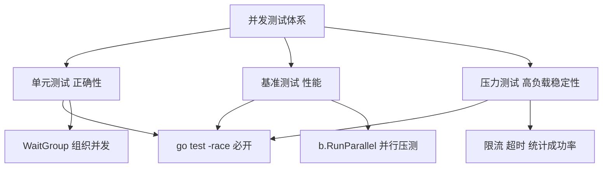

### 5.1 并发单元测试

> **是什么**：并发单元测试就是用测试代码模拟"很多人同时做同一件事"，然后断言最终结果符合预期。它像一个专门制造并发场景的考场，逼出那些平时隐藏的 bug。

> **为什么**：单线程跑一遍没问题，不代表并发没问题；很多 bug 只在特定交错下出现。测试里主动制造高并发 + `-race`，才能把偶发问题变成必现失败。

并发单元测试是确保并发程序正确性的重要手段。Go语言的testing包提供了丰富的测试功能。

**基本并发测试**

```go
package main

import (
    "sync"
    "testing"
)

func TestConcurrentIncrement(t *testing.T) {
    var counter int
    var mutex sync.Mutex
    var wg sync.WaitGroup

    increment := func() {
        mutex.Lock()
        defer mutex.Unlock()
        counter++
    }

    for i := 0; i < 1000; i++ {
        wg.Add(1)
        go func() {
            defer wg.Done()
            increment()
        }()
    }

    wg.Wait()

    if counter != 1000 {
        t.Errorf("期望 counter = 1000, 实际 counter = %d", counter)
    }
}
```

**使用testing.TB接口**

```go
package main

import (
    "sync"
    "testing"
)

func TestConcurrentMap(t *testing.T) {
    m := make(map[int]int)
    var mutex sync.Mutex
    var wg sync.WaitGroup

    for i := 0; i < 100; i++ {
        wg.Add(1)
        go func(n int) {
            defer wg.Done()
            mutex.Lock()
            m[n] = n * 2
            mutex.Unlock()
        }(i)
    }

    wg.Wait()

    if len(m) != 100 {
        t.Errorf("期望 map 长度 = 100, 实际长度 = %d", len(m))
    }
}
```

**并发测试辅助函数**

```go
package main

import (
    "sync"
    "testing"
)

func runConcurrent(t *testing.T, goroutines int, task func()) {
    var wg sync.WaitGroup
    wg.Add(goroutines)

    for i := 0; i < goroutines; i++ {
        go func() {
            defer wg.Done()
            task()
        }()
    }

    wg.Wait()
}

func TestConcurrentTask(t *testing.T) {
    var counter int
    var mutex sync.Mutex

    runConcurrent(t, 1000, func() {
        mutex.Lock()
        defer mutex.Unlock()
        counter++
    })

    if counter != 1000 {
        t.Errorf("期望 counter = 1000, 实际 counter = %d", counter)
    }
}
```

> ⚠️ **常见坑**：并发测试里用 `time.Sleep` 等待完成不可靠（慢机器上会偶发失败），应统一用 `WaitGroup` / channel 同步；`t.Fatal` 只能在测试主 goroutine 调用，子 goroutine 里请用 `t.Error` 或把错误送回主 goroutine。运行并发测试务必加 `-race`。

### 5.2 并发基准测试

> **是什么**：基准测试是给代码量体温。`b.RunParallel` 会让多个 goroutine 同时执行被测逻辑，模拟真实并发下的吞吐与锁争用。

> **为什么**：单 goroutine 的 benchmark 测不出锁竞争、"多核反而更慢"这类问题，只有并行跑才能暴露真实并发下的性能表现。

并发基准测试用于评估并发程序的性能。Go语言的testing包提供了基准测试功能。

**基本并发基准测试**

```go
package main

import (
    "sync"
    "testing"
)

func BenchmarkConcurrentIncrement(b *testing.B) {
    var counter int
    var mutex sync.Mutex

    b.RunParallel(func(pb *testing.PB) {
        for pb.Next() {
            mutex.Lock()
            counter++
            mutex.Unlock()
        }
    })
}
```

**比较不同实现的性能**

```go
package main

import (
    "sync"
    "testing"
)

func BenchmarkMutexIncrement(b *testing.B) {
    var counter int
    var mutex sync.Mutex

    b.RunParallel(func(pb *testing.PB) {
        for pb.Next() {
            mutex.Lock()
            counter++
            mutex.Unlock()
        }
    })
}

func BenchmarkAtomicIncrement(b *testing.B) {
    var counter int64

    b.RunParallel(func(pb *testing.PB) {
        for pb.Next() {
            atomic.AddInt64(&counter, 1)
        }
    })
}
```

**带子测试的基准测试**

```go
package main

import (
    "sync"
    "testing"
)

func BenchmarkWorkerPool(b *testing.B) {
    workers := []int{1, 2, 4, 8, 16}

    for _, w := range workers {
        b.Run(fmt.Sprintf("workers-%d", w), func(b *testing.B) {
            pool := NewWorkerPool(w)
            pool.Start()
            defer pool.Close()

            b.ResetTimer()
            for i := 0; i < b.N; i++ {
                pool.AddTask(func() {})
            }
        })
    }
}
```

> ⚠️ **常见坑**：并行基准测试若测的是共享可变状态（如上面的计数器），结果反映的是"争用最坏情况"，别误当成单核性能；准备阶段记得 `b.ResetTimer()` 排除开销，`b.N` 由测试框架自动调整，不要自己写死循环次数。

### 5.3 并发压力测试

并发压力测试用于评估并发程序在高负载下的表现。

**基本压力测试**

```go
package main

import (
    "net/http"
    "sync"
    "testing"
    "time"
)

func TestConcurrentRequests(t *testing.T) {
    url := "http://example.com"
    requests := 100
    var wg sync.WaitGroup
    var success, failure int
    var mutex sync.Mutex

    for i := 0; i < requests; i++ {
        wg.Add(1)
        go func() {
            defer wg.Done()

            resp, err := http.Get(url)
            if err != nil {
                mutex.Lock()
                failure++
                mutex.Unlock()
                return
            }
            defer resp.Body.Close()

            if resp.StatusCode == http.StatusOK {
                mutex.Lock()
                success++
                mutex.Unlock()
            } else {
                mutex.Lock()
                failure++
                mutex.Unlock()
            }
        }()
    }

    wg.Wait()

    t.Logf("成功: %d, 失败: %d", success, failure)
    if failure > 0 {
        t.Errorf("存在失败的请求")
    }
}
```

**带超时的压力测试**

```go
package main

import (
    "context"
    "net/http"
    "sync"
    "testing"
    "time"
)

func TestConRequestsWithTimeout(t *testing.T) {
    url := "http://example.com"
    requests := 100
    timeout := 5 * time.Second
    var wg sync.WaitGroup
    var success, failure, timeoutCount int
    var mutex sync.Mutex

    ctx, cancel := context.WithTimeout(context.Background(), timeout)
    defer cancel()

    for i := 0; i < requests; i++ {
        wg.Add(1)
        go func() {
            defer wg.Done()

            req, err := http.NewRequestWithContext(ctx, "GET", url, nil)
            if err != nil {
                mutex.Lock()
                failure++
                mutex.Unlock()
                return
            }

            resp, err := http.DefaultClient.Do(req)
            if err != nil {
                if ctx.Err() == context.DeadlineExceeded {
                    mutex.Lock()
                    timeoutCount++
                    mutex.Unlock()
                } else {
                    mutex.Lock()
                    failure++
                    mutex.Unlock()
                }
                return
            }
            defer resp.Body.Close()

            if resp.StatusCode == http.StatusOK {
                mutex.Lock()
                success++
                mutex.Unlock()
            } else {
                mutex.Lock()
                failure++
                mutex.Unlock()
            }
        }()
    }

    wg.Wait()

    t.Logf("成功: %d, 失败: %d, 超时: %d", success, failure, timeoutCount)
}
```

**带限流的压力测试**

```go
package main

import (
    "net/http"
    "sync"
    "testing"
    "time"
)

type RateLimiter struct {
    semaphore chan struct{}
}

func NewRateLimiter(limit int) *RateLimiter {
    return &RateLimiter{
        semaphore: make(chan struct{}, limit),
    }
}

func (rl *RateLimiter) Acquire() {
    rl.semaphore <- struct{}{}
}

func (rl *RateLimiter) Release() {
    <-rl.semaphore
}

func TestRateLimitedRequests(t *testing.T) {
    url := "http://example.com"
    requests := 100
    rateLimit := 10
    limiter := NewRateLimiter(rateLimit)
    var wg sync.WaitGroup
    var success, failure int
    var mutex sync.Mutex

    start := time.Now()

    for i := 0; i < requests; i++ {
        wg.Add(1)
        go func() {
            defer wg.Done()

            limiter.Acquire()
            defer limiter.Release()

            resp, err := http.Get(url)
            if err != nil {
                mutex.Lock()
                failure++
                mutex.Unlock()
                return
            }
            defer resp.Body.Close()

            if resp.StatusCode == http.StatusOK {
                mutex.Lock()
                success++
                mutex.Unlock()
            } else {
                mutex.Lock()
                failure++
                mutex.Unlock()
            }
        }()
    }

    wg.Wait()

    duration := time.Since(start)
    t.Logf("成功: %d, 失败: %d, 耗时: %v", success, failure, duration)
    t.Logf("平均每秒请求: %.2f", float64(requests)/duration.Seconds())
}
```

### 5.4 实例：并发缓存测试

让我们用一个实际的例子来巩固本章学到的知识。我们将为之前实现的并发缓存系统编写测试。

```go
package main

import (
    "sync"
    "testing"
    "time"
)

func TestCacheSetAndGet(t *testing.T) {
    cache := NewCache()

    cache.Set("key1", "value1", 0)

    value, found := cache.Get("key1")
    if !found {
        t.Error("期望找到 key1")
    }
    if value != "value1" {
        t.Errorf("期望 value = 'value1', 实际 value = '%v'", value)
    }
}

func TestCacheExpiration(t *testing.T) {
    cache := NewCache()

    cache.Set("key1", "value1", 1*time.Second)

    value, found := cache.Get("key1")
    if !found {
        t.Error("期望找到 key1")
    }
    if value != "value1" {
        t.Errorf("期望 value = 'value1', 实际 value = '%v'", value)
    }

    time.Sleep(2 * time.Second)

    value, found = cache.Get("key1")
    if found {
        t.Error("期望 key1 已过期")
    }
}

func TestConcurrentCacheAccess(t *testing.T) {
    cache := NewCache()
    var wg sync.WaitGroup

    for i := 0; i < 1000; i++ {
        wg.Add(1)
        go func(n int) {
            defer wg.Done()
            key := fmt.Sprintf("key%d", n)
            value := fmt.Sprintf("value%d", n)
            cache.Set(key, value, 0)
        }(i)
    }

    wg.Wait()

    for i := 0; i < 1000; i++ {
        key := fmt.Sprintf("key%d", i)
        expectedValue := fmt.Sprintf("value%d", i)

        value, found := cache.Get(key)
        if !found {
            t.Errorf("期望找到 %s", key)
        }
        if value != expectedValue {
            t.Errorf("期望 value = '%s', 实际 value = '%v'", expectedValue, value)
        }
    }
}

func BenchmarkCacheSet(b *testing.B) {
    cache := NewCache()

    b.RunParallel(func(pb *testing.PB) {
        i := 0
        for pb.Next() {
            key := fmt.Sprintf("key%d", i)
            value := fmt.Sprintf("value%d", i)
            cache.Set(key, value, 0)
            i++
        }
    })
}

func BenchmarkCacheGet(b *testing.B) {
    cache := NewCache()

    for i := 0; i < 1000; i++ {
        key := fmt.Sprintf("key%d", i)
        value := fmt.Sprintf("value%d", i)
        cache.Set(key, value, 0)
    }

    b.ResetTimer()
    b.RunParallel(func(pb *testing.PB) {
        i := 0
        for pb.Next() {
            key := fmt.Sprintf("key%d", i%1000)
            cache.Get(key)
            i++
        }
    })
}
```

### 5.5 小结

本章介绍了Go语言的并发测试，包括并发单元测试、并发基准测试、并发压力测试等。我们学习了每种测试方法的使用方法和注意事项。并发单元测试可以确保并发程序的正确性，并发基准测试可以评估并发程序的性能，并发压力测试可以评估并发程序在高负载下的表现。掌握好这些并发测试技术对于编写高质量的并发程序非常重要。

下一章我们将学习Go语言的并发最佳实践，包括并发设计原则、并发代码组织、并发错误处理等，以及它们的使用方法和注意事项。

**面试题**

1. 并发测试为什么一定要加 `-race`？它能保证 100% 发现所有竞争吗？
2. `testing.T` 的并发安全边界是什么？子测试如何并行？
3. `b.RunParallel` 的工作机制是怎样的？它和 `b.N` 有什么关系？
4. 压力测试如何评估 QPS、成功率与 P99 延迟？
5. 如何避免测试因 `time.Sleep` 而不稳定？

## 第六章：并发最佳实践

代码能跑只是及格线，可读、可维护、可排查才是工程目标。本章把并发从"技巧"提升为"设计"：**优先通信、明确生命周期、统一错误处理、克制优化**。

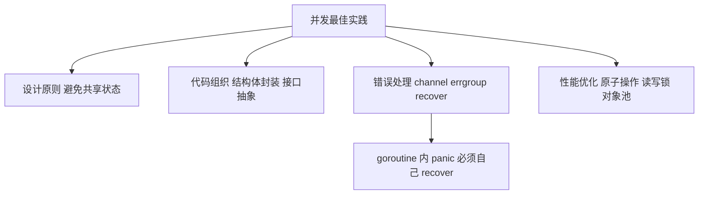

### 6.1 并发设计原则

> **是什么**：设计阶段的取舍，比事后 debug 值钱得多。三条铁律：**能用 channel 传递就不要共享内存；每个 goroutine 都要有人负责它的退出；context 只传控制信号与元数据，不传业务参数**。

> **为什么**：大多数并发事故（泄漏、死锁、竞态）都源于"生命周期没人管""共享状态没保护"。把这两件事在设计时想清楚，后期几乎不用救火。

良好的并发设计是编写高质量并发程序的基础。以下是Go语言并发编程的一些核心设计原则。

**避免共享状态**

尽可能避免共享状态，使用channel传递数据：

```go
func worker(id int, jobs <-chan int, results chan<- int) {
    for job := range jobs {
        fmt.Printf("Worker %d 处理任务 %d\n", id, job)
        results <- job * 2
    }
}

func main() {
    jobs := make(chan int, 100)
    results := make(chan int, 100)

    for w := 1; w <= 3; w++ {
        go worker(w, jobs, results)
    }

    for j := 1; j <= 5; j++ {
        jobs <- j
    }
    close(jobs)

    for a := 1; a <= 5; a++ {
        <-results
    }
}
```

**使用channel进行通信**

Go语言的哲学是"不要通过共享内存来通信，而要通过通信来共享内存"：

```go
func producer(ch chan<- int) {
    for i := 0; i < 10; i++ {
        ch <- i
    }
    close(ch)
}

func consumer(ch <-chan int) {
    for value := range ch {
        fmt.Println("消费:", value)
    }
}

func main() {
    ch := make(chan int)
    go producer(ch)
    consumer(ch)
}
```

**控制goroutine的生命周期**

使用context控制goroutine的生命周期：

```go
func worker(ctx context.Context, id int) {
    for {
        select {
        case <-ctx.Done():
            fmt.Printf("Worker %d 收到取消信号\n", id)
            return
        default:
            fmt.Printf("Worker %d 正在工作\n", id)
            time.Sleep(500 * time.Millisecond)
        }
    }
}

func main() {
    ctx, cancel := context.WithCancel(context.Background())
    
    for i := 1; i <= 3; i++ {
        go worker(ctx, i)
    }
    
    time.Sleep(2 * time.Second)
    fmt.Println("取消所有worker")
    cancel()
    time.Sleep(time.Second)
}
```

**避免goroutine泄漏**

确保所有goroutine都能正常退出：

```go
func process(ctx context.Context, data string) {
    select {
    case <-ctx.Done():
        fmt.Println("处理被取消")
        return
    case result := <-doWork(data):
        fmt.Println("处理结果:", result)
    }
}

func doWork(data string) <-chan string {
    result := make(chan string)
    go func() {
        time.Sleep(time.Second)
        result <- "处理完成: " + data
    }()
    return result
}

func main() {
    ctx, cancel := context.WithTimeout(context.Background(), 500*time.Millisecond)
    defer cancel()
    
    process(ctx, "测试数据")
}
```

### 6.2 并发代码组织

良好的代码组织可以提高并发程序的可读性和可维护性。

**使用结构体封装并发逻辑**

```go
type WorkerPool struct {
    tasks   chan func()
    workers int
    wg      sync.WaitGroup
}

func NewWorkerPool(workers int) *WorkerPool {
    return &WorkerPool{
        tasks:   make(chan func(), 100),
        workers: workers,
    }
}

func (wp *WorkerPool) Start() {
    for i := 0; i < wp.workers; i++ {
        wp.wg.Add(1)
        go wp.worker()
    }
}

func (wp *WorkerPool) worker() {
    defer wp.wg.Done()
    for task := range wp.tasks {
        task()
    }
}

func (wp *WorkerPool) Submit(task func()) {
    wp.tasks <- task
}

func (wp *WorkerPool) Close() {
    close(wp.tasks)
    wp.wg.Wait()
}
```

**使用接口抽象并发行为**

```go
type TaskExecutor interface {
    Execute(ctx context.Context, task Task) error
}

type ConcurrentExecutor struct {
    workers int
}

func NewConcurrentExecutor(workers int) *ConcurrentExecutor {
    return &ConcurrentExecutor{workers: workers}
}

func (ce *ConcurrentExecutor) Execute(ctx context.Context, task Task) error {
    var wg sync.WaitGroup
    errChan := make(chan error, 1)
    
    wg.Add(1)
    go func() {
        defer wg.Done()
        if err := task.Run(ctx); err != nil {
            select {
            case errChan <- err:
            default:
            }
        }
    }()
    
    wg.Wait()
    close(errChan)
    
    select {
    case err := <-errChan:
        return err
    default:
        return nil
    }
}
```

**使用context传递请求范围的数据**

```go
type contextKey string

const userIDKey contextKey = "userID"

func handleRequest(ctx context.Context) {
    userID := ctx.Value(userIDKey)
    fmt.Println("处理用户请求:", userID)
}

func main() {
    ctx := context.WithValue(context.Background(), userIDKey, "user123")
    handleRequest(ctx)
}
```

### 6.3 并发错误处理

> **是什么**：并发下的错误处理要回答两个问题：**谁来收（错误如何汇总）**、**出事怎么办（是否取消其他任务、是否兜底 panic）**。`errgroup` 负责汇总，`recover` 负责兜底。

> **为什么**：goroutine 有独立栈，子 goroutine 里未捕获的 panic 会直接让整个进程崩溃，父 goroutine 的 recover 拦不住；错误渠道不统一，则会导致 `WaitGroup` 永远等不到、错误被悄悄吞掉。

正确的错误处理是并发程序稳定运行的关键。

**使用channel传递错误**

```go
func worker(id int, jobs <-chan int, results chan<- int, errors chan<- error) {
    for job := range jobs {
        result, err := processJob(job)
        if err != nil {
            errors <- fmt.Errorf("Worker %d 处理任务 %d 失败: %v", id, job, err)
            continue
        }
        results <- result
    }
}

func processJob(job int) (int, error) {
    if job%5 == 0 {
        return 0, fmt.Errorf("任务 %d 失败", job)
    }
    return job * 2, nil
}

func main() {
    jobs := make(chan int, 100)
    results := make(chan int, 100)
    errors := make(chan error, 100)

    for w := 1; w <= 3; w++ {
        go worker(w, jobs, results, errors)
    }

    go func() {
        for j := 1; j <= 10; j++ {
            jobs <- j
        }
        close(jobs)
    }()

    go func() {
        for err := range errors {
            fmt.Println("错误:", err)
        }
    }()

    for i := 0; i < 10; i++ {
        select {
        case result := <-results:
            fmt.Println("结果:", result)
        case err := <-errors:
            fmt.Println("错误:", err)
        }
    }
}
```

**使用errgroup管理错误**

```go
func processURL(ctx context.Context, url string) error {
    resp, err := http.Get(url)
    if err != nil {
        return err
    }
    defer resp.Body.Close()
    
    if resp.StatusCode != http.StatusOK {
        return fmt.Errorf("请求失败: %s", url)
    }
    
    return nil
}

func main() {
    urls := []string{
        "https://example.com",
        "https://example.org",
        "https://example.net",
    }
    
    g, ctx := errgroup.WithContext(context.Background())
    
    for _, url := range urls {
        url := url
        g.Go(func() error {
            return processURL(ctx, url)
        })
    }
    
    if err := g.Wait(); err != nil {
        fmt.Println("处理失败:", err)
    } else {
        fmt.Println("所有请求成功")
    }
}
```

**使用panic/recover处理严重错误**

```go
func safeWorker(id int, jobs <-chan int, results chan<- int) {
    defer func() {
        if r := recover(); r != nil {
            fmt.Printf("Worker %d 恢复: %v\n", id, r)
        }
    }()
    
    for job := range jobs {
        result := job * 2
        if job == 5 {
            panic(fmt.Sprintf("Worker %d 遇到严重错误", id))
        }
        results <- result
    }
}

func main() {
    jobs := make(chan int, 100)
    results := make(chan int, 100)

    for w := 1; w <= 3; w++ {
        go safeWorker(w, jobs, results)
    }

    for j := 1; j <= 10; j++ {
        jobs <- j
    }
    close(jobs)

    for i := 0; i < 10; i++ {
        <-results
    }
}
```

> ⚠️ **常见坑**：`errgroup` 只返回**第一个**非 nil 错误，且不会自动取消其他任务——要取消需用 `errgroup.WithContext` 派生 ctx 并让任务监听 `ctx.Done()`。另外 `recover` 只能拦同一 goroutine 内的 panic，每个可能 panic 的 goroutine 都要自己 `defer recover`，否则进程直接退出。

### 6.4 并发性能优化

性能优化是并发编程的重要目标，但需要注意不要过度优化。

**使用sync.Pool减少内存分配**

```go
type Buffer struct {
    data []byte
}

var bufferPool = sync.Pool{
    New: func() interface{} {
        return &Buffer{
            data: make([]byte, 0, 1024),
        }
    },
}

func processData(data []byte) {
    buf := bufferPool.Get().(*Buffer)
    defer bufferPool.Put(buf)
    
    buf.data = append(buf.data[:0], data...)
    
    fmt.Println("处理数据:", len(buf.data))
}

func main() {
    data := []byte("测试数据")
    for i := 0; i < 10; i++ {
        go processData(data)
    }
    time.Sleep(time.Second)
}
```

**使用原子操作替代锁**

```go
type Counter struct {
    value int64
}

func (c *Counter) Increment() {
    atomic.AddInt64(&c.value, 1)
}

func (c *Counter) Get() int64 {
    return atomic.LoadInt64(&c.value)
}

func main() {
    counter := &Counter{}
    var wg sync.WaitGroup

    for i := 0; i < 1000; i++ {
        wg.Add(1)
        go func() {
            defer wg.Done()
            counter.Increment()
        }()
    }

    wg.Wait()
    fmt.Println("计数:", counter.Get())
}
```

**使用读写锁提高读性能**

```go
type Cache struct {
    data  map[string]int
    mutex sync.RWMutex
}

func (c *Cache) Get(key string) (int, bool) {
    c.mutex.RLock()
    defer c.mutex.RUnlock()
    value, found := c.data[key]
    return value, found
}

func (c *Cache) Set(key string, value int) {
    c.mutex.Lock()
    defer c.mutex.Unlock()
    c.data[key] = value
}

func main() {
    cache := &Cache{
        data: make(map[string]int),
    }

    cache.Set("key1", 100)

    if value, found := cache.Get("key1"); found {
        fmt.Println("值:", value)
    }
}
```

### 6.5 实例：并发任务处理器

让我们用一个实际的例子来巩固本章学到的知识。我们将实现一个并发任务处理器。

```go
package main

import (
    "context"
    "fmt"
    "sync"
    "time"
)

type Task struct {
    ID   int
    Data string
}

type TaskResult struct {
    TaskID int
    Result string
    Error  error
}

type TaskProcessor struct {
    tasks    chan Task
    results  chan TaskResult
    workers  int
    ctx      context.Context
    cancel   context.CancelFunc
    wg       sync.WaitGroup
}

func NewTaskProcessor(workers int) *TaskProcessor {
    ctx, cancel := context.WithCancel(context.Background())
    return &TaskProcessor{
        tasks:   make(chan Task, 100),
        results: make(chan TaskResult, 100),
        workers: workers,
        ctx:     ctx,
        cancel:  cancel,
    }
}

func (tp *TaskProcessor) Start() {
    for i := 0; i < tp.workers; i++ {
        tp.wg.Add(1)
        go tp.worker(i + 1)
    }
}

func (tp *TaskProcessor) worker(id int) {
    defer tp.wg.Done()
    
    for {
        select {
        case <-tp.ctx.Done():
            fmt.Printf("Worker %d 收到停止信号\n", id)
            return
        case task, ok := <-tp.tasks:
            if !ok {
                fmt.Printf("Worker %d 任务通道关闭\n", id)
                return
            }
            
            result := TaskResult{TaskID: task.ID}
            
            if err := tp.processTask(&task, &result); err != nil {
                result.Error = fmt.Errorf("Worker %d 处理任务 %d 失败: %v", id, task.ID, err)
            }
            
            select {
            case tp.results <- result:
            case <-tp.ctx.Done():
                return
            }
        }
    }
}

func (tp *TaskProcessor) processTask(task *Task, result *TaskResult) error {
    fmt.Printf("处理任务 %d: %s\n", task.ID, task.Data)
    time.Sleep(time.Second)
    result.Result = fmt.Sprintf("处理完成: %s", task.Data)
    return nil
}

func (tp *TaskProcessor) AddTask(task Task) {
    select {
    case tp.tasks <- task:
    case <-tp.ctx.Done():
        fmt.Println("任务处理器已关闭，无法添加任务")
    }
}

func (tp *TaskProcessor) Results() <-chan TaskResult {
    return tp.results
}

func (tp *TaskProcessor) Stop() {
    tp.cancel()
    close(tp.tasks)
    tp.wg.Wait()
    close(tp.results)
}

func main() {
    processor := NewTaskProcessor(3)
    processor.Start()
    
    for i := 1; i <= 10; i++ {
        processor.AddTask(Task{
            ID:   i,
            Data: fmt.Sprintf("任务数据%d", i),
        })
    }
    
    go func() {
        for result := range processor.Results() {
            if result.Error != nil {
                fmt.Println("错误:", result.Error)
            } else {
                fmt.Printf("结果: 任务 %d - %s\n", result.TaskID, result.Result)
            }
        }
    }()
    
    time.Sleep(5 * time.Second)
    processor.Stop()
    fmt.Println("任务处理器已停止")
}
```

这个程序：
1. 实现了一个线程安全的任务处理器
2. 使用context控制goroutine的生命周期
3. 使用channel传递任务和结果
4. 使用WaitGroup等待所有worker完成
5. 提供了优雅的关闭机制

### 6.6 小结

本章介绍了Go语言的并发最佳实践，包括并发设计原则、并发代码组织、并发错误处理等。我们学习了每种最佳实践的使用方法和注意事项。并发设计原则是编写高质量并发程序的基础，并发代码组织可以提高程序的可读性和可维护性，并发错误处理可以确保程序的稳定运行。掌握好这些并发最佳实践对于编写高质量的并发程序非常重要。

下一章我们将学习Go语言的高级并发特性，包括sync.Pool、singleflight、errgroup、semaphore等，以及它们的使用方法和注意事项。

**面试题**

1. "不要通过共享内存来通信"具体指什么？落地时如何取舍？
2. 并发代码如何组织才易读易维护？结构体封装与接口抽象各解决什么问题？
3. `errgroup` 的错误语义是什么？如何用它限制并发数量？
4. 子 goroutine 中发生 panic 会怎样？如何兜底？
5. 并发性能优化的常见手段与误区有哪些？

## 第七章：高级并发特性

标准库与 `golang.org/x/sync` 提供了几个"进阶武器"。它们解决的都是同一类问题：**在高并发下少做重复功、少分配内存、管住并发量**。

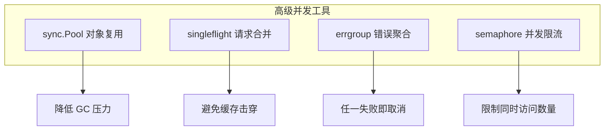

### 7.1 sync.Pool

> **是什么**：`sync.Pool` 像共享单车停放点。用完的"车"（临时对象）不销毁，放回池子里；下次有人要用直接骑走，省去了重新造车的成本。

> **为什么**：短时间内大量创建 / 销毁如 `bytes.Buffer`、大 `[]byte` 这类对象，会带来频繁的内存分配和 GC 压力。对象池把分配次数降下来，高并发场景下能显著提升吞吐。

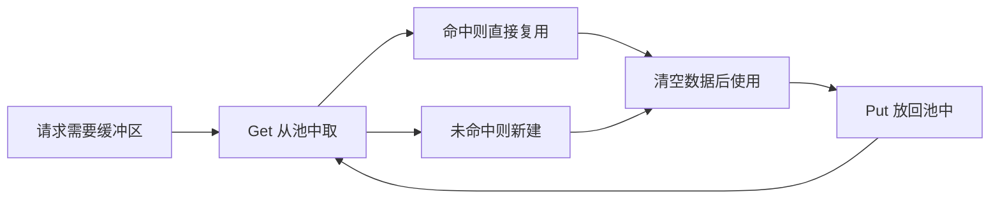

sync.Pool是一个临时对象池，用于存储和获取临时对象，减少内存分配和垃圾回收的压力。

**基本使用**

```go
type Buffer struct {
    data []byte
}

var bufferPool = sync.Pool{
    New: func() interface{} {
        return &Buffer{
            data: make([]byte, 0, 1024),
        }
    },
}

func processData(data []byte) {
    buf := bufferPool.Get().(*Buffer)
    defer bufferPool.Put(buf)
    
    buf.data = append(buf.data[:0], data...)
    
    fmt.Println("处理数据:", len(buf.data))
}

func main() {
    data := []byte("测试数据")
    for i := 0; i < 10; i++ {
        go processData(data)
    }
    time.Sleep(time.Second)
}
```

**使用场景**

sync.Pool适用于以下场景：
- 需要频繁创建和销毁的对象
- 对象的创建成本较高
- 对象可以被多个goroutine共享使用

**注意事项**

- sync.Pool中的对象可能会被垃圾回收
- 不要在sync.Pool中存储敏感信息
- sync.Pool不是线程安全的，每个goroutine应该独立使用

> ⚠️ **常见坑**：补充说明——`Pool.Get`/`Pool.Put` 自身是并发安全的，真正要小心的是**同一个对象被两个 goroutine 同时持有**。池中对象可能在任意一次 GC 被清空，**绝不能用来保存持久状态或连接**；对象放回前要重置（如 `buf.Reset()`），否则会残留上次的数据。

### 7.2 singleflight

> **是什么**：singleflight 像"拼团取号"。第一个人去窗口要资料时，后面有相同需求的人不重复问，而是等第一个人把结果带回来，大家一起用——相同 key 在这段时间只真正执行一次。

> **为什么**：缓存刚失效的瞬间，大量并发请求会同时穿透到数据库，把库压垮（缓存击穿）。singleflight 把这批请求合并成一次后端调用，其余请求共享结果。

singleflight是一种并发模式，用于抑制重复请求，确保同一时间只有一个goroutine执行相同的操作。

**基本使用**

```go
type Service struct {
    mu    sync.Mutex
    cache map[string]string
    group singleflight.Group
}

func NewService() *Service {
    return &Service{
        cache: make(map[string]string),
    }
}

func (s *Service) GetData(key string) (string, error) {
    s.mu.Lock()
    if value, ok := s.cache[key]; ok {
        s.mu.Unlock()
        return value, nil
    }
    s.mu.Unlock()

    result, err, _ := s.group.Do(key, func() (interface{}, error) {
        value, err := s.fetchFromDB(key)
        if err == nil {
            s.mu.Lock()
            s.cache[key] = value
            s.mu.Unlock()
        }
        return value, err
    })

    if err != nil {
        return "", err
    }
    return result.(string), nil
}

func (s *Service) fetchFromDB(key string) (string, error) {
    time.Sleep(time.Second)
    return fmt.Sprintf("数据: %s", key), nil
}

func main() {
    service := NewService()
    var wg sync.WaitGroup

    for i := 0; i < 10; i++ {
        wg.Add(1)
        go func() {
            defer wg.Done()
            value, err := service.GetData("key1")
            if err != nil {
                fmt.Println("错误:", err)
                return
            }
            fmt.Println("值:", value)
        }()
    }

    wg.Wait()
}
```

**使用场景**

singleflight适用于以下场景：
- 缓存失效时的并发请求
- 数据库查询的并发请求
- API调用的并发请求

> ⚠️ **常见坑**：`group.Do` 的 `fn` 里发生 panic 会传播给所有等待者，可能拖垮调用方，务必在 `fn` 内部处理好错误；singleflight 只合并"同一时刻"的请求，默认也不缓存结果，缓存失效问题仍需配合本地缓存 / 过期策略；共享的返回值禁止被调用方修改。

### 7.3 errgroup

> **是什么**：`errgroup` 是 `WaitGroup` 的"加强版"——不光等你干完，还会把第一个错误记下来；配合 `WithContext`，一旦有任务失败就自动取消其他任务。

> **为什么**：手写 `WaitGroup + error channel` 又长又容易漏（忘记 close、错误只留一个）。errgroup 把"等待 + 错误传播 + 取消"三件事一次搞定。

errgroup是一个用于管理多个goroutine错误的高级并发工具，可以方便地等待所有goroutine完成并收集错误。

**基本使用**

```go
func processURL(ctx context.Context, url string) error {
    resp, err := http.Get(url)
    if err != nil {
        return err
    }
    defer resp.Body.Close()
    
    if resp.StatusCode != http.StatusOK {
        return fmt.Errorf("请求失败: %s", url)
    }
    
    return nil
}

func main() {
    urls := []string{
        "https://example.com",
        "https://example.org",
        "https://example.net",
    }
    
    g, ctx := errgroup.WithContext(context.Background())
    
    for _, url := range urls {
        url := url
        g.Go(func() error {
            return processURL(ctx, url)
        })
    }
    
    if err := g.Wait(); err != nil {
        fmt.Println("处理失败:", err)
    } else {
        fmt.Println("所有请求成功")
    }
}
```

**限制并发数量**

```go
func main() {
    urls := make([]string, 100)
    for i := 0; i < 100; i++ {
        urls[i] = fmt.Sprintf("https://example.com/page%d", i)
    }
    
    g, ctx := errgroup.WithContext(context.Background())
    g.SetLimit(10)
    
    for _, url := range urls {
        url := url
        g.Go(func() error {
            return processURL(ctx, url)
        })
    }
    
    if err := g.Wait(); err != nil {
        fmt.Println("处理失败:", err)
    } else {
        fmt.Println("所有请求成功")
    }
}
```

> ⚠️ **常见坑**：`g.SetLimit(n)` 后 `g.Go` 会阻塞直到有空位，别在循环里无限塞任务导致内存膨胀；`errgroup` 返回的是**最早发生**的错误，其余错误会被丢弃，若要收集全部错误需自行用 channel 汇总；`WithContext` 派生的 ctx 在任一任务失败时被取消，任务内部必须监听它。

### 7.4 semaphore

> **是什么**：信号量像停车场的车位。车位一共 3 个，开进来一辆车就占一个位，满了就得在外面等，出去一辆才能再进一辆。

> **为什么**：访问数据库连接池、磁盘 IO、付费 API 等稀缺资源时，必须限制同时进入的 goroutine 数量，否则会把资源打爆。

semaphore是一种并发控制机制，用于限制同时访问某个资源的goroutine数量。

**基本实现**

```go
type Semaphore struct {
    ch chan struct{}
}

func NewSemaphore(limit int) *Semaphore {
    return &Semaphore{
        ch: make(chan struct{}, limit),
    }
}

func (s *Semaphore) Acquire() {
    s.ch <- struct{}{}
}

func (s *Semaphore) Release() {
    <-s.ch
}

func worker(id int, sem *Semaphore) {
    sem.Acquire()
    defer sem.Release()
    
    fmt.Printf("Worker %d 开始工作\n", id)
    time.Sleep(time.Second)
    fmt.Printf("Worker %d 完成工作\n", id)
}

func main() {
    sem := NewSemaphore(3)
    var wg sync.WaitGroup

    for i := 1; i <= 10; i++ {
        wg.Add(1)
        go func(id int) {
            defer wg.Done()
            worker(id, sem)
        }(i)
    }

    wg.Wait()
}
```

**带超时的获取**

```go
func (s *Semaphore) AcquireWithTimeout(timeout time.Duration) bool {
    select {
    case s.ch <- struct{}{}:
        return true
    case <-time.After(timeout):
        return false
    }
}

func workerWithTimeout(id int, sem *Semaphore) {
    if !sem.AcquireWithTimeout(2 * time.Second) {
        fmt.Printf("Worker %d 获取信号量超时\n", id)
        return
    }
    defer sem.Release()
    
    fmt.Printf("Worker %d 开始工作\n", id)
    time.Sleep(time.Second)
    fmt.Printf("Worker %d 完成工作\n", id)
}

func main() {
    sem := NewSemaphore(3)
    var wg sync.WaitGroup

    for i := 1; i <= 10; i++ {
        wg.Add(1)
        go func(id int) {
            defer wg.Done()
            workerWithTimeout(id, sem)
        }(i)
    }

    wg.Wait()
}
```

> ⚠️ **常见坑**：用 buffered channel 实现的信号量，只有 `Acquire` 成功后才需要 `Release`；若 `AcquireWithTimeout` 返回 false，**就不能再 Release**，否则会凭空多出令牌。`Release` 一般紧跟 `defer`，保证异常路径也能归还。channel 容量即最大并发数，别和"限流令牌桶"混淆。

### 7.5 实例：并发下载器

让我们用一个实际的例子来巩固本章学到的知识。我们将实现一个并发下载器，使用singleflight避免重复下载，使用semaphore限制并发数量。

```go
package main

import (
    "context"
    "fmt"
    "io"
    "net/http"
    "os"
    "path/filepath"
    "sync"
    "time"

    "golang.org/x/sync/errgroup"
    "golang.org/x/sync/singleflight"
)

type Downloader struct {
    semaphore   *Semaphore
    group       singleflight.Group
    downloadDir string
}

func NewDownloader(workers int, downloadDir string) *Downloader {
    return &Downloader{
        semaphore:   NewSemaphore(workers),
        downloadDir: downloadDir,
    }
}

func (d *Downloader) Download(ctx context.Context, url string) (string, error) {
    if !d.semaphore.AcquireWithTimeout(5 * time.Second) {
        return "", fmt.Errorf("获取下载信号量超时")
    }
    defer d.semaphore.Release()

    result, err, _ := d.group.Do(url, func() (interface{}, error) {
        return d.doDownload(ctx, url)
    })

    if err != nil {
        return "", err
    }
    return result.(string), nil
}

func (d *Downloader) doDownload(ctx context.Context, url string) (string, error) {
    req, err := http.NewRequestWithContext(ctx, "GET", url, nil)
    if err != nil {
        return "", fmt.Errorf("创建请求失败: %w", err)
    }

    resp, err := http.DefaultClient.Do(req)
    if err != nil {
        return "", fmt.Errorf("请求失败: %w", err)
    }
    defer resp.Body.Close()

    if resp.StatusCode != http.StatusOK {
        return "", fmt.Errorf("HTTP状态码: %d", resp.StatusCode)
    }

    filename := filepath.Base(url)
    filepath := filepath.Join(d.downloadDir, filename)

    file, err := os.Create(filepath)
    if err != nil {
        return "", fmt.Errorf("创建文件失败: %w", err)
    }
    defer file.Close()

    _, err = io.Copy(file, resp.Body)
    if err != nil {
        return "", fmt.Errorf("写入文件失败: %w", err)
    }

    fmt.Printf("下载完成: %s -> %s\n", url, filepath)
    return filepath, nil
}

func main() {
    downloadDir := "./downloads"
    os.MkdirAll(downloadDir, 0755)

    downloader := NewDownloader(3, downloadDir)

    urls := []string{
        "https://example.com/file1.txt",
        "https://example.com/file2.txt",
        "https://example.com/file3.txt",
    }

    ctx, cancel := context.WithTimeout(context.Background(), 30*time.Second)
    defer cancel()

    g, ctx := errgroup.WithContext(ctx)

    for _, url := range urls {
        url := url
        g.Go(func() error {
            filepath, err := downloader.Download(ctx, url)
            if err != nil {
                return fmt.Errorf("下载 %s 失败: %w", url, err)
            }
            fmt.Printf("文件已保存: %s\n", filepath)
            return nil
        })
    }

    if err := g.Wait(); err != nil {
        fmt.Println("下载失败:", err)
    } else {
        fmt.Println("所有文件下载完成")
    }
}
```

这个程序：
1. 使用semaphore限制并发下载数量
2. 使用singleflight避免重复下载
3. 使用errgroup管理多个下载任务
4. 使用context控制超时
5. 提供了完整的错误处理

### 7.6 小结

本章介绍了Go语言的高级并发特性，包括sync.Pool、singleflight、errgroup、semaphore等。我们学习了每种高级特性的使用方法和注意事项。sync.Pool可以减少内存分配和垃圾回收的压力，singleflight可以抑制重复请求，errgroup可以方便地管理多个goroutine的错误，semaphore可以限制并发数量。掌握好这些高级并发特性对于编写高效的并发程序非常重要。

**面试题**

1. `sync.Pool` 的原理与适用场景？为什么池中对象可能随时被回收？
2. `singleflight` 解决什么问题？在缓存击穿场景下如何应用？
3. `errgroup` 与 `sync.WaitGroup` 的区别？`g.SetLimit` 有什么用？
4. 用 buffered channel 实现 semaphore 的原理是什么？`Acquire` 失败后能否 `Release`？
5. `golang.org/x/sync` 还提供哪些实用工具（如 `semaphore.Weighted`、`sync/singleflight`）？

## 总结

本文档系统地介绍了Go语言的并发编程，从基础的并发概念到高级的并发特性，涵盖了并发编程的各个方面。我们学习了：

1. **并发基础**：并发与并行的区别、goroutine的使用、channel的操作
2. **并发模式**：Worker Pool、Pipeline、Fan-out/Fan-in、Context等常见模式
3. **并发调试和优化**：竞态检测、性能分析、并发优化技术
4. **并发实践**：并发Web服务、并发数据处理、并发任务调度
5. **并发测试**：并发单元测试、并发基准测试、并发压力测试
6. **并发最佳实践**：并发设计原则、并发代码组织、并发错误处理
7. **高级并发特性**：sync.Pool、singleflight、errgroup、semaphore等

Go语言的并发编程模型简单而强大，通过goroutine和channel的组合，可以轻松地编写高效的并发程序。掌握好Go语言的并发编程技术，对于编写高性能、高可靠性的应用程序至关重要。

希望本文档能够帮助你更好地理解和掌握Go语言的并发编程。祝你在Go语言的并发编程之路上越走越远！

## 附录：高频面试题汇总

1. 并发与并行的区别？Go 为什么选择 CSP 模型？
2. goroutine 与操作系统线程的区别？GMP 模型各自代表什么？
3. 无缓冲与带缓冲 channel 的同步差异？容量为 1 的缓冲 channel 能当锁吗？
4. 向已关闭 / nil channel 收发数据分别会发生什么？谁负责关闭 channel？
5. `sync.Mutex`、`RWMutex`、`atomic`、`sync.Map` 的适用场景与取舍？
6. 什么是数据竞争？`-race` 的原理与局限？
7. 死锁、活锁、goroutine 泄漏的成因与排查方式？
8. 循环中启动 goroutine 捕获循环变量有什么坑？Go 1.22 有何变化？
9. `context` 的取消如何逐级传播？为什么 `cancel()` 必须调用？
10. `context.Value` 适合放什么？为什么推荐自定义 key 类型？
11. Worker Pool 如何优雅关闭并保证任务不丢？
12. Pipeline 模式中错误如何传递？忘记 `close` 会怎样？
13. Fan-out / Fan-in 各自解决什么问题？Fan-in 为何要单独 goroutine 收尾？
14. 并发 Web 服务如何做限流、超时与共享状态保护？
15. 为什么 `http.Client` 必须自定义超时？如何避免 goroutine 泄漏？
16. 并发测试为什么要配 `-race`？`b.RunParallel` 怎么用？
17. 如何用 `pprof` 定位 CPU、内存与 goroutine 瓶颈？
18. 减少锁争用的常用手段有哪些？什么是分段锁？
19. 子 goroutine 中 panic 会发生什么？如何兜底？
20. `errgroup` 的错误语义？如何限制并发数？
21. `sync.Pool` 的原理与注意事项？对象何时被回收？
22. `singleflight` 如何防止缓存击穿？
23. 用 buffered channel 实现 semaphore 的原理？
24. 并发性能优化有哪些手段与误区？为什么不要过早优化？
