# Go 语言微服务 —— 现代架构实践

> 面向对象：已经会写 HTTP / gRPC 服务、懂数据库与缓存，想进入"分布式架构"世界的同学。
> 阅读方式：先建立"为什么"的全局观，再看"怎么做"的代码，最后用第十一章的完整项目把所有零件拼成系统。
> 环境要求：Go 1.22+；示例依赖用 `docker compose` 一键启动，无需手工装中间件。

## 目录

- [第一章 微服务架构总览](#第一章-微服务架构总览)
- [第二章 服务通信：REST 与 gRPC](#第二章-服务通信rest-与-grpc)
- [第三章 服务注册与发现](#第三章-服务注册与发现)
- [第四章 配置中心](#第四章-配置中心)
- [第五章 API 网关](#第五章-api-网关)
- [第六章 服务容错与治理](#第六章-服务容错与治理)
- [第七章 分布式事务与一致性](#第七章-分布式事务与一致性)
- [第八章 可观测性](#第八章-可观测性)
- [第九章 消息驱动与事件架构](#第九章-消息驱动与事件架构)
- [第十章 部署与运维](#第十章-部署与运维)
- [第十一章 实战：电商微服务系统](#第十一章-实战电商微服务系统)
- [附录：微服务高频面试专题](#附录微服务高频面试专题)

---

## 第一章 微服务架构总览

### 1.1 什么是微服务

**微服务**是一种把单个应用拆成**一组小型、独立部署的服务**的架构风格，每个服务围绕一项业务能力构建，拥有自己的数据存储，通过轻量协议（HTTP/gRPC/消息）通信。

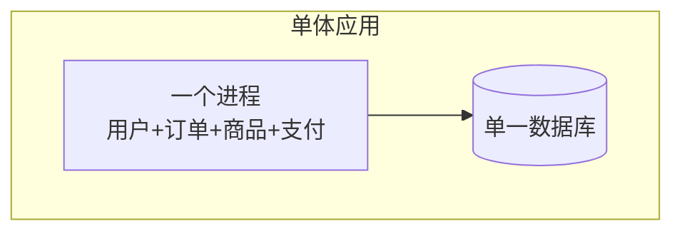

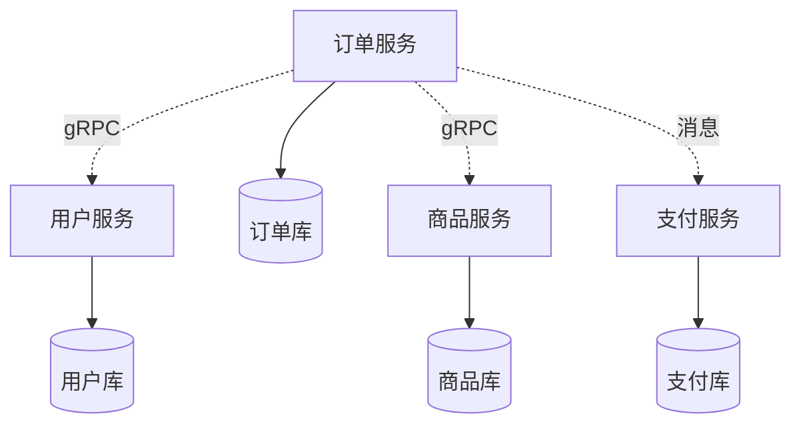

| 维度 | 单体 | 微服务 |
|---|---|---|
| 部署 | 一个包整体部署 | 每个服务独立部署 |
| 数据库 | 通常共享 | **每服务独享** |
| 扩展 | 整体扩容 | 按热点服务单独扩容 |
| 技术栈 | 统一 | 可异构 |
| 故障 | 一处崩溃可能全挂 | 故障隔离 |
| 复杂度 | 代码耦合 | **分布式复杂度** |
| 团队 | 大团队协作难 | 小团队自治（对应康威定律） |

### 1.2 从单体到微服务：不要一步到位

**微服务的成本极高**，绝大多数团队应该先走"模块化单体"，遇到瓶颈再拆。


**拆分的时机**（满足其一再拆）：

- 某个模块需要**独立扩容**（如秒杀）；
- 团队规模变大，**协作冲突**严重；
- 模块需要**不同技术栈**或发布节奏；
- 单体发布周期已经拖慢整个团队。

> ⚠️ 反模式：**分布式单体** —— 拆成了一堆服务，但每次改动要同时发布五个，还共享一个数据库。这比单体更糟。

### 1.3 服务边界怎么划：DDD 限界上下文

划边界是微服务最难也最关键的一步。核心方法是**领域驱动设计（DDD）的限界上下文**：一个业务概念的**含义**只在一个上下文内唯一。

例子：同样是"商品"，

- 在**商品上下文**里，商品有标题、详情、库存、价格；
- 在**订单上下文**里，"商品"只是一个快照（下单时的名称和价格），因为价格会变。

结论：**订单服务不应直接查商品库**，而应保存下单时刻的商品快照。**不同上下文，模型不同，边界就出来了。**

**康威定律**：系统架构会趋同于组织沟通结构。所以边界设计要和团队组织一起考虑。

### 1.4 微服务带来的新问题

拆开只是开始，随之而来的是**分布式复杂性**，本教程后面每一章都在解决其中一类：

| 问题 | 对应章节 |
|---|---|
| 服务之间怎么找、怎么通信 | 第二、三章 |
| 配置如何集中管理 | 第四章 |
| 外部入口如何统一治理 | 第五章 |
| 一个服务挂了如何不拖垮全局 | 第六、七章 |
| 一条请求跨了 8 个服务，出错怎么查 | 第八章 |
| 如何部署几十个服务 | 第十章 |

### 1.5 本章小结与面试题

**要点回顾**：微服务是"业务能力 + 独立数据 + 独立部署"；先模块化单体，按瓶颈拆；边界靠 DDD 限界上下文；警惕分布式单体。

**面试题**：微服务与单体的取舍？服务拆分的原则？什么是康威定律？什么是分布式单体？

---

## 第二章 服务通信：REST 与 gRPC

### 2.1 通信方式全景

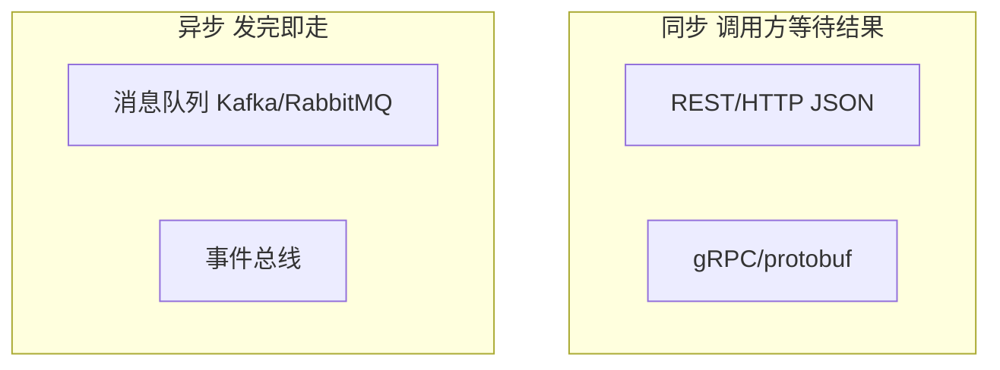

- **同步**：简单直观，但会形成调用链，一处变慢会传导；适合"必须拿到结果才能继续"的场景（查用户）。
- **异步**：解耦、削峰，但一致性变复杂（见第九章）；适合"通知/记录/最终一致"的场景（发积分）。

### 2.2 REST vs gRPC 怎么选

| 维度 | REST (HTTP/JSON) | gRPC (HTTP/2 + protobuf) |
|---|---|---|
| 数据格式 | 文本 JSON，可读 | 二进制，体积小、快 |
| 契约 | OpenAPI 文档 | `.proto` 强类型契约 |
| 流式 | 弱（SSE/WS） | 原生四种流模式 |
| 浏览器直连 | 天然支持 | 需 grpc-web |
| 调试 | curl 即可 | 需 grpcurl/工具 |
| 适合 | 对外 API、Web 前端 | **服务间内部调用** |

**经验法则**：**对外用 REST，对内用 gRPC**。对外要的是通用性和可调试性，对内要的是性能和强契约。

### 2.3 gRPC 深入

**（1）定义 proto 契约**

```protobuf
syntax = "proto3";

package user.v1;

option go_package = "example.com/gen/user/v1;userv1";

service UserService {
  rpc GetUser(GetUserRequest) returns (GetUserResponse);
  rpc ListUsers(ListUsersRequest) returns (stream User); // 服务端流
}

message GetUserRequest { string id = 1; }
message GetUserResponse { User user = 1; }
message ListUsersRequest { int32 page_size = 1; }
message User {
  string id = 1;
  string name = 2;
  string email = 3;
}
```

生成代码：

```bash
protoc --go_out=. --go-grpc_out=. user.proto
```

**（2）服务端与客户端**

```go
// 服务端
type userServer struct {
	userv1.UnimplementedUserServiceServer // 前向兼容：新增方法不会编译报错
}

func (s *userServer) GetUser(ctx context.Context, req *userv1.GetUserRequest) (*userv1.GetUserResponse, error) {
	u, err := repo.Find(ctx, req.GetId())
	if err != nil {
		return nil, status.Errorf(codes.NotFound, "user %s not found", req.GetId())
	}
	return &userv1.GetUserResponse{User: &userv1.User{Id: u.ID, Name: u.Name}}, nil
}

func main() {
	lis, _ := net.Listen("tcp", ":50051")
	srv := grpc.NewServer(
		grpc.UnaryInterceptor(serverLoggingInterceptor),
	)
	userv1.RegisterUserServiceServer(srv, &userServer{})
	srv.Serve(lis)
}
```

```go
// 客户端
conn, err := grpc.NewClient("dns:///user-service:50051",
	grpc.WithTransportCredentials(insecure.NewCredentials()),
	grpc.WithUnaryInterceptor(clientTracingInterceptor),
)
defer conn.Close()
client := userv1.NewUserServiceClient(conn)

ctx, cancel := context.WithTimeout(context.Background(), 500*time.Millisecond)
defer cancel()
resp, err := client.GetUser(ctx, &userv1.GetUserRequest{Id: "42"})
```

**（3）gRPC 错误码**

gRPC 有**标准化状态码**，不要自己乱造：

| codes | 含义 | 对应 HTTP |
|---|---|---|
| `OK` | 成功 | 200 |
| `InvalidArgument` | 参数错误 | 400 |
| `Unauthenticated` | 未认证 | 401 |
| `PermissionDenied` | 无权限 | 403 |
| `NotFound` | 不存在 | 404 |
| `DeadlineExceeded` | 超时 | 504 |
| `Unavailable` | 服务不可用（可重试） | 503 |

**（4）拦截器**：gRPC 的"中间件"，用于日志、鉴权、链路追踪、限流。

```go
func serverLoggingInterceptor(
	ctx context.Context, req interface{},
	info *grpc.UnaryServerInfo, handler grpc.UnaryHandler,
) (interface{}, error) {
	start := time.Now()
	resp, err := handler(ctx, req)
	slog.Info("grpc_call", "method", info.FullMethod,
		"cost_ms", time.Since(start).Milliseconds(), "err", err)
	return resp, err
}
```

### 2.4 为什么 protobuf 更快

- **二进制编码**：只传字段编号 + 值，不带字段名，体积比 JSON 小 3~10 倍。
- **HTTP/2 多路复用**：一条连接并发跑多个请求，没有 HTTP/1.1 的队头阻塞。
- **强类型契约**：`.proto` 是唯一事实来源，前后端/服务间不会再"字段对不上"。

> **面试点**：protobuf 用**字段编号**标识字段，所以改字段只能加新编号、不能复用旧编号，这也是它前向兼容的基础。

### 2.5 契约版本管理

- 文件路径带版本：`user/v1/user.proto`，新增不兼容改动时开 `v2`。
- **只增不改不删**：新增字段给新编号；字段废弃用 `reserved` 标记，避免编号被误用。

### 2.6 本章小结与面试题

**要点回顾**：对内 gRPC 对外 REST；gRPC 四种流 + 标准错误码 + 拦截器；protobuf 靠字段编号兼容。

**面试题**：gRPC 为什么比 REST 快？四种流模式？gRPC 如何做鉴权和超时？protobuf 的兼容规则？

---

## 第三章 服务注册与发现

### 3.1 为什么需要

微服务实例是**动态的**：K8s 里 Pod 重建后 IP 会变，自动扩缩容实例数也在变。**硬编码 IP 必然失败**，所以需要注册中心。

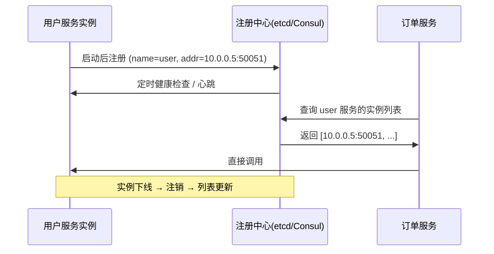

### 3.2 注册中心选型

| 注册中心 | 一致性 | 特点 | 适合 |
|---|---|---|---|
| **etcd** | CP (Raft) | K8s 底层，强一致，API 简洁 | 云原生、Go 生态 |
| **Consul** | CP | 功能全（健康检查/DNS/多数据中心） | 传统微服务 |
| **Nacos** | AP/CP 可选 | 阿里开源，注册 + 配置一体，控制台友好 | 国内团队首选 |

> CAP 简述：网络分区（P）在分布式系统中不可避免，所以只能**在一致性和可用性之间二选一**。注册中心一般要求**强一致**（CP），否则可能拿到已下线的实例。

### 3.3 客户端发现 vs 服务端发现

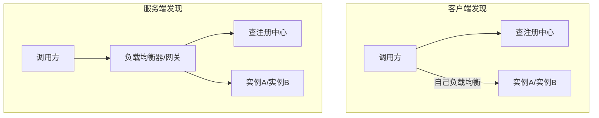

- **客户端发现**：调用方自己查列表 + 选实例（配合 gRPC 的 `round_robin` resolver）。性能好，但每个语言都要实现。
- **服务端发现**：交给网关/K8s Service。简单，但多一跳。

### 3.4 实战：基于 etcd 的注册

```bash
go get go.etcd.io/etcd/client/v3
```

```go
import (
	"context"
	"time"

	clientv3 "go.etcd.io/etcd/client/v3"
)

// 注册：把地址写到 /services/<name>/<instance-id>，并租约续期
func Register(client *clientv3.Client, service, addr string) error {
	key := "/services/" + service + "/" + addr
	// 申请 10 秒租约
	lease, err := client.Grant(context.Background(), 10)
	if err != nil {
		return err
	}
	if _, err := client.Put(context.Background(), key, addr, clientv3.WithLease(lease.ID)); err != nil {
		return err
	}
	// 持续续租；进程崩溃则租约到期，key 自动消失（自动注销）
	ch, err := client.KeepAlive(context.Background(), lease.ID)
	if err != nil {
		return err
	}
	go func() {
		for range ch {
			// 续租成功
		}
	}()
	return nil
}

// 发现 + 监听变化
func Watch(client *clientv3.Client, service string) {
	prefix := "/services/" + service + "/"
	resp, _ := client.Get(context.Background(), prefix, clientv3.WithPrefix())
	for _, kv := range resp.Kvs {
		slog.Info("发现实例", "addr", string(kv.Value))
	}
	// 监听后续增删
	client.Watch(context.Background(), prefix, clientv3.WithPrefix())
}
```

> **精髓**：用**租约（Lease）**实现自动注销。实例挂了不再续租，key 到期自动删除，调用方立刻感知。

### 3.5 本章小结与面试题

**要点回顾**：注册中心解决动态地址；etcd/Consul 强一致，Nacos 注册+配置一体；客户端/服务端发现各有取舍；租约实现自动注销。

**面试题**：为什么需要注册中心？CAP 如何影响选型？客户端发现和服务端发现的区别？如何实现实例自动下线？

---

## 第四章 配置中心

### 4.1 为什么不能把配置写在文件里

多服务、多环境（dev/test/prod）、频繁变更的配置（限流阈值、开关、数据库地址），如果放在代码仓库或镜像里：

- 改一个阈值要**重新打包发布**；
- 生产密码**进了 Git**（安全事故）；
- 各服务配置**散落各处**，无法统一审计。

**配置中心**提供：集中存储、按环境/服务隔离、**热更新**、权限审计。

### 4.2 选型

| 方案 | 特点 |
|---|---|
| **Nacos** | 注册 + 配置一体，有控制台，支持热更新，国内常用 |
| **Apollo**（携程） | 配置专业，灰度发布、权限、审计强 |
| **Consul KV** | 轻量，适合已有 Consul 的团队 |
| **K8s ConfigMap/Secret** | K8s 原生，适合纯容器环境 |

### 4.3 热更新原理：Watch / 长轮询

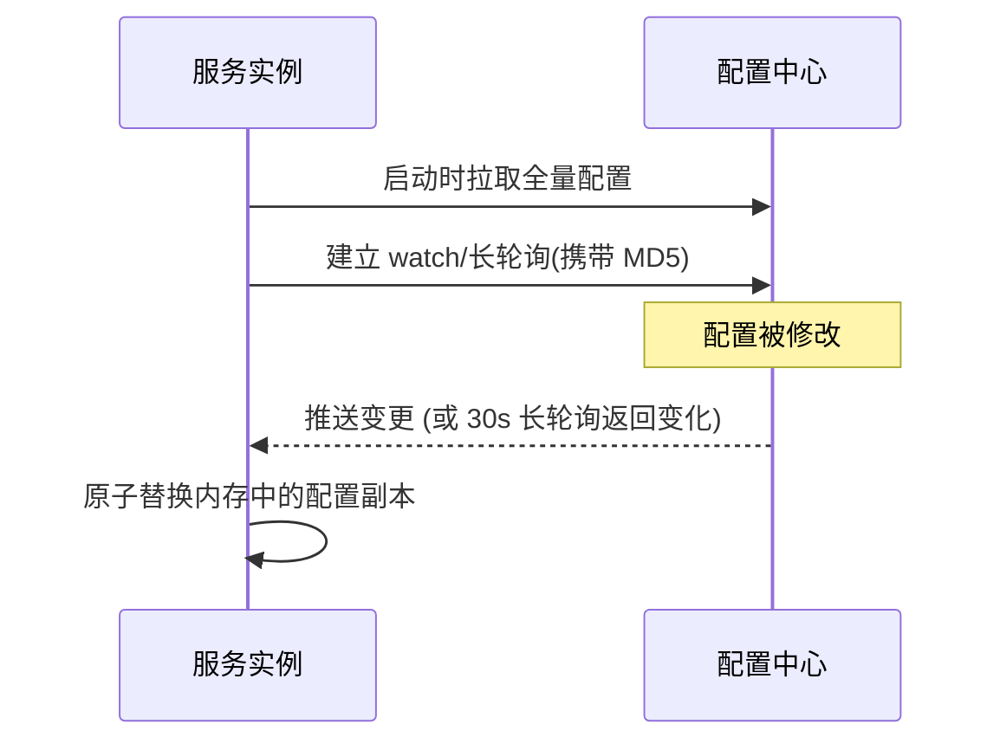

**关键实现要点**：

- 配置读取要**并发安全**：用 `atomic.Value` 或 `sync.RWMutex` 保护，读多写少。
- **变更要可回滚**：保留上一版本，异常时快速切回。
- **敏感信息加密**：密码、密钥用 KMS/Vault 加密，或走 Secret。

```go
type ConfigStore struct {
	v atomic.Value // 存 *Config
}

func (s *ConfigStore) Load() *Config { return s.v.Load().(*Config) }

func (s *ConfigStore) Update(c *Config) { s.v.Store(c) } // 配置变更时调用

// 注意：不要在热路径每次读取都解析 JSON，应缓存已解析对象
```

### 4.4 本章小结与面试题

**要点回顾**：配置中心解决"改配置不用发版"；热更新靠 watch/长轮询；读取要并发安全；敏感配置要加密。

**面试题**：配置中心和注册中心的区别？配置热更新怎么实现？如何保证配置变更不出事故（灰度/回滚）？

---

## 第五章 API 网关

### 5.1 网关是流量的唯一入口

外部请求**不直接打服务**，而是先经过网关。网关统一处理横切关注点：

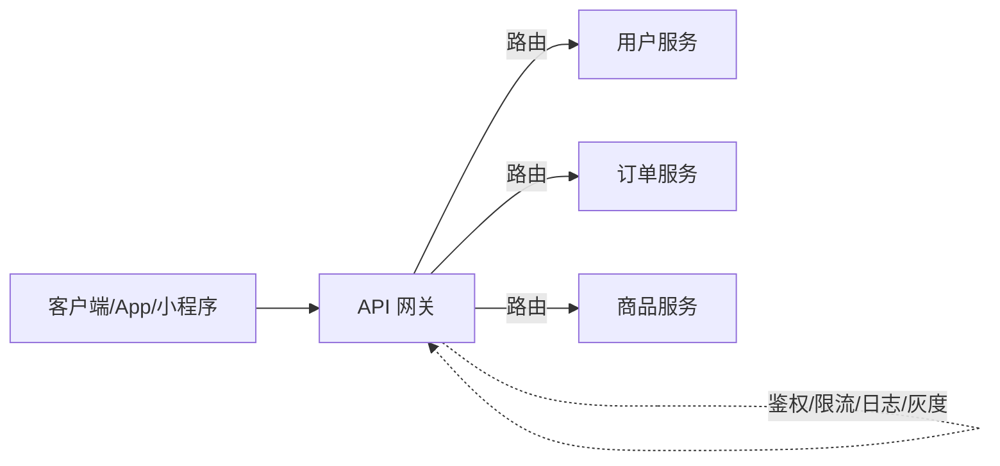

**网关的职责**：

- **路由**：`/api/v1/orders/**` → 订单服务。
- **认证鉴权**：在入口统一校验 JWT，后端服务不再各写一遍。
- **限流/熔断**：保护后端。
- **协议转换**：外部 REST ↔ 内部 gRPC。
- **灰度/AB 测试**：按 header/用户分流。
- **日志与监控**：所有流量集中观测。

### 5.2 选型

| 网关 | 语言/生态 | 特点 |
|---|---|---|
| **Kong** | OpenResty(Nginx) | 插件生态丰富，成熟 |
| **APISIX** | OpenResty | 国内活跃，性能好，动态配置 |
| **Traefik** | Go | 云原生友好，自动发现 K8s |
| **自研** | Go | 契合业务，可深度定制 |

Go 自研精简网关的核心就是"**反向代理 + 中间件链**"：

```go
func NewGateway(routes map[string]string, auth MW) http.Handler {
	mux := http.NewServeMux()
	for prefix, target := range routes {
		proxy := httputil.NewSingleHostReverseProxy(mustURL(target))
		mux.Handle(prefix, proxy)
	}
	return Chain(mux, auth, RateLimit(1000, 2000), Logging(logger))
}
```

### 5.3 BFF：为不同前端定制聚合层

**BFF（Backend For Frontend）**：为 App、Web、小程序各建一个聚合服务，把多个后端服务的调用聚合成一个接口，减少客户端请求次数，也避免把展示逻辑污染到领域服务。

### 5.4 本章小结与面试题

**要点回顾**：网关是统一入口，处理鉴权/限流/路由/灰度；Go 自研网关=反代+中间件；BFF 做前端定制聚合。

**面试题**：网关的作用？网关如何做鉴权？BFF 是什么、解决什么问题？网关会不会成为单点/瓶颈（如何高可用）？

---

## 第六章 服务容错与治理

微服务中"**依赖必然失败**"，容错的目标是：**局部故障不扩散成雪崩**。

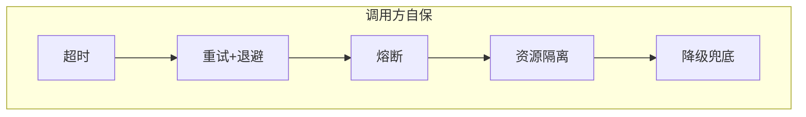

各项细节（超时/重试/熔断/隔离/降级）在[《中间件与工具集成》第七章](go-middleware.md#第七章-容错限流--熔断--重试--超时)已有完整代码，这里强调微服务场景下的组合原则：

1. **超时逐层递减**：网关 3s → 服务 A 1s → 服务 B 500ms。下游超时必须小于上游，否则上游超时了下游还在跑。
2. **只重试幂等 + 可重试错误**：`Unavailable`/`DeadlineExceeded` 可重试，`InvalidArgument` 重试无意义。
3. **熔断 + 降级成对出现**：熔断打开后必须有兜底返回，否则用户直接看到错误。
4. **隔离线程/连接**：一个慢依赖不能占满所有协程，用信号量或独立连接池限制并发。
5. **重试要加抖动**：否则所有实例同时重试，形成"重试风暴"把下游彻底打垮。

> **一句话**：**超时是底线，熔断是开关，降级是保命，隔离是防火墙。**

---

## 第七章 分布式事务与一致性

### 7.1 为什么分布式事务难

单机数据库靠 ACID 事务保证原子性。但微服务中"下单扣库存 + 扣余额"分属两个服务和两个库，**没有全局事务**。而且根据 CAP，跨服务的强一致会牺牲可用性。

**BASE 理论**：基本可用（Basically Available）、软状态（Soft state）、最终一致（Eventually consistent）—— 微服务普遍选择**最终一致性**。

### 7.2 方案对比

| 方案 | 一致性 | 复杂度 | 适合 |
|---|---|---|---|
| 2PC（两阶段提交） | 强 | 高、阻塞 | 数据库层，少用于微服务 |
| TCC | 强（业务补偿） | 高 | 资金类，需 Try/Confirm/Cancel |
| Saga | 最终 | 中 | 长流程业务（订单履约） |
| 本地消息表 | 最终 | 低 | **最常用**，与业务同库 |
| 事务消息（RocketMQ） | 最终 | 中 | 有 MQ 基础设施时 |

### 7.3 Saga：把长事务拆成"正向 + 补偿"

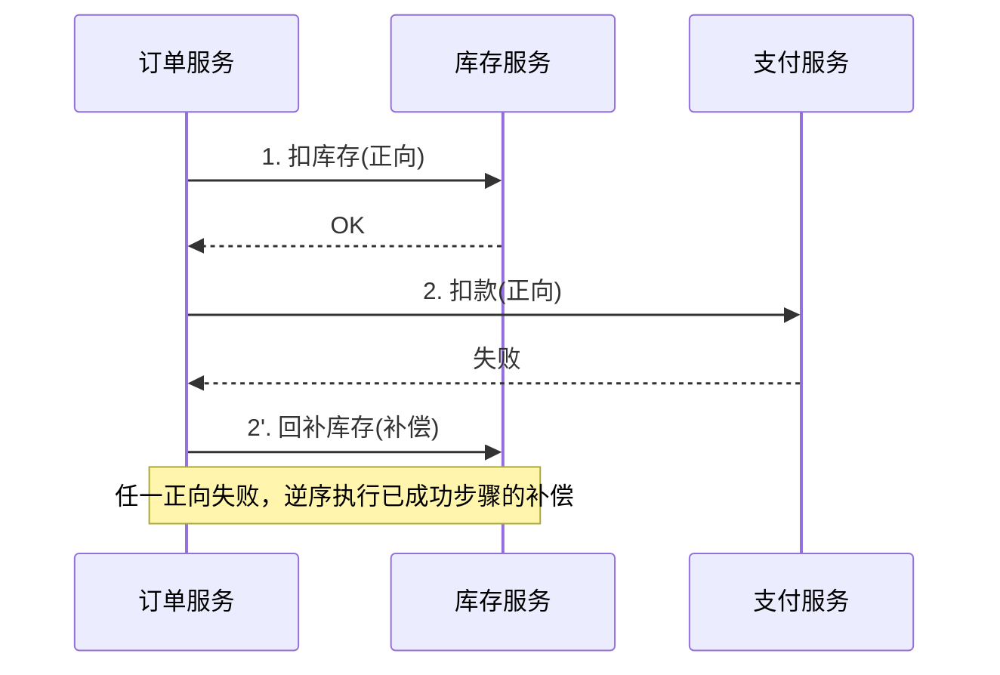

每个步骤都要有一个**补偿操作**（扣库存 → 加回库存）。补偿必须**幂等**。

### 7.4 本地消息表：最实用的最终一致性

**思路**：把"业务操作"和"要发的消息"放在**同一个本地事务**里，再由后台任务把消息投递给 MQ。

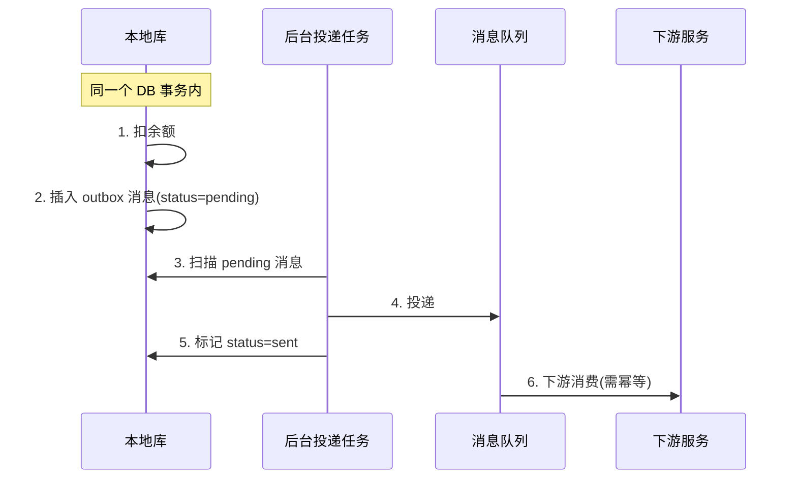

```go
func PayAndNotify(ctx context.Context, db *sql.DB, orderID string, amount float64) error {
	tx, err := db.BeginTx(ctx, nil)
	if err != nil {
		return err
	}
	defer tx.Rollback()

	// 1. 业务操作
	if _, err := tx.ExecContext(ctx, "UPDATE accounts SET balance = balance - ? WHERE id = ?", amount, orderID); err != nil {
		return err
	}
	// 2. 同事务写消息表（保证"业务成功则消息一定存在"）
	if _, err := tx.ExecContext(ctx,
		"INSERT INTO outbox(id, topic, payload, status) VALUES(?,?,?,'pending')",
		orderID, "order.paid", `{"order_id":"`+orderID+`"}`); err != nil {
		return err
	}
	return tx.Commit()
}
```

后台任务轮询 `outbox` 表投递 MQ，投递成功后标记 `sent`；下游必须**幂等消费**（见中间件篇 4.3）。

### 7.5 幂等：分布式一致性的地基

任何"可能重复"的操作都要幂等。常用手段：

- **唯一键约束**：数据库唯一索引，重复插入直接失败。
- **状态机**：只允许 `待支付 → 已支付`，重复回调第二次因状态不符被拒。
- **Redis SETNX 去重**：见中间件篇。

### 7.6 本章小结与面试题

**要点回顾**：微服务普遍选最终一致性（BASE）；常用本地消息表；Saga 靠补偿；幂等是一切基础。

**面试题**：CAP 与 BASE？2PC/TCC/Saga 区别？本地消息表如何保证不丢消息？如何设计幂等？

---

## 第八章 可观测性

分布式系统里"**看不到就等于没有**"。可观测性三支柱：**日志 Logging、指标 Metrics、链路追踪 Tracing**。

### 8.1 分布式追踪原理：Trace 与 Span

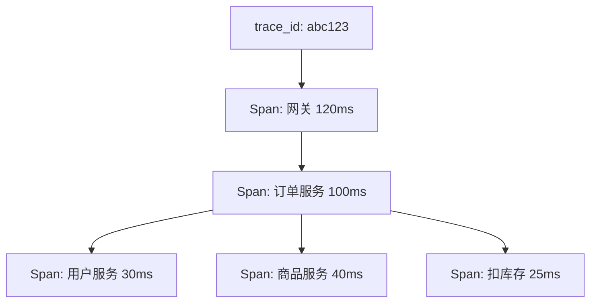

- **Trace**：一次完整请求的调用树，用 `trace_id` 标识。
- **Span**：一次具体操作（一次 RPC / 一次 DB 查询），记录起止时间、父 span。
- **上下文传播**：`trace_id` / `span_id` 通过 HTTP header（`traceparent`）或 gRPC metadata 在服务间传递。

### 8.2 用 OpenTelemetry 落地

OpenTelemetry（OTel）是**厂商中立的统一标准**，一套 API 可导出到 Jaeger、Zipkin、Tempo 等。

```go
// 在 HTTP 中间件中创建 span
func TracingMW(service string) mw.Middleware {
	tracer := otel.Tracer(service)
	return func(next http.Handler) http.Handler {
		return http.HandlerFunc(func(w http.ResponseWriter, r *http.Request) {
			// 从上游 header 提取上下文，形成同一条 trace
			ctx := otel.GetTextMapPropagator().Extract(r.Context(), propagation.HeaderCarrier(r.Header))
			ctx, span := tracer.Start(ctx, r.Method+" "+r.URL.Path)
			defer span.End()

			next.ServeHTTP(w, r.WithContext(ctx))
		})
	}
}

// 出站调用注入上下文（HTTP 客户端 / gRPC 拦截器同理）
otel.GetTextMapPropagator().Inject(ctx, propagation.HeaderCarrier(req.Header))
```

配套 `otelhttp`、`otelgrpc` 会自动埋点，无需手写。

### 8.3 一次线上排查的完整链路

**场景**：用户投诉"下单很慢"。

1. **指标定位**：Grafana 面板显示 `order_create_duration` 的 **P99 从 200ms 飙到 3s**。
2. **追踪下钻**：在 Jaeger 里按 `order_create` 过滤，找到慢 trace，看到耗时集中在 `user-service.GetUser` 这个 span。
3. **日志佐证**：用该 trace 的 `trace_id` 去日志系统（Loki/ELK）搜索，看到 `timeout` 和下游连接池打满的 warn 日志。
4. **定位根因**：用户服务某实例连接池泄漏，导致响应变慢。
5. **修复 + 验证**：修复后指标回落，trace 恢复正常。

> 这就是三支柱**互相配合**的价值：指标发现问题，追踪定位服务，日志找到原因。

### 8.4 本章小结与面试题

**要点回顾**：三支柱各司其职；trace_id 靠 header 跨服务传播；OTel 是统一标准；排障是"指标→追踪→日志"的漏斗。

**面试题**：Trace 和 Span 的关系？trace_id 如何跨服务传递？采样策略（头部采样 vs 尾部采样）？为什么平均值会骗人？

---

## 第九章 消息驱动与事件架构

### 9.1 从"调用"到"事件"

命令式（"你去扣库存"）耦合强；**事件驱动**（"订单已创建"）让生产者和消费者互不关心。

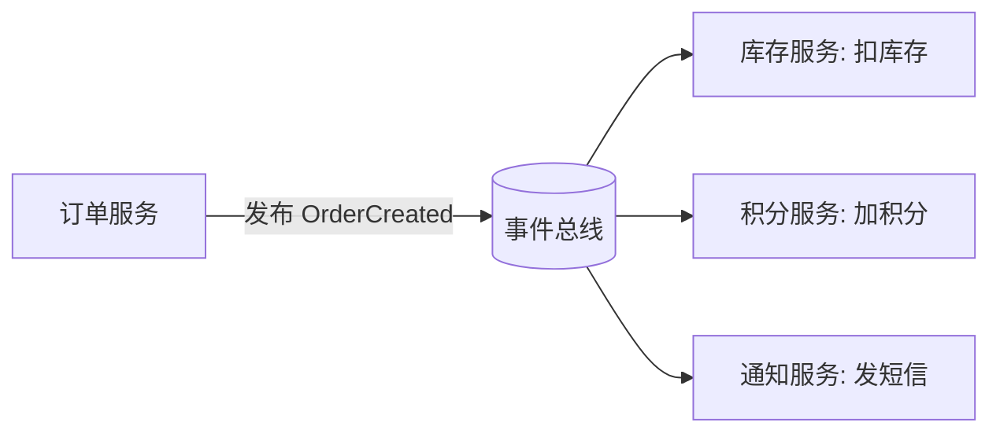

好处：**新增消费者不改生产者**（开放-封闭）；坏处：**最终一致**，且链路难追踪（需靠 trace 关联）。

### 9.2 CQRS：读写分离的架构模式

**CQRS（命令查询职责分离）**：写模型（Command）和读模型（Query）分开，用事件同步。

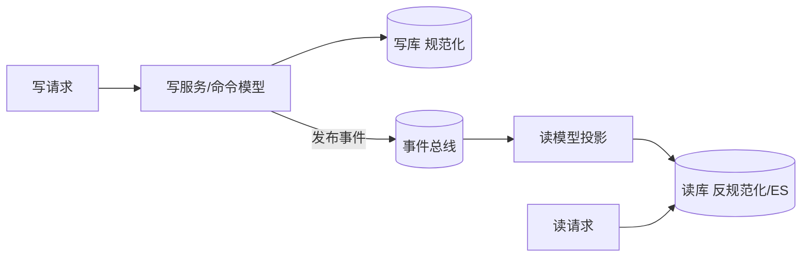

适合**读远多于写**、且读写对数据结构要求差异大的场景（如商品列表搜索）。

### 9.3 事件溯源（Event Sourcing）简介

不存"当前状态"，而是存**改变状态的事件序列**，当前状态由事件重放得到。好处：完整审计、可回溯任意时刻；代价：模型复杂、事件版本管理难。金融、账务领域常见。

> **慎用**：CQRS 和事件溯源都很重，**没有明确收益不要上**。

---

## 第十章 部署与运维

### 10.1 容器化：Docker

每个服务一个镜像，多阶段构建产出瘦身镜像（见[《网络开发》4.6](go-webdev.md#46-部署多阶段构建-dockerfile)）。微服务用 `docker compose` 本地编排：

```yaml
services:
  user:
    build: ./user
    ports: ["50051:50051"]
  order:
    build: ./order
    environment:
      USER_ADDR: user:50051
    depends_on: [user, etcd]
  etcd:
    image: bitnami/etcd:latest
    environment:
      ALLOW_NONE_AUTHENTICATION: "yes"
```

### 10.2 Kubernetes 核心概念

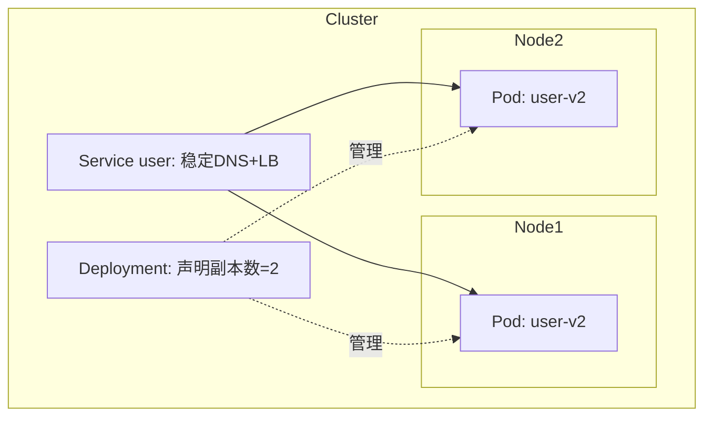

- **Pod**：最小调度单元，包含一个或多个容器。
- **Deployment**：声明"我要 3 个副本"，K8s 负责维持、滚动升级。
- **Service**：给一组 Pod 一个稳定地址和负载均衡（解决"Pod IP 会变"）。
- **ConfigMap/Secret**：注入配置和密钥。

### 10.3 健康检查与发布

- **livenessProbe**：探活失败 → **重启**容器（进程卡死时用）。
- **readinessProbe**：就绪失败 → **摘除流量**（依赖未就绪时用，别重启）。
- **滚动更新**：逐个替换 Pod，配合 `maxUnavailable=0` 实现零停机。
- **灰度/金丝雀**：先给新版本 5% 流量，观察指标再全量。

> ⚠️ 常见错误：把 readiness 探针指向还依赖外部服务的接口，导致外部抖动时整个集群实例被摘光。

### 10.4 CI/CD 与 Service Mesh

- **CI/CD**：提交代码 → 自动测试 → 构建镜像 → 推仓库 → 部署（GitOps）。
- **Service Mesh（Istio）**：把"重试/熔断/加密/追踪"从代码里抽出，交给 **Sidecar 代理**（Envoy）统一处理。业务代码零侵入，但增加运维复杂度和一跳延迟。

> **取舍**：服务少、团队小，用 SDK 库（如本教程的方式）即可；服务规模大、多语言混布，才值得上 Mesh。

### 10.5 本章小结与面试题

**要点回顾**：Docker 容器化 + compose 本地编排；K8s 的 Pod/Deployment/Service；探针分工；滚动更新与灰度；Mesh 是"容错下沉到基础设施"。

**面试题**：liveness 和 readiness 的区别？K8s 如何做零停机发布？Service 如何实现负载均衡？Service Mesh 解决什么问题、代价是什么？

---

## 第十一章 实战：电商微服务系统

### 11.1 目标架构

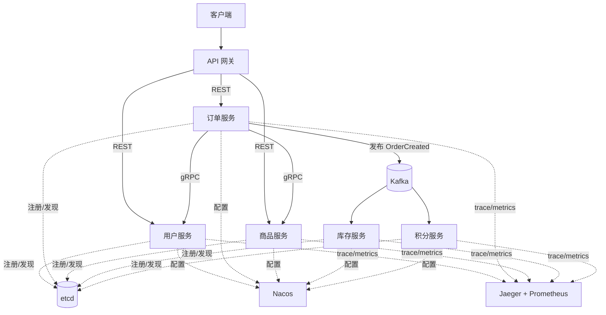

### 11.2 服务划分与接口

| 服务 | 职责 | 对外接口 | 数据 |
|---|---|---|---|
| 用户服务 | 注册、登录、用户信息 | gRPC `UserService` | user 库 |
| 商品服务 | 商品、库存查询 | gRPC `ProductService` | product 库 |
| 订单服务 | 下单、查单 | gRPC/HTTP | order 库 |
| 库存服务 | 扣减库存（异步） | 消费 `OrderCreated` | inventory 库 |
| 积分服务 | 加积分（异步） | 消费 `OrderCreated` | points 库 |

### 11.3 关键实现：下单主流程

```go
func (s *OrderService) CreateOrder(ctx context.Context, req *CreateOrderReq) (*Order, error) {
	// 1. 参数校验
	if err := req.Validate(); err != nil {
		return nil, status.Error(codes.InvalidArgument, err.Error())
	}

	// 2. 调用商品服务（带超时 + 熔断）
	ctx, cancel := context.WithTimeout(ctx, 800*time.Millisecond)
	defer cancel()

	product, err := s.cb.Execute(func() (interface{}, error) {
		return s.productClient.GetProduct(ctx, &pb.GetProductRequest{Id: req.ProductID})
	})
	if err != nil {
		return nil, status.Error(codes.Unavailable, "商品服务暂不可用")
	}

	// 3. 本地事务：写订单 + 写 outbox 消息（最终一致）
	order := &Order{ID: newID(), UserID: req.UserID, ProductID: req.ProductID,
		Amount: product.(*pb.GetProductResponse).Price}
	if err := s.repo.CreateWithOutbox(ctx, order, "order.created", order); err != nil {
		return nil, status.Error(codes.Internal, "创建订单失败")
	}
	return order, nil
}
```

### 11.4 一键启动

```bash
docker compose up -d          # 起 etcd/nacos/kafka/jaeger/mysql + 5 个服务
curl -X POST localhost:8080/api/v1/orders -H 'Authorization: Bearer <token>' \
  -d '{"product_id":"p1","quantity":1}'
# 打开 http://localhost:16686 看这条下单请求的完整调用链
```

### 11.5 本章小结

**要点回顾**：网关统一入口；服务间 gRPC；注册用 etcd；事件驱动解耦下单后的扣库存/加积分；outbox 保证消息不丢；全链路可观测。

---

## 附录：微服务高频面试专题

**Q1：微服务与单体如何取舍？**
没有银弹。中小团队、业务未稳定时优先模块化单体；当出现独立扩容、团队协作、异构技术栈等明确需求，再按瓶颈逐步拆分。核心原则：**边界清晰 > 拆得细**。

**Q2：服务如何拆分？**
基于 DDD 限界上下文，按业务能力划分；保证**高内聚低耦合**、**每服务独享数据库**；从"改一个需求要动几个服务"来检验边界是否合理。

**Q3：服务间如何通信？**
对外 REST（通用、可调试），对内 gRPC（高性能、强契约），非实时/需解耦的用消息队列。异步优先用于最终一致场景。

**Q4：服务发现如何实现？**
注册中心（etcd/Consul/Nacos）保存实例列表；实例启动注册、心跳/租约保活、下线自动注销；调用方客户端发现（自负载均衡）或经网关服务端发现。

**Q5：如何防止雪崩？**
超时（逐层递减）+ 重试（幂等、退避、抖动）+ 熔断（快速失败）+ 资源隔离（舱壁）+ 降级（兜底数据）。**超时是底线**。

**Q6：分布式事务怎么办？**
多数场景选**最终一致**：本地消息表/事务消息 + 幂等消费；资金类强一致可用 TCC；长流程用 Saga（正向 + 补偿）。CAP 决定了不可能兼得强一致与高可用。

**Q7：如何保证幂等？**
唯一键约束、状态机流转、Redis 去重（SETNX）、请求去重表。所有可能重试/重复投递的入口都要幂等。

**Q8：一次跨服务请求出错怎么排查？**
可观测性三支柱配合：**指标**发现异常（P99 飙升）→ **链路追踪**定位到具体服务和 span → **日志**用 trace_id 找到根因。统一 trace_id 是关键。

**Q9：如何做零停机发布？**
K8s 滚动更新 + 优雅关闭（见网络开发篇）+ readiness 探针控制流量摘除；先小流量灰度，观察指标再全量。

**Q10：网关会不会成为瓶颈？**
会。网关必须**无状态 + 多副本 + 前置 LB**；鉴权尽量无状态（JWT）；热点配置放缓存；必要时按业务域拆分多个网关。
