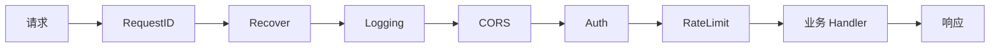
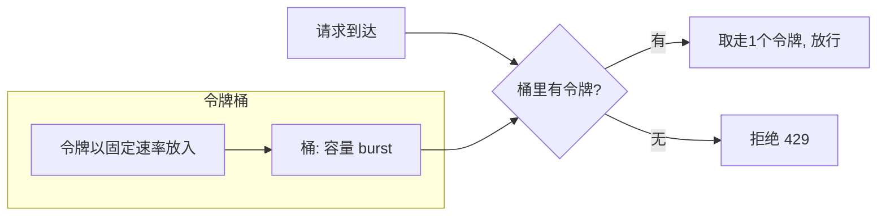
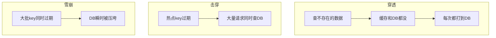
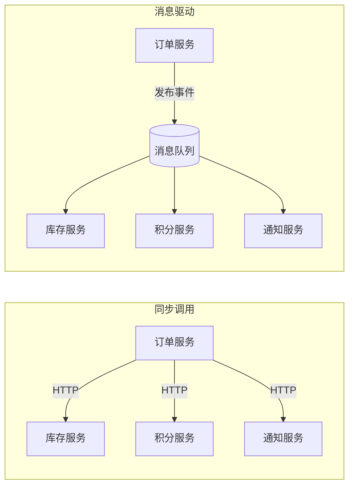
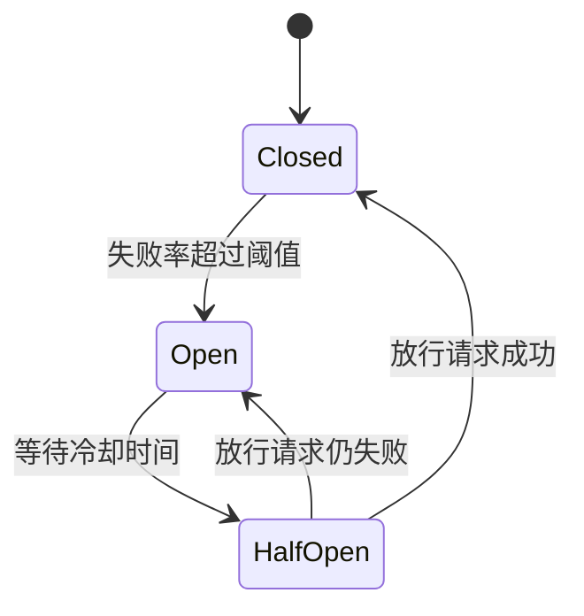

# Go 语言中间件与工具集成 —— 系统集成能力

> 面向对象：已经会写 HTTP 服务，想让服务"能连数据库、能扛流量、能被观测"的同学。
> 阅读方式：每个中间件都给出**独立可复用的组件**（`NewXxx` 构造 + 配置 + 测试），而不是一次性代码片段。
> 环境要求：Go 1.22+。涉及外部依赖的章节会给出 `docker run` 一键启动命令，无需手动安装。

## 目录

- [第一章 HTTP 中间件](#第一章-http-中间件)
- [第二章 数据库集成](#第二章-数据库集成)
- [第三章 缓存集成（Redis）](#第三章-缓存集成redis)
- [第四章 消息队列集成](#第四章-消息队列集成)
- [第五章 配置、日志与可观测性](#第五章-配置日志与可观测性)
- [第六章 工程工具集成](#第六章-工程工具集成)
- [第七章 容错：限流 / 熔断 / 重试 / 超时](#第七章-容错限流--熔断--重试--超时)
- [第八章 实战：组装一个可观测的小型后端](#第八章-实战组装一个可观测的小型后端)
- [附录：高频面试题汇总](#附录高频面试题汇总)

---

## 第一章 HTTP 中间件

### 1.1 中间件原理与可复用骨架

中间件的本质是 `func(http.Handler) http.Handler`。为了能像搭积木一样组合，我们定义一个统一的 `Chain`：

```go
package mw

import "net/http"

// Middleware 统一签名，方便组合
type Middleware func(http.Handler) http.Handler

// Chain 按注册顺序包裹：先注册的在外层（最先收到请求、最后写出响应）
func Chain(h http.Handler, mws ...Middleware) http.Handler {
	for i := len(mws) - 1; i >= 0; i-- {
		h = mws[i](h)
	}
	return h
}
```



### 1.2 日志中间件（结构化）

> 为什么不用 `fmt.Println`？因为生产日志要被 ELK/Loki 采集，必须是结构化的（JSON）。

```go
package mw

import (
	"log/slog"
	"net/http"
	"time"
)

// responseWriter 包装原生 Writer 以捕获状态码和响应字节数
type responseWriter struct {
	http.ResponseWriter
	status int
	bytes  int
}

func (w *responseWriter) WriteHeader(code int) {
	w.status = code
	w.ResponseWriter.WriteHeader(code)
}

func (w *responseWriter) Write(b []byte) (int, error) {
	n, err := w.ResponseWriter.Write(b)
	w.bytes += n
	return n, err
}

func Logging(logger *slog.Logger) Middleware {
	return func(next http.Handler) http.Handler {
		return http.HandlerFunc(func(w http.ResponseWriter, r *http.Request) {
			start := time.Now()
			ww := &responseWriter{ResponseWriter: w, status: http.StatusOK}
			next.ServeHTTP(ww, r)
			logger.Info("http_request",
				"method", r.Method,
				"path", r.URL.Path,
				"status", ww.status,
				"bytes", ww.bytes,
				"cost_ms", time.Since(start).Milliseconds(),
				"request_id", GetRequestID(r.Context()),
			)
		})
	}
}
```

### 1.3 认证中间件（JWT）

```go
package mw

import (
	"context"
	"net/http"
	"strings"

	"github.com/golang-jwt/jwt/v5"
)

type ctxKey string

const userIDKey ctxKey = "user_id"

func Auth(secret []byte) Middleware {
	return func(next http.Handler) http.Handler {
		return http.HandlerFunc(func(w http.ResponseWriter, r *http.Request) {
			raw := strings.TrimPrefix(r.Header.Get("Authorization"), "Bearer ")
			if raw == "" {
				http.Error(w, `{"code":40100,"msg":"缺少凭证"}`, http.StatusUnauthorized)
				return
			}
			token, err := jwt.Parse(raw, func(t *jwt.Token) (interface{}, error) {
				if _, ok := t.Method.(*jwt.SigningMethodHMAC); !ok {
					return nil, jwt.ErrSignatureInvalid // 固定算法，防 alg=none
				}
				return secret, nil
			})
			if err != nil || !token.Valid {
				http.Error(w, `{"code":40101,"msg":"凭证无效"}`, http.StatusUnauthorized)
				return
			}
			claims := token.Claims.(jwt.MapClaims)
			uid := claims["uid"].(string)
			next.ServeHTTP(w, r.WithContext(context.WithValue(r.Context(), userIDKey, uid)))
		})
	}
}

// UserID 从 context 取当前用户
func UserID(ctx context.Context) string {
	uid, _ := ctx.Value(userIDKey).(string)
	return uid
}
```

**测试中间件**（中间件天然好测，因为它是纯函数）：

```go
func TestAuth_RejectsMissingToken(t *testing.T) {
	h := Auth([]byte("k"))(http.HandlerFunc(func(w http.ResponseWriter, r *http.Request) {
		t.Fatal("不应该执行到业务 Handler")
	}))
	req := httptest.NewRequest("GET", "/", nil)
	rec := httptest.NewRecorder()
	h.ServeHTTP(rec, req)
	if rec.Code != http.StatusUnauthorized {
		t.Fatalf("期望 401，实际 %d", rec.Code)
	}
}
```

### 1.4 CORS 中间件

浏览器同源策略会拦截跨域请求，CORS 就是服务端声明"我允许谁来访问"。

```go
func CORS(allowOrigins []string) Middleware {
	allowed := make(map[string]bool, len(allowOrigins))
	for _, o := range allowOrigins {
		allowed[o] = true
	}
	return func(next http.Handler) http.Handler {
		return http.HandlerFunc(func(w http.ResponseWriter, r *http.Request) {
			origin := r.Header.Get("Origin")
			if allowed[origin] {
				w.Header().Set("Access-Control-Allow-Origin", origin)
				w.Header().Set("Access-Control-Allow-Methods", "GET,POST,PUT,DELETE,OPTIONS")
				w.Header().Set("Access-Control-Allow-Headers", "Content-Type,Authorization")
				w.Header().Set("Access-Control-Allow-Credentials", "true")
			}
			// 预检请求直接返回，不进业务
			if r.Method == http.MethodOptions {
				w.WriteHeader(http.StatusNoContent)
				return
			}
			next.ServeHTTP(w, r)
		})
	}
}
```

> ⚠️ 当 `Allow-Credentials=true` 时，`Allow-Origin` **不能是 `*`**，必须回显具体域名，否则浏览器拒绝。

### 1.5 限流中间件（令牌桶）

限流保护自己不被突发流量打垮。用 `golang.org/x/time/rate` 的令牌桶：

```go
import "golang.org/x/time/rate"

func RateLimit(rps int, burst int) Middleware {
	// 按 IP 维护独立限流器
	limiters := sync.Map{}
	getLimiter := func(key string) *rate.Limiter {
		if v, ok := limiters.Load(key); ok {
			return v.(*rate.Limiter)
		}
		l := rate.NewLimiter(rate.Limit(rps), burst)
		limiters.Store(key, l)
		return l
	}
	return func(next http.Handler) http.Handler {
		return http.HandlerFunc(func(w http.ResponseWriter, r *http.Request) {
			ip, _, _ := net.SplitHostPort(r.RemoteAddr)
			if !getLimiter(ip).Allow() {
				http.Error(w, `{"code":42900,"msg":"请求过于频繁"}`, http.StatusTooManyRequests)
				return
			}
			next.ServeHTTP(w, r)
		})
	}
}
```



> 生产环境多实例部署时，内存限流会"各自为政"，需要改用 **Redis + Lua 脚本**做集中式限流。

### 1.6 RequestID 与 Recover

```go
func RequestID() Middleware {
	return func(next http.Handler) http.Handler {
		return http.HandlerFunc(func(w http.ResponseWriter, r *http.Request) {
			id := r.Header.Get("X-Request-ID")
			if id == "" {
				id = uuid.NewString()
			}
			w.Header().Set("X-Request-ID", id)
			next.ServeHTTP(w, r.WithContext(context.WithValue(r.Context(), ctxKey("rid"), id)))
		})
	}
}

func Recover(logger *slog.Logger) Middleware {
	return func(next http.Handler) http.Handler {
		return http.HandlerFunc(func(w http.ResponseWriter, r *http.Request) {
			defer func() {
				if err := recover(); err != nil {
					logger.Error("panic", "err", err, "stack", string(debug.Stack()))
					http.Error(w, `{"code":50000,"msg":"服务器内部错误"}`, http.StatusInternalServerError)
				}
			}()
			next.ServeHTTP(w, r)
		})
	}
}
```

### 1.7 本章小结与面试题

**要点回顾**：中间件是纯函数，天然可测试；顺序决定语义（Recover 要最外层，Auth 要在业务前）；跨实例限流要用共享存储。

**面试题**：日志中间件如何拿到状态码？限流算法有哪几种（令牌桶/漏桶/滑动窗口）？CORS 预检请求是什么？

---

## 第二章 数据库集成

### 2.1 database/sql 与连接池

Go 标准库 `database/sql` 自带连接池，但**默认参数很激进**，生产必须调。

```go
import (
	"database/sql"
	"time"

	_ "github.com/go-sql-driver/mysql"
)

func OpenDB(dsn string) (*sql.DB, error) {
	db, err := sql.Open("mysql", dsn) // 注意：此时并未真正建立连接
	if err != nil {
		return nil, err
	}

	db.SetMaxOpenConns(50)                  // 最大连接数（含使用中）
	db.SetMaxIdleConns(25)                  // 最大空闲连接数
	db.SetConnMaxLifetime(30 * time.Minute) // 连接最长寿命，避免被 MySQL 断开
	db.SetConnMaxIdleTime(5 * time.Minute)  // 空闲多久回收

	ctx, cancel := context.WithTimeout(context.Background(), 3*time.Second)
	defer cancel()
	if err := db.PingContext(ctx); err != nil { // 真正验证连通性
		return nil, err
	}
	return db, nil
}
```

`SetMaxIdleConns` 一定要 ≤ `SetMaxOpenConns`，否则多余的空闲连接会被立刻关闭（"连接抖动"）。

### 2.2 SQL 注入与预编译

> **绝对不要**用字符串拼接拼 SQL！这是最经典的漏洞。

```go
// ❌ 危险：输入 `1 OR 1=1` 就能拖库
query := "SELECT * FROM users WHERE name = '" + name + "'"

// ✅ 正确：占位符预编译，参数与语句分离
row := db.QueryRowContext(ctx, "SELECT id, name FROM users WHERE name = ?", name)
```

### 2.3 事务与 Context 超时

```go
func Transfer(ctx context.Context, db *sql.DB, from, to int64, amount float64) error {
	tx, err := db.BeginTx(ctx, &sql.TxOptions{Isolation: sql.LevelRepeatableRead})
	if err != nil {
		return err
	}
	defer tx.Rollback() // 若已 Commit，Rollback 返回 ErrTxDone，无副作用

	if _, err := tx.ExecContext(ctx, "UPDATE accounts SET balance = balance - ? WHERE id = ?", amount, from); err != nil {
		return err
	}
	if _, err := tx.ExecContext(ctx, "UPDATE accounts SET balance = balance + ? WHERE id = ?", amount, to); err != nil {
		return err
	}
	return tx.Commit()
}
```

**注意**：所有 `*Context` 方法都要传 `ctx`，这样客户端断开或超时后，数据库能及时取消慢查询，避免连接被占用。

### 2.4 ORM：用还是不用？

| 场景 | 建议 |
|---|---|
| 复杂查询、性能敏感 | 手写 SQL（`sqlx` 简化映射） |
| CRUD 为主、迭代快 | ORM（GORM） |
| 团队 SQL 能力弱 | ORM |

GORM 示例：

```go
type User struct {
	ID    uint   `gorm:"primaryKey"`
	Name  string `gorm:"size:32;index"`
	Email string `gorm:"uniqueIndex"`
}

db.AutoMigrate(&User{})
db.Create(&User{Name: "gopher", Email: "g@go.dev"})

var u User
db.First(&u, "email = ?", "g@go.dev")
```

> **面试点**：ORM 的 N+1 查询问题（循环里查关联表），用 `Preload` 一次查出来。ORM 也会生成不可控 SQL，线上慢查询要能定位到具体语句。

### 2.5 本章小结与面试题

**要点回顾**：连接池三参数要显式设置；永远用占位符；事务记得 `defer Rollback`；所有查询带 `ctx`。

**面试题**：连接池参数如何设置？`SetConnMaxLifetime` 解决什么问题？如何排查连接泄漏？ORM 的优缺点？

---

## 第三章 缓存集成（Redis）

### 3.1 快速接入 go-redis

```bash
docker run -d --name redis -p 6379:6379 redis:7-alpine
```

```go
import "github.com/redis/go-redis/v9"

rdb := redis.NewClient(&redis.Options{
	Addr:         "localhost:6379",
	PoolSize:     20,
	ReadTimeout:  500 * time.Millisecond,
	WriteTimeout: 500 * time.Millisecond,
})

ctx := context.Background()
rdb.Set(ctx, "user:1", `{"name":"gopher"}`, 10*time.Minute)
val, err := rdb.Get(ctx, "user:1").Result()
if errors.Is(err, redis.Nil) {
	// key 不存在（这是正常情况，不是错误）
}
```

### 3.2 缓存三大经典问题 ⭐



| 问题 | 原因 | 解决方案 |
|---|---|---|
| 缓存穿透 | 查不存在的数据，缓存永远不命中 | 布隆过滤器 / 缓存空值（短过期） |
| 缓存击穿 | 单个热点 key 过期瞬间被并发打 DB | 互斥锁重建 / 逻辑过期不过期 |
| 缓存雪崩 | 大量 key 同时失效 | 过期时间加随机抖动 / 多级缓存 |

**互斥锁防击穿**（配合本地单飞更佳）：

```go
func GetUser(ctx context.Context, rdb *redis.Client, db *sql.DB, id string) (*User, error) {
	key := "user:" + id
	if val, err := rdb.Get(ctx, key).Result(); err == nil {
		var u User
		_ = json.Unmarshal([]byte(val), &u)
		return &u, nil
	}

	// 只允许一个协程去查 DB，其余等待
	lockKey := "lock:" + key
	ok, _ := rdb.SetNX(ctx, lockKey, 1, 3*time.Second).Result()
	if !ok {
		time.Sleep(50 * time.Millisecond)
		return GetUser(ctx, rdb, db, id) // 简化：实际应重试有限次
	}
	defer rdb.Del(ctx, lockKey)

	var u User
	if err := db.QueryRowContext(ctx, "SELECT id,name FROM users WHERE id=?", id).Scan(&u.ID, &u.Name); err != nil {
		// 缓存空值防穿透
		rdb.Set(ctx, key, "", time.Minute)
		return nil, err
	}
	b, _ := json.Marshal(u)
	// 过期时间加随机抖动，防雪崩
	rdb.Set(ctx, key, b, 10*time.Minute+time.Duration(rand.Intn(120))*time.Second)
	return &u, nil
}
```

### 3.3 缓存模式

- **Cache-Aside（旁路缓存，最常用）**：读时先查缓存、未命中查库回填；写时**先更新库、再删缓存**。删除比更新缓存更安全（避免并发写导致脏数据）。
- **Write-Through**：写库同时写缓存，一致性高、延迟略大。
- **Write-Behind**：只写缓存，异步刷库，性能最高但有丢数据风险。

### 3.4 本地缓存与单飞

进程内缓存避免网络开销，常用 `sync.Map`（简单）或 `bigcache`（大容量低 GC）。关键是解决"缓存失效时并发回源"，用 `singleflight` 合并请求：

```go
import "golang.org/x/sync/singleflight"

var g singleflight.Group

func GetConfig(key string) (string, error) {
	v, err, _ := g.Do(key, func() (interface{}, error) {
		// 同一 key 的并发请求只执行一次
		return loadFromDB(key)
	})
	if err != nil {
		return "", err
	}
	return v.(string), nil
}
```

### 3.5 缓存一致性

> **没有绝对强一致的缓存方案**，只有"可接受的一致性"。

- 常用：Cache-Aside + 延迟双删（更新库后删缓存，延迟再删一次）。
- 强一致要求高：直接读写 DB，不用缓存，或用 binlog 订阅（Canal）异步失效。
- 记住一句话：**"先更新数据库，再删除缓存"**，而不是"更新缓存"。

### 3.6 本章小结与面试题

**要点回顾**：穿透靠空值/布隆过滤，击穿靠互斥重建，雪崩靠随机过期；缓存删除优先于更新；singleflight 解决并发回源。

**面试题**：三大缓存问题及解法？先删缓存还是先更新库？如何保证缓存与数据库最终一致？本地缓存和分布式缓存的取舍？

---

## 第四章 消息队列集成

### 4.1 为什么需要消息队列



- **解耦**：生产者不用知道消费者是谁。
- **削峰**：突发流量先入队，消费者按能力慢慢处理。
- **异步**：非核心链路（发短信、写日志）不阻塞主流程。
- **广播**：一个事件多方消费。

### 4.2 Kafka 快速上手（segmentio/kafka-go）

```bash
docker run -d --name kafka -p 9092:9092 apache/kafka:latest
```

```go
import "github.com/segmentio/kafka-go"

// 生产者
w := &kafka.Writer{
	Addr:     kafka.TCP("localhost:9092"),
	Topic:    "order-created",
	Balancer: &kafka.LeastBytes{},
}
defer w.Close()

err := w.WriteMessages(ctx, kafka.Message{
	Key:   []byte("order-1001"),
	Value: []byte(`{"order_id":1001,"amount":99.9}`),
})

// 消费者
r := kafka.NewReader(kafka.ReaderConfig{
	Brokers:  []string{"localhost:9092"},
	Topic:    "order-created",
	GroupID:  "order-consumer", // 同组消费分摊，不同组各自全量消费
	MinBytes: 1,
	MaxBytes: 10e6,
})
defer r.Close()

for {
	m, err := r.ReadMessage(ctx)
	if err != nil {
		break
	}
	log.Printf("收到: key=%s value=%s", m.Key, m.Value)
	// 业务处理成功后提交 offset（这里用 ReadMessage 自动提交）
}
```

### 4.3 消息可靠性三件套

| 目标 | 手段 |
|---|---|
| 不丢 | 生产者 acks=all + 重试；消费者**处理成功后再提交 offset** |
| 不重 | 消费端**幂等**（唯一键去重、状态机、Redis SETNX） |
| 有序 | 同一业务 key（如 order_id）进同一分区 |

**幂等消费示例**：

```go
func handleOrderCreated(ctx context.Context, rdb *redis.Client, msg kafka.Message) error {
	// 用消息唯一键做去重
	key := "idem:" + string(msg.Key) + ":" + strconv.FormatInt(msg.Offset, 10)
	ok, _ := rdb.SetNX(ctx, key, 1, 24*time.Hour).Result()
	if !ok {
		return nil // 已处理过，直接跳过
	}
	return processOrder(ctx, msg.Value)
}
```

> ⚠️ 顺序：**先处理业务、再提交 offset、最后（或同事务）记录幂等键**。若先提交 offset 再处理业务，中间崩溃就会丢消息。

### 4.4 本章小结与面试题

**要点回顾**：MQ 解决解耦/削峰/异步；不丢靠 ack + 手动提交；不重靠幂等；有序靠分区键。

**面试题**：Kafka 为什么快？如何保证不丢消息？消息重复消费如何解决？消费者组的作用？Kafka 与 RabbitMQ 如何选型？

---

## 第五章 配置、日志与可观测性

### 5.1 配置管理：环境变量 + Viper

十二要素应用（12-Factor）原则：**配置与代码分离，通过环境变量注入**。Viper 支持多来源合并：

```go
import "github.com/spf13/viper"

type Config struct {
	Addr    string `mapstructure:"addr"`
	DBDSN   string `mapstructure:"db_dsn"`
	LogLvl  string `mapstructure:"log_level"`
}

func Load() (*Config, error) {
	viper.SetConfigName("config")
	viper.SetConfigType("yaml")
	viper.AddConfigPath(".")
	viper.SetDefault("addr", ":8080")
	viper.SetDefault("log_level", "info")

	// 环境变量覆盖：APP_ADDR -> addr
	viper.SetEnvPrefix("APP")
	viper.AutomaticEnv()

	if err := viper.ReadInConfig(); err != nil {
		// 找不到文件不算致命，可能全靠环境变量
		var notFound viper.ConfigFileNotFoundError
		if !errors.As(err, &notFound) {
			return nil, err
		}
	}
	var cfg Config
	return &cfg, viper.Unmarshal(&cfg)
}
```

**优先级（高 → 低）**：显式 Set > 环境变量 > 配置文件 > 默认值。

### 5.2 结构化日志与级别

```go
var level slog.Level
_ = level.UnmarshalText([]byte(cfg.LogLvl)) // "debug"/"info"/"error"
logger := slog.New(slog.NewJSONHandler(os.Stdout, &slog.HandlerOptions{Level: level}))
slog.SetDefault(logger)
```

> 日志级别约定：`debug` 开发排查 / `info` 关键业务节点 / `warn` 可恢复异常 / `error` 需要人介入。**不要什么都打 error**，否则告警失灵。

### 5.3 Prometheus 指标

暴露 `/metrics`，让 Prometheus 定时拉取。

```go
import (
	"github.com/prometheus/client_golang/prometheus"
	"github.com/prometheus/client_golang/prometheus/promhttp"
)

var (
	httpRequests = prometheus.NewCounterVec(
		prometheus.CounterOpts{Name: "http_requests_total", Help: "请求总数"},
		[]string{"method", "path", "status"},
	)
	httpLatency = prometheus.NewHistogramVec(
		prometheus.HistogramOpts{Name: "http_request_duration_seconds", Buckets: prometheus.DefBuckets},
		[]string{"path"},
	)
)

func init() {
	prometheus.MustRegister(httpRequests, httpLatency)
}

// 在日志中间件里顺带记录
func Metrics(next http.Handler) http.Handler {
	return http.HandlerFunc(func(w http.ResponseWriter, r *http.Request) {
		start := time.Now()
		ww := &responseWriter{ResponseWriter: w, status: 200}
		next.ServeHTTP(ww, r)
		httpRequests.WithLabelValues(r.Method, r.URL.Path, strconv.Itoa(ww.status)).Inc()
		httpLatency.WithLabelValues(r.URL.Path).Observe(time.Since(start).Seconds())
	})
}

// 挂载
mux.Handle("/metrics", promhttp.Handler())
```

> **四种指标类型**：Counter（只增）、Gauge（可增减）、Histogram（分布，算 P99）、Summary。**告警要用 Histogram 算分位数，不要用平均延迟**（平均数会掩盖长尾）。

### 5.4 OpenTelemetry 链路追踪

在微服务里，一个请求会跨越多个服务，需要 `trace_id` 把它们串起来。用 OTLP 导出到 Jaeger：

```go
import (
	"go.opentelemetry.io/otel"
	"go.opentelemetry.io/otel/exporters/otlp/otlptrace/otlptracegrpc"
	"go.opentelemetry.io/otel/sdk/trace"
)

func InitTracer(ctx context.Context, serviceName string) (*trace.TracerProvider, error) {
	exp, err := otlptracegrpc.New(ctx)
	if err != nil {
		return nil, err
	}
	tp := trace.NewTracerProvider(
		trace.WithBatcher(exp),
		trace.WithResource(resource.NewWithAttributes(
			semconv.SchemaURL, semconv.ServiceName(serviceName),
		)),
	)
	otel.SetTracerProvider(tp)
	return tp, nil
}
```

```bash
docker run -d --name jaeger -p 16686:16686 -p 4317:4317 jaegertracing/all-in-one:latest
# 打开 http://localhost:16686 查看调用链
```

> **面试点**：Logging（离散事件）、Metrics（聚合数值）、Tracing（请求全链路）是可观测性三支柱，缺一不可。

### 5.5 本章小结与面试题

**要点回顾**：配置优先级；结构化日志分级；Prometheus 用 Histogram 算 P99；OTel 串起跨服务链路。

**面试题**：可观测性三支柱？为什么要用分位数而不是平均延迟？trace_id 如何跨服务传递？

---

## 第六章 工程工具集成

### 6.1 依赖注入：Wire

手工 `NewA(NewB(NewC()))` 在依赖变多后很难维护。Google Wire 在**编译期**生成注入代码，无反射、无运行时开销。

```go
// wire.go（加 `//go:build wireinject` 约束）
//go:build wireinject

func InitApp() (*App, error) {
	wire.Build(NewDB, NewRepo, NewService, NewHandler, NewApp)
	return nil, nil
}
```

运行 `wire` 命令后生成 `wire_gen.go`，这就是标准代码。对比运行时反射注入（如 uber/dig），Wire 更易调试。

### 6.2 定时任务：robfig/cron

```go
import "github.com/robfig/cron/v3"

c := cron.New(cron.WithSeconds()) // 支持秒级
c.AddFunc("0 0 3 * * *", func() { // 每天 03:00:00
	log.Println("执行每日对账")
})
c.Start()
defer c.Stop()
```

> 多实例部署时定时任务会重复执行，需要分布式锁（如 Redis）保证只有一台机器跑。

### 6.3 命令行工具：cobra

```go
var rootCmd = &cobra.Command{Use: "app", Short: "我的应用"}

var serveCmd = &cobra.Command{
	Use:   "serve",
	Short: "启动 HTTP 服务",
	RunE: func(cmd *cobra.Command, args []string) error {
		return startServer()
	},
}

func init() {
	rootCmd.AddCommand(serveCmd)
	serveCmd.Flags().StringP("addr", "a", ":8080", "监听地址")
}

func main() { rootCmd.Execute() }
```

```bash
app serve --addr :9090
```

### 6.4 对象存储：MinIO / S3

```bash
docker run -d --name minio -p 9000:9000 -p 9001:9001 \
  -e MINIO_ROOT_USER=admin -e MINIO_ROOT_PASSWORD=admin123 \
  minio/minio server /data --console-address ":9001"
```

```go
import "github.com/minio/minio-go/v7"

cli, _ := minio.New("localhost:9000", &minio.Options{
	Creds:  credentials.NewStaticV4("admin", "admin123", ""),
	Secure: false,
})

// 上传
_, err := cli.FPutObject(ctx, "uploads", "avatar.png", "./avatar.png",
	minio.PutObjectOptions{ContentType: "image/png"})

// 生成 7 天有效的临时下载链接（比公开桶安全）
u, _ := cli.PresignedGetObject(ctx, "uploads", "avatar.png", 7*24*time.Hour, nil)
```

> **原则**：文件存对象存储，数据库只存 URL。永远用**预签名 URL**给客户端临时访问，不要开放整桶。

### 6.5 本章小结与面试题

**要点回顾**：Wire 编译期注入；cron 多实例要加锁；cobra 组织 CLI；对象存储用预签名 URL。

**面试题**：编译期 DI 和运行时 DI 的区别？定时任务如何避免重复执行？大文件上传设计（分片、断点续传）？

---

## 第七章 容错：限流 / 熔断 / 重试 / 超时



### 7.1 超时：一切容错的基础

没有超时，就没有容错。每个出站调用都必须有超时：

```go
ctx, cancel := context.WithTimeout(r.Context(), 500*time.Millisecond)
defer cancel()
resp, err := client.Do(req.WithContext(ctx))
```

> **关键**：把上游的 `r.Context()` 传递下去，上游取消时下游调用一并取消，避免资源浪费。

### 7.2 重试与退避

重试要满足：**幂等** + **有次数上限** + **指数退避 + 抖动**。

```go
func Retry(ctx context.Context, attempts int, fn func() error) error {
	var err error
	for i := 0; i < attempts; i++ {
		if err = fn(); err == nil {
			return nil
		}
		// 指数退避 + 抖动，避免"重试风暴"同时爆发
		backoff := time.Duration(1<<i)*100*time.Millisecond + time.Duration(rand.Intn(100))*time.Millisecond
		select {
		case <-time.After(backoff):
		case <-ctx.Done():
			return ctx.Err()
		}
	}
	return err
}
```

> ⚠️ 非幂等操作（如"创建订单"）重试会导致重复下单，必须配合幂等键。

### 7.3 熔断：别让故障蔓延

当依赖服务大面积失败，继续调用只会拖垮自己。熔断器三态：**Closed（正常）→ Open（断开，直接快速失败）→ Half-Open（试探）**。

```go
import "github.com/sony/gobreaker"

cb := gobreaker.NewCircuitBreaker(gobreaker.Settings{
	Name:        "user-service",
	MaxRequests: 3,                // Half-Open 时放行 3 个试探请求
	Interval:    10 * time.Second, // Closed 状态统计窗口
	Timeout:     30 * time.Second, // Open 后多久进入 Half-Open
	ReadyToTrip: func(counts gobreaker.Counts) bool {
		return counts.ConsecutiveFailures > 5
	},
})

result, err := cb.Execute(func() (interface{}, error) {
	return callUserService(ctx)
})
```

### 7.4 隔离与降级

- **隔离**：给不同依赖分配独立连接池/协程池，防止一个慢依赖耗尽所有资源（舱壁模式）。
- **降级**：依赖不可用时返回兜底数据（默认值、缓存快照），而不是直接报错。例如推荐服务挂了，就返回热门榜单。

### 7.5 本章小结与面试题

**要点回顾**：超时是一切的底座；重试必须幂等 + 退避；熔断三态；隔离防资源耗尽；降级保可用性。

**面试题**：熔断和限流的区别？熔断器三个状态如何转换？重试风暴怎么避免？降级策略有哪些？

---

## 第八章 实战：组装一个可观测的小型后端

把前面组件拼起来，形成 `main.go` 的装配逻辑：

```go
func main() {
	cfg, _ := Load()
	logger := slog.New(slog.NewJSONHandler(os.Stdout, &slog.HandlerOptions{Level: slog.LevelInfo}))
	slog.SetDefault(logger)

	// 依赖
	db, _ := OpenDB(cfg.DBDSN)
	rdb := redis.NewClient(&redis.Options{Addr: cfg.RedisAddr})

	// 初始化链路追踪
	tp, _ := InitTracer(context.Background(), "demo-api")
	defer tp.Shutdown(context.Background())

	// 业务处理器
	app := newHandler(db, rdb)

	// 中间件洋葱（注意顺序）
	mux := http.NewServeMux()
	mux.HandleFunc("GET /users/{id}", app.getUser)
	mux.Handle("/metrics", promhttp.Handler())

	h := mw.Chain(mux,
		mw.RequestID(),
		mw.Recover(logger),
		mw.Metrics,
		mw.Logging(logger),
		mw.CORS([]string{"https://example.com"}),
		mw.RateLimit(100, 200),
	)

	srv := &http.Server{Addr: cfg.Addr, Handler: h, ReadTimeout: 5 * time.Second}
	// ... 优雅关闭（见《网络开发》1.9）
	_ = srv.ListenAndServe()
}
```

**中间件顺序原则**（从外到内）：

1. `RequestID` 最先，让后续所有日志都能带上它；
2. `Recover` 尽早，兜住后面所有 panic；
3. `Metrics`/`Logging` 覆盖全部请求；
4. `CORS` 在鉴权之前（预检请求不能要求鉴权）；
5. `RateLimit` 放在鉴权前后皆可，视保护对象而定；
6. 业务 Handler 最内层。

配套 `docker-compose.yml` 一键起依赖（Redis + MySQL + Jaeger），让读者 clone 即可运行。

---

## 附录：高频面试题汇总

1. 中间件的执行顺序与实现原理？
2. 常见限流算法及适用场景？
3. 数据库连接池参数怎么调？连接泄漏如何排查？
4. 缓存穿透 / 击穿 / 雪崩的区别与解法？
5. 如何保证缓存与数据库的一致性？
6. 消息队列如何保证不丢、不重、有序？
7. 可观测性三支柱？P99 为什么比平均值重要？
8. Wire 与反射式 DI 的区别？
9. 熔断器状态机？熔断与限流的区别？
10. 重试的注意事项（幂等、退避、抖动）？
