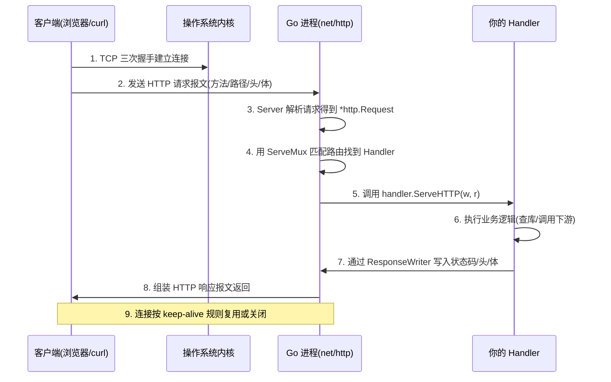
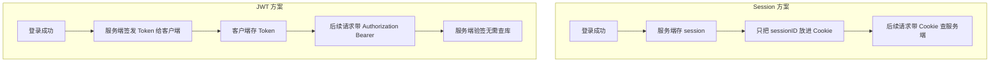
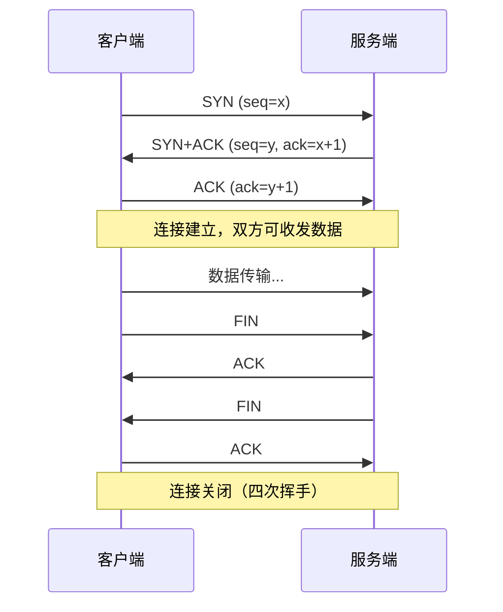
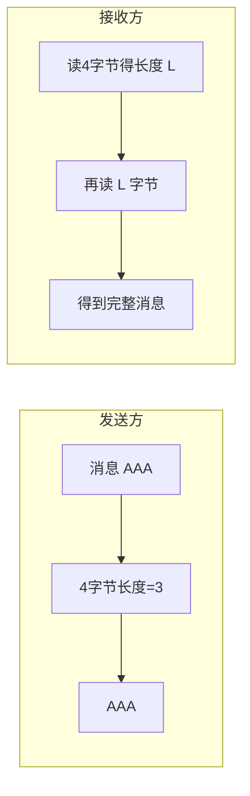
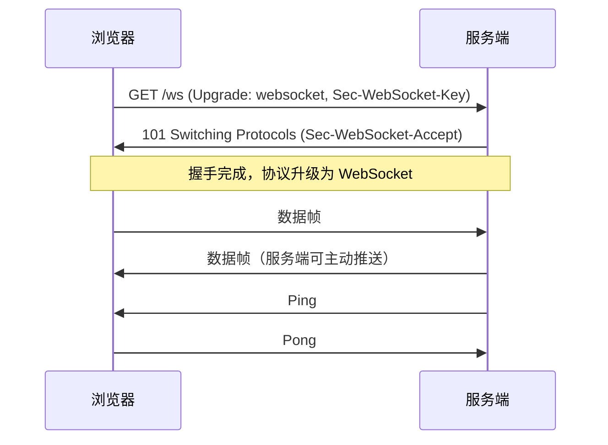
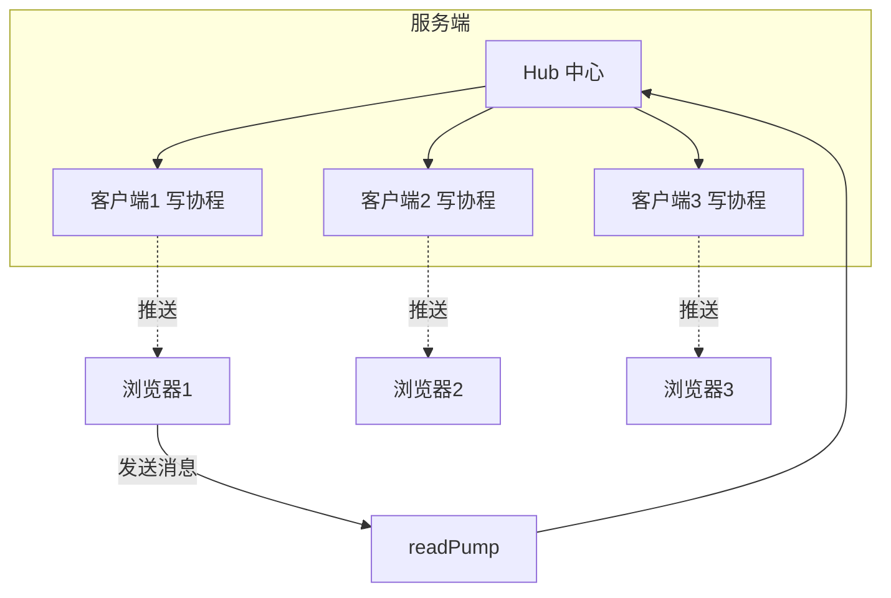
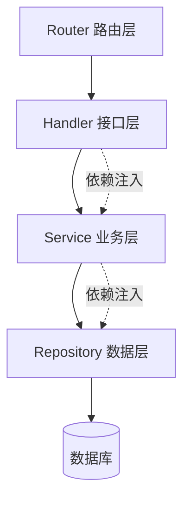

# Go 语言网络开发 —— Web 开发技能

> 面向对象：会写 Go 基础语法，但没做过完整 Web 服务的同学。
> 阅读方式：每节先讲"是什么、为什么"，再给**可以直接跑的最小示例**，最后补"生产环境要注意什么"。
> 环境要求：Go 1.22+（示例用到 `http.ServeMux` 的方法路由），Linux/macOS/Windows 均可。

## 目录

- [第一章 HTTP 服务](#第一章-http-服务)
  - [1.1 从一张图理解一次 HTTP 请求](#11-从一张图理解一次-http-请求)
  - [1.2 net/http 的两个核心接口](#12-nethttp-的两个核心接口)
  - [1.3 手写路由：理解 ServeMux 与 Middleware](#13-手写路由理解-servemux-与-middleware)
  - [1.4 路由框架怎么选：标准库 vs Gin vs Chi](#14-路由框架怎么选标准库-vs-gin-vs-chi)
  - [1.5 HTTP 客户端：超时、连接复用与重试](#15-http-客户端超时连接复用与重试)
  - [1.6 中间件与"洋葱模型"](#16-中间件与洋葱模型)
  - [1.7 RESTful API 设计规范与统一响应](#17-restful-api-设计规范与统一响应)
  - [1.8 参数校验：把脏数据挡在门口](#18-参数校验把脏数据挡在门口)
  - [1.9 优雅关闭：别让关机打断用户请求](#19-优雅关闭别让关机打断用户请求)
  - [1.10 认证：Session、Cookie 与 JWT](#110-认证sessioncookie-与-jwt)
  - [1.11 文件上传与下载](#111-文件上传与下载)
  - [1.12 模板渲染：html/template](#112-模板渲染htmltemplate)
  - [1.13 本章小结与面试题](#113-本章小结与面试题)
- [第二章 TCP/UDP 编程](#第二章-tcpudp-编程)
- [第三章 WebSocket 编程](#第三章-websocket-编程)
- [第四章 工程化与实战项目](#第四章-工程化与实战项目)
- [附录：高频面试题汇总](#附录高频面试题汇总)

---

## 第一章 HTTP 服务

### 1.1 从一张图理解一次 HTTP 请求

很多同学一上来就抄 Gin 的 `r.GET(...)` 代码，结果是"会写不会讲"。要讲清楚，先把**一次请求的完整生命周期**在脑子里画出来：



**要记住的 3 个关键词**：

1. **连接**：HTTP 建立在 TCP 之上。Go 的 `net/http` 帮你处理了连接的接受、解析、复用，你只需要写 Handler。
2. **请求对象 `*http.Request`**：封装了方法、URL、Header、Body、Context。
3. **响应写入器 `http.ResponseWriter`**：你把数据写进去，它负责变成合法的 HTTP 响应。

### 1.2 net/http 的两个核心接口

整个 `net/http` 服务器模型，其实就靠一个接口撑起来：

```go
// Handler 是 net/http 的核心接口：任何"能处理请求"的东西都实现它
type Handler interface {
    ServeHTTP(w http.ResponseWriter, r *http.Request)
}
```

一切皆 Handler：函数（`http.HandlerFunc`）、路由表（`*http.ServeMux`）、中间件，最终都满足这个接口。

**最小可运行服务器**：

```go
package main

import (
	"fmt"
	"log"
	"net/http"
)

func main() {
	// 用函数适配成 Handler（http.HandlerFunc 是函数类型，实现了 ServeHTTP）
	http.HandleFunc("/hello", func(w http.ResponseWriter, r *http.Request) {
		// 设置响应头（必须在写入 body 之前设置）
		w.Header().Set("Content-Type", "text/plain; charset=utf-8")
		w.WriteHeader(http.StatusOK) // 可选，默认 200
		fmt.Fprintf(w, "你好，%s！当前路径：%s\n", r.URL.Query().Get("name"), r.URL.Path)
	})

	log.Println("服务启动于 :8080")
	// nil 表示使用默认的 DefaultServeMux
	log.Fatal(http.ListenAndServe(":8080", nil))
}
```

跑起来试一下：

```bash
go run main.go
curl "http://localhost:8080/hello?name=Go"
# 你好，Go！当前路径：/hello
```

> ⚠️ **常见坑**：`w.Header().Set(...)` 必须在 `WriteHeader`/`Write` 之前调用，否则会被忽略并打印 `superfluous response.WriteHeader call`。

### 1.3 手写路由：理解 ServeMux 与 Middleware

`ServeMux` 就是一个"路径 → Handler"的映射表。理解它，你才能理解框架干了什么。

```go
package main

import (
	"fmt"
	"net/http"
)

func main() {
	mux := http.NewServeMux()

	// Go 1.22+ 支持方法 + 路径参数，不再需要第三方路由也能写 REST
	mux.HandleFunc("GET /users", listUsers)
	mux.HandleFunc("POST /users", createUser)
	mux.HandleFunc("GET /users/{id}", getUser) // {id} 是路径参数

	http.ListenAndServe(":8080", mux)
}

func listUsers(w http.ResponseWriter, r *http.Request) {
	fmt.Fprintln(w, "用户列表")
}

func createUser(w http.ResponseWriter, r *http.Request) {
	w.WriteHeader(http.StatusCreated)
	fmt.Fprintln(w, "创建用户")
}

func getUser(w http.ResponseWriter, r *http.Request) {
	id := r.PathValue("id") // 取出 {id}
	fmt.Fprintf(w, "用户详情：%s\n", id)
}
```

**`ServeMux` 的匹配规则**（面试常问）：

- 精确路径 > 长前缀 > 短前缀。`/users/{id}` 与 `/users/` 会按最长匹配。
- 以 `/` 结尾的 pattern 是**子树匹配**，`/static/` 会匹配 `/static/a/b/c`。
- 未匹配到任何路由返回 `404`；方法不匹配，Go 1.22+ 返回 `405 Method Not Allowed`。

### 1.4 路由框架怎么选：标准库 vs Gin vs Chi

| 维度 | 标准库 net/http | Gin | Chi |
|---|---|---|---|
| 依赖 | 无 | 中等 | 极轻（纯标准库风格） |
| 路由参数 | 1.22+ 支持 | 支持 | 支持 |
| 性能 | 好 | 很好 | 好 |
| 中间件生态 | 自己写 | 丰富 | 兼容 `http.Handler` |
| 上手难度 | 低 | 低 | 低 |
| 适合场景 | 小服务/学习/追求可控 | 业务快速开发 | 想要标准库兼容 + 路由能力 |

**建议**：学习和中小项目优先标准库 + `ServeMux`；业务团队要效率用 Gin；想要"框架无侵入"用 Chi。**面试时能讲清三者取舍，比只会背 Gin API 值钱得多。**

Gin 最小示例（对比感受一下）：

```go
r := gin.Default()
r.GET("/users/:id", func(c *gin.Context) {
	id := c.Param("id")
	c.JSON(http.StatusOK, gin.H{"id": id})
})
r.Run(":8080")
```

### 1.5 HTTP 客户端：超时、连接复用与重试

> **血泪教训**：`http.Get()` 用的是 `http.DefaultClient`，它**没有超时**。下游一旦卡住，你的 Goroutine 会永久泄漏。

**正确做法：自定义 Client + 复用 Transport**。

```go
package main

import (
	"context"
	"fmt"
	"io"
	"net"
	"net/http"
	"time"
)

var httpClient = &http.Client{
	Timeout: 10 * time.Second, // 整体超时（连接+读写）
	Transport: &http.Transport{
		MaxIdleConns:        100,              // 连接池总上限
		MaxIdleConnsPerHost: 10,               // 每个 host 的空闲连接
		IdleConnTimeout:     90 * time.Second, // 空闲连接多久回收
		DialContext: (&net.Dialer{
			Timeout:   5 * time.Second, // 建连超时
			KeepAlive: 30 * time.Second,
		}).DialContext,
	},
}

func fetchUser(ctx context.Context, id string) ([]byte, error) {
	req, err := http.NewRequestWithContext(ctx, http.MethodGet,
		"https://api.example.com/users/"+id, nil)
	if err != nil {
		return nil, err
	}
	req.Header.Set("Accept", "application/json")

	resp, err := httpClient.Do(req)
	if err != nil {
		return nil, err
	}
	defer resp.Body.Close() // 必须关闭，否则连接无法复用

	if resp.StatusCode != http.StatusOK {
		return nil, fmt.Errorf("unexpected status: %d", resp.StatusCode)
	}
	// 限制读取大小，防止下游返回超大响应拖垮内存
	return io.ReadAll(io.LimitReader(resp.Body, 1<<20)) // 最多 1MB
}
```

**为什么必须 `defer resp.Body.Close()`？**
不关闭 Body，连接不会归还到连接池，`MaxIdleConns` 很快被占满，后续请求只能新建连接 —— 表现就是"越来越慢"。

### 1.6 中间件与"洋葱模型"

中间件本质是：**接收一个 Handler，返回一个新的 Handler**。它可以在业务前后插入逻辑。

```go
type Middleware func(http.Handler) http.Handler

// 把多个中间件串起来：先注册的在外层
func Chain(h http.Handler, mws ...Middleware) http.Handler {
	for i := len(mws) - 1; i >= 0; i-- {
		h = mws[i](h)
	}
	return h
}
```


执行顺序像"洋葱"：**请求从外往里穿，响应从里往外冒**。

一个实用的日志中间件：

```go
func Logging(next http.Handler) http.Handler {
	return http.HandlerFunc(func(w http.ResponseWriter, r *http.Request) {
		start := time.Now()
		ww := &responseWriter{ResponseWriter: w, status: http.StatusOK}
		next.ServeHTTP(ww, r)
		log.Printf("%s %s %d %s", r.Method, r.URL.Path, ww.status, time.Since(start))
	})
}

type responseWriter struct {
	http.ResponseWriter
	status int
}

func (w *responseWriter) WriteHeader(code int) {
	w.status = code
	w.ResponseWriter.WriteHeader(code)
}
```

一个恢复 panic 的中间件（生产必备）：

```go
func Recover(next http.Handler) http.Handler {
	return http.HandlerFunc(func(w http.ResponseWriter, r *http.Request) {
		defer func() {
			if err := recover(); err != nil {
				log.Printf("panic: %v\n%s", err, debug.Stack())
				http.Error(w, "服务器内部错误", http.StatusInternalServerError)
			}
		}()
		next.ServeHTTP(w, r)
	})
}
```

### 1.7 RESTful API 设计规范与统一响应

REST 的核心思想：**用 URL 表示资源，用 HTTP 方法表示动作**。

| 动作 | 方法 | 路径 | 状态码 |
|---|---|---|---|
| 查询列表 | GET | `/users` | 200 |
| 查询单个 | GET | `/users/{id}` | 200 / 404 |
| 创建 | POST | `/users` | 201 |
| 全量更新 | PUT | `/users/{id}` | 200 |
| 局部更新 | PATCH | `/users/{id}` | 200 |
| 删除 | DELETE | `/users/{id}` | 204 |

**统一响应结构**（团队协作的关键约定）：

```go
type Response struct {
	Code int         `json:"code"` // 业务码，0 表示成功
	Msg  string      `json:"msg"`
	Data interface{} `json:"data,omitempty"`
}

func OK(w http.ResponseWriter, data interface{}) {
	writeJSON(w, http.StatusOK, Response{Code: 0, Msg: "ok", Data: data})
}

func Fail(w http.ResponseWriter, httpStatus, code int, msg string) {
	writeJSON(w, httpStatus, Response{Code: code, Msg: msg})
}

func writeJSON(w http.ResponseWriter, status int, v interface{}) {
	w.Header().Set("Content-Type", "application/json; charset=utf-8")
	w.WriteHeader(status)
	_ = json.NewEncoder(w).Encode(v)
}
```

> 关键区分：**HTTP 状态码**表达"请求处理结果"（404/500），**业务码**表达"业务规则结果"（余额不足=1001）。两者不要混用。

### 1.8 参数校验：把脏数据挡在门口

永远不要相信客户端。校验分两层：**语法校验**（格式对不对）和**业务校验**（能不能做）。

```go
type CreateUserReq struct {
	Name  string `json:"name"`
	Email string `json:"email"`
	Age   int    `json:"age"`
}

func (r *CreateUserReq) Validate() error {
	if strings.TrimSpace(r.Name) == "" {
		return errors.New("name 不能为空")
	}
	if !strings.Contains(r.Email, "@") {
		return errors.New("email 格式不正确")
	}
	if r.Age < 0 || r.Age > 150 {
		return errors.New("age 必须在 0~150 之间")
	}
	return nil
}
```

生产里通常用 `go-playground/validator` 通过标签声明式校验：

```go
type CreateUserReq struct {
	Name  string `json:"name"  validate:"required,min=1,max=32"`
	Email string `json:"email" validate:"required,email"`
	Age   int    `json:"age"   validate:"gte=0,lte=150"`
}

var validate = validator.New()

if err := validate.Struct(req); err != nil {
	Fail(w, http.StatusBadRequest, 40001, err.Error())
	return
}
```

### 1.9 优雅关闭：别让关机打断用户请求

直接 `kill` 进程会让正在处理的请求被硬生生切断。正确做法是**先停止接收新请求，等在途请求处理完，再退出**。

```go
package main

import (
	"context"
	"log"
	"net/http"
	"os"
	"os/signal"
	"syscall"
	"time"
)

func main() {
	srv := &http.Server{
		Addr:         ":8080",
		Handler:      router(),
		ReadTimeout:  5 * time.Second,
		WriteTimeout: 10 * time.Second,
		IdleTimeout:  60 * time.Second,
	}

	go func() {
		if err := srv.ListenAndServe(); err != nil && err != http.ErrServerClosed {
			log.Fatalf("listen: %v", err)
		}
	}()

	// 等待退出信号（Ctrl+C 或 kill）
	quit := make(chan os.Signal, 1)
	signal.Notify(quit, syscall.SIGINT, syscall.SIGTERM)
	<-quit
	log.Println("正在关闭服务...")

	ctx, cancel := context.WithTimeout(context.Background(), 30*time.Second)
	defer cancel()
	if err := srv.Shutdown(ctx); err != nil {
		log.Fatalf("强制关闭: %v", err)
	}
	log.Println("服务已优雅退出")
}
```

**一句话总结**：`Shutdown` = 关闭监听端口 + 等待空闲连接 + 等现有请求结束（受 ctx 超时约束）。

### 1.10 认证：Session、Cookie 与 JWT



| 维度 | Session | JWT |
|---|---|---|
| 状态 | 服务端有状态 | 服务端无状态 |
| 存储 | 内存/Redis | 客户端持有 |
| 水平扩展 | 需共享存储 | 天然友好 |
| 注销 | 服务端删即可 | 需黑名单/短过期 |
| 适合 | 单体/后台系统 | 微服务/开放 API |

JWT 签发与校验（用标准库手写，理解原理；生产可用 `golang-jwt/jwt`）：

```go
import (
	"crypto/hmac"
	"crypto/sha256"
	"encoding/base64"
	"encoding/json"
	"strings"
	"time"
)

var secret = []byte("your-secret-key")

func sign(payload map[string]interface{}) string {
	header := base64.RawURLEncoding.EncodeToString([]byte(`{"alg":"HS256","typ":"JWT"}`))
	payload["exp"] = time.Now().Add(24 * time.Hour).Unix()
	pb, _ := json.Marshal(payload)
	body := base64.RawURLEncoding.EncodeToString(pb)

	signingInput := header + "." + body
	h := hmac.New(sha256.New, secret)
	h.Write([]byte(signingInput))
	sig := base64.RawURLEncoding.EncodeToString(h.Sum(nil))
	return signingInput + "." + sig
}

func verify(token string) bool {
	parts := strings.Split(token, ".")
	if len(parts) != 3 {
		return false
	}
	h := hmac.New(sha256.New, secret)
	h.Write([]byte(parts[0] + "." + parts[1]))
	expected := base64.RawURLEncoding.EncodeToString(h.Sum(nil))
	// 用恒定时间比较，防时序攻击
	return hmac.Equal([]byte(expected), []byte(parts[2]))
}
```

配套的鉴权中间件：

```go
func Auth(next http.Handler) http.Handler {
	return http.HandlerFunc(func(w http.ResponseWriter, r *http.Request) {
		token := strings.TrimPrefix(r.Header.Get("Authorization"), "Bearer ")
		if token == "" || !verify(token) {
			Fail(w, http.StatusUnauthorized, 40100, "未认证或凭证无效")
			return
		}
		next.ServeHTTP(w, r)
	})
}
```

> ⚠️ JWT 里 **payload 只是 Base64 编码，不是加密**，别放敏感信息；`alg=none` 攻击老生常谈，服务端务必固定算法。

### 1.11 文件上传与下载

**上传**（`multipart/form-data`）：

```go
func UploadHandler(w http.ResponseWriter, r *http.Request) {
	// 限制请求体最大 10MB，防止内存被打爆
	r.Body = http.MaxBytesReader(w, r.Body, 10<<20)

	if err := r.ParseMultipartForm(10 << 20); err != nil {
		Fail(w, http.StatusBadRequest, 40010, "文件过大或格式错误")
		return
	}
	file, header, err := r.FormFile("file")
	if err != nil {
		Fail(w, http.StatusBadRequest, 40011, "缺少 file 字段")
		return
	}
	defer file.Close()

	// 生产环境务必重命名，绝不能直接用用户文件名（路径穿越风险）
	name := fmt.Sprintf("%d_%s", time.Now().UnixNano(), filepath.Base(header.Filename))
	dst, err := os.Create(filepath.Join("./uploads", name))
	if err != nil {
		Fail(w, http.StatusInternalServerError, 50010, "保存失败")
		return
	}
	defer dst.Close()

	if _, err := io.Copy(dst, file); err != nil {
		Fail(w, http.StatusInternalServerError, 50011, "写入失败")
		return
	}
	OK(w, map[string]string{"filename": name})
}
```

**下载**：`http.ServeFile` 会自动处理 `Range` 断点续传和 `Content-Type`：

```go
func DownloadHandler(w http.ResponseWriter, r *http.Request) {
	w.Header().Set("Content-Disposition", `attachment; filename="report.pdf"`)
	http.ServeFile(w, r, "./files/report.pdf")
}
```

### 1.12 模板渲染：html/template

服务端渲染第一个页面时，**必须用 `html/template` 而不是 `text/template`**。前者会自动做 HTML 转义，有效防 XSS。

```go
tpl := template.Must(template.New("index").Parse(`
<!DOCTYPE html>
<html><body>
  <h1>你好，{{ .Name }}</h1>
  <ul>{{ range .Items }}<li>{{ . }}</li>{{ end }}</ul>
</body></html>
`))

http.HandleFunc("/page", func(w http.ResponseWriter, r *http.Request) {
	data := map[string]interface{}{
		"Name":  "<script>alert(1)</script>", // 会被自动转义，安全
		"Items": []string{"Go", "Web", "并发"},
	}
	tpl.Execute(w, data)
})
```

> **面试点**：`text/template` 不转义，`html/template` 会按上下文（HTML/JS/CSS/URL）做不同转义。渲染 HTML 一律用后者。

### 1.13 本章小结与面试题

**要点回顾**

- `net/http` 的核心是 `Handler` 接口；函数、路由、中间件都以它统一。
- 中间件是"包一层"的装饰器，执行像洋葱。
- HTTP 客户端**必须自定义超时并复用 Transport**，Body 必须 Close。
- 生产必备三件套：**Recover 中间件、优雅关闭、统一响应**。
- REST 用 URL 表资源、方法表动作；HTTP 状态码与业务码分离。

**面试题**

1. `http.Handler` 和 `http.HandlerFunc` 的联系与区别？
2. 为什么 `http.DefaultClient` 有风险？如何正确设置超时？
3. 中间件的执行顺序是怎样的？多个中间件如何组织？
4. 优雅关闭的原理？`Shutdown` 和 `Close` 有什么区别？
5. JWT 和 Session 各自适合什么场景？JWT 如何实现注销？
6. `html/template` 与 `text/template` 的区别，为什么能防 XSS？

---

## 第二章 TCP/UDP 编程

### 2.1 TCP 三次握手与 Go 的抽象

HTTP 是"应用层协议"，底层跑在 TCP 上。要理解 TCP 编程，先复习握手：



Go 里 TCP 的两个核心类型：

- `net.Listener`：服务端监听，`Accept()` 返回一个 `net.Conn`。
- `net.Conn`：一条连接，实现了 `io.Reader`/`io.Writer`，可以当普通流读写。

### 2.2 TCP 服务器与客户端

**服务器**（每个连接开一个 Goroutine，这是 Go 处理并发的经典姿势）：

```go
package main

import (
	"bufio"
	"log"
	"net"
	"strings"
)

func main() {
	ln, err := net.Listen("tcp", ":9000")
	if err != nil {
		log.Fatal(err)
	}
	defer ln.Close()
	log.Println("TCP 服务监听 :9000")

	for {
		conn, err := ln.Accept() // 阻塞等待新连接
		if err != nil {
			log.Println("accept error:", err)
			continue
		}
		go handleConn(conn) // 一个连接一个 Goroutine
	}
}

func handleConn(conn net.Conn) {
	defer conn.Close()
	scanner := bufio.NewScanner(conn)
	for scanner.Scan() {
		line := strings.TrimSpace(scanner.Text())
		log.Printf("收到: %s", line)
		conn.Write([]byte("echo: " + line + "\n")) // 回显（Echo）
	}
}
```

**客户端**：

```go
conn, err := net.Dial("tcp", "localhost:9000")
if err != nil {
	log.Fatal(err)
}
defer conn.Close()
fmt.Fprintln(conn, "hello tcp")

reply, _ := bufio.NewReader(conn).ReadString('\n')
fmt.Print("服务端回复:", reply)
```

### 2.3 粘包/拆包与协议设计 ⭐

这是 TCP 面试的**必考题**。TCP 是"字节流"，**没有消息边界**：

> 你发两次 `"AAA"`、`"BBB"`，对面可能一次读到 `"AAABBB"`（粘包），也可能分三次读到 `"A"`、`"AB"`、`"BB"`（拆包）。

**解决方案**：在应用层加"长度前缀"定帧。



**编码**：

```go
import (
	"encoding/binary"
	"io"
)

// 发送：先写 4 字节大端长度，再写正文
func SendMessage(w io.Writer, payload []byte) error {
	var lenBuf [4]byte
	binary.BigEndian.PutUint32(lenBuf[:], uint32(len(payload)))
	if _, err := w.Write(lenBuf[:]); err != nil {
		return err
	}
	_, err := w.Write(payload)
	return err
}

// 接收：先读长度，再按长度读满
func ReadMessage(r io.Reader) ([]byte, error) {
	var lenBuf [4]byte
	if _, err := io.ReadFull(r, lenBuf[:]); err != nil {
		return nil, err
	}
	length := binary.BigEndian.Uint32(lenBuf[:])
	if length > 1<<20 { // 防御：拒绝超长消息
		return nil, fmt.Errorf("message too large: %d", length)
	}
	payload := make([]byte, length)
	if _, err := io.ReadFull(r, payload); err != nil {
		return nil, err
	}
	return payload, nil
}
```

> `io.ReadFull` 是关键：它保证"要么读满 length 字节，要么返回错误"，帮你处理了拆包。

### 2.4 UDP 编程

UDP **无连接、不保证到达、不保证顺序**，但开销小、延迟低。适合实时性优先的场景（游戏、音视频、DNS）。

```go
// 服务端
addr, _ := net.ResolveUDPAddr("udp", ":9001")
conn, _ := net.ListenUDP("udp", addr)
defer conn.Close()

buf := make([]byte, 1024)
for {
	n, remote, err := conn.ReadFromUDP(buf) // 每次读一个完整数据报（有边界！）
	if err != nil {
		continue
	}
	log.Printf("来自 %s: %s", remote, string(buf[:n]))
	conn.WriteToUDP([]byte("pong\n"), remote)
}
```

**UDP 与 TCP 对比**：

| 维度 | TCP | UDP |
|---|---|---|
| 连接 | 面向连接 | 无连接 |
| 可靠性 | 可靠、有序 | 不可靠、可能乱序丢包 |
| 边界 | 无（字节流，需自己定帧） | 有（数据报） |
| 速度 | 较慢 | 快 |
| 典型场景 | HTTP、文件传输 | 游戏、直播、DNS |

### 2.5 实例：多人聊天服务器

把上面技巧组合起来：维护一个"在线连接集合"，广播消息。

```go
package main

import (
	"bufio"
	"log"
	"net"
	"sync"
)

type Hub struct {
	mu      sync.Mutex
	clients map[net.Conn]struct{}
}

func NewHub() *Hub { return &Hub{clients: make(map[net.Conn]struct{})} }

func (h *Hub) Add(c net.Conn)    { h.mu.Lock(); h.clients[c] = struct{}{}; h.mu.Unlock() }
func (h *Hub) Remove(c net.Conn) { h.mu.Lock(); delete(h.clients, c); h.mu.Unlock() }

func (h *Hub) Broadcast(sender net.Conn, msg string) {
	h.mu.Lock()
	defer h.mu.Unlock()
	for c := range h.clients {
		if c != sender {
			c.Write([]byte(msg + "\n"))
		}
	}
}

func main() {
	hub := NewHub()
	ln, _ := net.Listen("tcp", ":9002")
	defer ln.Close()
	log.Println("聊天服务监听 :9002")

	for {
		conn, err := ln.Accept()
		if err != nil {
			continue
		}
		hub.Add(conn)
		go func() {
			defer func() { hub.Remove(conn); conn.Close() }()
			scanner := bufio.NewScanner(conn)
			for scanner.Scan() {
				hub.Broadcast(conn, scanner.Text())
			}
		}()
	}
}
```

> ⚠️ `map` 并发读写会 panic，必须用 `sync.Mutex` 保护。这是 Go 并发编程最常见的 bug 之一。

### 2.6 本章小结与面试题

**要点回顾**

- TCP 服务端经典模型：`Listen → Accept → 每连接一个 Goroutine`。
- TCP 是字节流，**必须自己定帧**（长度前缀）解决粘包/拆包。
- UDP 有数据报边界、无连接、不保证可靠。
- 共享 map/slice 要加锁，或用 channel 传递所有权。

**面试题**

1. TCP 粘包、拆包是什么？如何解决？为什么 UDP 没有这个问题？
2. Go 中一个连接一个 Goroutine 会有什么问题？如何限制并发连接数？
3. `io.ReadFull` 和 `io.Read` 的区别？
4. TCP 三次握手/四次挥手，为什么建立是三次、关闭是四次？
5. 如何检测并处理"死连接"（对端已断开）？

---

## 第三章 WebSocket 编程

### 3.1 原理：一次 HTTP 升级而来

WebSocket 让服务端能**主动推送**消息。它的建立过程：先发一个普通的 HTTP 请求，带上 `Upgrade: websocket` 头，服务端返回 `101 Switching Protocols`，之后这条 TCP 连接就变成全双工通道。



**三种"服务端推送"方案对比**：

| 方案 | 实时性 | 服务端→客户端 | 开销 | 适合 |
|---|---|---|---|---|
| 短轮询 | 差 | 靠客户端反复问 | 高 | 兼容性要求极高的老系统 |
| SSE | 好 | 单向流 | 低 | 通知、日志流 |
| WebSocket | 最好 | 双向 | 中 | 聊天、协作、游戏 |

### 3.2 WebSocket 服务器

标准库没有 WebSocket，用社区事实标准 `github.com/gorilla/websocket`：

```bash
go get github.com/gorilla/websocket
```

```go
package main

import (
	"log"
	"net/http"

	"github.com/gorilla/websocket"
)

var upgrader = websocket.Upgrader{
	ReadBufferSize:  1024,
	WriteBufferSize: 1024,
	// 生产环境必须校验来源，否则有跨站 WebSocket 劫持风险
	CheckOrigin: func(r *http.Request) bool { return true },
}

func wsHandler(w http.ResponseWriter, r *http.Request) {
	conn, err := upgrader.Upgrade(w, r, nil)
	if err != nil {
		log.Println("upgrade:", err)
		return
	}
	defer conn.Close()

	for {
		mt, msg, err := conn.ReadMessage()
		if err != nil {
			log.Println("read:", err)
			break
		}
		log.Printf("收到: %s", msg)
		if err := conn.WriteMessage(mt, append([]byte("echo: "), msg...)); err != nil {
			break
		}
	}
}

func main() {
	http.HandleFunc("/ws", wsHandler)
	http.ListenAndServe(":8080", nil)
}
```

### 3.3 心跳与断线重连

**问题**：网络中间设备（NAT、负载均衡）会静默断开空闲连接，两端却都不知道。**解决**：定期发 Ping/Pong 探活。

```go
const (
	pingPeriod = 30 * time.Second // 多久发一次心跳
	pongWait   = 60 * time.Second // 多久收不到 Pong 判定超时
)

func readPump(conn *websocket.Conn) {
	defer conn.Close()
	conn.SetReadDeadline(time.Now().Add(pongWait))
	conn.SetPongHandler(func(string) error {
		conn.SetReadDeadline(time.Now().Add(pongWait)) // 收到 Pong 就续命
		return nil
	})
	for {
		if _, _, err := conn.ReadMessage(); err != nil {
			return
		}
	}
}

func writePump(conn *websocket.Conn) {
	ticker := time.NewTicker(pingPeriod)
	defer func() { ticker.Stop(); conn.Close() }()
	for range ticker.C {
		if err := conn.WriteMessage(websocket.PingMessage, nil); err != nil {
			return
		}
	}
}
```

> **重要**：一个 `websocket.Conn` **不支持并发写**。所有写操作要么串行，要么走一个单独 Goroutine（如上面的 `writePump`），否则会 panic。

### 3.4 实例：实时通知/聊天室



核心设计：每个连接一个"写通道 `chan []byte`"，Hub 广播时只是往各通道投递，由写协程统一发送，天然避免并发写。

```go
type Client struct {
	conn *websocket.Conn
	send chan []byte
}

func (c *Client) writePump() {
	defer c.conn.Close()
	for msg := range c.send { // 从通道取消息，串行发送
		if err := c.conn.WriteMessage(websocket.TextMessage, msg); err != nil {
			return
		}
	}
}
```

### 3.5 本章小结与面试题

**要点回顾**

- WebSocket 基于 HTTP 升级（101），实现全双工。
- 生产必备：**心跳探活 + 读写分离 + 来源校验**。
- 单个 Conn 不能并发写，用"消息通道 + 单写协程"模式。
- 选型记住：SSE 单向、WebSocket 双向。

**面试题**

1. WebSocket 握手过程？`Sec-WebSocket-Key` 的作用？
2. 为什么需要心跳？如何实现？
3. WebSocket 如何做鉴权？（提示：HTTP 头带 token，或首条消息认证）
4. 服务端如何水平扩展？多实例间如何广播消息？（提示：Redis Pub/Sub）

---

## 第四章 工程化与实战项目

### 4.1 项目分层：让代码可维护

小 demo 可以一个 `main.go` 搞定，但真实项目必须分层，否则业务逻辑、SQL、HTTP 代码搅在一起，改一处崩一片。



| 层 | 职责 | 不该做的事 |
|---|---|---|
| Handler | 解析请求、校验、组装响应 | 写 SQL、写业务规则 |
| Service | 业务规则、事务边界 | 处理 HTTP 细节 |
| Repository | 数据读写，隔离数据库 | 包含业务判断 |

### 4.2 配置与日志

**配置**：环境变量优先，配合默认值。用标准库 + 简单封装即可。

```go
type Config struct {
	Addr      string
	DBDSN     string
	JWTSecret string
}

func LoadConfig() *Config {
	return &Config{
		Addr:      getEnv("ADDR", ":8080"),
		DBDSN:     getEnv("DB_DSN", "app.db"),
		JWTSecret: getEnv("JWT_SECRET", "dev-secret"),
	}
}

func getEnv(key, def string) string {
	if v := os.Getenv(key); v != "" {
		return v
	}
	return def
}
```

**日志**：Go 1.21+ 内置结构化日志 `log/slog`，输出 JSON 便于采集：

```go
logger := slog.New(slog.NewJSONHandler(os.Stdout, &slog.HandlerOptions{Level: slog.LevelInfo}))
logger.Info("user login", "user_id", 42, "ip", "10.0.0.1")
// {"time":"...","level":"INFO","msg":"user login","user_id":42,"ip":"10.0.0.1"}
```

### 4.3 测试：httptest 是 Web 测试神器

不用真的起端口，`httptest` 能在内存里跑完整 HTTP 流程。

```go
func TestGetUser(t *testing.T) {
	mux := setupRouter() // 你的路由

	// 构造请求
	req := httptest.NewRequest(http.MethodGet, "/users/42", nil)
	// 记录响应
	rec := httptest.NewRecorder()

	mux.ServeHTTP(rec, req)

	if rec.Code != http.StatusOK {
		t.Fatalf("期望 200，实际 %d", rec.Code)
	}
	if !strings.Contains(rec.Body.String(), "42") {
		t.Errorf("响应体不含 user id: %s", rec.Body.String())
	}
}
```

表驱动测试（Go 的惯用写法）：

```go
func TestValidate(t *testing.T) {
	cases := []struct {
		name    string
		req     CreateUserReq
		wantErr bool
	}{
		{"正常", CreateUserReq{Name: "a", Email: "a@b.com", Age: 20}, false},
		{"空名字", CreateUserReq{Name: "", Email: "a@b.com", Age: 20}, true},
		{"邮箱错", CreateUserReq{Name: "a", Email: "bad", Age: 20}, true},
	}
	for _, tc := range cases {
		t.Run(tc.name, func(t *testing.T) {
			err := tc.req.Validate()
			if (err != nil) != tc.wantErr {
				t.Errorf("wantErr=%v, got %v", tc.wantErr, err)
			}
		})
	}
}
```

### 4.4 性能分析：pprof 三步定位瓶颈

```go
import _ "net/http/pprof"

func main() {
	go http.ListenAndServe("localhost:6060", nil) // 单独端口暴露 pprof
	// ... 你的服务
}
```

```bash
go tool pprof http://localhost:6060/debug/pprof/profile?seconds=30  # CPU
go tool pprof http://localhost:6060/debug/pprof/heap               # 内存
```

> ⚠️ pprof 端口**绝不能暴露到公网**，会泄露大量运行时信息。

### 4.5 实战项目：Todo REST API（完整可运行）

一个把前面所有知识点串起来的最小完整项目：路由 + 校验 + 中间件 + 内存存储 + 测试。

```go
package main

import (
	"encoding/json"
	"errors"
	"log"
	"net/http"
	"strings"
	"sync"
)

// ---------- 领域模型 ----------
type Todo struct {
	ID    int    `json:"id"`
	Title string `json:"title"`
	Done  bool   `json:"done"`
}

// ---------- 存储层 ----------
type Store struct {
	mu    sync.RWMutex
	seq   int
	todos map[int]*Todo
}

func NewStore() *Store { return &Store{todos: map[int]*Todo{}} }

func (s *Store) List() []*Todo {
	s.mu.RLock()
	defer s.mu.RUnlock()
	out := make([]*Todo, 0, len(s.todos))
	for _, t := range s.todos {
		out = append(out, t)
	}
	return out
}

func (s *Store) Create(title string) *Todo {
	s.mu.Lock()
	defer s.mu.Unlock()
	s.seq++
	t := &Todo{ID: s.seq, Title: title}
	s.todos[t.ID] = t
	return t
}

// ---------- 请求体 ----------
type createReq struct {
	Title string `json:"title"`
}

func (r createReq) Validate() error {
	if strings.TrimSpace(r.Title) == "" {
		return errors.New("title 不能为空")
	}
	return nil
}

// ---------- Handler 层 ----------
type Handler struct{ store *Store }

func (h *Handler) list(w http.ResponseWriter, r *http.Request) {
	writeJSON(w, http.StatusOK, map[string]interface{}{"code": 0, "data": h.store.List()})
}

func (h *Handler) create(w http.ResponseWriter, r *http.Request) {
	var req createReq
	if err := json.NewDecoder(r.Body).Decode(&req); err != nil {
		writeJSON(w, http.StatusBadRequest, map[string]interface{}{"code": 40000, "msg": "请求体不是合法 JSON"})
		return
	}
	if err := req.Validate(); err != nil {
		writeJSON(w, http.StatusBadRequest, map[string]interface{}{"code": 40000, "msg": err.Error()})
		return
	}
	writeJSON(w, http.StatusCreated, map[string]interface{}{"code": 0, "data": h.store.Create(req.Title)})
}

func writeJSON(w http.ResponseWriter, status int, v interface{}) {
	w.Header().Set("Content-Type", "application/json; charset=utf-8")
	w.WriteHeader(status)
	_ = json.NewEncoder(w).Encode(v)
}

// ---------- 中间件 ----------
func logging(next http.Handler) http.Handler {
	return http.HandlerFunc(func(w http.ResponseWriter, r *http.Request) {
		log.Printf("%s %s", r.Method, r.URL.Path)
		next.ServeHTTP(w, r)
	})
}

// ---------- 组装 ----------
func newRouter() http.Handler {
	h := &Handler{store: NewStore()}
	mux := http.NewServeMux()
	mux.HandleFunc("GET /todos", h.list)
	mux.HandleFunc("POST /todos", h.create)
	return logging(mux)
}

func main() {
	log.Println("Todo API 监听 :8080")
	log.Fatal(http.ListenAndServe(":8080", newRouter()))
}
```

验证：

```bash
go run main.go
curl -X POST localhost:8080/todos -d '{"title":"学习 Go Web"}'   # 201
curl localhost:8080/todos                                       # 列表
```

### 4.6 部署：多阶段构建 Dockerfile

```dockerfile
# 编译阶段用完整镜像，运行阶段只留二进制，镜像从 ~800MB 降到 ~10MB
FROM golang:1.22-alpine AS builder
WORKDIR /app
COPY . .
RUN CGO_ENABLED=0 go build -o server .

FROM alpine:latest
WORKDIR /app
COPY --from=builder /app/server .
EXPOSE 8080
CMD ["./server"]
```

```bash
docker build -t todo-api .
docker run -p 8080:8080 todo-api
```

### 4.7 本章小结

**要点回顾**

- 分层：Handler / Service / Repository 各司其职。
- 配置走环境变量，日志用 `slog` 输出结构化 JSON。
- 用 `httptest` 做无端口依赖的接口测试，表驱动组织用例。
- `pprof` 是定位性能问题的第一工具，但绝不能公网暴露。
- 部署用多阶段构建，产出瘦身镜像。

---

## 附录：高频面试题汇总

1. `net/http` 处理一次请求的完整流程？
2. 中间件的实现原理与执行顺序？
3. 如何防止 Goroutine 泄漏（HTTP 客户端、超时）？
4. 优雅关闭如何实现？
5. TCP 粘包/拆包的原因与解决？
6. UDP 与 TCP 的区别及适用场景？
7. WebSocket 握手原理、心跳、鉴权？
8. 服务端如何做限流、熔断（详见《中间件与工具集成》）？
9. RESTful API 的设计原则与状态码规范？
10. `pprof` 能定位哪些问题？怎么用？
